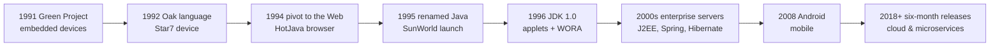
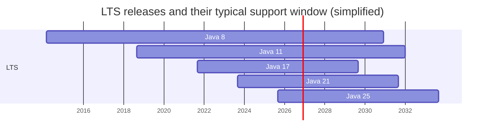
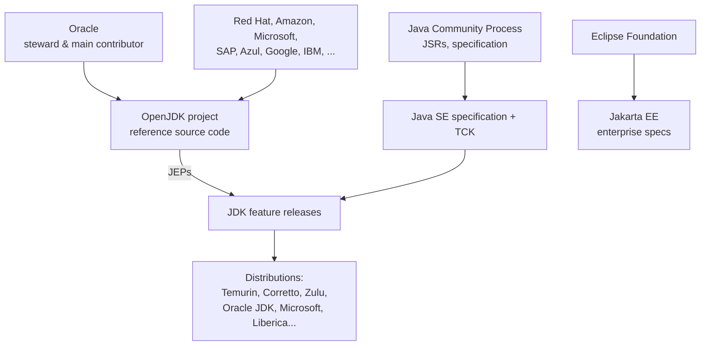
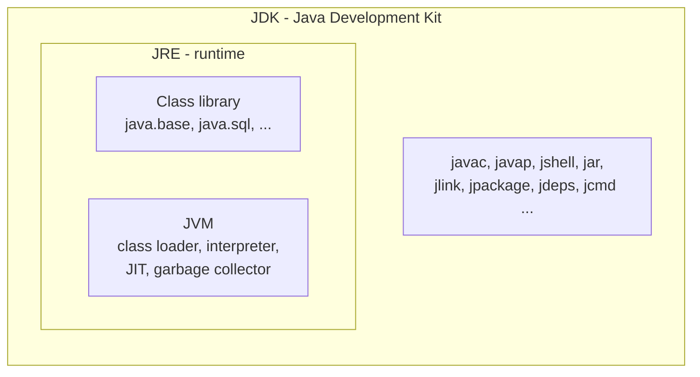

# 01 · History of Java

> Where Java came from, how it evolved version by version, who controls it today, and which
> JDK you should install and why.

---

## 1. The origin story (1991 – 1996)

| Year | Event |
|------|-------|
| 1991 | **The Green Project** starts at Sun Microsystems. James Gosling, Mike Sheridan and Patrick Naughton want a language for consumer devices (set-top boxes, TVs). C++ was too complex and too tied to the hardware. |
| 1992 | Gosling's language is called **Oak** (after the tree outside his office). The team demos the *Star7* (\*7) hand-held device. |
| 1994 | The set-top box market fails, the team pivots to the **web**. They build *WebRunner*, later **HotJava**, a browser that can run Java programs (*applets*). |
| 1995 | "Oak" is already a trademark, the language is renamed **Java** (after Java coffee). Public announcement at SunWorld, **23 May 1995**. Netscape agrees to ship Java in its browser. |
| 1996 | **JDK 1.0** released on **23 January 1996**. |

The design goals written in the 1996 white paper still explain Java today:

1. **Simple, object-oriented, familiar** (C/C++-like syntax, without pointers, operator overloading or multiple class inheritance).
2. **Robust and secure** (strong typing, no pointer arithmetic, garbage collection, bytecode verifier, sandbox).
3. **Architecture-neutral and portable**: *"Write Once, Run Anywhere"* (WORA) thanks to bytecode + JVM.
4. **High performance** (JIT compilation).
5. **Interpreted, threaded and dynamic** (threads built into the language, classes loaded at runtime).



---

## 2. Version timeline

### Classic era (Sun Microsystems)

| Version | Date | Code name | Key additions |
|---------|------|-----------|---------------|
| JDK 1.0 | Jan 1996 | Oak | The language, AWT, applets |
| JDK 1.1 | Feb 1997 | | Inner classes, **JDBC**, RMI, reflection, JavaBeans |
| J2SE 1.2 | Dec 1998 | Playground | **Collections framework**, Swing, JIT compiler, `strictfp`. Platform split into **J2SE / J2EE / J2ME** |
| J2SE 1.3 | May 2000 | Kestrel | **HotSpot JVM** becomes the default, JNDI |
| J2SE 1.4 | Feb 2002 | Merlin | `assert`, **NIO**, regular expressions, logging API, XML parsing. First release through the **JCP** (JSR 59) |
| J2SE 5.0 | Sep 2004 | Tiger | **Generics, annotations, enums, autoboxing, varargs, enhanced for**, `java.util.concurrent` |
| Java SE 6 | Dec 2006 | Mustang | Scripting API, JDBC 4, compiler API, big performance work |

* **Nov 2006 – 2007**: Sun releases Java as open source under **GPL v2 + Classpath Exception**, creating the **OpenJDK** project.
* **Jan 2010**: **Oracle completes the acquisition of Sun**. Oracle becomes Java's steward.

### Oracle era (big releases)

| Version | Date | Key additions |
|---------|------|---------------|
| Java 7 | Jul 2011 | try-with-resources, diamond `<>`, strings in `switch`, multi-catch, **NIO.2 (`java.nio.file`)**, fork/join, `invokedynamic` |
| **Java 8 (LTS)** | Mar 2014 | **Lambdas, Streams, `Optional`, `java.time`, default methods**. The most influential release since 5.0 |
| Java 9 | Sep 2017 | **Module system (JPMS / Project Jigsaw)**, **JShell**, G1 becomes default GC, `List.of()/Map.of()` |

### Six-month release train (2018 →)

From Java 10, a new feature release ships **every March and September**. Every few releases one is
marked **LTS (Long-Term Support)**: since Java 17 that is **every two years**.

| Version | Date | Highlights |
|---------|------|------------|
| 10 | Mar 2018 | `var` (local variable type inference) |
| **11 (LTS)** | Sep 2018 | Standard `HttpClient`, run single source file with `java File.java`, new `String` methods. Java EE & CORBA modules removed, JavaFX unbundled |
| 12 | Mar 2019 | Switch expressions (preview), Shenandoah GC |
| 13 | Sep 2019 | Text blocks (preview) |
| 14 | Mar 2020 | **Switch expressions** final, helpful `NullPointerException` messages, records (preview) |
| 15 | Sep 2020 | **Text blocks** final, ZGC production-ready, sealed classes (preview), Nashorn removed |
| 16 | Mar 2021 | **Records** and **pattern matching for `instanceof`** final, `jpackage` |
| **17 (LTS)** | Sep 2021 | **Sealed classes**, strong encapsulation of JDK internals. Oracle JDK free again (NFTC licence) |
| 18 | Mar 2022 | UTF-8 by default, `jwebserver` simple web server |
| 19 | Sep 2022 | Virtual threads (preview), record patterns (preview) |
| 20 | Mar 2023 | Scoped values (incubator) |
| **21 (LTS)** | Sep 2023 | **Virtual threads**, **record patterns**, **pattern matching for `switch`**, **sequenced collections**, generational ZGC |
| 22 | Mar 2024 | Unnamed variables `_`, Foreign Function & Memory API final, multi-file source launcher |
| 23 | Sep 2024 | Markdown documentation comments, generational ZGC by default |
| 24 | Mar 2025 | **Stream gatherers**, Class-File API, post-quantum ML-KEM / ML-DSA, virtual threads no longer pinned by `synchronized` |
| **25 (LTS)** | Sep 2025 | **Compact source files & instance `main`**, **module import declarations**, **flexible constructor bodies**, scoped values, compact object headers |
| 26 | Mar 2026 | Applet API removed, **HTTP/3** in `HttpClient`, AOT object caching with any GC, G1 throughput improvements |
| 27 | Sep 2026 | G1 default on every machine, post-quantum hybrid key exchange for TLS 1.3, compact object headers on by default, structured concurrency (preview) |
| **29 (LTS)** | Sep 2027 (planned) | Next long-term-support release |



> Support windows depend on the vendor (Oracle, Adoptium, Amazon, Azul, Red Hat, Microsoft...).
> The bars above are indicative only; check your vendor's page.

**Preview / incubator features**: a *preview* feature is complete but may still change; you must
opt in with `--enable-preview`. An *incubator* module (`jdk.incubator.*`) is an experimental API.
Never rely on either in production code.

---

## 3. Who controls Java today?



* **OpenJDK**: the open-source implementation. Every JDK you install is built from it.
* **JEP (JDK Enhancement Proposal)**: how a feature is proposed and tracked (`openjdk.org/jeps`).
* **JCP / JSR**: the formal process that approves the Java SE *specification*.
* **Jakarta EE** (formerly Java EE / J2EE): enterprise specs (Servlets, JPA, CDI, REST...). Oracle
  gave Java EE to the **Eclipse Foundation** in 2017. Since Jakarta EE 9 (2020) the package
  prefix is `jakarta.*` instead of `javax.*`. **This is why old tutorials use `javax.persistence`
  and new code uses `jakarta.persistence`.**
* Key people: **James Gosling** (creator), **Mark Reinhold** (chief architect of the Java platform),
  **Brian Goetz** (Java language architect).

### The Java platforms

| Platform | Purpose |
|----------|---------|
| **Java SE** (Standard Edition) | The core language + JDK. Everything in this repository |
| **Jakarta EE** (Enterprise Edition) | Specifications for servers: Servlet, JPA, CDI, Bean Validation, JAX-RS... |
| **Java ME** (Micro Edition) | Old feature phones and embedded devices (mostly legacy) |
| **Java Card** | SIM cards, bank cards, smart cards |
| **Android** | Uses the Java language (and Kotlin) but its own runtime (ART), not a JVM |

### JDK vs JRE vs JVM



* **JVM**: runs bytecode. Platform-specific (one per OS/CPU).
* **JRE**: JVM + standard libraries. Since Java 11 no separate JRE is shipped; you build a slim
  runtime for your app with **`jlink`** instead.
* **JDK**: JRE + development tools. **Developers always install the JDK.**

---

## 4. Important milestones outside the JDK

| Year | Milestone | Why it matters |
|------|-----------|----------------|
| 1999 | J2EE 1.2 | Java takes over enterprise servers |
| 2001 | **Hibernate** (Gavin King) | Becomes the most used ORM → inspires JPA (2006) |
| 2002-2004 | **Spring Framework** (Rod Johnson) | Lightweight alternative to EJB, today the dominant Java backend framework |
| 2004 | **Maven 2** | Dependency management + standard project layout |
| 2008 | **Android** | Java syntax on billions of phones |
| 2010-2021 | **Oracle v. Google** | Copyright suit about Java APIs in Android. The US Supreme Court ruled Google's use was **fair use** (April 2021) |
| 2011 | **Kotlin** announced (JetBrains) | Modern JVM language, official Android language since 2017 |
| 2014 | **Spring Boot 1.0** | Convention-over-configuration, embedded server, `java -jar app.jar` |
| 2018 | Oracle JDK licence change | Led to free distributions: **Adoptium Temurin, Amazon Corretto, Azul Zulu, Microsoft Build of OpenJDK** |
| 2019 | **Quarkus**, **Micronaut**, **GraalVM native image** | Cloud-native Java: fast startup, low memory |
| 2022-2025 | **Spring Boot 3** (Jakarta EE 10, Java 17+), **Spring Boot 4** (Nov 2025: Jakarta EE 11, Jackson 3, Hibernate 7) | Current generation of the ecosystem |

---

## 5. What should you install, and why?

| Choice | Recommendation | Why |
|--------|----------------|-----|
| **Version** | Learn on an **LTS**: **Java 21** (this repo) or **Java 25** | Jobs use LTS versions; libraries and frameworks support them first. Most companies run 17 or 21 in 2026 |
| **Distribution** | **Eclipse Temurin** | Free, TCK-certified, vendor-neutral, available everywhere (`winget install EclipseAdoptium.Temurin.21.JDK`) |
| On AWS | Amazon Corretto | Patched and supported by AWS |
| On Azure | Microsoft Build of OpenJDK | Supported by Microsoft |
| Paid support | Oracle JDK, Azul, Red Hat | Commercial SLAs |
| **Build tool** | **Maven** (this repo) then Gradle | Maven is the most common in job postings; Gradle is common on Android and newer projects |
| **IDE** | IntelliJ IDEA (Community is free) or VS Code + Extension Pack for Java | Best Java tooling |

---

## 6. Practical

`practical/ModernJavaTour.java` runs a feature from each important release on your JDK.

```bash
# from the repository root (Java 11+ can run a single source file directly)
java topics/01-history/practical/ModernJavaTour.java
```

Try also:

```bash
java -version              # vendor + version
java --list-modules        # the modules of your JDK (Java 9+ module system)
jshell                     # interactive Java (Java 9+), type /exit to quit
```

---

## 7. Interview questions

1. Why is Java "platform independent" while the JVM is not?
2. What is the difference between the JDK, JRE and JVM?
3. What is an LTS release? Which LTS versions exist today?
4. Why do new projects use `jakarta.*` instead of `javax.*`?
5. What is the difference between OpenJDK and Oracle JDK?
6. Name three features of Java 8, three of Java 17 and three of Java 21.

## 8. Exercises

- [ ] Install a second JDK (for example 25) and switch between them with `JAVA_HOME`.
- [ ] Run `ModernJavaTour.java` and explain every line of output.
- [ ] Pick one JEP from <https://openjdk.org/jeps/0>, read it and summarise it in 5 lines.

## References

- OpenJDK project pages: <https://openjdk.org/projects/jdk/> (e.g. `/26/`, `/27/`)
- JEP index: <https://openjdk.org/jeps/0>
- Java version history: <https://en.wikipedia.org/wiki/Java_version_history>
- Adoptium: <https://adoptium.net>
