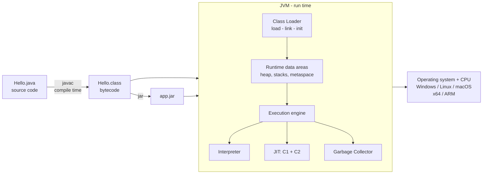
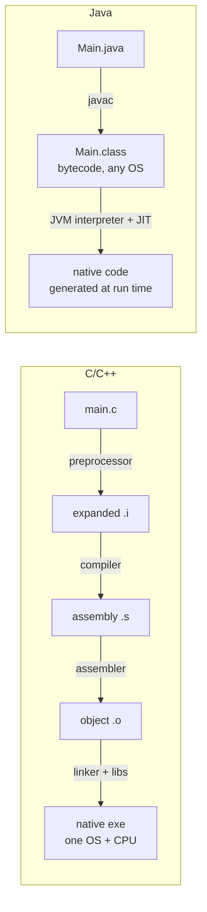
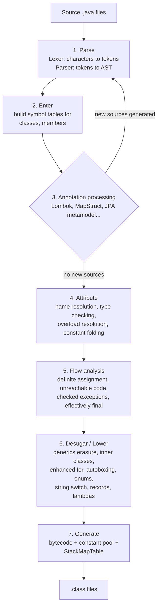
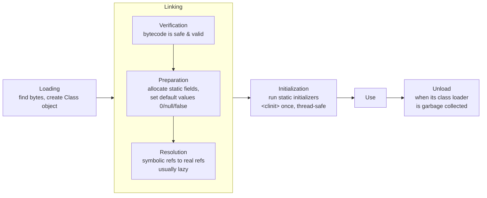
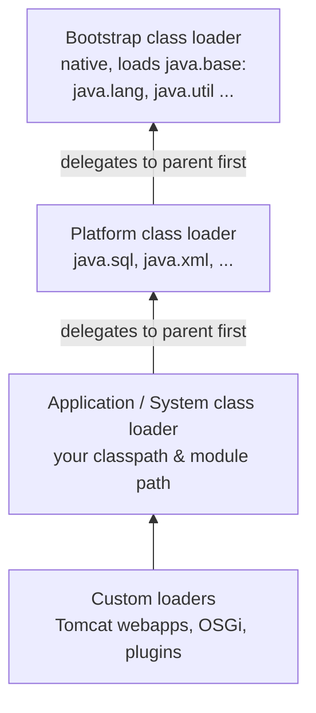
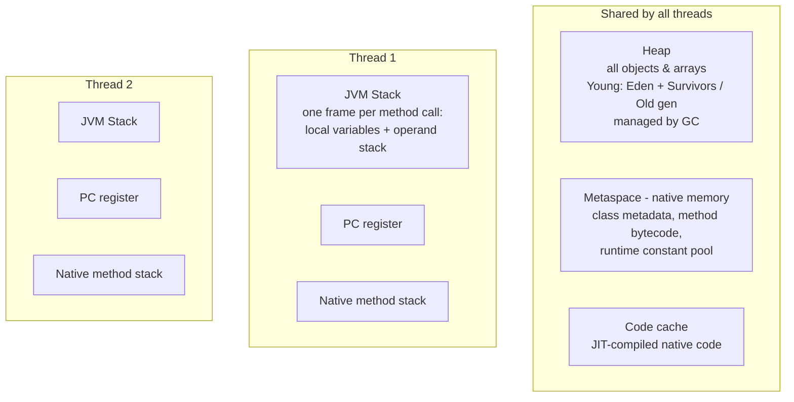
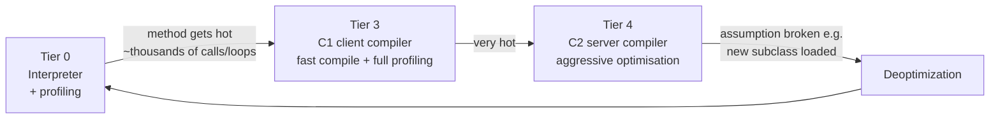
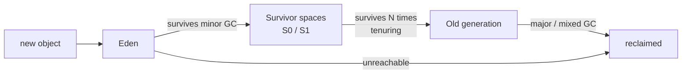

# 02 · How Java code is compiled and executed

> From `Hello.java` to machine instructions: the `javac` compiler phases, the `.class` file,
> class loading, the JVM memory areas, the interpreter, the JIT compilers and the garbage collector.

---

## 1. The big picture

Java uses a **two-step model**: source code is compiled **ahead of time** to platform-independent
**bytecode**, then the **JVM** turns bytecode into native machine code **at runtime** (interpreter + JIT).



Compare with C/C++ where the compiler produces native machine code for **one** OS + CPU:



**Why this design?**

| Benefit | Cost |
|---------|------|
| Same `.class`/`.jar` runs on every OS with a JVM (WORA) | Need a JVM installed (or bundled with `jlink`/`jpackage`) |
| JIT optimises using *real* runtime profiles (often beats static compilers on long-running servers) | Slower startup and "warm-up" before peak speed |
| Bytecode verifier = safety (no memory corruption) | More memory than a native binary |
| Dynamic class loading (plugins, Spring proxies, hot reload) | Harder to analyse ahead of time |

---

## 2. Stage 1: the `javac` compiler (compile time)

`javac` is itself written in Java (module `jdk.compiler`). It works in these phases:



| Phase | What happens | Example error produced here |
|-------|--------------|-----------------------------|
| **Lexical analysis** | Characters become tokens: `int`, `x`, `=`, `5`, `;` | `illegal character: '#'` |
| **Syntax analysis** | Tokens become an **Abstract Syntax Tree (AST)** following the grammar | `';' expected` |
| **Enter** | Every class/method/field is recorded in symbol tables | `duplicate class` |
| **Annotation processing** | Processors read annotations and may *generate code* (Lombok getters, MapStruct mappers). If new files are generated, compilation restarts on them (*rounds*) | processor-specific |
| **Attribute** | Resolves every name and type, picks the overloaded method, folds constants (`60 * 60` → `3600`) | `cannot find symbol`, `incompatible types` |
| **Flow** | Checks variables are assigned before use, code is reachable, checked exceptions are caught/declared, lambda captures are effectively final | `variable x might not have been initialized`, `unreported exception IOException` |
| **Desugar (lower)** | Rewrites high-level features into simpler Java: generics are **erased**, `for (x : list)` becomes an `Iterator` loop, `int` ↔ `Integer` boxing calls inserted, inner classes become separate `Outer$Inner.class` files, lambdas become `invokedynamic` | – |
| **Generate** | Emits bytecode instructions, the **constant pool**, and `StackMapTable` frames used by the verifier | – |

> `javac` does almost no optimisation. Optimisation is the **JIT's** job at runtime.

### Syntactic sugar you can see after compilation

```java
// what you write                         // roughly what javac generates
for (String s : list) { ... }             for (Iterator<String> it = list.iterator(); it.hasNext();) { String s = it.next(); ... }
Integer x = 5;                            Integer x = Integer.valueOf(5);
int y = x;                                int y = x.intValue();
List<String> l = new ArrayList<>();       List l = new ArrayList();      // + casts where values are read
String s = "a" + b + c;                   invokedynamic makeConcatWithConstants   (Java 9+)
Runnable r = () -> go();                  invokedynamic LambdaMetafactory + private static lambda$main$0()
```

---

## 3. Stage 2: the `.class` file

A `.class` file is a binary format defined by the **JVM specification**, independent of the Java language
(Kotlin, Scala, Groovy also produce `.class` files).

```
ClassFile {
    u4 magic = 0xCAFEBABE           // every class file starts with this
    u2 minor_version
    u2 major_version                // 52 = Java 8, 61 = 17, 65 = 21, 69 = 25
    constant_pool[]                 // all literals and symbolic references (class names, method names, strings)
    u2 access_flags                 // public, final, abstract, interface, enum, record...
    this_class, super_class
    interfaces[]
    fields[]
    methods[]                       // each method has a Code attribute with the bytecode
    attributes[]                    // SourceFile, InnerClasses, Record, PermittedSubclasses...
}
```

Running a class compiled for a newer Java on an older JVM gives the famous error:

```
UnsupportedClassVersionError: Hello has been compiled by a more recent version of the Java Runtime
(class file version 65.0), this version of the Java Runtime only recognizes class file versions up to 61.0
```

Fix: run with a newer JDK or compile with `javac --release 17`.

### Bytecode is a stack machine

```java
static int add(int a, int b) { return a + b; }
```
```
javap -c output:
  0: iload_0      // push local variable 0 (a) onto the operand stack
  1: iload_1      // push local variable 1 (b)
  2: iadd         // pop two ints, push the sum
  3: ireturn      // return the int on top of the stack
```


The five **invoke** instructions:

| Instruction | Used for |
|-------------|----------|
| `invokestatic` | static methods |
| `invokevirtual` | normal instance methods (dynamic dispatch through the vtable) |
| `invokeinterface` | methods called through an interface type |
| `invokespecial` | constructors (`<init>`), `private` methods, `super.method()` |
| `invokedynamic` | lambdas, string concatenation, records' `toString/equals/hashCode`, pattern switch |

---

## 4. Stage 3: class loading (run time)

When you run `java Hello`, the launcher creates the JVM, which loads classes **lazily** (only when
first used).



### Class loader hierarchy and parent delegation



1. A loader is asked for a class → it first **asks its parent**.
2. Only if the parent cannot find it does it load the class itself.
3. Why: **security and consistency**. Your own `java.lang.String` can never replace the real one.

**Initialization triggers** (the class's `static {}` block runs): `new`, calling a static method, reading/writing a
non-constant static field, reflection (`Class.forName`), initializing a subclass, being the main class.
**Not** a trigger: referencing a `static final` compile-time constant (it is inlined by `javac`).

---

## 5. Stage 4: runtime data areas (JVM memory)



| Area | Per thread? | Contains | Error when full |
|------|-------------|----------|-----------------|
| **Heap** | shared | objects, arrays, string pool (since Java 7) | `OutOfMemoryError: Java heap space` |
| **Metaspace** (replaced PermGen in Java 8) | shared | class metadata | `OutOfMemoryError: Metaspace` |
| **JVM stack** | per thread | frames: local variables, operand stack, return address | `StackOverflowError` (deep/infinite recursion) |
| **PC register** | per thread | address of the current bytecode instruction | – |
| **Native stack** | per thread | frames of native (C) methods | – |
| **Code cache** | shared | JIT-compiled machine code | warning, JIT stops compiling |

```java
void demo() {
    int count = 3;                    // primitive local: lives in the stack frame
    Person p = new Person("Ali");     // reference p in the stack, Person object in the heap
}                                      // frame popped; the object becomes garbage if nothing else refers to it
```

Useful flags: `-Xms512m` (initial heap), `-Xmx2g` (max heap), `-Xss1m` (stack size per thread),
`-XX:MaxMetaspaceSize=256m`.

---

## 6. Stage 5: execution engine — interpreter + JIT

HotSpot uses **tiered compilation**:



* **Interpreter**: executes one bytecode at a time. Starts immediately, slow.
* **C1**: compiles quickly with light optimisation. Good for startup.
* **C2**: slow to compile, produces highly optimised code using the collected profile.
* **Deoptimization**: if a speculative assumption becomes false, the JVM throws away the compiled code and goes back to the interpreter.

Main JIT optimisations:

| Optimisation | Idea |
|--------------|------|
| **Inlining** | Replace a call with the body of the method (the mother of all optimisations) |
| **Escape analysis** | If an object never leaves the method, allocate it on the stack / remove it (scalar replacement) |
| **Devirtualisation** | If only one implementation of an interface is loaded, call it directly |
| **Loop unrolling / vectorisation** | Fewer jumps; use SIMD instructions |
| **Dead code elimination, constant propagation** | Remove work whose result is never used |
| **Intrinsics** | Replace known methods (`Math.sqrt`, `System.arraycopy`, `String.equals`) with hand-written CPU instructions |

### Alternatives: Ahead-Of-Time compilation

| Technology | What it does | When to use |
|------------|--------------|-------------|
| **GraalVM Native Image** | Compiles the whole app + JDK to a native executable ("closed world") | Serverless, CLI tools: ~10 ms startup, low memory. Reflection needs configuration |
| **Project Leyden AOT cache** (JDK 24+: `-XX:AOTCache`) | Stores loaded/linked classes, profiles and objects from a training run | Faster startup while staying on a normal JVM |
| **CRaC** (Coordinated Restore at Checkpoint) | Snapshot a warmed-up JVM and restore it | Fast startup with full JIT performance (Azul, some vendors) |

---

## 7. Stage 6: garbage collection (overview)

Objects are never freed manually. The GC finds objects that are no longer **reachable** from GC roots
(local variables on stacks, static fields, active threads, JNI refs) and reclaims their memory.



**Generational hypothesis**: most objects die young, so the young generation is collected often and cheaply.

| Collector | Flag | Best for |
|-----------|------|----------|
| Serial | `-XX:+UseSerialGC` | tiny heaps, single CPU containers |
| Parallel | `-XX:+UseParallelGC` | batch jobs, maximum throughput |
| **G1** (default) | `-XX:+UseG1GC` | general purpose, balanced pauses. Default everywhere since JDK 27 |
| **ZGC** (generational) | `-XX:+UseZGC` | very large heaps, sub-millisecond pauses |
| Shenandoah | `-XX:+UseShenandoahGC` | low pauses (Red Hat builds and others) |

Details in [06-advanced-java/08-jvm-memory-gc](../06-advanced-java/08-jvm-memory-gc/README.md).

---

## 8. Tools (the "packages" of this topic) and why

| Tool | Why you use it |
|------|----------------|
| `javac` | Compile `.java` → `.class`. `--release N` targets an older Java safely |
| `java` | Launch the JVM. `java File.java` compiles in memory and runs (Java 11+) |
| `javap -c -v` | **Disassemble** a class: see bytecode, constant pool, version. Best way to learn what the compiler did |
| `jshell` | REPL to test snippets without a class or `main` |
| `jar` | Package classes + resources into a `.jar` with a `MANIFEST.MF` (`Main-Class`) |
| `jdeps` | Show which modules/packages your jar depends on |
| `jlink` | Build a minimal custom runtime containing only the modules you need |
| `jpackage` | Build a native installer (`.msi`, `.exe`, `.deb`, `.dmg`) |
| `jcmd`, `jstack`, `jmap`, `jstat` | Inspect a running JVM: threads, heap, GC, flags |
| **JDK Flight Recorder + JDK Mission Control** | Low-overhead production profiling |
| **Maven / Gradle** | Automate all of the above for real projects (topic 12) |
| GraalVM `native-image` | AOT-compile to a native binary |

---

## 9. Practical

All commands run from `topics/02-compilation-and-jvm/practical`.

### 9.1 Compile, inspect, run by hand

```bash
javac -d out Hello.java                 # compile into the out folder
java -cp out Hello                      # run from the class path
javap -c -v -cp out Hello               # see magic, version 65, constant pool, bytecode
javap -p -c -cp out 'Hello$Greeter'     # the nested class became a separate .class file
jar --create --file hello.jar --main-class Hello -C out .
java -jar hello.jar
```

### 9.2 Watch class loading and static initialisation order

```bash
java ClassLoadingDemo.java
java -Xlog:class+load:file=classes.txt ClassLoadingDemo.java   # every class the JVM loads
```

### 9.3 Watch the JIT at work

```bash
java JitWarmup.java                                   # timing per round goes down as code gets compiled
java -Xint JitWarmup.java                             # interpreter only: much slower
java -XX:+PrintCompilation JitWarmup.java | more      # methods as they get compiled (tier in column 3)
```

### 9.4 See the JVM memory and crash it on purpose

```bash
java MemoryAreas.java                    # prints heap/stack info, triggers a StackOverflowError and catches it
java -Xmx16m MemoryAreas.java oom        # shows OutOfMemoryError: Java heap space
```

---

## 10. Corner cases & interview questions

* Is Java compiled or interpreted? **Both**: compiled to bytecode, then interpreted *and* JIT-compiled.
* Why is the first request to a Spring Boot app slower than the next ones? Class loading + JIT warm-up.
* `static final int MAX = 10;` used in another class: changing it requires recompiling the *other* class too (constant inlined).
* `static final Integer MAX = 10;` is **not** a compile-time constant (it's an object) → not inlined.
* `ClassNotFoundException` (checked, when loading by name e.g. `Class.forName`) vs `NoClassDefFoundError` (class existed at compile time but is missing / failed to initialise at runtime).
* `ExceptionInInitializerError`: thrown when a `static {}` block throws; the class is then unusable.
* Can two classes have the same fully qualified name in one JVM? Yes, if loaded by **different class loaders** (that's how app servers isolate webapps); they are different types.
* What does the bytecode verifier protect against? Stack underflow/overflow, wrong types, jumping into the middle of instructions, accessing private members.

## Exercises

- [ ] Use `javap -c` to find the `invokedynamic` generated for a lambda and for string concatenation.
- [ ] Compile `Hello.java` with `--release 8` and check the major version with `javap -v`.
- [ ] Find the number of the iteration where `JitWarmup` gets fast and explain why.
- [ ] Build a custom runtime: `jlink --add-modules java.base --output tiny-jre` and run Hello with `tiny-jre/bin/java`.

## References

- JVM specification (class file format, instructions): <https://docs.oracle.com/javase/specs/jvms/se21/html/>
- Java Language Specification: <https://docs.oracle.com/javase/specs/jls/se21/html/>
- OpenJDK HotSpot overview: <https://openjdk.org/groups/hotspot/>
