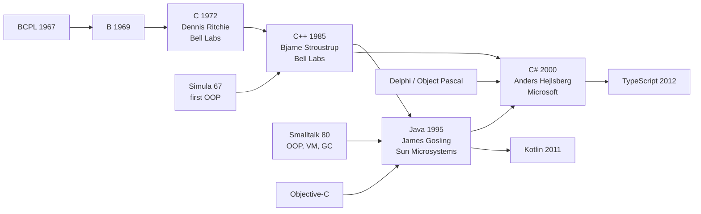
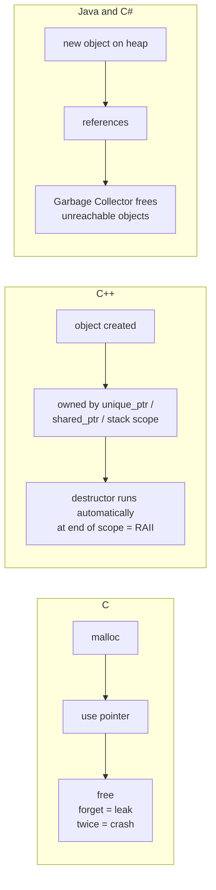

# 03 · C vs C++ vs C# vs Java

> The four languages side by side: history, how they compile and run, memory, type system, OOP,
> generics, error handling, concurrency, ecosystems, performance, uses and jobs. The `practical`
> folder contains **the same program written in all four languages**.

---

## 1. Family tree



* **C** was created to write the **UNIX** operating system: close to the hardware, small, portable assembler.
* **C++** ("C with classes") added **OOP, templates, RAII** to C while staying compatible and zero-cost.
* **Java** kept C++'s syntax but removed the dangerous parts (pointers, manual memory, multiple inheritance)
  and added a **virtual machine + garbage collector** for portability and safety.
* **C#** was Microsoft's answer to Java for the **.NET** platform (after a legal dispute about Microsoft's Java
  version). It started very close to Java and then added many features faster (properties, LINQ, async/await).

---

## 2. How each one compiles and runs

```mermaid
flowchart TB
    subgraph C_and_CPP[C and C++ : ahead-of-time native compilation]
        a1[.c / .cpp + headers] --> a2[Preprocessor<br/>#include, #define] --> a3[Compiler<br/>gcc, clang, MSVC] --> a4[Object files .o/.obj] --> a5[Linker + libraries] --> a6[Native executable<br/>for ONE OS + CPU]
    end
    subgraph Java_side[Java : bytecode + JVM]
        b1[.java] --> b2[javac] --> b3[.class bytecode<br/>portable] --> b4[JVM: class loader,<br/>interpreter + JIT C1/C2, GC] --> b5[Native code at run time]
    end
    subgraph CS_side[C# : IL + CLR]
        c1[.cs] --> c2[Roslyn compiler<br/>dotnet build] --> c3[.dll assembly<br/>CIL / MSIL portable] --> c4[CLR: JIT RyuJIT,<br/>tiered compilation, GC] --> c5[Native code at run time]
        c3 -.->|Native AOT option| c6[Native executable]
    end
```



| | C | C++ | Java | C# |
|---|---|---|---|---|
| Output of compiler | Native machine code | Native machine code | **Bytecode** (`.class`) | **CIL** (`.dll`, `.exe`) |
| Runtime needed | none (C runtime lib) | none (C++ runtime lib) | **JVM** | **.NET CLR** |
| Portability | Recompile per platform | Recompile per platform | Same `.jar` everywhere | Same `.dll` everywhere (.NET 5+) |
| JIT | – | – | HotSpot C1/C2, Graal | RyuJIT, tiered |
| Native AOT | default | default | GraalVM Native Image | Native AOT (.NET 7+) |
| Startup time | instant | instant | slower (warm-up), fast with AOT | slower, fast with AOT |
| Header files | yes (`.h`) | yes (`.h/.hpp`), modules C++20 | no | no |
| Preprocessor | yes | yes | **no** (annotations instead) | limited (`#if`, `#region`) |

---

## 3. Memory management



| | C | C++ | Java | C# |
|---|---|---|---|---|
| Allocation | `malloc/calloc` | stack, `new`, `make_unique` | `new` (heap), primitives on stack | `new` class (heap), `struct` (stack/inline) |
| Freeing | manual `free` | destructors, **RAII**, smart pointers | **GC** | **GC** |
| Pointers | full, with arithmetic | full + references (`&`) | **no pointers**, only references | references; real pointers only in `unsafe` |
| Value types | `struct`, primitives | everything can be a value | **only the 8 primitives** (value classes coming with Project Valhalla) | `struct`, `enum`, primitives, `record struct` |
| Deterministic cleanup | manual | destructors | `try-with-resources` + `AutoCloseable` | `using` + `IDisposable` |
| Typical bugs | leaks, dangling pointers, buffer overflow, double free | same but rarer, undefined behaviour | `NullPointerException`, memory leaks via forgotten references | `NullReferenceException`, same |
| Memory safe | ❌ | ❌ | ✅ | ✅ (outside `unsafe`) |

---

## 4. Language features compared

### Type system

| | C | C++ | Java | C# |
|---|---|---|---|---|
| Typing | static, weak (implicit conversions, `void*`) | static, fairly strong | static, strong | static, strong (+ `dynamic`) |
| Integer sizes | platform dependent (`int` may be 16/32) | platform dependent | **fixed** (`int` = 32-bit everywhere) | fixed |
| Unsigned types | yes | yes | **no** (only `char`; helpers like `Integer.toUnsignedString`) | yes (`uint`, `ulong`, `byte`) |
| Boolean | `int` / `_Bool` (C99) / `bool` (C23) | `bool` | `boolean` (no int conversion) | `bool` (no int conversion) |
| Strings | `char[]` ending with `'\0'` | `std::string` (mutable) | `String` (**immutable**) | `string` (**immutable**) |
| Type inference | `auto` (C23) | `auto` | `var` (Java 10) | `var` (C# 3) |
| Null safety | `NULL` | `nullptr`, `std::optional` | `Optional`, annotations (`@Nullable`) | **nullable reference types** `string?` (C# 8) |
| Enums | ints | `enum class` | **full classes** (fields, methods) | ints with names |

### Object orientation

| | C | C++ | Java | C# |
|---|---|---|---|---|
| Classes | ❌ (structs + function pointers) | ✅ | ✅ (everything lives in a class) | ✅ |
| Inheritance | ❌ | **multiple** (diamond solved with `virtual` inheritance) | single class + multiple interfaces | single class + multiple interfaces |
| Methods virtual by default? | – | **no** (need `virtual`) | **yes** (use `final` to stop) | **no** (need `virtual` + `override`) |
| Interfaces | – | abstract classes with pure virtual methods | `interface` (+ default/static/private methods) | `interface` (+ default methods since C# 8) |
| Access modifiers | – | `public`, `protected`, `private`, `friend` | `public`, `protected`, package-private, `private` | `public`, `protected`, `internal`, `private`, `protected internal`, `private protected` |
| Properties | – | – | getters/setters (records generate accessors) | **properties** `{ get; set; }` |
| Operator overloading | ❌ | ✅ | ❌ | ✅ |
| Records / data classes | – | `struct` | `record` (Java 16) | `record`, `record struct` (C# 9/10) |
| Default parameter values | ❌ | ✅ | ❌ (use overloading / builders) | ✅ (+ named arguments) |
| Extension methods | – | – | ❌ | ✅ |
| Root class | – | none | `java.lang.Object` | `System.Object` |

### Generics

| | C | C++ | Java | C# |
|---|---|---|---|---|
| Mechanism | macros / `void*` | **templates**: a new copy of code per type at compile time | **type erasure**: one copy, types checked by the compiler then removed | **reified**: type info kept at runtime, specialised for value types |
| `List<int>` allowed? | – | ✅ | ❌ must use `List<Integer>` (boxing) | ✅ no boxing |
| `new T()` / `T[]` | – | ✅ | ❌ | ✅ (`where T : new()`) |
| Know `T` at runtime | – | ✅ | ❌ | ✅ (`typeof(T)`) |
| Metaprogramming | macros | templates, `constexpr`, concepts | annotation processors | source generators, reflection emit |

### Errors, functions, concurrency

| | C | C++ | Java | C# |
|---|---|---|---|---|
| Error handling | return codes, `errno` | exceptions (any type), `noexcept`, `std::expected` | exceptions: **checked + unchecked** | exceptions: **unchecked only** |
| Cleanup | `goto cleanup` | destructors | `finally`, try-with-resources | `finally`, `using` |
| Lambdas | ❌ (function pointers) | C++11 | Java 8 | C# 3 |
| Query over collections | – | ranges (C++20) | **Streams** | **LINQ** |
| Threads | pthreads / C11 threads | `std::thread`, `std::async` | `Thread`, `ExecutorService`, **virtual threads** | `Thread`, `Task`, **async/await** |
| Async style | callbacks | futures, coroutines (C++20) | `CompletableFuture`, virtual threads (blocking code that scales) | `async/await` |

---

## 5. Ecosystem and tooling

| | C | C++ | Java | C# |
|---|---|---|---|---|
| Standard | ISO C (C23) | ISO C++ (C++23) | Java SE spec (JCP) + OpenJDK | ECMA-334 + .NET Foundation |
| Main compilers / runtimes | GCC, Clang, MSVC | GCC, Clang, MSVC | OpenJDK builds (Temurin, Corretto...), GraalVM | .NET (CoreCLR), Mono, Unity |
| Package manager | none standard (vcpkg, Conan) | vcpkg, Conan | **Maven Central** via Maven / Gradle | **NuGet** |
| Build tool | make, CMake | CMake, MSBuild, Bazel | **Maven, Gradle** | `dotnet` CLI / MSBuild |
| IDE | VS Code, CLion | Visual Studio, CLion | **IntelliJ IDEA**, Eclipse, VS Code | **Visual Studio**, Rider, VS Code |
| Web backend | – | Drogon, Crow (rare) | **Spring Boot**, Quarkus, Micronaut, Jakarta EE | **ASP.NET Core** |
| ORM | – | ODB (rare) | **Hibernate / JPA**, MyBatis, jOOQ | **Entity Framework Core**, Dapper |
| Testing | Unity, CMocka | GoogleTest, Catch2 | **JUnit**, AssertJ, Mockito | xUnit, NUnit, MSTest, Moq |
| Desktop UI | GTK | Qt | JavaFX, Swing | WPF, WinForms, MAUI, Avalonia |
| Mobile | – | – | **Android** (with Kotlin) | MAUI, Unity |
| Games | – | Unreal Engine | Minecraft (Java edition), libGDX | **Unity**, Godot (C#) |

---

## 6. Performance and resource usage

| | C | C++ | Java | C# |
|---|---|---|---|---|
| Raw speed | ★★★★★ | ★★★★★ | ★★★★ (after warm-up) | ★★★★ |
| Memory footprint | smallest | small | larger (JVM + GC headroom) | larger |
| Startup | instant | instant | 0.1–several s (ms with native image) | fast–medium (ms with Native AOT) |
| Predictable latency | ✅ | ✅ | GC pauses (tiny with ZGC) | GC pauses |
| Peak throughput on long-running servers | excellent | excellent | excellent (profile-guided JIT) | excellent |

> Rule of thumb: C/C++ when **every byte and nanosecond** matters or there is no OS (embedded, drivers,
> game engines, browsers). Java/C# when **developer productivity, safety and huge ecosystems** matter
> (business backends, cloud services).

---

## 7. Where each language is used & jobs

| Language | Main domains | Typical job titles |
|----------|--------------|--------------------|
| **C** | OS kernels (Linux, Windows parts), embedded/IoT, drivers, firmware, databases (SQLite, PostgreSQL), interpreters (CPython) | Embedded engineer, firmware engineer, systems programmer |
| **C++** | Game engines, browsers (Chrome), high-frequency trading, CAD, compilers, robotics, desktop apps | Game engine dev, quant developer, systems engineer |
| **Java** | **Enterprise backends**, banking/fintech, telecom, e-commerce, Android, **big data** (Hadoop, Kafka, Spark, Elasticsearch, Cassandra are JVM based), government systems | **Java backend developer**, Spring Boot developer, Android dev, big-data engineer |
| **C#** | Enterprise backends on Microsoft stack, Windows desktop, Azure services, **Unity games** | .NET developer, ASP.NET Core developer, Unity developer |

Java and C# skills transfer easily between each other: if you know one well you can learn the other in weeks.

---

## 8. Same code in four languages

### Hello world

```c
// C
#include <stdio.h>
int main(void) { printf("Hello\n"); return 0; }
```
```cpp
// C++
#include <iostream>
int main() { std::cout << "Hello\n"; }
```
```java
// Java (Java 25 also allows: void main() { IO.println("Hello"); })
public class Hello { public static void main(String[] args) { System.out.println("Hello"); } }
```
```csharp
// C# (top-level statements)
Console.WriteLine("Hello");
```

### A class with encapsulation

```cpp
// C++
class Account {
    double balance = 0;                       // private by default in a class
public:
    void deposit(double amount) { if (amount > 0) balance += amount; }
    double getBalance() const { return balance; }
};
```
```java
// Java
public class Account {
    private double balance;
    public void deposit(double amount) { if (amount > 0) balance += amount; }
    public double getBalance() { return balance; }
}
```
```csharp
// C#
public class Account {
    public decimal Balance { get; private set; }          // property
    public void Deposit(decimal amount) { if (amount > 0) Balance += amount; }
}
```
```c
/* C: no classes, a struct + functions taking a pointer */
typedef struct { double balance; } Account;
void deposit(Account *a, double amount) { if (amount > 0) a->balance += amount; }
```

---

## 9. Practical

The `practical` folder implements **one program four times**: store students with grades, sort them by
grade, compute the average and print them. Compare memory handling, collections and sorting.

| File | Run |
|------|-----|
| `java/Students.java` | `java topics/03-language-comparison/practical/java/Students.java` |
| `c/students.c` | `gcc students.c -o students && ./students` |
| `cpp/students.cpp` | `g++ -std=c++20 students.cpp -o students && ./students` |
| `csharp/Program.cs` | `cd csharp && dotnet run` |

(Install GCC with MSYS2 or use WSL; install the .NET SDK for C#.)

---

## 10. Interview questions

1. Why does Java not support multiple inheritance of classes, while C++ does?
2. Explain type erasure in Java vs reified generics in C# vs templates in C++.
3. Java has no pointers. What are references then, and what does "Java is always pass-by-value" mean?
4. What is RAII and what are its equivalents in Java and C#?
5. Checked vs unchecked exceptions: why did C# choose not to have checked exceptions?
6. Why can Java be as fast as C++ for long-running servers but not for short CLI programs?

## References

- Java Language Specification: <https://docs.oracle.com/javase/specs/>
- C# documentation: <https://learn.microsoft.com/dotnet/csharp/>
- C++ reference: <https://en.cppreference.com/>
- C reference: <https://en.cppreference.com/w/c>
