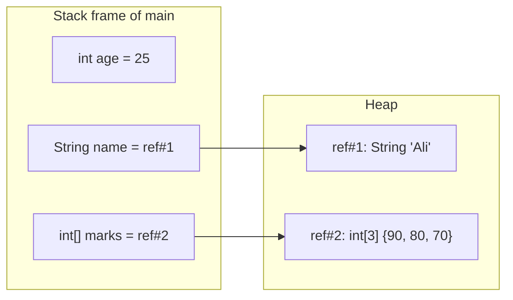
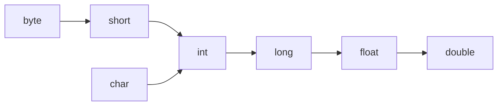
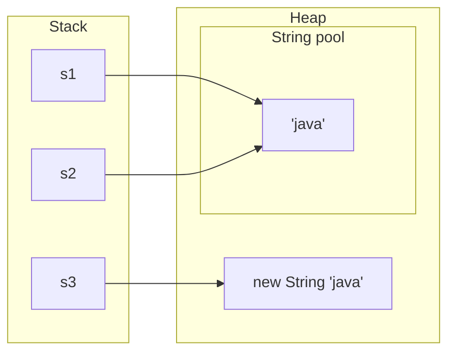
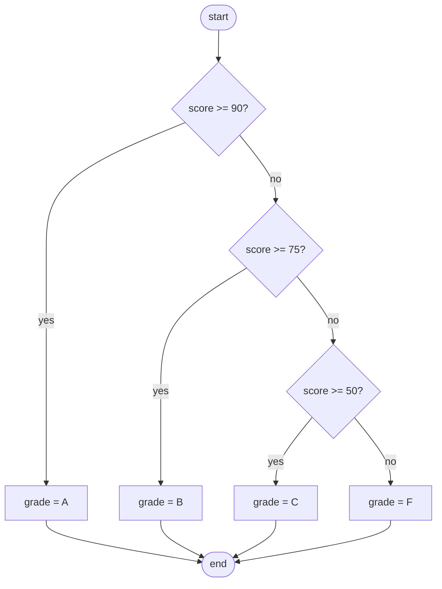
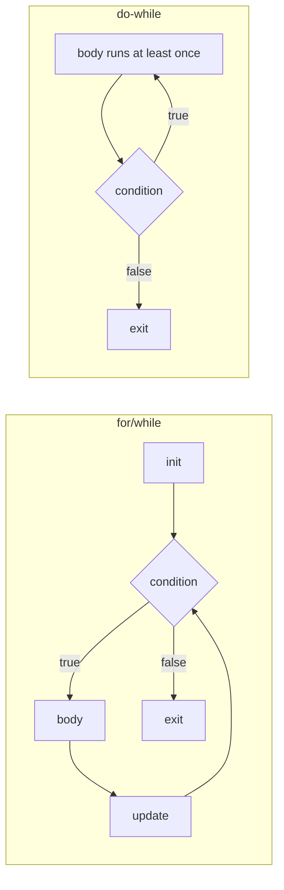
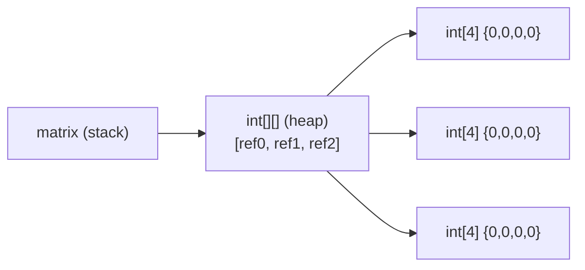
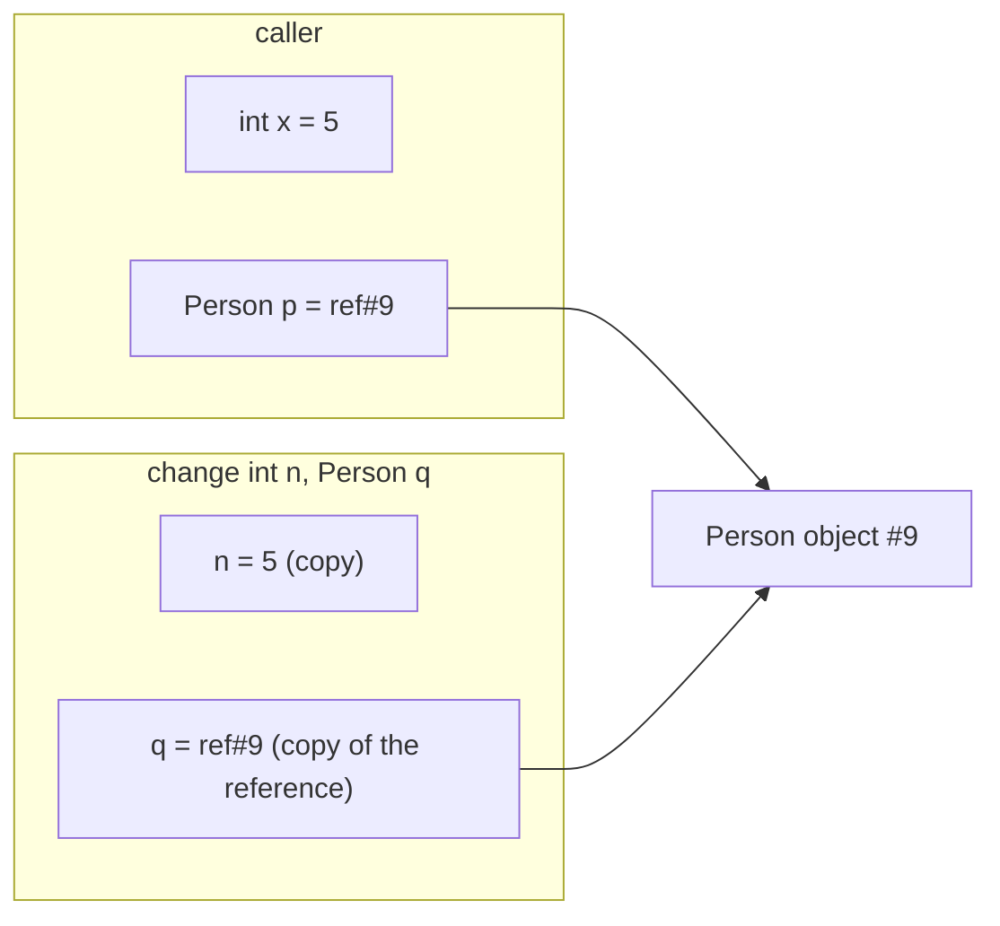

# 04 · Foundation syntax

> Everything you need before OOP: program structure, variables, data types, casting, operators,
> strings, input/output, conditions, loops, arrays, methods, enums, `var`, text blocks and dates.
> Each section has the theory, a diagram where it helps, the corner cases that appear in
> interviews, and a runnable file in `practical/`.

| # | Section | Practical file |
|---|---------|----------------|
| 1 | Program structure | `ProgramStructure.java` |
| 2-5 | Variables, data types, wrappers, casting | `DataTypes.java` |
| 6-7 | Operators, floating point & `BigDecimal` | `Operators.java` |
| 8 | Strings | `Strings.java` |
| 9 | Input / output | `InputOutput.java` |
| 10 | Conditions | `Conditions.java` |
| 11 | Loops | `Loops.java` |
| 12 | Arrays | `ArraysDemo.java` |
| 13 | Methods | `Methods.java` |
| 14 | Enums, `var`, constants, dates | `EnumsVarDates.java` |

Run any file with `java topics/04-foundation-syntax/practical/<File>.java`.
Exercises are in [`exercises.md`](exercises.md).

---

## 1. Program structure

```java
package com.jdk.basics;                 // 1. package (folder) - optional for single files

import java.util.List;                  // 2. imports (java.lang.* is imported automatically)

/** 3. Javadoc comment */
public class Hello {                    // 4. class: file name must be Hello.java when public

    public static void main(String[] args) {   // 5. entry point
        System.out.println("Hello");           // 6. statement ends with ;
    }
}
```

* `public` → the JVM can call it from outside. `static` → no object needed. `void` → returns nothing.
  `String[] args` → command-line arguments.
* Java 25 (JEP 512) also allows a **compact source file** for beginners:
  ```java
  void main() {
      IO.println("Hello");
  }
  ```
* Comments: `// line`, `/* block */`, `/** Javadoc, generates HTML docs */`.

**Naming conventions** (not enforced by the compiler but by every team):

| Element | Convention | Example |
|---------|------------|---------|
| class, interface, enum, record | PascalCase | `BankAccount` |
| method, variable | camelCase | `calculateTotal`, `userName` |
| constant (`static final`) | UPPER_SNAKE_CASE | `MAX_SIZE` |
| package | lowercase, reversed domain | `com.company.project` |

Identifiers: letters, digits, `_`, `$`; cannot start with a digit; cannot be a keyword (`class`, `int`, `new`...).
`_` alone is reserved (unnamed variable since Java 22).

---

## 2. Variables

```java
int age;                 // declaration
age = 25;                // assignment
int year = 2026;         // declaration + initialisation
final double PI = 3.14;  // constant: cannot be reassigned
var name = "Ali";        // type inferred as String (local variables only, Java 10+)
```

| Kind | Where declared | Default value? | Lifetime |
|------|----------------|----------------|----------|
| **Local** variable | inside a method/block | ❌ **must be assigned before use** (compile error otherwise) | until the block ends |
| **Instance** field | in the class, no `static` | ✅ 0 / false / null | as long as the object lives |
| **Static** field | in the class, `static` | ✅ 0 / false / null | as long as the class is loaded |
| **Parameter** | method signature | value passed by caller | during the call |

**Scope** is the block `{ }` in which the variable is declared. You can't declare a local with the same
name as another local in an enclosing block (but you can shadow a field).

---

## 3. Data types

```mermaid
flowchart TB
    T[Java types] --> P[Primitive types<br/>value stored directly]
    T --> R[Reference types<br/>variable holds a reference to an object on the heap]
    P --> I[Integer: byte, short, int, long]
    P --> F[Floating point: float, double]
    P --> CH[char - UTF-16 code unit]
    P --> B[boolean]
    R --> CL[Classes: String, Integer, ArrayList, your classes]
    R --> IF[Interfaces, enums, records]
    R --> AR[Arrays: int[], String[]]
```

### The 8 primitive types

| Type | Size | Range | Default | Literal example |
|------|------|-------|---------|-----------------|
| `byte` | 8 bit | -128 … 127 | 0 | `(byte) 10` |
| `short` | 16 bit | -32 768 … 32 767 | 0 | `(short) 1000` |
| `int` | 32 bit | -2 147 483 648 … 2 147 483 647 (≈ ±2.1 billion) | 0 | `42`, `1_000_000`, `0xFF`, `0b1010` |
| `long` | 64 bit | ≈ ±9.22 × 10¹⁸ | 0L | `42L` |
| `float` | 32 bit | ≈ ±3.4 × 10³⁸, ~7 decimal digits | 0.0f | `3.14f` |
| `double` | 64 bit | ≈ ±1.8 × 10³⁰⁸, ~15-16 digits | 0.0 | `3.14`, `1e-9` |
| `char` | 16 bit | 0 … 65 535 (unsigned) | `'\u0000'` | `'A'`, `'\n'`, `'A'` |
| `boolean` | JVM-dependent | `true` / `false` | false | `true` |

* Sizes are **identical on every platform** (unlike C/C++).
* Integer literals are `int` by default, decimal literals are `double` by default.
* `char` is a number: `'A' + 1 == 66`.

### Stack vs heap (simplified)



### Wrapper classes and autoboxing

Every primitive has a wrapper class in `java.lang`: `Byte, Short, Integer, Long, Float, Double, Character, Boolean`.
Collections and generics need objects, so Java converts automatically:

```java
List<Integer> list = new ArrayList<>();
list.add(5);              // autoboxing:   Integer.valueOf(5)
int x = list.get(0);      // unboxing:     list.get(0).intValue()
```

Wrappers give useful helpers: `Integer.parseInt("42")`, `Integer.MAX_VALUE`, `Double.isNaN(d)`,
`Character.isDigit(c)`, `Integer.toBinaryString(10)`.

---

## 4. Type conversion (casting)



* **Widening** (left → right in the diagram): automatic and safe (`long → float` may lose precision).
* **Narrowing** (right → left): needs an explicit cast and may lose data:
  ```java
  double d = 9.99;
  int i = (int) d;          // 9   (truncates, does not round)
  int big = 130;
  byte b = (byte) big;      // -126 (overflow wraps around)
  ```
* In expressions, `byte`, `short` and `char` are promoted to `int`:
  ```java
  byte a = 10, c = 20;
  byte sum = a + c;         // ❌ compile error: a + c is int
  byte sum2 = (byte) (a + c); // ✅
  a += 5;                   // ✅ compound assignment contains a hidden cast
  ```
* String ↔ number: `Integer.parseInt("12")`, `Double.parseDouble("1.5")`, `String.valueOf(12)`, `"" + 12`.

---

## 5. Data-type corner cases

| Code | Result | Why |
|------|--------|-----|
| `Integer.MAX_VALUE + 1` | `-2147483648` | **silent overflow** (use `Math.addExact` to get an exception) |
| `5 / 2` | `2` | integer division |
| `5 / 2.0` | `2.5` | one operand is double |
| `10 / 0` | `ArithmeticException` | integer division by zero |
| `10.0 / 0` | `Infinity` | floating point rules (IEEE 754) |
| `0.0 / 0` | `NaN`, and `NaN == NaN` is **false** | use `Double.isNaN` |
| `0.1 + 0.2 == 0.3` | `false` (`0.30000000000000004`) | binary floating point → use `BigDecimal` for money |
| `Integer a = 127, b = 127; a == b` | `true` | Integer cache -128…127 |
| `Integer a = 128, b = 128; a == b` | `false` | different objects → **always use `.equals`** |
| `Integer n = null; int x = n;` | `NullPointerException` | unboxing null |
| `long l = 1000 * 1000 * 1000 * 10;` | wrong value | multiplication done in `int` before widening → write `10L` |
| `int x = 010;` | `8` | leading zero = **octal** |
| `char c = 'A'; c + 1` | `66` (int) | char promoted to int; `(char)(c + 1)` is `'B'` |
| `Math.abs(Integer.MIN_VALUE)` | negative! | no positive counterpart in int range |

---

## 6. Operators

| Category | Operators | Notes |
|----------|-----------|-------|
| Arithmetic | `+ - * / %` | `%` keeps the sign of the left operand: `-7 % 3 == -1` (use `Math.floorMod`) |
| Increment / decrement | `++ --` | prefix `++i` changes then uses; postfix `i++` uses then changes |
| Assignment | `= += -= *= /= %= &= \|= ^= <<= >>= >>>=` | compound forms include an implicit cast |
| Relational | `== != > < >= <=` | `==` on objects compares **references**, not content |
| Logical | `&& \|\| !` | **short-circuit**: right side evaluated only if needed |
| Bitwise | `& \| ^ ~ << >> >>>` | `>>>` fills with zeros (unsigned shift) |
| Ternary | `cond ? a : b` | an expression, returns a value |
| Type | `instanceof` | `obj instanceof String s` binds `s` (Java 16) |

**Precedence (high → low)**: postfix `x++` → unary `++x ! ~ (cast)` → `* / %` → `+ -` → shifts → relational `< > instanceof`
→ `== !=` → `&` → `^` → `|` → `&&` → `||` → `?:` → assignment. **Use parentheses** when in doubt.

Corner cases:

```java
int i = 5;
i = i++;               // i is still 5! (old value saved, i incremented, old value assigned back)
int j = i++ + ++i;     // legal but unreadable: never write this

String s = null;
if (s != null && s.length() > 0) {}   // safe: && stops at the first false
if (s != null &  s.length() > 0) {}   // NullPointerException: & evaluates both sides
```

---

## 7. Floating point and money

```java
System.out.println(0.1 + 0.2);                                   // 0.30000000000000004
BigDecimal a = new BigDecimal("0.1");                            // ✅ String constructor
BigDecimal b = new BigDecimal(0.1);                              // ❌ 0.1000000000000000055511151231257827...
BigDecimal total = a.add(new BigDecimal("0.2"));                 // 0.3
BigDecimal share = new BigDecimal("10").divide(new BigDecimal("3"), 2, RoundingMode.HALF_UP); // 3.33
new BigDecimal("2.0").equals(new BigDecimal("2.00"));            // false (scale differs) -> use compareTo
```

**Packages**: `java.math.BigDecimal` (exact decimals, money), `java.math.BigInteger` (unlimited integers),
`java.lang.Math` (`sqrt`, `pow`, `round`, `floorMod`, `addExact`...).

---

## 8. Strings



```java
String s1 = "java";                 // literal -> string pool
String s2 = "java";                 // same pooled object
String s3 = new String("java");     // new object on the heap
s1 == s2        // true  (same reference)
s1 == s3        // false (different objects)
s1.equals(s3)   // true  (same content) -> ALWAYS compare strings with equals
```

* **Immutable**: every "modifying" method returns a **new** `String`. Benefits: thread safety, caching of `hashCode`,
  safe as `HashMap` keys, string pool.
* Concatenating in a loop creates many objects → use **`StringBuilder`** (not thread-safe, fast) or
  `StringBuffer` (synchronized, legacy).
* Useful methods: `length, charAt, substring, indexOf, contains, startsWith, endsWith, toUpperCase, trim, strip,
  isBlank, split, replace, join, repeat, chars, compareTo, equalsIgnoreCase, formatted, lines`.
* **Text blocks** (Java 15):
  ```java
  String json = """
          {
            "name": "Ali",
            "age": 25
          }
          """;
  ```
* Formatting: `System.out.printf("%-10s|%5d|%8.2f%n", name, age, salary)`; `"%s is %d".formatted(name, age)`.

| Specifier | Meaning |
|-----------|---------|
| `%d` | integer |
| `%f`, `%.2f` | decimal, 2 digits |
| `%s` | string (any object via `toString`) |
| `%c` | char |
| `%b` | boolean |
| `%n` | platform line separator |
| `%,d` | thousands separator |
| `%-10s` / `%10s` | left / right aligned in 10 columns |

---

## 9. Input and output

| Need | Use | Package |
|------|-----|---------|
| Print | `System.out.println / print / printf` | `java.lang` |
| Errors | `System.err.println` | `java.lang` |
| Read keyboard (simple) | `Scanner` | `java.util` |
| Read keyboard/files fast | `BufferedReader` | `java.io` |
| Command-line arguments | `String[] args` | – |

**The `Scanner` trap**: `nextInt()` leaves the newline in the buffer, so a following `nextLine()` returns `""`.
Fix: call an extra `nextLine()` after `nextInt()`, or read every line with `nextLine()` and parse it.

---

## 10. Conditions



```java
// if / else if / else
if (score >= 90) grade = 'A';
else if (score >= 75) grade = 'B';
else grade = 'F';

// ternary
String result = score >= 50 ? "pass" : "fail";

// classic switch: falls through without break!
switch (day) {
    case 1:
    case 7:
        type = "weekend";
        break;
    default:
        type = "weekday";
}

// switch expression (Java 14): no fall-through, returns a value, must be exhaustive
String type = switch (day) {
    case 1, 7 -> "weekend";
    case 2, 3, 4, 5, 6 -> "weekday";
    default -> {
        String msg = "invalid day " + day;
        yield msg;                        // yield returns a value from a block
    }
};

// pattern matching switch (Java 21)
String describe = switch (obj) {
    case null -> "null!";
    case Integer i when i > 100 -> "big int " + i;
    case Integer i -> "int " + i;
    case String s -> "string of length " + s.length();
    default -> "something else";
};
```

`switch` works on: `byte, short, char, int` (+ wrappers), `String`, `enum`, and since Java 21 **any type** with patterns.
Not on `long`, `float`, `double`, `boolean` (classic form).

Corner cases: `if (x = 5)` doesn't compile (not boolean) — good; `if (flag = true)` **does** compile with a boolean
and is always true. Dangling `else` belongs to the nearest `if` → always use braces.

---

## 11. Loops



| Loop | Use when |
|------|----------|
| `for (int i = 0; i < n; i++)` | you know the number of iterations / need the index |
| `for (String s : list)` | iterating every element of an array or `Iterable` |
| `while (cond)` | repeat until something happens (unknown count) |
| `do { } while (cond);` | body must run at least once (menus, input validation) |
| `list.forEach(x -> ...)` / streams | functional style (topic 06) |

* `break` exits the loop, `continue` skips to the next iteration.
* **Labeled break** exits outer loops: `outer: for (...) { for (...) { if (found) break outer; } }`.
* Removing from a `List` inside a for-each → `ConcurrentModificationException`; use `list.removeIf(...)` or an `Iterator`.
* `for (;;)` and `while (true)` are infinite loops.
* Off-by-one: `i <= arr.length` → `ArrayIndexOutOfBoundsException`.

---

## 12. Arrays

```java
int[] marks = new int[3];                 // {0, 0, 0} default values
int[] primes = {2, 3, 5, 7};              // literal
String[] names = new String[2];           // {null, null}
int[][] matrix = new int[3][4];           // 3 rows x 4 columns
int[][] jagged = {{1}, {2, 3}, {4, 5, 6}}; // rows of different length
```



* Fixed size, zero-based, `length` is a **field** (`arr.length`) — strings use `length()` and lists `size()`.
* Arrays are **objects**: `int[] b = a;` copies the reference, both names see the same data. Copy with
  `a.clone()`, `Arrays.copyOf`, `System.arraycopy`.
* `java.util.Arrays`: `toString`, `deepToString`, `sort`, `binarySearch` (array must be sorted), `fill`, `copyOf`,
  `copyOfRange`, `equals`, `asList`, `stream`.
* `a == b` and `a.equals(b)` compare references; use `Arrays.equals(a, b)`.
* Array covariance: `Object[] objs = new String[1]; objs[0] = 1;` → `ArrayStoreException` at runtime.
* Need to grow/shrink? Use `ArrayList` (topic 06 collections).

---

## 13. Methods

```java
//  modifiers   return type  name    parameters
    public static int         add    (int a, int b) {
        return a + b;
    }
```

* **Overloading**: same name, different parameter list (type/number/order). Return type alone is not enough.
* **Varargs**: `static int sum(int... numbers)` → `numbers` is an `int[]`; must be the last parameter.
* **Recursion**: a method calling itself; needs a base case or you get `StackOverflowError`.
* **Java is always pass-by-value**:



```java
static void change(int n, Person q) {
    n = 100;                 // only the copy changes, caller's x stays 5
    q.setName("Changed");    // modifies the SAME object -> caller sees it
    q = new Person("New");   // re-points the copy only -> caller's p unaffected
}
```

---

## 14. Enums, `var`, constants and dates

```java
enum Status { ACTIVE, SUSPENDED, CLOSED }      // a type-safe set of constants (more in OOP topic)
Status s = Status.valueOf("ACTIVE");
for (Status st : Status.values()) { ... }
s.ordinal();  s.name();

var list = new ArrayList<String>();            // var: local variables with initialiser only
// var x;          ❌ no initialiser
// var n = null;   ❌ type cannot be inferred
// fields, parameters, return types cannot be var
```

**Date & time** — use `java.time` (Java 8), never `java.util.Date`/`Calendar` in new code:

| Class | Represents | Example |
|-------|-----------|---------|
| `LocalDate` | date without time zone | birthday `2000-05-14` |
| `LocalTime` | time of day | `09:30` |
| `LocalDateTime` | date + time, no zone | appointment in local time |
| `ZonedDateTime` | date + time + zone | `2026-11-15T10:00+02:00[Africa/Cairo]` |
| `Instant` | point on the UTC time line | timestamps in DBs / logs |
| `Duration` | time-based amount | `PT2H30M` |
| `Period` | date-based amount | `P1Y2M` |
| `DateTimeFormatter` | parse & format | `ofPattern("dd/MM/yyyy")` |

All `java.time` classes are **immutable and thread-safe**.

---

## 15. Packages used in this topic (and why)

| Package | Classes | Why |
|---------|---------|-----|
| `java.lang` (auto-imported) | `String, StringBuilder, Math, System, Integer, Double, Character, Object` | the core of the language |
| `java.util` | `Scanner, Arrays, ArrayList, List, Objects, Random` | input, array helpers, collections |
| `java.math` | `BigDecimal, BigInteger, RoundingMode` | exact money calculations, huge numbers |
| `java.time` | `LocalDate, LocalDateTime, Duration, Period, DateTimeFormatter, ZoneId` | modern, immutable date/time |
| `java.io` | `BufferedReader, InputStreamReader` | fast line input |
| `java.util.random` | `RandomGenerator` | modern random number API (Java 17) |
| `java.text` | `NumberFormat` | locale-aware currency/number formatting |

---

## 16. Interview questions

1. How many primitive types does Java have? Why is `String` not one of them?
2. Why does `0.1 + 0.2 != 0.3`? How do you store money?
3. `==` vs `equals()` for strings and wrappers? What is the Integer cache?
4. Why are strings immutable? `StringBuilder` vs `StringBuffer`?
5. Is Java pass-by-value or pass-by-reference? Explain with an object.
6. What does `i = i++` do?
7. `break` vs `continue` vs `return`? What is a labeled break?
8. Default values of an `int[]`, `boolean[]`, `String[]`? Of a local variable?
9. Classic `switch` fall-through vs switch expressions.
