# 05 · Object-Oriented Programming (OOP)

> Classes and objects, constructors, `this`/`static`/`final`, the four pillars (encapsulation,
> inheritance, polymorphism, abstraction), interfaces vs abstract classes, `Object` methods
> (`equals`/`hashCode`/`toString`/`clone`), nested classes, records, sealed types, enums,
> relationships (association/aggregation/composition) — with UML diagrams and **every corner case**
> that usually appears in interviews. Every section maps to a runnable file in `practical/`.

| Section | Practical file |
|---------|----------------|
| 1-3 Classes, objects, constructors, `this`, `static`, `final`, init order | `ClassesAndObjects.java` |
| 4 Encapsulation, access modifiers, immutability | `Encapsulation.java` |
| 5 Inheritance | `Inheritance.java` |
| 6 Polymorphism (overloading & overriding) | `Polymorphism.java` |
| 7 Abstraction: abstract classes & interfaces | `AbstractionInterfaces.java` |
| 8 `Object` methods: `equals`, `hashCode`, `toString`, `clone` | `ObjectMethods.java` |
| 9 Nested, inner, local and anonymous classes | `NestedClasses.java` |
| 10 Records, sealed types, enums | `RecordsSealedEnums.java` |
| 11 Relationships & composition over inheritance | `Relationships.java` |

Run: `java topics/05-oop/practical/<File>.java`. Exercises: [`exercises.md`](exercises.md).

---

## 0. Why OOP?

Procedural code organises a program as **functions operating on data**. As programs grow, any function can
change any data, so bugs spread. OOP groups **data + the behaviour that protects it** into objects that talk
through messages (method calls).

| Procedural | Object-oriented |
|------------|-----------------|
| `withdraw(account, 100)` — anyone can set `account.balance = -5` | `account.withdraw(100)` — the object validates itself |
| Data and functions separate | Data and behaviour together |
| Reuse by copy/paste or function libraries | Reuse by composition and inheritance |
| Hard to model real-world domains | Classes map to domain concepts (Customer, Order, Invoice) |

The **four pillars**:

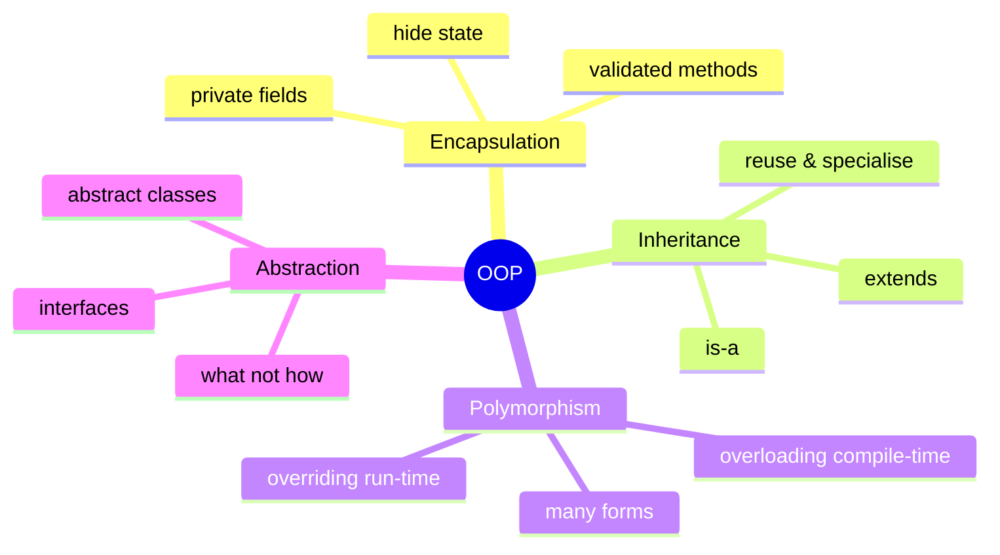

---

## 1. Classes and objects

* A **class** is a blueprint (a type). An **object** (instance) is a concrete thing created from it with `new`.
* A class has **fields** (state), **methods** (behaviour), **constructors** (initialisation), and may contain
  nested types and initializer blocks.

```java
public class Car {
    private String model;          // field (state)
    private int speed;

    public Car(String model) {     // constructor
        this.model = model;
    }

    public void accelerate(int delta) {   // method (behaviour)
        speed += delta;
    }
}

Car c1 = new Car("BMW");           // object 1
Car c2 = new Car("Kia");           // object 2
Car c3 = c1;                       // no new object: another reference to object 1
```

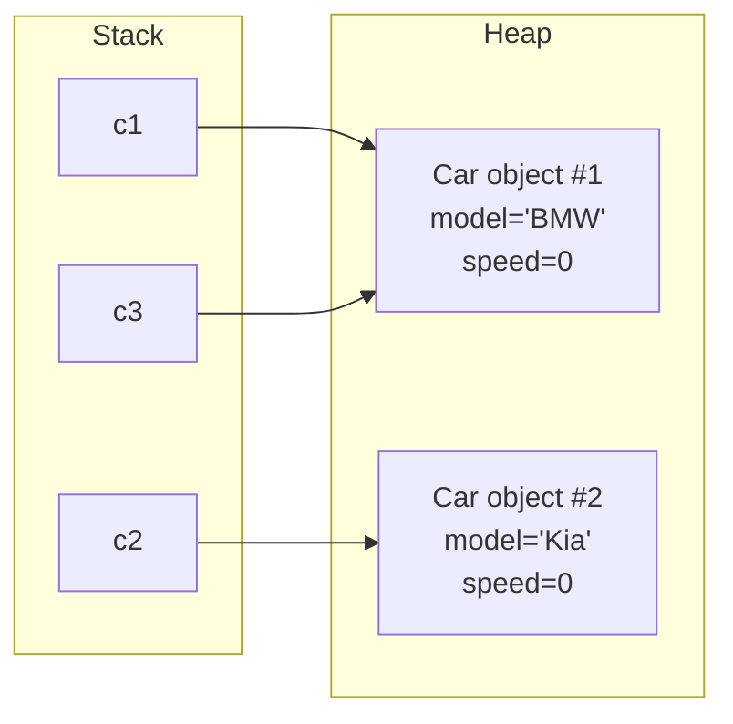

`new` does: allocate memory on the heap → set fields to default values → run initialisers & constructor →
return the reference.

---

## 2. Constructors

| Rule | Detail |
|------|--------|
| Name = class name, **no return type** | `void Car()` is a *method*, not a constructor! |
| **Default constructor** | Added by the compiler **only if you write no constructor at all** |
| Overloading | Several constructors with different parameters |
| `this(...)` | Calls another constructor of the same class (**constructor chaining**) |
| `super(...)` | Calls the parent constructor. If you don't write it, the compiler inserts `super()` |
| First statement | `this(...)` or `super(...)` must come first (Java 25 allows statements *before* them that don't use `this`) |
| Not inherited | A subclass never inherits constructors |
| `private` constructor | Prevents `new` from outside: singletons, utility classes, factories |

```java
public class Employee {
    private final String name;
    private final double salary;

    public Employee(String name) {
        this(name, 5_000);                 // chaining to the main constructor
    }

    public Employee(String name, double salary) {
        if (salary < 0) throw new IllegalArgumentException("salary < 0");
        this.name = name;                  // this.name = field, name = parameter
        this.salary = salary;
    }
}
```

### Object initialisation order

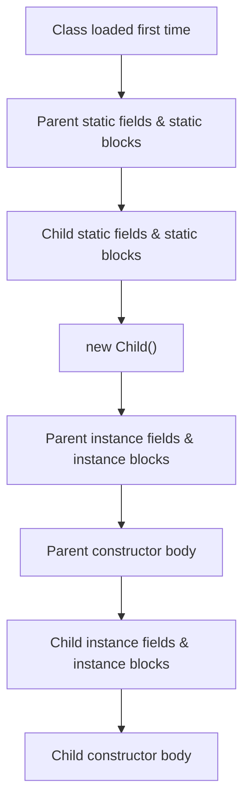

Static parts run **once per class**; instance parts run **for every object**.

---

## 3. `this`, `static`, `final`

### `this`
* Reference to the current object.
* Uses: disambiguate field vs parameter, call another constructor `this(...)`, pass the current object
  (`list.add(this)`), return it for fluent APIs (`return this;`).

### `static` — belongs to the class, not to objects

| | Instance member | Static member |
|---|---|---|
| Belongs to | each object | the class (one copy) |
| Access | `obj.method()` | `ClassName.method()` |
| Can use `this` | ✅ | ❌ |
| Can access instance members directly | ✅ | ❌ (needs an object) |
| Overridable | ✅ | ❌ (only *hidden*) |
| Example | `account.getBalance()` | `Math.max()`, `Integer.parseInt()`, counters, factories |

### `final`

| On | Meaning |
|----|---------|
| variable | assigned once (the **reference** is final; the object can still change: `final List<> l` → `l.add()` works) |
| method | cannot be overridden |
| class | cannot be extended (`String`, `Integer`, records) |
| parameter | cannot be reassigned inside the method |

`static final` primitive/String initialised with a constant = **compile-time constant**.

---

## 4. Encapsulation

> Hide the internal state; expose only **operations that keep the object valid**.

### Access modifiers

| Modifier | Same class | Same package | Subclass (other package) | Everywhere |
|----------|:---:|:---:|:---:|:---:|
| `private` | ✅ | ❌ | ❌ | ❌ |
| *(default / package-private)* | ✅ | ✅ | ❌ | ❌ |
| `protected` | ✅ | ✅ | ✅ (through inheritance) | ❌ |
| `public` | ✅ | ✅ | ✅ | ✅ |

Top-level classes can only be `public` or package-private.

```java
public class BankAccount {
    private BigDecimal balance = BigDecimal.ZERO;      // hidden

    public void deposit(BigDecimal amount) {           // controlled access
        if (amount.signum() <= 0) throw new IllegalArgumentException("amount must be positive");
        balance = balance.add(amount);
    }

    public BigDecimal getBalance() { return balance; } // read-only view, no setter
}
```

**Getters/setters are not encapsulation by themselves** — a public setter for every field is just a public field
with extra steps. Expose behaviour (`deposit`, `withdraw`) instead of raw setters.

### Immutable classes (recipe)

1. `final` class (or private constructor + factories) so no subclass can add mutability.
2. All fields `private final`.
3. No setters.
4. **Defensive copies** of mutable inputs and outputs (`List.copyOf`, `new Date(d.getTime())`).
5. "Modifying" methods return a new object (`withSalary(...)`).

Benefits: thread-safe without locks, safe `HashMap` keys, easy to reason about. Examples: `String`, `Integer`,
`LocalDate`, `BigDecimal`, records.

Corner cases:
* `private` is **class-level**, not object-level: an object can read another object's private fields of the same class
  (that's how `equals(Object o)` works).
* Returning a mutable internal list leaks state: `getItems().clear()` empties your object → return `List.copyOf(items)`
  or `Collections.unmodifiableList(items)`.
* `protected` also gives access to the **whole package**, which surprises many people.

---

## 5. Inheritance (`extends`)

> "**is-a**" relationship: a `Manager` **is an** `Employee`. The subclass inherits accessible fields and
> methods and can **add** or **override** behaviour.

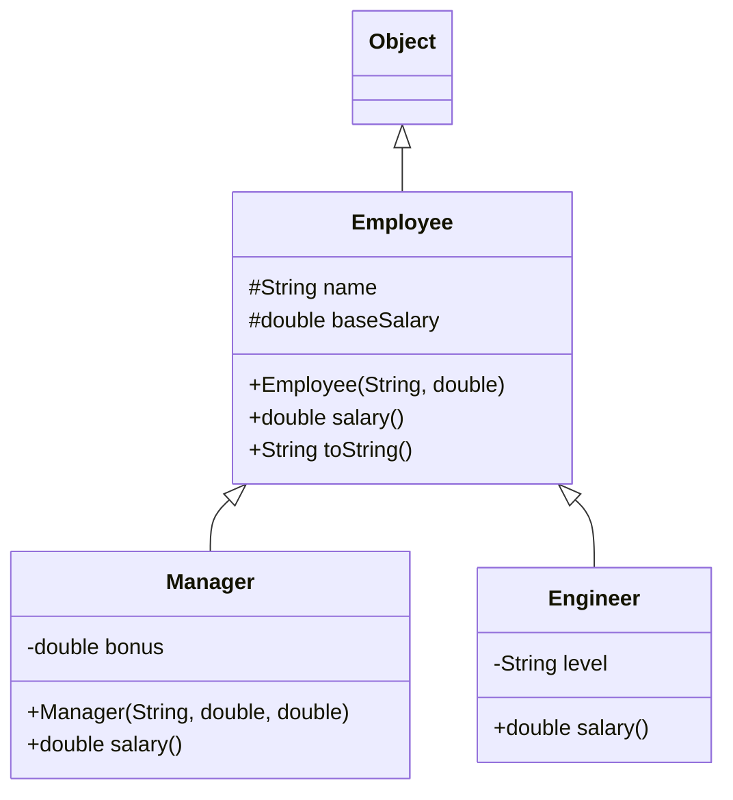

```java
class Manager extends Employee {
    private final double bonus;

    Manager(String name, double base, double bonus) {
        super(name, base);                 // must initialise the parent part first
        this.bonus = bonus;
    }

    @Override
    double salary() {
        return super.salary() + bonus;     // reuse parent behaviour
    }
}
```

### Types of inheritance

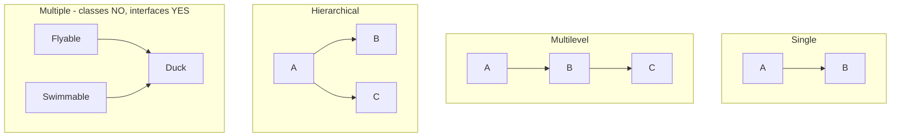

**Why no multiple inheritance of classes?** The **diamond problem**: if `B` and `C` both extend `A` and override
`m()`, which `m()` does `D extends B, C` inherit? Which copy of `A`'s fields? Java avoids it for classes; for
interfaces (no state) it forces you to resolve conflicts explicitly (section 7).

### What is (not) inherited

| Member | Inherited? |
|--------|------------|
| `public` / `protected` fields & methods | ✅ |
| package-private | ✅ only if the subclass is in the same package |
| `private` fields/methods | ❌ not accessible (they exist inside the object, but you can't touch them) |
| constructors | ❌ never |
| `static` members | accessible through the subclass, but **hidden**, not overridden |

### Corner cases
* **Field hiding**: a field in the child with the same name as in the parent **hides** it; fields are **not polymorphic**.
  `Parent p = new Child(); p.name` → parent's field.
* **Static method hiding**: `Parent p = new Child(); p.staticMethod()` → **Parent's** version (resolved by the reference type).
* Parent has no no-arg constructor → every child constructor **must** call `super(args)` explicitly, or it doesn't compile.
* **Calling an overridable method from a constructor** is dangerous: the child's override runs **before** the child's
  fields are initialised (you'll see `null`/`0`). Make such methods `private` or `final`.
* `final` classes can't be extended; `final` methods can't be overridden.
* Every class extends `Object` implicitly.

---

## 6. Polymorphism ("many forms")

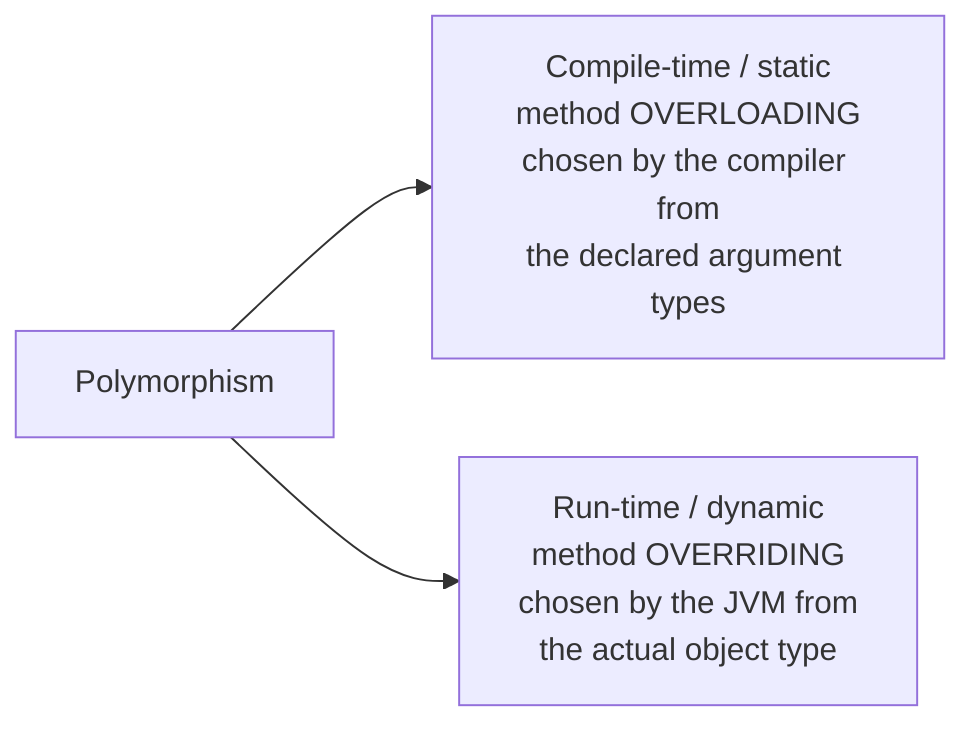

### 6.1 Overriding and dynamic dispatch

```java
Employee e = new Manager("Sara", 10_000, 2_000);   // reference type Employee, object type Manager
e.salary();   // 12000 -> Manager.salary() runs: the JVM looks at the OBJECT, not the variable
```

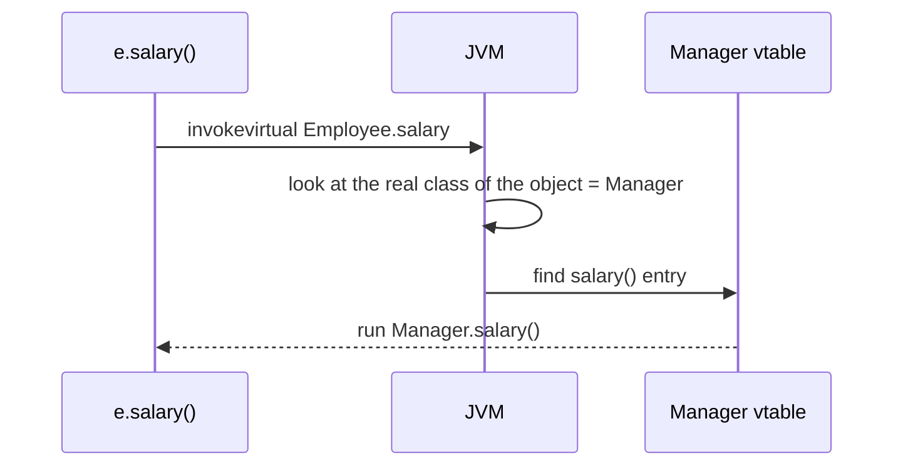

**Overriding rules**

| Rule | Example |
|------|---------|
| Same name + same parameter types | `double salary()` |
| Return type same or a **subtype** (covariant return) | parent returns `Animal`, child may return `Dog` |
| Access **same or wider** | parent `protected` → child `protected` or `public`, not `private` |
| Checked exceptions **same, narrower or none** | parent `throws IOException` → child may throw `FileNotFoundException` or nothing, not `Exception` |
| Cannot override `final`, `static`, `private` methods | static → hiding; private → a new unrelated method |
| Use `@Override` | the compiler checks that you really override (catches typos like `equals(Employee o)`) |

**Upcasting & downcasting**

```java
Employee e = new Manager(...);        // upcast: implicit, always safe
Manager m = (Manager) e;              // downcast: explicit, checked at runtime
Engineer x = (Engineer) e;            // compiles, ClassCastException at runtime!
if (e instanceof Manager mgr) {       // safe pattern (Java 16)
    mgr.approveBudget();
}
```

### 6.2 Overloading resolution (compile time)

The compiler picks the overload in **three phases**, stopping at the first that matches:

1. Exact match / **widening** primitive conversion (no boxing, no varargs).
2. **Boxing / unboxing** allowed.
3. **Varargs** allowed.

Inside a phase, the **most specific** method wins.

| Call | Overloads | Chosen | Why |
|------|-----------|--------|-----|
| `m(5)` | `m(long)`, `m(Integer)` | `m(long)` | widening (phase 1) beats boxing (phase 2) |
| `m(5)` | `m(Object)`, `m(int...)` | `m(Object)` | boxing (phase 2) beats varargs (phase 3) |
| `m(null)` | `m(Object)`, `m(String)` | `m(String)` | most specific |
| `m(null)` | `m(String)`, `m(Integer)` | ❌ compile error | ambiguous |
| `m('a')` | `m(int)`, `m(String)` | `m(int)` | char widens to int |
| `Object o = "x"; m(o)` | `m(Object)`, `m(String)` | `m(Object)` | overloads use the **declared** type, not the runtime type |

---

## 7. Abstraction: abstract classes and interfaces

> Expose **what** an object does, hide **how**.

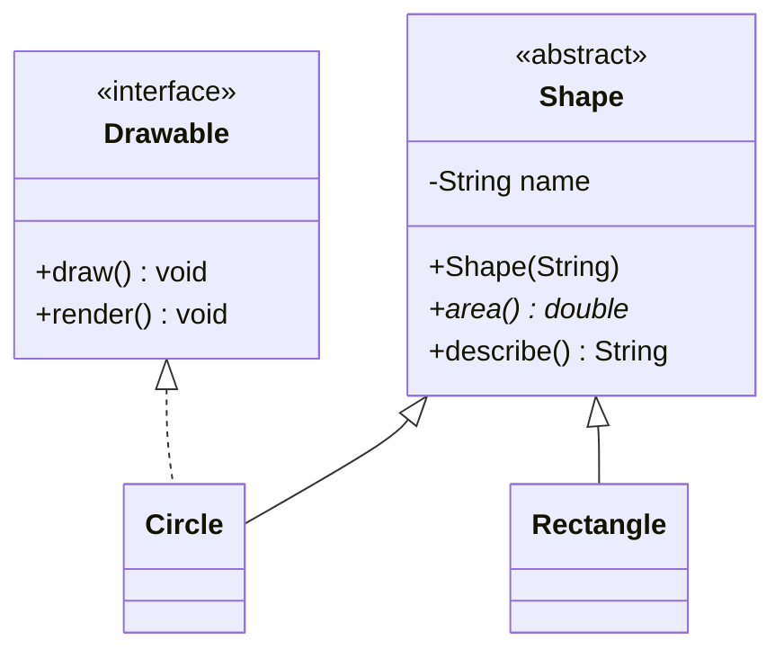

### Abstract class
* Declared `abstract`; **cannot be instantiated**; may have `abstract` methods (no body) **and** concrete methods,
  fields, constructors (called via `super`), any access modifiers.
* A subclass must implement all abstract methods or be abstract itself.
* Use when subclasses **share state and code** (template method pattern).

### Interface
* A **contract**: "can-do" capability (`Comparable`, `Runnable`, `AutoCloseable`).
* Methods are `public abstract` by default. Fields are always `public static final` (constants).
* Since Java 8: `default` methods (with body) and `static` methods. Since Java 9: `private` methods.
* A class can implement **many** interfaces; an interface can `extends` many interfaces.
* Exactly one abstract method → **functional interface** → can be implemented with a lambda.

| | Abstract class | Interface |
|---|---|---|
| Instantiate | ❌ | ❌ |
| Multiple inheritance | ❌ one parent | ✅ implement many |
| Fields | any | only constants |
| Constructors | ✅ | ❌ |
| Method access | any | `public` (or `private` helpers) |
| State | ✅ | ❌ |
| Relationship | **is-a** (Dog is an Animal) | **can-do** (Dog is Comparable) |
| Evolve API | add concrete method | add `default` method |

### Default-method conflicts (the interface diamond)

1. **Class wins**: a method in the class or a superclass beats any interface default.
2. **More specific interface wins**: if `B extends A` and both define `m()`, `B.m()` wins.
3. Otherwise **you must override** and choose: `A.super.m()` or `B.super.m()` — else compile error.

Corner cases:
* `static` interface methods are **not inherited**: call `MyInterface.helper()`, not `impl.helper()`.
* A default method can't override `equals/hashCode/toString` from `Object`.
* An abstract class can implement an interface without implementing its methods.
* An abstract class with **zero** abstract methods is legal (just prevents instantiation).
* `abstract` + `final` / `abstract` + `private` / `abstract` + `static` on a method → compile error.

---

## 8. `java.lang.Object` methods

| Method | Default behaviour | Override when |
|--------|-------------------|---------------|
| `equals(Object)` | `this == o` (identity) | objects with the same *value* should be equal |
| `hashCode()` | identity-based number | **always together with `equals`** |
| `toString()` | `ClassName@hexHash` | always, for logs/debugging |
| `getClass()` | runtime class | final, can't override |
| `clone()` | shallow field copy, needs `Cloneable` | prefer copy constructors |
| `wait/notify/notifyAll` | thread coordination | final |
| `finalize()` | deprecated for removal | never — use `try-with-resources` / `Cleaner` |

### The `equals` / `hashCode` contract

* **Reflexive** `a.equals(a)`; **symmetric** `a.equals(b) ⇔ b.equals(a)`; **transitive**; **consistent**;
  `a.equals(null)` is `false`.
* If `a.equals(b)` then **`a.hashCode() == b.hashCode()`** (the reverse is not required: collisions are allowed).

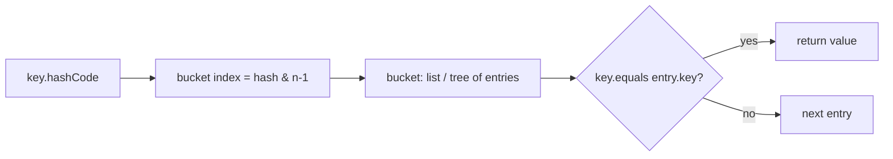

Breaking it:
* Override `equals` but not `hashCode` → two "equal" objects land in different buckets: `set.contains(copy)` is
  **false**, duplicates in `HashSet`.
* **Mutating a field used in `hashCode` after putting the object in a `HashSet`/`HashMap` key** → the entry is lost
  in the wrong bucket. Keys should be immutable.
* `equals(Employee o)` instead of `equals(Object o)` → **overloads**, doesn't override (use `@Override`).
* `instanceof` in `equals` with subclasses that add fields breaks **symmetry**; `getClass() != o.getClass()` keeps it
  (or make the class `final`, or use records).

### `clone`: shallow vs deep

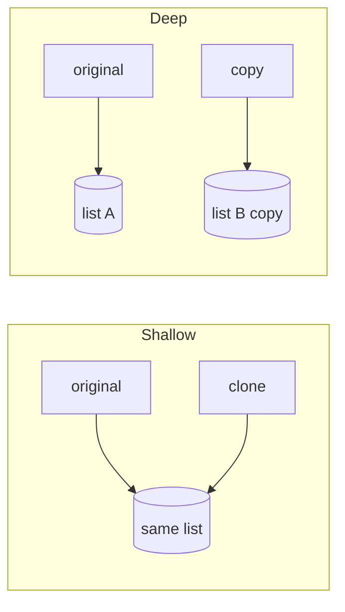

Prefer **copy constructors** or static factories (`new Order(other)`, `List.copyOf`) over `Cloneable`.

---

## 9. Nested classes

| Kind | Declared | Has outer `this`? | Typical use |
|------|----------|-------------------|-------------|
| **Static nested** | `static class Node` inside a class | ❌ | helpers grouped with their outer class (`Map.Entry`, builders) |
| **Inner** (non-static) | `class Iter` inside a class | ✅ `Outer.this` | iterators, objects tied to an outer instance |
| **Local** | inside a method | ✅ (if in instance method) | one-off helper inside a method |
| **Anonymous** | `new Interface() { ... }` | ✅ | one-off implementation (before lambdas) |
| **Lambda** | `x -> x * 2` | no own `this` (uses enclosing `this`) | functional interfaces |

Corner cases:
* Create an inner object: `outer.new Inner()`.
* Local/anonymous classes and lambdas can capture only **effectively final** local variables.
* In an anonymous class, `this` is the anonymous object; in a lambda, `this` is the enclosing object.
* An inner class keeps a hidden reference to its outer object → possible **memory leak** (e.g. listeners). Prefer
  `static` nested classes when you don't need the outer instance.

---

## 10. Records, sealed types and enums

### Records (Java 16)
```java
public record Money(BigDecimal amount, String currency) {
    public Money {                                       // compact constructor: validation
        Objects.requireNonNull(currency);
        if (amount.signum() < 0) throw new IllegalArgumentException("negative");
    }
    public Money add(Money other) { return new Money(amount.add(other.amount), currency); }
}
```
* Generated: `private final` fields, canonical constructor, accessors `amount()` (not `getAmount()`), `equals`,
  `hashCode`, `toString`.
* Implicitly `final`, cannot extend another class (extends `java.lang.Record`), **can implement interfaces**,
  can have static fields/methods and extra methods, **no extra instance fields**.
* Shallowly immutable: a `List` component can still be modified → copy it in the compact constructor.
* Perfect for DTOs, value objects, map keys, multiple return values.

### Sealed classes / interfaces (Java 17)
```java
public sealed interface Payment permits Card, Cash, Wallet {}
public record Card(String number) implements Payment {}
public record Cash() implements Payment {}
public non-sealed class Wallet implements Payment {}   // reopens the hierarchy
```
* Restrict which classes may extend/implement. Subclasses must be `final`, `sealed` or `non-sealed`.
* The compiler knows **all** subtypes → **exhaustive** `switch` without `default`. Models "one of" data (algebraic types).

### Enums
* A fixed set of instances; each constant is a `public static final` object; constructors are implicitly `private`.
* Can have fields, constructors, methods, implement interfaces, and **constant-specific bodies** (each constant
  overrides an abstract method → strategy pattern).
* `values()`, `valueOf()`, `ordinal()` (don't persist ordinals!), `name()`, `compareTo`.
* Use `EnumSet`/`EnumMap` for fast sets/maps of enums.
* An enum with one constant is the best **singleton** (serialization- and reflection-safe).

---

## 11. Relationships between classes

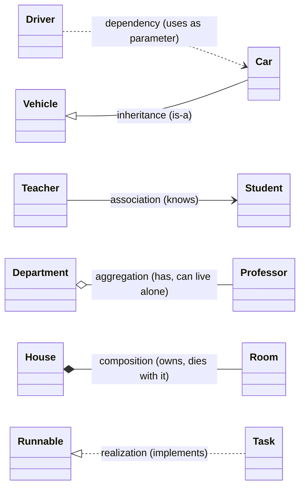

| Relationship | Meaning | Lifetime | Code |
|--------------|---------|----------|------|
| Dependency | uses temporarily | none | parameter / local variable |
| Association | knows another object | independent | field |
| Aggregation | whole–part, part can exist alone | independent | field set from outside (`new Department(profs)`) |
| Composition | whole owns part | part dies with whole | part created **inside** the whole |
| Inheritance | is-a | – | `extends` |
| Realization | implements a contract | – | `implements` |

### Composition over inheritance

Inheritance couples the child to the parent's implementation ("fragile base class"). Classic example: extending
`HashSet` to count added elements double-counts because `addAll` calls `add` internally. **Wrapping** (composition +
delegation) a `Set` avoids it. Prefer composition unless there is a true, stable **is-a** relationship.

---

## 12. Packages/APIs used in this topic and why

| Package / type | Why |
|----------------|-----|
| `java.lang.Object` | root of every class: `equals`, `hashCode`, `toString` |
| `java.util.Objects` | `Objects.equals`, `Objects.hash`, `requireNonNull` — null-safe helpers for writing `equals/hashCode` and validation |
| `java.lang.Comparable` / `java.util.Comparator` | natural vs custom ordering (sorting objects) |
| `java.lang.Cloneable` | marker interface for `clone()` (avoid in new code) |
| `java.lang.Record`, `java.lang.Enum` | implicit superclasses of records and enums |
| `java.util.EnumMap` / `EnumSet` | high-performance collections for enum keys |
| `java.io.Serializable` | marker for Java serialization (prefer JSON in modern apps) |
| Lombok *(third-party)* | generates getters/builders/equals; many teams now prefer records instead |

Design principles that build on OOP (SOLID, design patterns) are in
[14-clean-code-solid-design-patterns](../14-clean-code-solid-design-patterns/README.md).

---

## 13. Interview questions

1. Four pillars of OOP with a real example each.
2. Abstract class vs interface? When would you choose each since Java 8?
3. Overloading vs overriding? Which is resolved at compile time?
4. Can you override a static method? A private method? A final method?
5. Why must `hashCode` be overridden together with `equals`? What happens if you don't?
6. Why is calling an overridable method from a constructor dangerous?
7. Why doesn't Java support multiple inheritance of classes? How do default methods handle the diamond?
8. What is an immutable class? How do you create one?
9. Composition vs aggregation vs association?
10. Why are records better than Lombok `@Data` for DTOs? What can't records do?
11. `instanceof` vs `getClass()` in `equals`?
12. What is the difference between a static nested class and an inner class?
