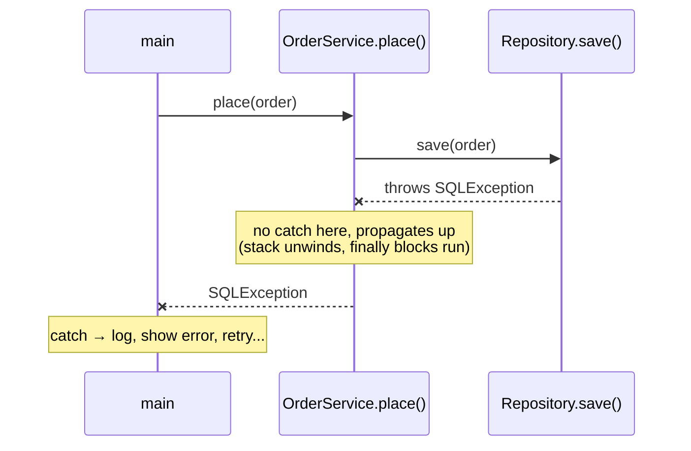
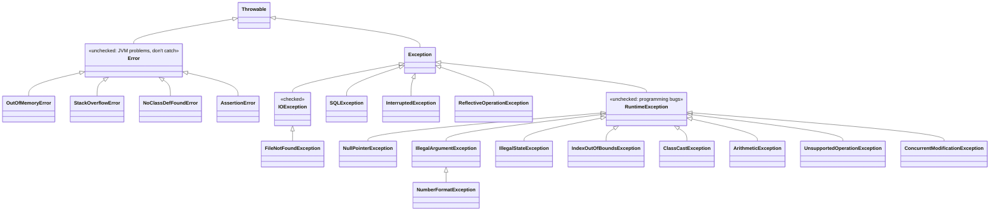
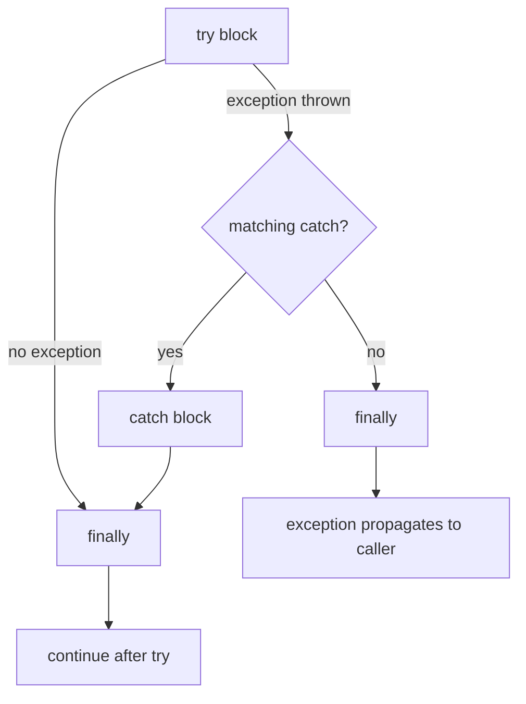
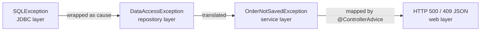

# 06.01 · Exceptions

> How Java reports and handles errors: the `Throwable` hierarchy, checked vs unchecked,
> `try/catch/finally`, try-with-resources, custom exceptions, chaining, and the best practices used
> in real backends.

---

## 1. Why exceptions?

C returns error codes that callers forget to check. Exceptions **separate the normal path from the error path**,
can't be silently ignored (checked ones), carry a **message + stack trace + cause**, and propagate automatically up
the call stack until someone can handle them.



---

## 2. The hierarchy



| Category | Extends | Compiler forces handling? | Meaning | Examples |
|----------|---------|---------------------------|---------|----------|
| **Checked** | `Exception` (not `RuntimeException`) | ✅ catch or declare `throws` | recoverable, external failure the caller should plan for | `IOException`, `SQLException`, `InterruptedException` |
| **Unchecked** | `RuntimeException` | ❌ | programming error / violated precondition | `NullPointerException`, `IllegalArgumentException`, `IndexOutOfBoundsException` |
| **Error** | `Error` | ❌ | serious JVM problem, usually can't recover | `OutOfMemoryError`, `StackOverflowError` |

### Most common exceptions and what they mean

| Exception | Typical cause |
|-----------|---------------|
| `NullPointerException` | calling a method / field on `null`, unboxing `null` |
| `IllegalArgumentException` | a method received an invalid argument (throw it yourself for validation) |
| `IllegalStateException` | method called at the wrong time (e.g. `withdraw` on a closed account) |
| `NumberFormatException` | `Integer.parseInt("12a")` |
| `ArrayIndexOutOfBoundsException` / `IndexOutOfBoundsException` | wrong index |
| `ClassCastException` | invalid downcast |
| `ArithmeticException` | integer division by zero |
| `ConcurrentModificationException` | modifying a collection while iterating |
| `UnsupportedOperationException` | modifying an immutable collection (`List.of`) |
| `NoSuchElementException` | `iterator.next()` past the end, `Optional.get()` on empty |
| `IOException` / `FileNotFoundException` / `UncheckedIOException` | file/network problems |
| `InterruptedException` | a waiting/sleeping thread was interrupted |

---

## 3. `try` / `catch` / `finally`

```java
try {
    int value = Integer.parseInt(input);       // may throw
    process(value);
} catch (NumberFormatException e) {            // most specific first
    log.warn("bad number: {}", input);
} catch (IOException | SQLException e) {       // multi-catch (Java 7)
    throw new ServiceException("processing failed", e);
} finally {
    cleanup();                                 // ALWAYS runs (success, exception, return)
}
```



Rules & corner cases:
* Catch order: subclass before superclass, otherwise **compile error** ("already caught").
* In multi-catch the types can't be subclasses of each other, and the variable is implicitly `final`.
* `finally` runs even if `try` executes `return` — **except** `System.exit()`, JVM crash, or killed process.
* **`return` inside `finally` overrides** the `try`'s return value **and swallows exceptions** → never do it.
* An exception thrown in `finally` **replaces** the original exception (it's lost) → use try-with-resources.
* Catching `Exception`/`Throwable` hides bugs and catches `InterruptedException` — catch what you can handle.

---

## 4. try-with-resources (Java 7)

Any object implementing **`AutoCloseable`** (`InputStream`, `Connection`, `Scanner`, `ExecutorService` since 19...)
is closed automatically, even when an exception occurs.

```java
try (Connection con = dataSource.getConnection();
     PreparedStatement ps = con.prepareStatement(sql)) {
    ...
}   // ps.close() then con.close() — reverse order of opening
```

* Resources close in **reverse order**.
* If the body throws **and** `close()` throws, the close exception is attached as a **suppressed** exception
  (`e.getSuppressed()`) — nothing is lost.
* Java 9: you can use an existing effectively-final variable: `try (existingStream) { ... }`.

---

## 5. `throw`, `throws`, chaining and custom exceptions

```java
public void withdraw(BigDecimal amount) throws InsufficientFundsException {   // throws: declares
    if (amount.signum() <= 0) {
        throw new IllegalArgumentException("amount must be positive: " + amount); // throw: raises
    }
    if (amount.compareTo(balance) > 0) {
        throw new InsufficientFundsException(id, balance, amount);
    }
}
```

**Custom exception** — extend `RuntimeException` (most common in modern code) or `Exception` (when callers must handle it):

```java
public class InsufficientFundsException extends Exception {
    private final BigDecimal missing;

    public InsufficientFundsException(String accountId, BigDecimal balance, BigDecimal requested) {
        super("Account %s has %s, requested %s".formatted(accountId, balance, requested));
        this.missing = requested.subtract(balance);
    }

    public BigDecimal missing() { return missing; }
}
```

**Exception chaining / translation** — wrap low-level exceptions in exceptions that make sense at your layer, and
**keep the cause**:

```java
try {
    repository.save(order);
} catch (SQLException e) {
    throw new OrderPersistenceException("could not save order " + order.id(), e);   // cause kept
}
```



---

## 6. Checked vs unchecked: which to use?

| Use **checked** when | Use **unchecked** when |
|----------------------|------------------------|
| The caller can reasonably **recover** (retry, choose another file, ask the user) | It's a **bug** or broken precondition (null argument, invalid state) |
| The failure is part of the method's contract | Most callers can't do anything useful except let it propagate |

Modern frameworks (Spring, Hibernate/JPA) use **unchecked** exceptions almost everywhere: checked exceptions don't
compose well with lambdas/streams and pollute every signature. Java's own `java.io` uses checked exceptions;
`UncheckedIOException` wraps them when needed (e.g. inside streams).

---

## 7. Best practices

1. **Never swallow**: `catch (Exception e) {}` hides failures. At minimum log it or rethrow.
2. **Log or rethrow, not both** (otherwise the same error appears many times in the logs).
3. **Fail fast**: validate arguments at the start (`Objects.requireNonNull`, `IllegalArgumentException`).
4. **Include context in messages**: ids, values, what was attempted.
5. **Keep the cause** when wrapping (`new X("msg", e)`).
6. **Don't use exceptions for normal control flow** (creating a stack trace is expensive); return `Optional`, a
   boolean, or a result type.
7. **Close resources with try-with-resources**, never in a hand-written `finally`.
8. **Restore the interrupt flag** if you catch `InterruptedException` and can't rethrow it:
   `Thread.currentThread().interrupt();`
9. **Handle at the boundary**: one global handler per entry point (Spring `@RestControllerAdvice`, a CLI `main`).
10. Don't catch `Error`s (`OutOfMemoryError`) except at top level to log and exit.

---

## 8. Overriding and exceptions

* An overriding method may throw **the same, narrower, or no checked exceptions**, never broader/new checked ones.
* It may throw any unchecked exception.
* Constructors can declare any exceptions; a subclass constructor must declare the parent constructor's checked exceptions.

---

## 9. Reading a stack trace

```
Exception in thread "main" java.lang.IllegalStateException: order 42 already paid    <- type + message
    at com.shop.Order.pay(Order.java:31)                                             <- where it was thrown
    at com.shop.CheckoutService.checkout(CheckoutService.java:18)                    <- who called it
    at com.shop.Main.main(Main.java:9)
Caused by: java.sql.SQLException: duplicate key                                       <- the root cause
    ... 3 more
```

Read the **first line** (what), the **first frame in your code** (where), and the **last `Caused by`** (root cause).
Since Java 14, NPE messages say exactly what was null: `Cannot invoke "String.length()" because "name" is null`.
(Local variable names appear only when the class was compiled with debug info `-g`, as Maven/IDEs do; otherwise you
see `"<local1>"`.)

---

## 10. Packages / libraries and why

| Package / library | Why |
|-------------------|-----|
| `java.lang` | `Throwable`, `Exception`, `RuntimeException`, `Error`, common runtime exceptions |
| `java.io` | `IOException`, `UncheckedIOException`, `FileNotFoundException` |
| `java.util` | `NoSuchElementException`, `ConcurrentModificationException`, `Objects.requireNonNull` |
| `java.util.Optional` | represent "no result" without exceptions or `null` |
| Spring `org.springframework.dao.DataAccessException` | unchecked, database-independent hierarchy (translates `SQLException`) |
| Spring `@RestControllerAdvice` + `ProblemDetail` | one place to map exceptions to HTTP responses (topic 08) |
| SLF4J (topic 15) | log exceptions with stack traces: `log.error("msg", e)` |

---

## 11. Practical

```bash
java topics/06-advanced-java/01-exceptions/practical/ExceptionBasics.java
java topics/06-advanced-java/01-exceptions/practical/ResourcesAndCustomExceptions.java
```

## 12. Interview questions

1. Checked vs unchecked exceptions? Give two examples of each.
2. `Error` vs `Exception`?
3. Does `finally` always run? What if `try` returns? What if `finally` returns?
4. What are suppressed exceptions?
5. `throw` vs `throws`?
6. `ClassNotFoundException` vs `NoClassDefFoundError`?
7. How do you handle exceptions globally in a Spring Boot REST API?
8. Why is `catch (Exception e) {}` bad? Why is catching `InterruptedException` and ignoring it bad?

## Exercises

- [ ] Write a `parseAge(String)` that throws a custom `InvalidAgeException` (checked) with a helpful message.
- [ ] Write a resource class implementing `AutoCloseable` that throws in `close()`; show the suppressed exception.
- [ ] Wrap a `SQLException` into an unchecked `RepositoryException`, then print the whole cause chain.
- [ ] Inside a stream `map`, call a method that throws `IOException`. Fix it with `UncheckedIOException`.
