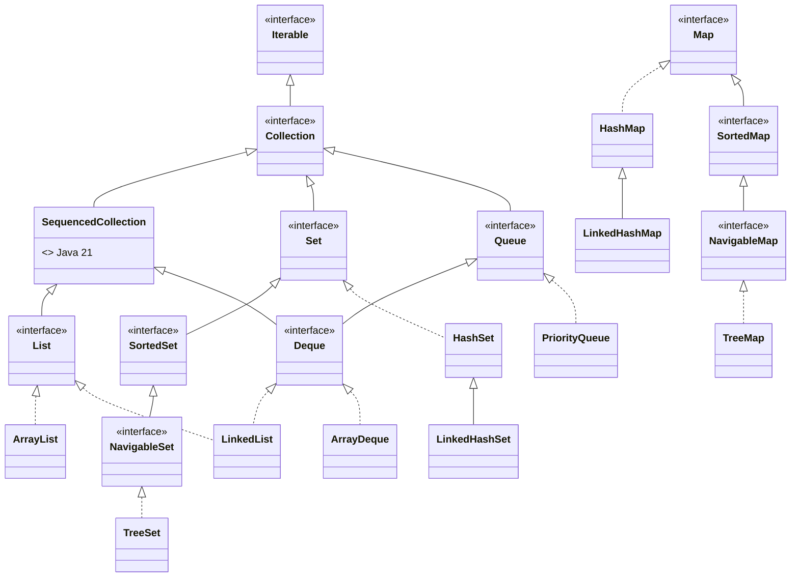
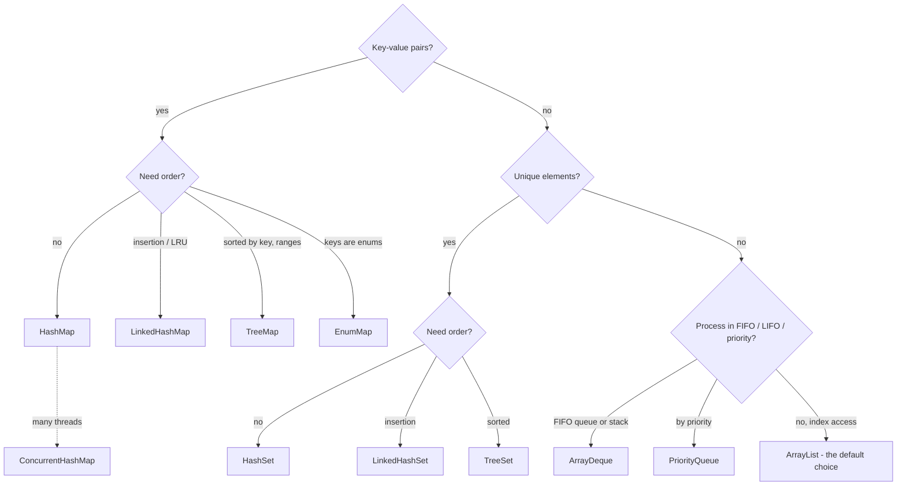
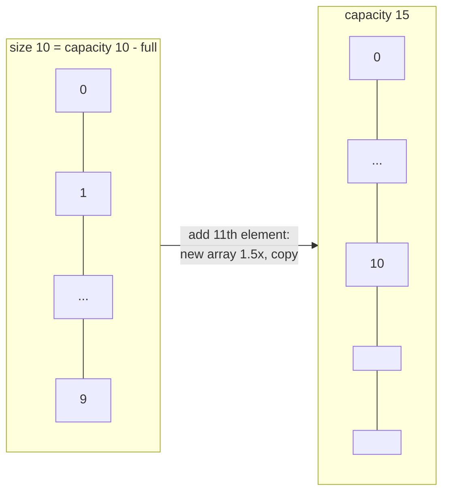
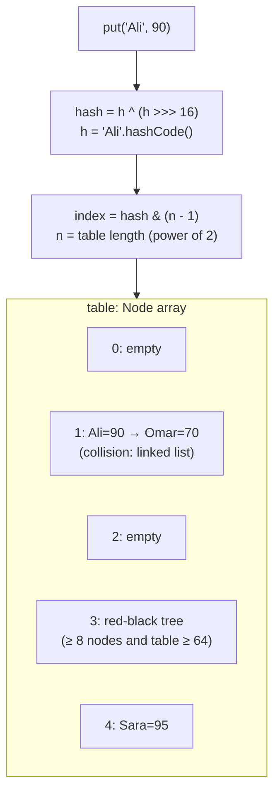

# 06.02 · Collections Framework

> The data structures you use every day: `List`, `Set`, `Queue`/`Deque`, `Map`; how `ArrayList`,
> `HashMap`, `TreeMap`, `PriorityQueue` work inside; Big-O of every operation; sorting with
> `Comparable`/`Comparator`; immutable and concurrent collections; and how to choose.

---

## 1. The big picture



`Map` is **not** a `Collection` (it stores key → value pairs), but it is part of the framework.

| Interface | Ordered? | Duplicates? | Access | Main implementations |
|-----------|----------|-------------|--------|----------------------|
| `List` | by index (insertion) | ✅ | `get(i)` | `ArrayList`, `LinkedList` |
| `Set` | no / insertion / sorted | ❌ | `contains` | `HashSet`, `LinkedHashSet`, `TreeSet`, `EnumSet` |
| `Queue` | FIFO or priority | ✅ | `offer/poll/peek` | `ArrayDeque`, `PriorityQueue`, `LinkedList` |
| `Deque` | both ends | ✅ | `addFirst/addLast/pollFirst/...` | `ArrayDeque`, `LinkedList` |
| `Map` | no / insertion / sorted | keys ❌, values ✅ | `get(key)` | `HashMap`, `LinkedHashMap`, `TreeMap`, `EnumMap` |

---

## 2. Which collection should I use?



**Default choices**: `ArrayList`, `HashMap`, `HashSet`, `ArrayDeque`. Program to interfaces:
`List<String> names = new ArrayList<>();`.

---

## 3. Big-O cheat sheet

| Operation | ArrayList | LinkedList | HashSet / HashMap | TreeSet / TreeMap | ArrayDeque | PriorityQueue |
|-----------|-----------|------------|-------------------|-------------------|------------|---------------|
| add at end | **O(1)** amortised | O(1) | O(1) avg | O(log n) | O(1) | O(log n) |
| add at index / front | O(n) | O(1) at ends, O(n) to find index | – | – | O(1) at ends | – |
| get by index | **O(1)** | O(n) | – | – | – | – |
| contains / get(key) | O(n) | O(n) | **O(1)** avg, O(log n) worst (treeified) | O(log n) | O(n) | O(n) |
| remove | O(n) (shift) | O(1) with iterator | O(1) avg | O(log n) | O(1) at ends | O(log n) poll, O(n) arbitrary |
| iterate in order | yes | yes | no order | **sorted** | yes | **not sorted** |
| min / max | O(n) | O(n) | O(n) | O(log n) | – | O(1) peek |
| memory | compact array | node per element (~3x more) | entry per element | node per element | compact array | compact array |

> `LinkedList` is almost never faster than `ArrayList` in practice (poor CPU cache locality). Use `ArrayDeque` for
> queues/stacks.

---

## 4. Internals

### 4.1 `ArrayList` — a resizable array



* Backed by `Object[] elementData`; default capacity 10 (allocated lazily on first add).
* When full, grows by **50%** (`newCapacity = old + old >> 1`) and copies — that's why `add` is *amortised* O(1).
* `remove(i)` shifts all following elements left → O(n). Pre-size with `new ArrayList<>(expectedSize)`.
* `remove(int index)` vs `remove(Object o)`: `list.remove(1)` removes **index 1**, `list.remove(Integer.valueOf(1))`
  removes the value 1. Classic bug with `List<Integer>`.

### 4.2 `HashMap` — array of buckets



1. Compute `hashCode()`, spread the high bits, and find the bucket with `hash & (n-1)`.
2. Empty bucket → store the node. Otherwise walk the bucket using **`equals`** to find the same key (replace value) or
   append a new node.
3. A bucket with **≥ 8 nodes** (and table ≥ 64) becomes a **red-black tree** → worst case O(log n) instead of O(n).
4. When `size > capacity × loadFactor (0.75)` the table **doubles** and entries are redistributed (*rehash*).
5. Allows **one `null` key** and `null` values. Iteration order is **not defined** (and can change after a resize).

Consequences: keys need correct `equals`/`hashCode` (topic 05) and should be **immutable**. Pre-size big maps:
`HashMap.newHashMap(expected)` (Java 19).

### 4.3 `LinkedHashMap` / `LinkedHashSet`
A `HashMap` + doubly-linked list through the entries → **predictable iteration order** (insertion order, or access
order with `new LinkedHashMap<>(16, 0.75f, true)`). Override `removeEldestEntry` to build an **LRU cache**.

### 4.4 `TreeMap` / `TreeSet` — red-black tree
* Self-balancing BST → `get/put/remove` O(log n), **sorted** iteration.
* Navigation: `firstKey, lastKey, floorKey(x)` (≤ x), `ceilingKey(x)` (≥ x), `headMap, tailMap, subMap`, `descendingMap`.
* Uses `compareTo`/`Comparator` — **not `equals`** — to decide equality! If `compare` returns 0 the element is
  considered a duplicate. No `null` keys (with natural ordering).

### 4.5 `PriorityQueue` — binary heap
Array-based **min-heap**: `peek` O(1), `offer/poll` O(log n). Iteration / `toString` are **not sorted**; only `poll()`
returns elements in priority order. Max-heap: `new PriorityQueue<>(Comparator.reverseOrder())`.

### 4.6 `ArrayDeque` — circular array
Fast add/remove at both ends. Use as a **stack** (`push/pop/peek`) instead of the legacy `Stack` class, and as a
**queue** (`offer/poll`) instead of `LinkedList`. No `null` elements.

---

## 5. Sorting: `Comparable` vs `Comparator`

| | `Comparable<T>` | `Comparator<T>` |
|---|---|---|
| Package | `java.lang` | `java.util` |
| Method | `int compareTo(T other)` | `int compare(T a, T b)` |
| Where | inside the class: **natural order** (one) | outside: **any number** of orders |
| Used by | `Collections.sort(list)`, `TreeSet`, `TreeMap` | `list.sort(cmp)`, `new TreeSet<>(cmp)`, `stream.sorted(cmp)` |

Return: negative → `a` first, 0 → equal, positive → `b` first.

```java
employees.sort(Comparator
        .comparing(Employee::department)                     // 1st key
        .thenComparing(Employee::salary, Comparator.reverseOrder())   // 2nd key descending
        .thenComparing(Employee::name, Comparator.nullsLast(String::compareTo)));
```

Corner cases:
* Never write `return a.value - b.value;` for ints → **overflow** for large/negative values. Use `Integer.compare`.
* `compareTo` should be **consistent with `equals`**; otherwise `TreeSet` and `HashSet` disagree about duplicates
  (`new BigDecimal("2.0")` vs `"2.00"`).
* `List.sort` / `Collections.sort` are **stable** (TimSort): equal elements keep their relative order.

---

## 6. Immutable / unmodifiable collections

| Creation | Modifiable? | Nulls? | Notes |
|----------|-------------|--------|-------|
| `List.of(a, b)`, `Set.of`, `Map.of`, `Map.ofEntries` (Java 9) | ❌ throws `UnsupportedOperationException` | ❌ throws NPE | `Set.of`/`Map.of` reject duplicates |
| `List.copyOf(col)` (Java 10) | ❌ | ❌ | real copy |
| `stream.toList()` (Java 16) | ❌ | ✅ | |
| `Collections.unmodifiableList(list)` | ❌ through the view | ✅ | a **view**: changes to the original are visible! |
| `Arrays.asList(array)` | set ✅, add/remove ❌ | ✅ | fixed size, **writes through** to the array |
| `Collectors.toList()` | ✅ (in practice `ArrayList`) | ✅ | |

---

## 7. Iteration and modification

* **Fail-fast** iterators (`ArrayList`, `HashMap`...) throw `ConcurrentModificationException` if the collection is
  structurally modified during iteration (except through the iterator itself). It's a bug detector, not a guarantee.
* **Fail-safe / weakly consistent** iterators (`CopyOnWriteArrayList`, `ConcurrentHashMap`) never throw; they
  iterate over a snapshot or tolerate concurrent changes.
* Remove safely: `iterator.remove()`, `removeIf(predicate)`, or collect into a new list.
* `ListIterator` can go backwards and `set/add` while iterating.

---

## 8. Modern `Map` API (Java 8+)

```java
Map<String, Integer> counts = new HashMap<>();
counts.merge(word, 1, Integer::sum);                       // word count in one line
counts.getOrDefault("missing", 0);
counts.putIfAbsent("java", 0);
Map<String, List<String>> byCity = new HashMap<>();
byCity.computeIfAbsent(city, k -> new ArrayList<>()).add(name);   // multimap pattern
counts.forEach((k, v) -> System.out.println(k + "=" + v));
for (Map.Entry<String, Integer> e : counts.entrySet()) { ... }    // iterate keys+values efficiently
```

Java 21 **sequenced collections**: `getFirst()`, `getLast()`, `addFirst()`, `removeLast()`, `reversed()` on
`List`, `Deque`, `LinkedHashSet`, `SortedSet`; `firstEntry()`, `pollLastEntry()`, `sequencedKeySet()` on `LinkedHashMap`/`TreeMap`.

---

## 9. Thread-safe collections (details in 06-concurrency)

| Need | Use | Avoid |
|------|-----|-------|
| Concurrent map | `ConcurrentHashMap` (lock striping/CAS, no null keys/values) | `Hashtable`, `Collections.synchronizedMap` (one lock) |
| Mostly-read list | `CopyOnWriteArrayList` | `Vector` |
| Producer–consumer | `ArrayBlockingQueue`, `LinkedBlockingQueue` | wait/notify by hand |
| Sorted concurrent | `ConcurrentSkipListMap` | synchronized `TreeMap` |

Legacy classes `Vector`, `Stack`, `Hashtable`, `Enumeration` exist only for backward compatibility.

---

## 10. Packages & libraries and why

| Package / library | Why |
|-------------------|-----|
| `java.util` | all core collections, `Collections` and `Arrays` utility classes, `Comparator`, `Iterator` |
| `java.util.concurrent` | thread-safe collections and queues |
| `java.util.stream` | process collections declaratively (topic 06.04) |
| **Guava** (Google) | `Multimap`, `BiMap`, `Table`, `ImmutableList`, caches — when the JDK lacks a structure |
| **Apache Commons Collections** | `Bag`, `MultiValuedMap`, many utilities |
| **Eclipse Collections** / **fastutil** | primitive collections (`IntList` without boxing), big-data performance |
| **Caffeine** | high-performance in-memory cache (better than a hand-made LRU) |

---

## 11. Practical

```bash
java topics/06-advanced-java/02-collections/practical/ListsSetsQueues.java
java topics/06-advanced-java/02-collections/practical/MapsDemo.java
java topics/06-advanced-java/02-collections/practical/SortingComparators.java
```

## 12. Interview questions

1. How does `HashMap` work internally? What happens on collision? When does it resize? What is treeification?
2. `ArrayList` vs `LinkedList`? Which one would you use as a queue?
3. `HashSet` vs `LinkedHashSet` vs `TreeSet`?
4. `HashMap` vs `Hashtable` vs `ConcurrentHashMap`?
5. Why must keys be immutable? What happens if a key's `hashCode` changes?
6. `Comparable` vs `Comparator`? Why is `a - b` a bad comparator?
7. Fail-fast vs fail-safe iterators?
8. `List.of` vs `Arrays.asList` vs `Collections.unmodifiableList`?
9. How would you implement an LRU cache in Java?

## Exercises

- [ ] Count word frequencies in a text and print the top 5 (HashMap + sorting entries).
- [ ] Group students by grade into `Map<Character, List<String>>` with `computeIfAbsent`.
- [ ] Check balanced brackets `{[()]}` using `ArrayDeque` as a stack.
- [ ] Find the k largest numbers in a stream of 1 000 000 numbers using a `PriorityQueue` of size k.
- [ ] Implement an LRU cache of capacity 3 with `LinkedHashMap` and test eviction.
- [ ] Use `TreeMap.floorEntry` to map scores to grades (90→A, 80→B, ...).
