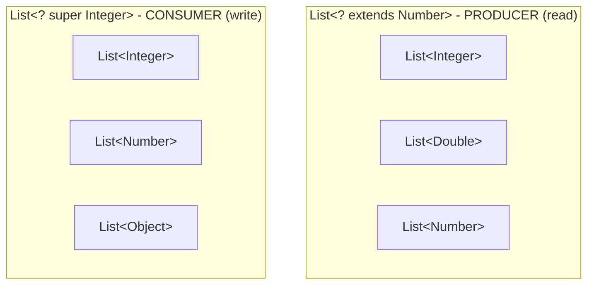
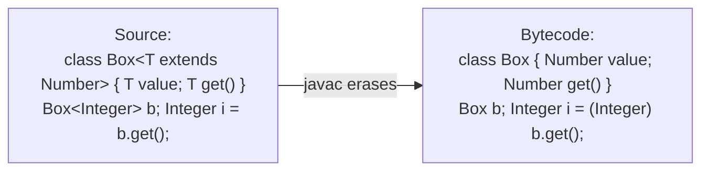

# 06.03 · Generics

> Write code once for many types while the compiler checks the types for you. Generic classes and
> methods, bounded types, wildcards and the **PECS** rule, invariance, **type erasure** and all its
> consequences, bridge methods, heap pollution, recursive bounds and type tokens.

---

## 1. Why generics?

```java
// Before Java 5 (raw types): the compiler can't help you
List list = new ArrayList();
list.add("hello");
list.add(42);                         // compiles!
String s = (String) list.get(1);      // ClassCastException at RUNTIME

// With generics: the error moves to COMPILE time and casts disappear
List<String> names = new ArrayList<>();
names.add(42);                        // ❌ compile error
String first = names.get(0);          // no cast
```

Benefits: **type safety**, **no casts**, **reusable algorithms** (`Collections.sort`, `Optional<T>`, `Repository<T, ID>`).

---

## 2. Syntax

```java
// generic class                      type parameter list
public class Box<T> {
    private T value;
    public Box(T value) { this.value = value; }
    public T get() { return value; }
    public <R> Box<R> map(Function<? super T, ? extends R> f) { return new Box<>(f.apply(value)); }
}

// generic interface
public interface Repository<T, ID> {
    Optional<T> findById(ID id);
    T save(T entity);
}

// generic method (its own type parameter, declared before the return type)
public static <T> T firstOrDefault(List<T> list, T defaultValue) {
    return list.isEmpty() ? defaultValue : list.get(0);
}

Box<String> b = new Box<>("hi");                     // diamond <> infers String (Java 7)
String x = Util.<String>firstOrDefault(list, "-");   // explicit type witness (rarely needed)
```

| Letter | Convention |
|--------|------------|
| `T` | Type |
| `E` | Element (collections) |
| `K`, `V` | Key, Value |
| `R` | Result / Return |
| `ID` | identifier type (Spring Data) |
| `?` | wildcard: unknown type (only in usages, not declarations) |

---

## 3. Bounded type parameters

```java
static <T extends Number> double sum(List<T> list)               // upper bound: T is Number or subclass
static <T extends Comparable<T>> T max(List<T> list)             // T can compare with itself
static <T extends Number & Comparable<T>> T clamp(T v, T lo, T hi) // multiple bounds: class first, then interfaces
```

Inside the method you can call methods of the bound (`doubleValue()`, `compareTo()`).

---

## 4. Invariance, covariance, wildcards

**Generics are invariant**: even though `Integer` is a `Number`, `List<Integer>` is **not** a `List<Number>`.

```java
List<Integer> ints = new ArrayList<>();
List<Number> nums = ints;          // ❌ compile error. If allowed:
nums.add(3.14);                    // a Double inside a List<Integer>!
```

Arrays are **covariant** (`Integer[]` is an `Object[]`), which is why arrays fail at runtime with
`ArrayStoreException` while generics fail safely at compile time.

Wildcards restore flexibility:



| Wildcard | Accepts | Can **read** as | Can **add** |
|----------|---------|-----------------|-------------|
| `List<?>` | any list | `Object` | only `null` |
| `List<? extends Number>` | `List<Number>`, `List<Integer>`, `List<Double>` | `Number` ✅ | ❌ (which subtype?) |
| `List<? super Integer>` | `List<Integer>`, `List<Number>`, `List<Object>` | `Object` only | `Integer` ✅ |

### PECS: **P**roducer **E**xtends, **C**onsumer **S**uper

```java
// copies FROM src (producer → extends) INTO dest (consumer → super)
public static <T> void copy(List<? super T> dest, List<? extends T> src)

// a Comparator of a supertype can compare subtypes: Comparator<Object> works for List<String>
public static <T> void sort(List<T> list, Comparator<? super T> c)
```

Rule of thumb: parameters you only **read from** → `? extends T`; parameters you only **write into** → `? super T`;
both → plain `T`. Don't use wildcards in **return types**.

---

## 5. Type erasure — how generics work inside

Generics exist **only at compile time**. `javac` checks types, inserts casts, and then **erases** the type
parameters to their bound (`Object` if unbounded) — so `List<String>` and `List<Integer>` are the same class at
runtime. This kept bytecode compatible with pre-Java-5 code.



### Consequences (the corner cases)

| You cannot... | Why | Work-around |
|---------------|-----|-------------|
| `new T()` | `T` unknown at runtime | pass a `Supplier<T>` or `Class<T>` |
| `new T[10]` / `new List<String>[10]` | arrays need the real element type | `(T[]) new Object[10]` (unchecked), or use `List<T>` |
| `obj instanceof List<String>` | type argument erased | `instanceof List<?>` |
| use primitives: `List<int>` | type arguments must be objects | `List<Integer>` (boxing) or primitive collections |
| overload `m(List<String>)` and `m(List<Integer>)` | same erasure `m(List)` → **name clash** | different method names |
| `static T field` | one static field shared by all `Box<X>` | – |
| `catch (T e)` / generic exception classes | erased at runtime | – |
| `List<String>.class` | only one class object | `List.class`, or a **type token** |
| get `T` of a local `List<T>` at runtime | erased | type tokens via subclassing (`new TypeReference<List<User>>() {}`) |

**Bridge methods**: when a class implements `Comparable<Person>` the compiler also generates
`compareTo(Object)` that casts and calls `compareTo(Person)`, so polymorphism keeps working after erasure
(`method.isBridge()` is `true`).

**Heap pollution**: a variable of a parameterized type refers to an object of another parameterization, usually
through raw types or generic varargs (`T... args` creates a `T[]`). The compiler warns ("unchecked"); `@SafeVarargs`
documents that a varargs method is safe.

**Raw types** (`List` without `<>`) exist only for backward compatibility: they disable type checking. Never use them
in new code.

---

## 6. Advanced patterns

```java
// recursive bound: T must be comparable to itself (or to a supertype)
public static <T extends Comparable<? super T>> T max(Collection<? extends T> items)

// how Enum is declared
public abstract class Enum<E extends Enum<E>> implements Comparable<E>

// self-type for fluent builders in hierarchies
abstract class Builder<B extends Builder<B>> {
    B name(String n) { ...; return self(); }
    abstract B self();
}

// generic "result" type instead of exceptions
sealed interface Result<T> permits Ok, Err {}
record Ok<T>(T value) implements Result<T> {}
record Err<T>(String error) implements Result<T> {}
```

**Type tokens**: frameworks need the full generic type at runtime (e.g. JSON → `List<User>`). Java keeps generic
info in **class/field/method signatures** (readable by reflection), so libraries use an anonymous subclass:

```java
List<User> users = mapper.readValue(json, new TypeReference<List<User>>() {});            // Jackson
ResponseEntity<List<User>> r = rest.exchange(url, GET, null, new ParameterizedTypeReference<List<User>>() {}); // Spring
```

---

## 7. Packages / libraries and why

| Package / library | Why |
|-------------------|-----|
| `java.util` | generic collections `List<E>`, `Map<K,V>`, `Optional<T>`, `Comparator<T>` |
| `java.util.function` | generic functional interfaces `Function<T,R>`, `Predicate<T>`, `Supplier<T>` |
| `java.lang.reflect` | `ParameterizedType`, `TypeVariable`, `Method.isBridge()` — read generic info at runtime |
| Jackson `TypeReference` | deserialize generic types (`List<User>`) |
| Spring `ParameterizedTypeReference`, `ResolvableType` | same for HTTP clients and Spring internals |
| Guava `TypeToken` | general-purpose type tokens |

---

## 8. Practical

```bash
java topics/06-advanced-java/03-generics/practical/GenericsBasics.java
java topics/06-advanced-java/03-generics/practical/WildcardsAndErasure.java
```

## 9. Interview questions

1. What is type erasure? Why did Java choose it? What can't you do because of it?
2. Is `List<Integer>` a subtype of `List<Number>`? Why not? How do arrays differ?
3. Explain PECS with `Collections.copy`.
4. `List<?>` vs `List<Object>` vs raw `List`?
5. What is a bridge method?
6. Why can't you create a generic array?
7. How does Jackson know the element type when you deserialize to `List<User>`?

## Exercises

- [ ] Write a generic `Pair<A, B>` with `swap()` returning `Pair<B, A>`.
- [ ] Write `static <T extends Comparable<? super T>> T max(List<? extends T> list)` and test it with `List<LocalDate>`.
- [ ] Write a generic `Cache<K, V>` with a `Function<K, V> loader` and `get(K)`.
- [ ] Write `static double sumAll(List<? extends Number> list)` and `static void fillWithZeros(List<? super Integer> list, int n)`.
- [ ] Write a generic in-memory `CrudRepository<T, ID>` with `save`, `findById`, `findAll`, `deleteById` (you'll meet the real one in Spring Data).
