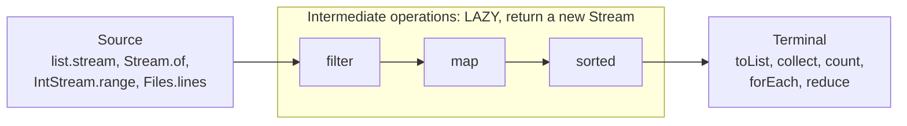
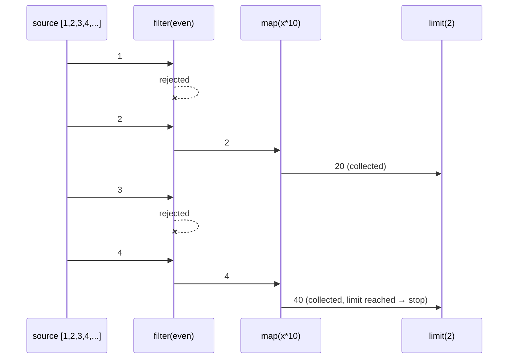

# 06.04 · Lambdas, functional interfaces, Streams and `Optional`

> Functional-style Java (Java 8+): lambdas and method references, the `java.util.function` interfaces,
> the Stream API (sources, intermediate and terminal operations, laziness), `Collectors` (grouping,
> partitioning, `toMap`, `teeing`), parallel streams, `Optional`, gatherers, and the common pitfalls.
> This is the Java counterpart of C#'s LINQ-to-Objects (see [topic 09](../../09-linq/README.md)).

---

## 1. Imperative vs declarative

```java
// imperative: HOW to do it
List<String> result = new ArrayList<>();
for (Employee e : employees) {
    if (e.salary() > 8000) {
        result.add(e.name().toUpperCase());
    }
}
Collections.sort(result);

// declarative: WHAT you want
List<String> result = employees.stream()
        .filter(e -> e.salary() > 8000)
        .map(e -> e.name().toUpperCase())
        .sorted()
        .toList();
```

Declarative code is shorter, reads like the requirement, and is easier to parallelise.

---

## 2. Lambdas

A **lambda** is an anonymous function: `(parameters) -> body`. It can only be used where a **functional
interface** (an interface with exactly one abstract method) is expected — the *target type*.

```java
Runnable r = () -> System.out.println("hi");                  // no parameters
Function<String, Integer> len = s -> s.length();               // one parameter, no parentheses needed
Comparator<String> cmp = (a, b) -> a.compareTo(b);             // two parameters
BinaryOperator<Integer> add = (Integer a, Integer b) -> a + b; // explicit types
Function<Integer, Integer> sq = x -> {                         // block body needs return
    int r2 = x * x;
    return r2;
};
BiFunction<String, String, String> j = (var a, var b) -> a + b; // var in lambdas (Java 11)
```

Rules:
* Captured local variables must be **effectively final** (never reassigned).
* `this` inside a lambda is the **enclosing object** (unlike anonymous classes).
* Lambdas are compiled to `invokedynamic` + a private method — not to extra `.class` files (topic 02).

---

## 3. Functional interfaces (`java.util.function`)

| Interface | Method | Shape | Example |
|-----------|--------|-------|---------|
| `Supplier<T>` | `T get()` | () → T | `() -> new ArrayList<>()` |
| `Consumer<T>` | `void accept(T)` | T → void | `s -> System.out.println(s)` |
| `BiConsumer<T,U>` | `void accept(T,U)` | (T,U) → void | `map.forEach((k, v) -> ...)` |
| `Function<T,R>` | `R apply(T)` | T → R | `String::length` |
| `BiFunction<T,U,R>` | `R apply(T,U)` | (T,U) → R | `(a, b) -> a + b` |
| `UnaryOperator<T>` | `T apply(T)` | T → T | `String::trim` |
| `BinaryOperator<T>` | `T apply(T,T)` | (T,T) → T | `Integer::sum` |
| `Predicate<T>` | `boolean test(T)` | T → boolean | `s -> s.isEmpty()` |
| `BiPredicate<T,U>` | `boolean test(T,U)` | (T,U) → boolean | `String::startsWith` |
| `Runnable` (`java.lang`) | `void run()` | () → void | threads |
| `Callable<V>` (`java.util.concurrent`) | `V call() throws Exception` | () → V | executors |
| `Comparator<T>` (`java.util`) | `int compare(T,T)` | (T,T) → int | sorting |

**Primitive specialisations** avoid boxing: `IntPredicate`, `IntFunction<R>`, `ToIntFunction<T>`, `IntUnaryOperator`,
`IntBinaryOperator`, `IntSupplier`, `ObjIntConsumer<T>`... (also `Long*`, `Double*`).

**Composition**:
```java
Predicate<String> notEmpty = s -> !s.isEmpty();
Predicate<String> valid = notEmpty.and(s -> s.length() < 20).or(s -> s.equals("admin")).negate();
Function<Integer, Integer> plus1 = x -> x + 1, times2 = x -> x * 2;
plus1.andThen(times2).apply(3);   // (3 + 1) * 2 = 8
plus1.compose(times2).apply(3);   // (3 * 2) + 1 = 7
Function.identity();              // x -> x
```

Write your own with `@FunctionalInterface` (the compiler checks there is exactly one abstract method).

---

## 4. Method references

| Kind | Syntax | Equivalent lambda |
|------|--------|-------------------|
| Static method | `Integer::parseInt` | `s -> Integer.parseInt(s)` |
| Instance method of a **particular** object | `System.out::println` | `x -> System.out.println(x)` |
| Instance method of an **arbitrary** object of a type | `String::toUpperCase` | `s -> s.toUpperCase()` |
| Constructor | `ArrayList::new` | `() -> new ArrayList<>()` |
| Array constructor | `String[]::new` | `n -> new String[n]` |

---

## 5. Streams

A stream is a **pipeline** that processes elements from a source. It **doesn't store** data and **doesn't modify**
the source.



Key properties:
1. **Lazy**: nothing happens until a terminal operation is called.
2. **Vertical processing**: each element flows through the whole pipeline before the next one (except stateful ops
   like `sorted`). Combined with **short-circuiting** (`limit`, `findFirst`, `anyMatch`) this allows infinite streams.
3. **Single use**: after the terminal operation the stream is consumed → reuse throws `IllegalStateException`.



### Sources

`collection.stream()`, `Stream.of(a, b)`, `Arrays.stream(arr)`, `IntStream.range(0, 10)` / `rangeClosed`,
`Stream.iterate(1, x -> x * 2)` (+ `limit` or the 3-arg form with a condition), `Stream.generate(supplier)`,
`Files.lines(path)`, `"text".chars()`, `map.entrySet().stream()`, `Pattern.splitAsStream`, `Stream.concat`.

### Intermediate operations (lazy)

| Operation | What it does | Stateful? |
|-----------|--------------|-----------|
| `filter(Predicate)` | keep matching elements | no |
| `map(Function)` | transform each element | no |
| `mapToInt/Long/Double`, `boxed` | switch to/from primitive streams | no |
| `flatMap(Function<T, Stream<R>>)` | one → many, then flatten | no |
| `mapMulti` (Java 16) | imperative flatMap | no |
| `distinct()` | remove duplicates (`equals`) | **yes** |
| `sorted()` / `sorted(Comparator)` | sort | **yes** (needs all elements) |
| `peek(Consumer)` | look at elements (debugging only) | no |
| `limit(n)` / `skip(n)` | first n / drop n | short-circuit |
| `takeWhile` / `dropWhile` (Java 9) | take/drop while condition holds | short-circuit |

### Terminal operations (eager)

| Operation | Result |
|-----------|--------|
| `toList()` (Java 16), `collect(Collector)` | collection / map / string |
| `forEach`, `forEachOrdered` | side effects |
| `count`, `min`, `max`, `sum`, `average`, `summaryStatistics` | numbers / `Optional` |
| `reduce(identity, accumulator)` | fold into one value |
| `anyMatch`, `allMatch`, `noneMatch` | boolean (short-circuit) |
| `findFirst`, `findAny` | `Optional` (short-circuit) |
| `toArray(String[]::new)` | array |

---

## 6. Collectors

```java
import static java.util.stream.Collectors.*;

Map<String, List<Employee>> byDept       = staff.stream().collect(groupingBy(Employee::dept));
Map<String, Long> countByDept            = staff.stream().collect(groupingBy(Employee::dept, counting()));
Map<String, Double> avgSalary            = staff.stream().collect(groupingBy(Employee::dept, averagingInt(Employee::salary)));
Map<String, Set<String>> namesByDept     = staff.stream().collect(groupingBy(Employee::dept, TreeMap::new, mapping(Employee::name, toSet())));
Map<Boolean, List<Employee>> richOrNot   = staff.stream().collect(partitioningBy(e -> e.salary() > 10_000));
Map<String, Integer> salaryByName        = staff.stream().collect(toMap(Employee::name, Employee::salary));
Map<String, Integer> maxByDept           = staff.stream().collect(toMap(Employee::dept, Employee::salary, Integer::max)); // merge duplicates
String csv                               = staff.stream().map(Employee::name).collect(joining(", ", "[", "]"));
Optional<Employee> top                   = staff.stream().collect(maxBy(comparingInt(Employee::salary)));
var minMax = staff.stream().collect(teeing(minBy(cmp), maxBy(cmp), (min, max) -> ...));   // Java 12
```

Corner cases: `toMap` throws `IllegalStateException` on **duplicate keys** (give a merge function) and
`NullPointerException` on **null values**. `groupingBy` returns a `HashMap` unless you pass a map factory.

---

## 7. Parallel streams

`list.parallelStream()` or `.parallel()` splits the work across the **common ForkJoinPool** (CPU cores − 1 threads).

| Good fit | Bad fit |
|----------|---------|
| large data (100k+ elements), CPU-heavy per element | small collections (overhead > gain) |
| `ArrayList`, arrays, `IntStream.range` (split well) | `LinkedList`, `Stream.iterate`, I/O sources |
| stateless, independent operations | shared mutable state, ordering requirements, blocking I/O |

Never mutate shared collections from a parallel `forEach`; use `collect`. Measure before using it in a server
(the common pool is shared by the whole JVM).

---

## 8. `Optional<T>`

A container that **may or may not** hold a value — an explicit, type-checked replacement for returning `null`.

```java
Optional<User> user = repository.findByEmail(email);
String name = user.map(User::name)
                  .filter(n -> !n.isBlank())
                  .orElse("anonymous");
User u = user.orElseThrow(() -> new UserNotFoundException(email));
user.ifPresentOrElse(this::sendWelcome, () -> log.warn("no user"));
```

| Do | Don't |
|----|-------|
| return `Optional` from methods that may find nothing | use it for fields, method parameters, or in collections |
| `map`, `flatMap`, `filter`, `orElse*`, `ifPresent*` | call `get()` without checking (use `orElseThrow()`) |
| `orElseGet(() -> expensive())` for costly defaults | `orElse(expensive())` — the argument is **always evaluated** |
| `Optional.empty()` | return `null` from an `Optional` method |

Primitive versions: `OptionalInt`, `OptionalLong`, `OptionalDouble`.

---

## 9. Stream gatherers (Java 24+)

`stream.gather(Gatherer)` adds custom intermediate operations. Built-ins in `java.util.stream.Gatherers`:
`windowFixed(3)` (chunks), `windowSliding(3)`, `fold`, `scan` (running totals), `mapConcurrent(n, f)` (virtual-thread
concurrency with order preserved). This repo targets Java 21, so gatherers are shown here only as reference:

```java
Stream.of(1, 2, 3, 4, 5).gather(Gatherers.windowFixed(2)).toList();   // [[1, 2], [3, 4], [5]]
Stream.of(1, 2, 3, 4).gather(Gatherers.scan(() -> 0, Integer::sum)).toList(); // [1, 3, 6, 10]
```

---

## 10. Pitfalls

* Reusing a stream → `IllegalStateException: stream has already been operated upon or closed`.
* Side effects in `map`/`filter` (modifying external state) → wrong results, especially in parallel.
* `peek` may not run at all if the terminal operation doesn't need the elements (e.g. `count()` on a sized stream).
* Infinite streams without `limit`/short-circuit → never terminate.
* Boxing overhead: prefer `mapToInt(...).sum()` over `map(...).reduce(0, Integer::sum)`.
* Checked exceptions can't be thrown from lambdas (wrap them, see 06.01).
* Debugging long pipelines is harder: split into named variables/methods when they get complex.
* `Stream.toList()` is unmodifiable; `Collectors.toList()` is not guaranteed to be either.

---

## 11. Packages / libraries and why

| Package / library | Why |
|-------------------|-----|
| `java.util.function` | standard functional interfaces |
| `java.util.stream` | `Stream`, `IntStream`, `Collectors`, `Gatherers` |
| `java.util.Optional` | null-safe result type |
| **Vavr** | immutable collections, `Try`, `Either`, pattern matching — "functional Java" |
| **StreamEx** / **jOOλ** | extra stream operations (zip, windowing, SQL-like joins) |
| **Reactor** / **RxJava** | *reactive* streams for async event processing (Spring WebFlux) — a different model from `java.util.stream` |

---

## 12. Practical

```bash
java topics/06-advanced-java/04-functional-streams/practical/LambdasAndFunctionalInterfaces.java
java topics/06-advanced-java/04-functional-streams/practical/StreamsAndCollectors.java
java topics/06-advanced-java/04-functional-streams/practical/OptionalDemo.java
```

## 13. Interview questions

1. What is a functional interface? Name five from `java.util.function`.
2. `map` vs `flatMap`? Give an example of each.
3. What does "streams are lazy" mean? Show an example where it matters.
4. Intermediate vs terminal operations? Stateless vs stateful?
5. `findFirst` vs `findAny`? `orElse` vs `orElseGet`?
6. When should you use parallel streams? When not?
7. How do you group a list of employees by department and count them?
8. Why should `Optional` not be used as a field or parameter?

## Exercises

- [ ] From a list of orders, compute total revenue per customer, sorted descending, top 3.
- [ ] Find all distinct words longer than 4 letters in a text file, sorted (`Files.lines` + `flatMap`).
- [ ] Partition numbers 1..100 into primes and non-primes.
- [ ] Build `Map<String, Optional<Employee>>` with the best-paid employee per department, then flatten it to `Map<String, String>`.
- [ ] Generate the first 20 Fibonacci numbers with `Stream.iterate` over a pair (record).
- [ ] Rewrite three loops from your previous exercises as streams, then decide which version is more readable.
