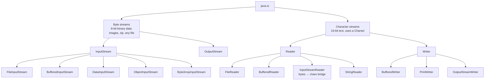
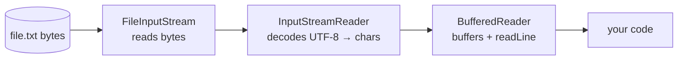
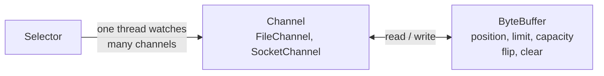
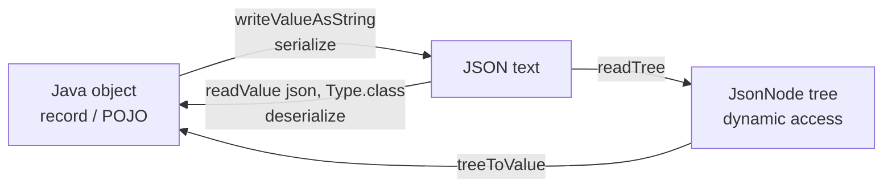

# 06.05 · I/O, NIO.2, serialization and JSON

> Reading and writing data: byte vs character streams and the decorator design of `java.io`,
> the modern `java.nio.file` API (`Path`, `Files`), channels/buffers, character encodings,
> Java serialization (and why to avoid it), and JSON with **Jackson** — the library behind every
> Spring Boot REST API.

---

## 1. Two families of streams in `java.io`



### The decorator pattern

Each class adds one capability by **wrapping** another stream:



```java
try (BufferedReader in = new BufferedReader(
        new InputStreamReader(new FileInputStream("data.txt"), StandardCharsets.UTF_8))) {
    String line;
    while ((line = in.readLine()) != null) { ... }
}
// modern equivalent:
try (BufferedReader in = Files.newBufferedReader(Path.of("data.txt"))) { ... }
```

**Always buffer** (reading byte-by-byte from disk is extremely slow), **always close** (try-with-resources), and
**always specify the charset** for text (UTF-8 is the default only since Java 18).

---

## 2. `java.nio.file` (NIO.2, Java 7) — use this for files

| Task | Code |
|------|------|
| Build a path | `Path p = Path.of("data", "users.csv");` (`Paths.get` is the older form) |
| Read whole small file | `String s = Files.readString(p);` / `List<String> lines = Files.readAllLines(p);` |
| Write | `Files.writeString(p, text, CREATE, APPEND);` / `Files.write(p, lines);` |
| Stream lines lazily (big files) | `try (Stream<String> lines = Files.lines(p)) { ... }` |
| Buffered reader/writer | `Files.newBufferedReader(p)`, `Files.newBufferedWriter(p)` |
| Exists / size / modified | `Files.exists(p)`, `Files.size(p)`, `Files.getLastModifiedTime(p)` |
| Create directories | `Files.createDirectories(p)` |
| Copy / move / delete | `Files.copy(a, b, REPLACE_EXISTING)`, `Files.move`, `Files.deleteIfExists` |
| List / walk a tree | `Files.list(dir)`, `Files.walk(dir)`, `Files.find(dir, depth, matcher)` |
| Temp files | `Files.createTempFile("pre", ".tmp")`, `Files.createTempDirectory("x")` |
| Watch a folder | `WatchService` (events on create/modify/delete) |
| Path operations | `p.getFileName()`, `p.getParent()`, `p.resolve("child")`, `p.relativize(q)`, `p.normalize()`, `p.toAbsolutePath()` |

`java.io.File` is the **legacy** API (methods return `false` instead of throwing helpful exceptions). Convert with
`file.toPath()` / `path.toFile()`.

### Channels, buffers and non-blocking I/O (`java.nio`)



* `FileChannel`: random access, `transferTo` (zero-copy), **memory-mapped files** (`map`) for huge files.
* `Selector` + non-blocking `SocketChannel`: one thread handles thousands of connections. This is what **Netty**
  (and therefore Spring WebFlux, gRPC, Kafka clients...) is built on. With **virtual threads** (06.06), simple
  blocking I/O scales again for most applications.

---

## 3. Character encodings

* A `char` is a UTF-16 code unit; files contain **bytes**. Converting needs a **charset**.
* Wrong charset → mojibake (`العربية` instead of `العربية`).
* Use `StandardCharsets.UTF_8` explicitly; Java 18+ defaults to UTF-8 (JEP 400), older versions used the OS default
  (e.g. Windows-1252/1256).
* Some Unicode characters (emoji) need **two** `char`s (a surrogate pair): `"😀".length() == 2`, use
  `codePointCount`.

---

## 4. Reading resources from the classpath

Files inside your jar (e.g. `src/main/resources/config.json`) are **not** files on disk in production:

```java
try (InputStream in = MyClass.class.getResourceAsStream("/config.json")) { ... }   // leading / = root of classpath
```

`Properties` loads simple `key=value` files (`application.properties` in Spring is the same format).

---

## 5. Java serialization (`Serializable`)

```java
class Session implements Serializable {
    @Serial private static final long serialVersionUID = 1L;   // version of the class format
    String user;
    transient String password;                                   // NOT serialized
}
new ObjectOutputStream(out).writeObject(session);
Session s = (Session) new ObjectInputStream(in).readObject();
```

* Converts an object graph to bytes (used historically by RMI, HTTP sessions, caches).
* `serialVersionUID` mismatch → `InvalidClassException`. `transient` and `static` fields are skipped.
* **Avoid it in new code**: deserializing untrusted data is a well-known **remote code execution** vector
  (gadget chains), it's Java-only, fragile across versions and slow. Use JSON, Protobuf or Avro. If you must, use
  records (safer: deserialized through the canonical constructor) and an `ObjectInputFilter`.

---

## 6. JSON

```json
{
  "id": 1,
  "name": "Ali",
  "active": true,
  "salary": 12000.50,
  "skills": ["Java", "SQL"],
  "address": { "city": "Cairo" },
  "manager": null
}
```

JSON types: object, array, string, number, boolean, null. It's the default format of REST APIs.

### Libraries

| Library | Notes | Use when |
|---------|-------|----------|
| **Jackson** (`tools.jackson` 3.x, `com.fasterxml.jackson` 2.x) | fastest, most features, **default in Spring Boot** (Boot 4 → Jackson 3) | almost always |
| Gson (Google) | simple, older, slower, less maintained | small/Android projects |
| JSON-B (Jakarta, impl. Yasson) | standard API | Jakarta EE servers |
| Moshi | Kotlin-friendly | Android / Kotlin |
| JSON-P (Jakarta) | low-level tree/stream API | standards-only environments |

### Jackson in one picture



```java
JsonMapper mapper = JsonMapper.builder()
        .enable(SerializationFeature.INDENT_OUTPUT)
        .disable(DeserializationFeature.FAIL_ON_UNKNOWN_PROPERTIES)
        .build();

String json = mapper.writeValueAsString(user);                       // object → JSON
User u = mapper.readValue(json, User.class);                         // JSON → object
List<User> all = mapper.readValue(arrayJson, new TypeReference<List<User>>() {});  // generic type (06.03)
JsonNode node = mapper.readTree(json);                               // tree model
String city = node.path("address").path("city").asString();
```

Common annotations (`com.fasterxml.jackson.annotation`, same in Jackson 2 and 3):

| Annotation | Effect |
|------------|--------|
| `@JsonProperty("full_name")` | rename a field in JSON |
| `@JsonIgnore` | never serialize/deserialize this field (passwords!) |
| `@JsonInclude(NON_NULL)` | skip null fields |
| `@JsonFormat(pattern = "dd/MM/yyyy")` | date format |
| `@JsonAlias({"mail", "e-mail"})` | accept alternative names when reading |
| `@JsonIgnoreProperties(ignoreUnknown = true)` | tolerate extra fields |
| `@JsonCreator` / `@JsonValue` | custom construction / single-value representation |
| `@JsonTypeInfo` + `@JsonSubTypes` | polymorphic JSON (`"type": "card"`) |

**Jackson 2 → 3 (Spring Boot 4)**: Maven group `tools.jackson.core`, packages `tools.jackson.databind...`;
`ObjectMapper` is immutable and built with `JsonMapper.builder()`; exceptions (`JacksonException`) are **unchecked**;
`java.time` support is built in; annotations stay in `com.fasterxml.jackson.annotation`.

### Other formats

| Format | Library |
|--------|---------|
| CSV | Apache Commons CSV, OpenCSV, Jackson CSV |
| Excel | Apache POI |
| XML | Jakarta XML Binding (JAXB), Jackson XML, StAX/SAX/DOM (`javax.xml`) |
| YAML | Jackson YAML, SnakeYAML (Spring's `application.yml`) |
| Binary | Protocol Buffers (gRPC), Avro (Kafka), MessagePack |

---

## 7. Packages / libraries and why

| Package / library | Why |
|-------------------|-----|
| `java.nio.file` | **the** API for files and directories |
| `java.io` | stream abstractions (`InputStream`, `Reader`...) used everywhere, `Serializable` |
| `java.nio` / `java.nio.channels` | buffers, channels, memory-mapped files, non-blocking networking |
| `java.nio.charset.StandardCharsets` | explicit encodings |
| `java.util.Properties` | `key=value` configuration files |
| `tools.jackson.core:jackson-databind` | JSON mapping (Spring Boot default) |
| Apache Commons IO | `FileUtils`, `IOUtils` helpers for older codebases |

---

## 8. Practical

```bash
java topics/06-advanced-java/05-io-nio-json/practical/FilesAndStreams.java
java topics/06-advanced-java/05-io-nio-json/practical/SerializationDemo.java

# Jackson (Maven module): run the demo and the tests
./mvnw -q -f topics/pom.xml -pl 06-advanced-java/05-io-nio-json/practical/jackson compile exec:java
./mvnw -f topics/pom.xml -pl 06-advanced-java/05-io-nio-json/practical/jackson test
```

## 9. Interview questions

1. Byte streams vs character streams? What does `InputStreamReader` do?
2. Why wrap a `FileReader` in a `BufferedReader`?
3. `java.io.File` vs `java.nio.file.Path`/`Files`?
4. What is `transient`? What is `serialVersionUID`? Why is Java serialization considered dangerous?
5. How do you read a 10 GB log file without running out of memory?
6. How do you ignore unknown JSON properties / rename a field / hide a password field with Jackson?
7. How does Jackson deserialize `List<User>` despite type erasure?

## Exercises

- [ ] Count lines, words and characters of a text file (like `wc`) with `Files.lines`.
- [ ] Find the 10 largest files under a folder with `Files.walk`.
- [ ] Copy a binary file with buffered streams and with `Files.copy`; compare speed for a 100 MB file.
- [ ] Convert a CSV of employees to JSON with Jackson (records + `@JsonProperty`).
- [ ] Read `https://api.github.com/repos/openjdk/jdk` with `HttpClient` and print `stargazers_count` via `JsonNode`.
