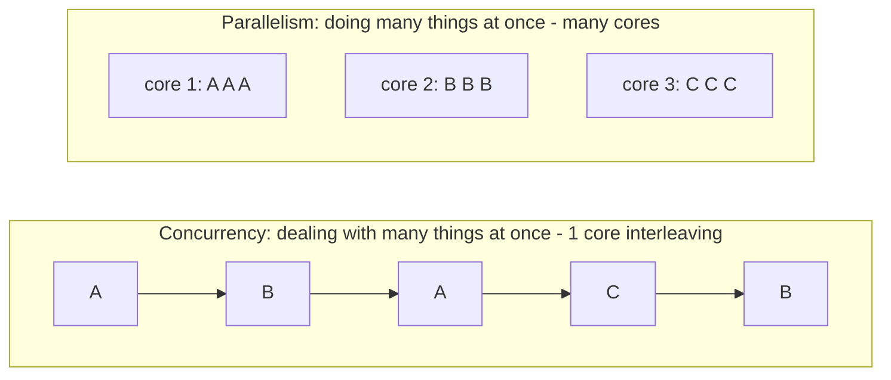
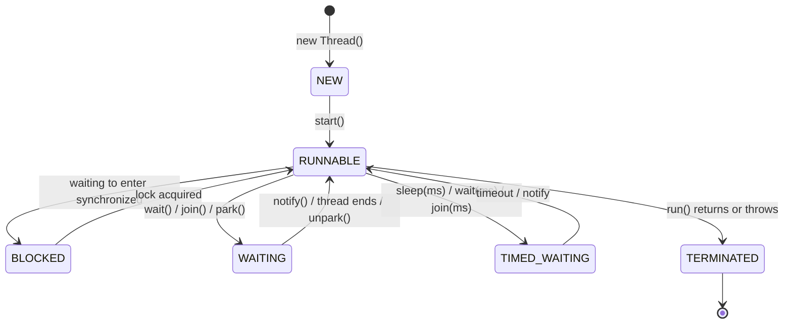
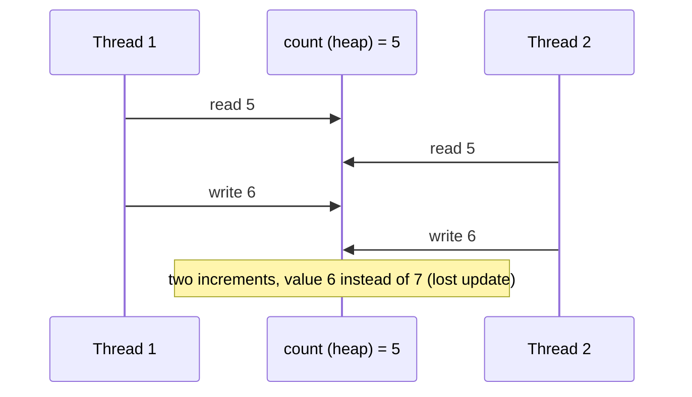
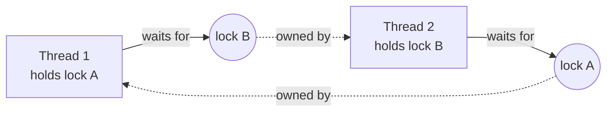
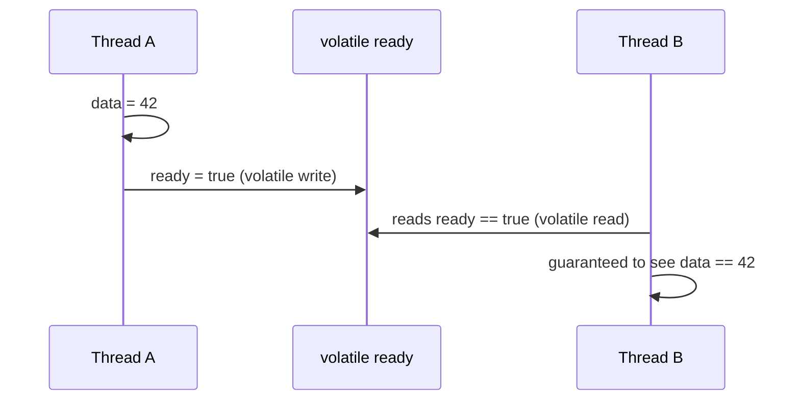
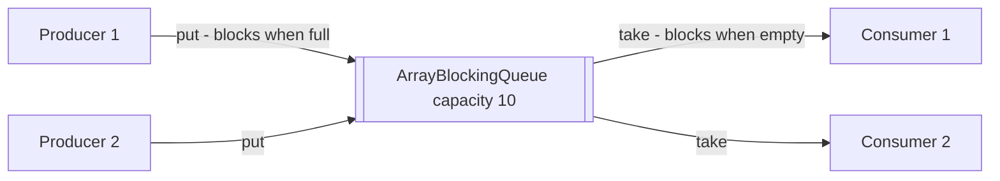
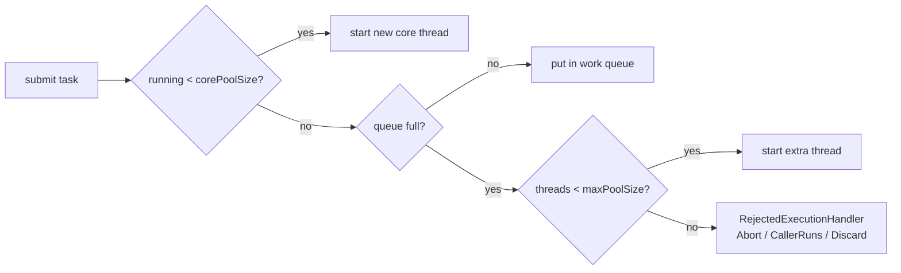
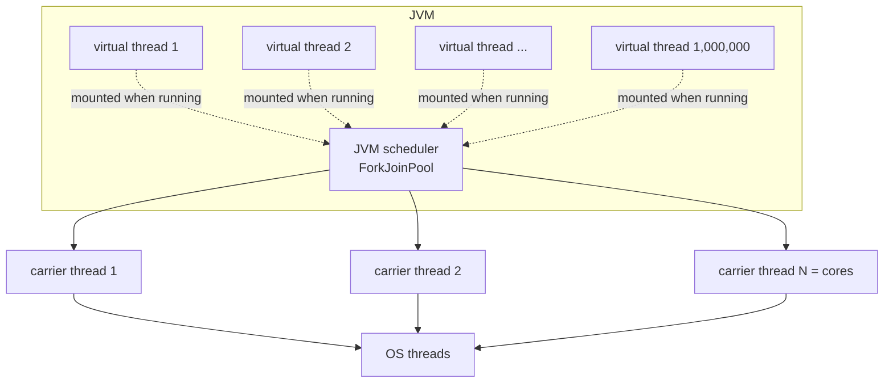

# 06.06 · Concurrency and multithreading

> Running work at the same time safely: threads and their lifecycle, race conditions, visibility and
> the Java Memory Model, `synchronized`/`volatile`, locks, atomics, concurrent collections,
> synchronizers, executors and thread pools, `CompletableFuture`, **virtual threads** (Java 21),
> structured concurrency and scoped values — with diagrams and the classic bugs reproduced.

---

## 1. Concurrency vs parallelism



* **Concurrency** = structure: many tasks in progress (e.g. a web server handling 1000 requests that mostly wait for
  the database).
* **Parallelism** = execution: tasks literally run simultaneously on several CPU cores (e.g. image processing).
* **CPU-bound** work benefits from ≈ number-of-cores threads; **I/O-bound** work benefits from many threads
  (→ virtual threads).

**Process vs thread**: a process has its own memory; threads inside a process **share the heap** (objects, static
fields) but each has its own **stack** (topic 02). Shared heap = fast communication, but also all the bugs below.

---

## 2. Threads

```java
Thread t1 = new Thread(() -> System.out.println("running in " + Thread.currentThread().getName()));
t1.start();                                  // start() creates a new thread; run() would just call the method!
t1.join();                                   // wait for it to finish

Thread vt = Thread.ofVirtual().start(task);  // virtual thread (Java 21)
Thread pt = Thread.ofPlatform().name("worker-", 0).start(task);
```

### Lifecycle



| Method | Meaning |
|--------|---------|
| `start()` | begin execution in a new thread (only once; second call → `IllegalThreadStateException`) |
| `join()` | wait for the thread to die |
| `sleep(ms)` | pause the current thread (keeps locks!) |
| `interrupt()` | politely ask a thread to stop: sets a flag; blocking calls throw `InterruptedException` |
| `setDaemon(true)` | JVM doesn't wait for daemon threads at exit |
| `yield()`, priorities | hints only, don't rely on them |

`Thread.stop()` was removed: stopping is **cooperative** via interruption.

---

## 3. What goes wrong

### 3.1 Race condition

`count++` is three operations: **read** → **add** → **write**. Two threads can interleave them:



**Check-then-act** races too: `if (!map.containsKey(k)) map.put(k, v);` → use `putIfAbsent`/`computeIfAbsent`.

### 3.2 Visibility

Each core has caches and the JIT/CPU may **reorder** or keep values in registers. Without synchronization, a thread
may **never see** another thread's write:

```java
boolean running = true;          // not volatile
// thread A: while (running) { }   ← may loop forever, the JIT can hoist the read out of the loop
// thread B: running = false;
```

### 3.3 Deadlock



Four conditions (Coffman): mutual exclusion, hold-and-wait, no preemption, circular wait. Break one: **always
acquire locks in the same global order**, use `tryLock` with timeout, or hold fewer locks.
Also: **livelock** (threads keep reacting to each other, no progress) and **starvation** (a thread never gets CPU/lock).

---

## 4. Java Memory Model (JMM) and happens-before

The JMM defines when a write by one thread is **guaranteed visible** to another. If action A *happens-before* B,
B sees A's effects.

| Rule | Happens-before |
|------|----------------|
| Program order | each action in a thread → later actions in the same thread |
| Monitor lock | `unlock` of a monitor → every later `lock` of the same monitor |
| `volatile` | a write to a volatile field → every later read of it |
| Thread start | `t.start()` → every action in `t` |
| Thread join | every action in `t` → `t.join()` returning |
| `final` fields | constructor finishing → any thread seeing the object (if `this` didn't escape) |
| Concurrency utilities | e.g. putting into a `BlockingQueue` → taking it out; `Future` completion → `get()` |



---

## 5. `synchronized`, `volatile`, `wait/notify`

```java
public synchronized void deposit(int x) { balance += x; }   // locks `this`
public static synchronized void inc() { ... }                // locks the Class object
synchronized (lock) { ... }                                  // locks any object (prefer a private final lock)
```

* Every object has an **intrinsic lock (monitor)**. `synchronized` gives **mutual exclusion + visibility**.
* Locks are **reentrant**: a thread holding a lock can enter another `synchronized` block on the same lock.
* `volatile` gives **visibility and ordering**, **not atomicity** (`volatile int x; x++` is still a race). Use it for
  flags and safe publication (e.g. double-checked locking singleton).
* `wait()` / `notifyAll()` must be called while holding the lock, **always in a loop** (spurious wake-ups):
  `while (!condition) lock.wait();`. In practice use `BlockingQueue`/`Condition` instead.

---

## 6. `java.util.concurrent` toolbox

### Locks (`java.util.concurrent.locks`)

| Lock | Extra powers vs `synchronized` |
|------|-------------------------------|
| `ReentrantLock` | `tryLock()`, `tryLock(timeout)`, interruptible locking, fairness, multiple `Condition`s |
| `ReentrantReadWriteLock` | many readers **or** one writer |
| `StampedLock` | optimistic reads (very fast for read-mostly data), not reentrant |

```java
lock.lock();
try { ... } finally { lock.unlock(); }     // ALWAYS unlock in finally
```

### Atomics (`java.util.concurrent.atomic`)

Lock-free using CPU **compare-and-swap (CAS)**: "set to new value only if it is still the expected value", retry otherwise.
`AtomicInteger/Long/Boolean/Reference` (`incrementAndGet`, `compareAndSet`, `updateAndGet`), `LongAdder` (faster
counter under high contention), `AtomicIntegerArray`.

### Concurrent collections
`ConcurrentHashMap` (atomic `compute`, `merge`, `computeIfAbsent`), `CopyOnWriteArrayList` (read-mostly listeners),
`ConcurrentLinkedQueue`, `ConcurrentSkipListMap`, and **`BlockingQueue`** for producer–consumer:



### Synchronizers

| Class | Purpose | Example |
|-------|---------|---------|
| `CountDownLatch` | wait until N events happened (one-shot) | main waits for 3 services to start |
| `CyclicBarrier` | N threads wait for each other, reusable | parallel simulation steps |
| `Semaphore` | limit concurrent access to N permits | max 5 calls to an external API |
| `Phaser` | flexible multi-phase barrier | dynamic number of parties |
| `Exchanger` | two threads swap objects | double buffering |

---

## 7. Executors and thread pools

Creating a platform thread is expensive (~1 MB stack, OS call). A **pool** reuses threads and queues tasks.



```java
ExecutorService pool = new ThreadPoolExecutor(
        4, 8,                                  // core, max threads
        60, TimeUnit.SECONDS,                  // idle extra threads die after 60s
        new ArrayBlockingQueue<>(100),         // BOUNDED queue
        new ThreadPoolExecutor.CallerRunsPolicy());   // back-pressure when saturated
Future<Integer> f = pool.submit(() -> compute());     // Callable → Future
Integer result = f.get(2, TimeUnit.SECONDS);
pool.shutdown();                                      // or try-with-resources (ExecutorService is AutoCloseable since 19)
```

| Factory | Notes |
|---------|-------|
| `Executors.newFixedThreadPool(n)` | **unbounded** queue → can run out of memory under load |
| `Executors.newCachedThreadPool()` | unbounded threads → can create thousands |
| `Executors.newSingleThreadExecutor()` | sequential background work |
| `Executors.newScheduledThreadPool(n)` | delays and periodic tasks |
| `Executors.newVirtualThreadPerTaskExecutor()` | one virtual thread per task (Java 21) |
| `ForkJoinPool.commonPool()` | work-stealing pool used by parallel streams & `CompletableFuture` defaults |

Sizing: CPU-bound ≈ `cores`; I/O-bound ≈ `cores × (1 + wait time / compute time)` — or just use virtual threads.

---

## 8. `CompletableFuture` — composing async work

```java
CompletableFuture<User> user = CompletableFuture.supplyAsync(() -> userService.load(id), pool);
CompletableFuture<List<Order>> orders = CompletableFuture.supplyAsync(() -> orderService.load(id), pool);

CompletableFuture<Dashboard> dashboard = user
        .thenCombine(orders, Dashboard::new)                 // both in parallel, then combine
        .thenApply(Dashboard::withTotals)                    // transform (like map)
        .orTimeout(2, TimeUnit.SECONDS)
        .exceptionally(ex -> Dashboard.empty());             // fallback on any failure
```

| Method | Like |
|--------|------|
| `thenApply(f)` | `map` |
| `thenCompose(f)` | `flatMap` (f returns another `CompletableFuture`) |
| `thenCombine(other, f)` | zip two futures |
| `thenAccept`, `thenRun` | consume / run after |
| `allOf(...)`, `anyOf(...)` | wait for all / first |
| `exceptionally`, `handle`, `whenComplete` | error handling |
| `orTimeout`, `completeOnTimeout` | timeouts (Java 9) |
| `join()` vs `get()` | `join` throws unchecked `CompletionException` |

Always pass your own executor for blocking work; the default common pool is sized for CPU work.

---

## 9. Virtual threads (Java 21)



* A virtual thread is a cheap Java object (a few KB, stack on the heap). When it **blocks** on I/O, `sleep`, a lock or
  a queue, it is **unmounted** and the carrier thread runs another virtual thread.
* Result: you can write simple **blocking, thread-per-request** code and still handle hundreds of thousands of
  concurrent requests — without reactive programming.
* Best for **I/O-bound** work (HTTP calls, DB queries). No benefit for CPU-bound work.
* **Don't pool** virtual threads (create one per task). Limit access to scarce resources with a `Semaphore` or a
  connection pool instead.
* Be careful with big `ThreadLocal` values (a million threads × your cache).
* *Pinning*: before Java 24, blocking inside `synchronized` pinned the carrier thread; JEP 491 (Java 24) fixed this.
* Spring Boot: `spring.threads.virtual.enabled=true` runs Tomcat request handling on virtual threads.

### Structured concurrency (preview) and scoped values (final in Java 25)

* **Structured concurrency** (`StructuredTaskScope`): subtasks forked inside a scope must finish before the scope
  closes; if one fails the others are cancelled → no leaked threads. Still in preview in Java 27.
* **Scoped values** (`ScopedValue`): immutable, inheritable per-request context — a safer, cheaper alternative to
  `ThreadLocal` with virtual threads.

---

## 10. Best practices

1. Prefer **immutability** and **confinement** (don't share) over locking.
2. Use high-level tools (`ExecutorService`, `ConcurrentHashMap`, `BlockingQueue`, `CompletableFuture`) over
   `wait/notify` and raw threads.
3. Keep critical sections small; never call unknown code (callbacks) while holding a lock.
4. Acquire multiple locks in a consistent order.
5. Always `unlock()` in `finally`; always `shutdown()` executors.
6. Bounded queues + rejection policies = back-pressure.
7. Restore the interrupt flag; make long tasks check `Thread.currentThread().isInterrupted()`.
8. Use virtual threads for I/O-bound concurrency on Java 21+.
9. Test concurrency with stress loops, `jcstress`, and **Awaitility** for async assertions; diagnose with thread dumps
   (`jstack`, `jcmd <pid> Thread.print`) — they show deadlocks automatically.

---

## 11. Packages / libraries and why

| Package / library | Why |
|-------------------|-----|
| `java.lang.Thread`, `Runnable` | basic threads, virtual threads (`Thread.ofVirtual()`) |
| `java.util.concurrent` | executors, futures, `CompletableFuture`, concurrent collections, synchronizers |
| `java.util.concurrent.atomic` | lock-free counters and references |
| `java.util.concurrent.locks` | `ReentrantLock`, `ReadWriteLock`, `StampedLock`, `Condition` |
| Spring `@Async`, `@Scheduled`, `TaskExecutor` | async methods and cron jobs in Spring apps |
| Project Reactor / RxJava | reactive, non-blocking streams (Spring WebFlux) |
| Resilience4j | bulkheads, rate limiters, timeouts around concurrent calls (topic 26) |
| Awaitility, jcstress | testing asynchronous / concurrent code |

---

## 12. Practical

```bash
java topics/06-advanced-java/06-concurrency/practical/ThreadsBasics.java
java topics/06-advanced-java/06-concurrency/practical/RaceConditionsAndLocks.java
java topics/06-advanced-java/06-concurrency/practical/ExecutorsAndFutures.java
java topics/06-advanced-java/06-concurrency/practical/VirtualThreadsDemo.java
```

## 13. Interview questions

1. Process vs thread? What do threads share?
2. `start()` vs `run()`? `sleep()` vs `wait()`?
3. What is a race condition? Why is `count++` not thread-safe? How do you fix it (3 ways)?
4. `synchronized` vs `volatile` vs `AtomicInteger`?
5. What is happens-before? Give three rules.
6. How does a deadlock happen and how do you prevent it?
7. Explain the parameters of `ThreadPoolExecutor`. Why is `newFixedThreadPool` risky?
8. `Future` vs `CompletableFuture`? `thenApply` vs `thenCompose`?
9. What are virtual threads? When do they help and when don't they?
10. How does `ConcurrentHashMap` differ from `Collections.synchronizedMap`?

## Exercises

- [ ] Simulate a bank with 10 threads doing 1000 random transfers between 5 accounts; prove the total stays constant (and break it without locking).
- [ ] Implement a bounded producer–consumer with `ArrayBlockingQueue` and a "poison pill" to stop consumers.
- [ ] Download 20 URLs concurrently with `HttpClient.sendAsync` + `CompletableFuture.allOf`; then with virtual threads.
- [ ] Use a `Semaphore` to allow at most 3 concurrent "API calls" among 20 tasks and print the max concurrency observed.
- [ ] Create a deadlock on purpose, take a thread dump with `jcmd <pid> Thread.print`, find the "Found one Java-level deadlock" section.
