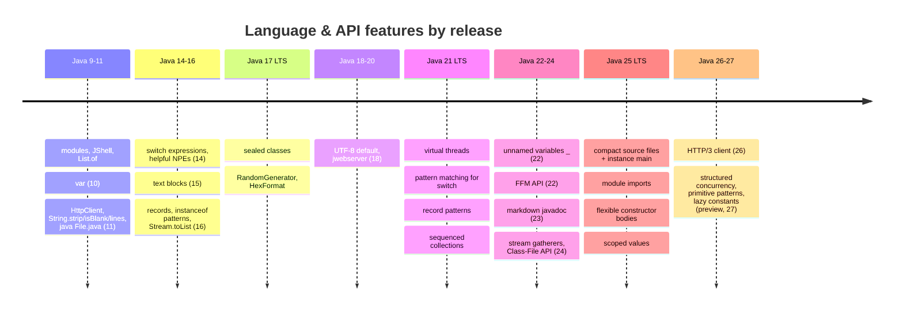

# 06.07 · Modern Java (Java 9 → 27)

> The features added since Java 8 that make today's Java concise and safe: `var`, text blocks,
> switch expressions, records, sealed types, pattern matching, sequenced collections, virtual threads,
> unnamed variables, compact source files, module imports, flexible constructors, scoped values,
> gatherers — each with the **before/after** code and its JEP. Plus a Java 8 → 21/25 migration checklist.

---

## 1. Feature map



| Feature | JEP | Final in | Status in Java 27 |
|---------|-----|----------|-------------------|
| `var` local variable type inference | 286 | 10 | ✅ |
| Switch expressions | 361 | 14 | ✅ |
| Helpful `NullPointerException`s | 358 | 14 | ✅ |
| Text blocks | 378 | 15 | ✅ |
| Records | 395 | 16 | ✅ |
| Pattern matching for `instanceof` | 394 | 16 | ✅ |
| Sealed classes | 409 | 17 | ✅ |
| Enhanced random generators | 356 | 17 | ✅ |
| UTF-8 by default | 400 | 18 | ✅ |
| Simple web server `jwebserver` | 408 | 18 | ✅ |
| Record patterns | 440 | 21 | ✅ |
| Pattern matching for `switch` | 441 | 21 | ✅ |
| Sequenced collections | 431 | 21 | ✅ |
| Virtual threads | 444 | 21 | ✅ |
| String templates | 430/459/465 | – | ❌ **withdrawn** (removed in 23) |
| Unnamed variables & patterns `_` | 456 | 22 | ✅ |
| Foreign Function & Memory API | 454 | 22 | ✅ |
| Launch multi-file source programs | 458 | 22 | ✅ |
| Markdown documentation comments | 467 | 23 | ✅ |
| Stream gatherers | 485 | 24 | ✅ |
| Class-File API | 484 | 24 | ✅ |
| Virtual threads without `synchronized` pinning | 491 | 24 | ✅ |
| Compact source files & instance `main` | 512 | 25 | ✅ |
| Module import declarations | 511 | 25 | ✅ |
| Flexible constructor bodies | 513 | 25 | ✅ |
| Scoped values | 506 | 25 | ✅ |
| Compact object headers | 519 → 534 | 25 (opt-in) | ✅ on by default in 27 |
| Primitive types in patterns | 455 → 532 | – | 🧪 preview |
| Structured concurrency | 453 → 533 | – | 🧪 preview |
| Lazy constants (was "stable values") | 502 → 531 | – | 🧪 preview |

---

## 2. Before / after

### `var` (Java 10)
```java
Map<String, List<Employee>> byDept = new HashMap<String, List<Employee>>();   // before
var byDept = new HashMap<String, List<Employee>>();                          // after
```
Only for local variables with an initializer. Use it when the type is obvious from the right-hand side.

### Text blocks (Java 15)
```java
String sql = "SELECT id, name\n" +
             "FROM employee\n" +
             "WHERE dept = ?\n";                       // before

String sql = """
        SELECT id, name
        FROM employee
        WHERE dept = ?
        """;                                          // after: indentation stripped automatically
```
Escapes: `\` at end of line = no newline, `\s` = keep a trailing space.

### Switch expressions (Java 14)
```java
int days;                                             // before
switch (month) {
    case FEBRUARY: days = 28; break;
    case APRIL: case JUNE: case SEPTEMBER: case NOVEMBER: days = 30; break;
    default: days = 31;
}

int days = switch (month) {                           // after: no fall-through, exhaustive, returns a value
    case FEBRUARY -> 28;
    case APRIL, JUNE, SEPTEMBER, NOVEMBER -> 30;
    default -> 31;
};
```

### Records (Java 16)
```java
// before: ~50 lines of fields, constructor, getters, equals, hashCode, toString (or Lombok)
public record Point(int x, int y) { }                 // after
```

### Pattern matching for `instanceof` (Java 16)
```java
if (obj instanceof String) { String s = (String) obj; use(s); }   // before
if (obj instanceof String s && !s.isBlank()) { use(s); }           // after
```

### Sealed types + switch patterns + record patterns (Java 17 / 21)
```java
sealed interface Shape permits Circle, Rect, Square { }
record Circle(double r) implements Shape { }
record Rect(double w, double h) implements Shape { }
record Square(double side) implements Shape { }

double area(Shape s) {
    return switch (s) {                                // exhaustive: the compiler knows every subtype
        case Circle(double r) -> Math.PI * r * r;      // record pattern deconstructs
        case Rect(double w, double h) when w == h -> w * w;   // guard
        case Rect(double w, double h) -> w * h;
        case Square(var side) -> side * side;
    };
}
```
This is **data-oriented programming**: model data as sealed records, operate on it with pattern matching. Adding a new
`Shape` makes every non-exhaustive `switch` a compile error — the compiler finds what you must update.

### Sequenced collections (Java 21)
```java
list.get(list.size() - 1);                            // before
list.getLast();                                       // after
// also: getFirst, addFirst, addLast, removeFirst, removeLast, reversed()
// LinkedHashMap: firstEntry(), lastEntry(), pollFirstEntry(), sequencedKeySet()
```

### Unnamed variables `_` (Java 22)
```java
try { ... } catch (NumberFormatException _) { return 0; }
for (var _ : list) count++;
map.forEach((_, value) -> total += value);
case Rect(double w, _) -> w;                          // ignore components in patterns
```

### Compact source files and instance `main` (Java 25)
```java
// Hello.java - no class declaration, no static, no String[] args
void main() {
    String name = IO.readln("Your name: ");
    IO.println("Hello " + name);
}
```

### Module import declarations (Java 25)
```java
import module java.base;         // imports every exported package of java.base: List, Map, Path, Stream...
```

### Flexible constructor bodies (Java 25)
```java
class Employee extends Person {
    Employee(String name, int age) {
        if (age < 18) throw new IllegalArgumentException("too young");   // allowed BEFORE super() now
        super(name);
    }
}
```

### Scoped values (Java 25)
```java
static final ScopedValue<User> CURRENT_USER = ScopedValue.newInstance();
ScopedValue.where(CURRENT_USER, user).run(() -> handleRequest());   // readable anywhere inside, immutable
```

### Smaller API additions worth knowing
| Since | API |
|-------|-----|
| 9 | `List.of`, `Optional.or/stream/ifPresentOrElse`, `Stream.takeWhile/dropWhile/iterate(seed, hasNext, next)`, `InputStream.transferTo` |
| 11 | `String.isBlank/strip/lines/repeat`, `Files.readString/writeString`, `HttpClient`, `Predicate.not` |
| 12 | `Collectors.teeing`, `String.indent/transform` |
| 16 | `Stream.toList()`, `Stream.mapMulti` |
| 17 | `HexFormat`, `RandomGenerator` |
| 19 | `HashMap.newHashMap(n)`, `ExecutorService` is `AutoCloseable` |
| 21 | `StringBuilder.repeat`, `String.indexOf(ch, from, to)`, `String.splitWithDelimiters`, `Math.clamp`, `Character.isEmoji` |
| 26 | HTTP/3 support in `HttpClient` |

---

## 3. Migrating Java 8 → 17/21/25 (checklist)

| Problem | Fix |
|---------|-----|
| `javax.xml.bind`, `javax.annotation`, JAX-WS, CORBA removed from the JDK (Java 11) | add Jakarta dependencies (`jakarta.xml.bind-api`...) |
| Libraries using JDK internals (`sun.misc.*`, illegal reflective access) fail since 16/17 | upgrade the library; temporary `--add-opens` |
| Spring Boot 2 → 3/4 | **`javax.*` → `jakarta.*`** imports, Java 17+ baseline |
| Old build plugins | update Maven compiler/surefire plugins, set `<maven.compiler.release>` |
| Security Manager | disabled since Java 24 — remove usages |
| `finalize()` | deprecated for removal — use `try-with-resources`/`Cleaner` |
| Applet API | removed in Java 26 |
| Behaviour change | default charset UTF-8 (18) — check code that relied on the OS charset |

Tools: **OpenRewrite** recipes (`UpgradeToJava21`), `jdeps --jdk-internals`, `jdeprscan`.

---

## 4. Packages and why

| API | Why |
|-----|-----|
| `java.lang.Record`, sealed/permits | data modelling with compiler-checked exhaustiveness |
| `java.util.SequencedCollection/SequencedMap` | uniform first/last/reversed access |
| `java.lang.Thread.ofVirtual()`, `Executors.newVirtualThreadPerTaskExecutor()` | scalable blocking concurrency |
| `java.lang.ScopedValue` | per-request context with virtual threads |
| `java.util.stream.Gatherers` | custom/windowed stream operations |
| `java.lang.foreign` | call native C libraries without JNI |
| `java.lang.classfile` | read/generate bytecode (frameworks, agents) |

---

## 5. Practical

```bash
java topics/06-advanced-java/07-modern-java/practical/ModernJava21.java
```

(Java 22–25 features are shown above as code; install JDK 25 to try them — this repository targets Java 21.)

## 6. Interview questions

1. What problems do records solve? What are their limitations?
2. What are sealed classes for? How do they work with `switch`?
3. Explain record patterns and guards (`when`) with an example.
4. What changed in `switch` between Java 8 and 21?
5. What are virtual threads and which JEP made them final?
6. Name three things you must change when migrating from Spring Boot 2 / Java 8 to Spring Boot 4 / Java 21.

## Exercises

- [ ] Rewrite a Java 8 style class (POJO + instanceof chains + classic switch) using records, sealed types and pattern matching.
- [ ] Model a JSON value (`JsonNull`, `JsonBool`, `JsonNumber`, `JsonString`, `JsonArray`, `JsonObject`) as a sealed hierarchy and write a `toJson` with a pattern switch.
- [ ] Use `Collectors.teeing` to compute min and max salary in one pass.
- [ ] Install JDK 25 and convert `ModernJava21.java` into a compact source file with `void main()` and `import module java.base;`.
