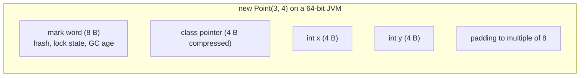
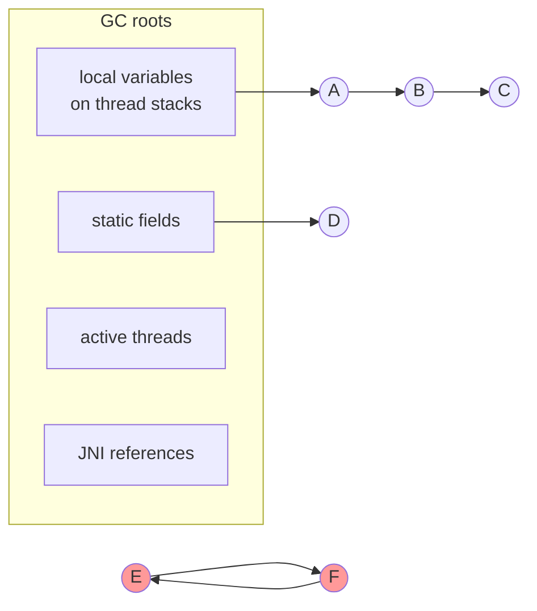
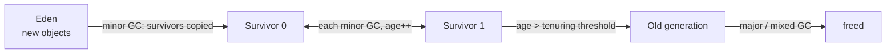
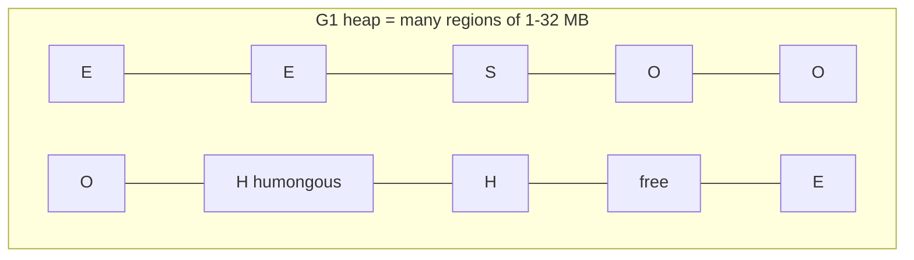
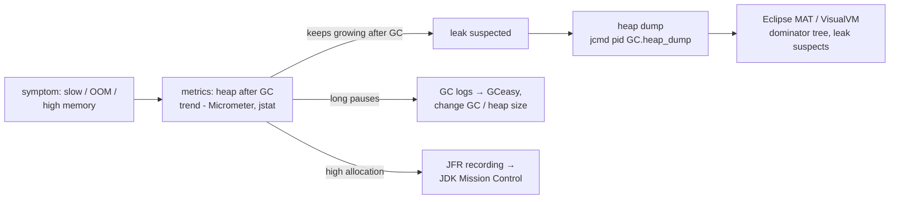

# 06.08 · JVM memory management and garbage collection

> What lives where in memory, how an object is laid out, how the garbage collector decides what is
> garbage, how the main collectors (Serial, Parallel, G1, ZGC, Shenandoah) work, reference types,
> memory leaks in a garbage-collected language, `OutOfMemoryError` types, JVM flags for containers,
> and the tools to diagnose memory problems in production.
> Start with the memory-area overview in [topic 02](../../02-compilation-and-jvm/README.md#5-stage-4-runtime-data-areas-jvm-memory).

---

## 1. Object layout



* Every object has a **header** (12 bytes typically; **8 bytes with compact object headers**, JEP 519 in Java 25,
  on by default since Java 27) + fields + padding to 8 bytes.
* `new Integer(5)` ≈ 16 bytes vs `int` 4 bytes → why primitive arrays and `IntStream` matter for big data.
* References are 4 bytes with **compressed oops** (heaps < 32 GB).

---

## 2. What is garbage? Reachability from GC roots



An object is **live** if a chain of references leads to it from a GC root. `E` and `F` reference each other but are
**unreachable**, so both are garbage (cycles are not a problem, unlike reference counting).

### Basic algorithms

| Algorithm | How | Pros / cons |
|-----------|-----|-------------|
| **Mark–sweep** | mark live objects, free the rest | fragmentation |
| **Mark–compact** | mark, then slide live objects together | no fragmentation, moves objects |
| **Copying** | copy live objects into an empty space | fast when few survive (young gen), needs 2× space |
| **Generational** | young objects collected often (copying), old ones rarely | exploits "most objects die young" |
| **Concurrent** | marking/relocation while the app runs (barriers) | short pauses, some CPU overhead |



**Stop-the-world (STW) pause** = all application threads stopped while the GC works. The goal of modern GCs is to
make pauses short and independent of heap size.

---

## 3. The collectors

The trade-off triangle: **throughput** (work done per CPU) ↔ **latency** (pause time) ↔ **footprint** (memory).

| GC | Flag | Design | Pauses | Use for |
|----|------|--------|--------|---------|
| Serial | `-XX:+UseSerialGC` | single thread, generational | long | tiny heaps, 1-CPU containers, CLIs |
| Parallel | `-XX:+UseParallelGC` | multi-thread, generational, STW | medium | batch jobs where throughput matters |
| **G1** (default) | `-XX:+UseG1GC` | heap split into equal **regions**; collects the regions with most garbage first; pause-time goal `-XX:MaxGCPauseMillis=200` | ~10–200 ms | general-purpose servers |
| **ZGC** | `-XX:+UseZGC` | concurrent, region-based, colored pointers + load barriers; generational by default since 23 | **< 1 ms**, independent of heap size (up to TBs) | low-latency services, huge heaps |
| Shenandoah | `-XX:+UseShenandoahGC` | concurrent compaction (Brooks/forwarding pointers) | < 10 ms | low latency (Red Hat, Corretto, Temurin builds) |
| Epsilon | `-XX:+UseEpsilonGC` | allocates, never collects | none | benchmarks, very short-lived jobs |



Since JDK 27, G1 is the default on every machine size (previously small machines got Serial).

---

## 4. Reference types (`java.lang.ref`)

| Type | Collected when | Use |
|------|----------------|-----|
| **Strong** (`Object o = ...`) | never while reachable | normal code |
| **Soft** `SoftReference` | memory is low (before OOM) | memory-sensitive caches (prefer Caffeine) |
| **Weak** `WeakReference` | next GC if only weakly reachable | `WeakHashMap` (metadata keyed by objects), listeners |
| **Phantom** `PhantomReference` | after finalization, `get()` always null | post-mortem cleanup → use **`Cleaner`** |

---

## 5. Memory leaks in Java

A leak = objects that are **still reachable** but will never be used again, so the GC can't free them.

| Leak | Example | Fix |
|------|---------|-----|
| Growing static collection | `static List<Order> CACHE` never cleared | bounded cache (Caffeine) with eviction/TTL |
| Unclosed resources | `Connection`, `InputStream` not closed | try-with-resources |
| Listeners / callbacks | registered, never removed | remove them; weak references |
| `ThreadLocal` in thread pools | pool threads live forever and keep the value | `remove()` in `finally`; scoped values |
| Inner class holding outer | anonymous listener keeps a big Activity/View | static nested classes |
| Wrong `equals/hashCode` keys | duplicates accumulate in a `HashMap` | correct keys (topic 05) |
| ClassLoader leaks | redeploying webapps in Tomcat | avoid static references across loaders |

### `OutOfMemoryError` variants

| Message | Meaning |
|---------|---------|
| `Java heap space` | heap full of live objects (leak or heap too small) |
| `GC overhead limit exceeded` | > 98% time in GC recovering < 2% (Parallel GC) |
| `Metaspace` | too many classes loaded (dynamic proxies, classloader leak) |
| `unable to create native thread` | too many platform threads / OS limits → virtual threads |
| `Direct buffer memory` | off-heap NIO buffers (`-XX:MaxDirectMemorySize`) |
| `Requested array size exceeds VM limit` | array larger than the JVM can allocate |

---

## 6. JVM flags you'll actually use

```bash
java -Xms512m -Xmx512m \                         # initial = max heap: no resizing pauses
     -XX:+UseG1GC -XX:MaxGCPauseMillis=100 \
     -XX:+HeapDumpOnOutOfMemoryError -XX:HeapDumpPath=/dumps \
     -Xlog:gc*:file=gc.log:time,uptime,level,tags \
     -jar app.jar

# in containers (Docker/Kubernetes) size the heap relative to the container memory limit:
java -XX:MaxRAMPercentage=75.0 -jar app.jar
```

The JVM is **container-aware** (reads cgroup CPU/memory limits). Leave room for metaspace, thread stacks, code cache
and direct buffers: heap ≈ 50–75% of the container limit.

Reading a GC log line (G1):
```
[2.345s][info][gc] GC(12) Pause Young (Normal) (G1 Evacuation Pause) 220M->45M(512M) 8.123ms
                    #12  type of pause                                 before->after(heap)  pause time
```

---

## 7. Diagnosing memory problems



| Tool | Use |
|------|-----|
| `jcmd <pid> GC.heap_info` / `GC.class_histogram` / `GC.heap_dump file.hprof` | swiss-army knife |
| `jstat -gcutil <pid> 1000` | GC statistics every second |
| `jmap -histo:live <pid>` | objects per class |
| **JDK Flight Recorder** (`-XX:StartFlightRecording`) + **JDK Mission Control** | low-overhead production profiling: allocations, GC, locks, hot methods |
| **Eclipse MAT**, VisualVM | analyse heap dumps |
| async-profiler | CPU/allocation flame graphs |
| Micrometer + Prometheus/Grafana (topic 27) | JVM memory/GC metrics over time |

---

## 8. Packages / libraries and why

| Package / tool | Why |
|----------------|-----|
| `java.lang.ref` | soft/weak/phantom references, `Cleaner` |
| `java.lang.management` | `MemoryMXBean`, `GarbageCollectorMXBean`, `MemoryPoolMXBean` — read memory/GC stats in code |
| `jdk.jfr` | create custom Flight Recorder events |
| **Caffeine** | bounded, high-performance caches instead of leaking maps |
| **Micrometer** | export JVM metrics (Spring Boot Actuator) |

---

## 9. Practical

```bash
java topics/06-advanced-java/08-jvm-memory-gc/practical/GcAndReferences.java
java -Xlog:gc topics/06-advanced-java/08-jvm-memory-gc/practical/GcAndReferences.java     # see every GC
java -XX:+UseZGC -Xlog:gc topics/06-advanced-java/08-jvm-memory-gc/practical/GcAndReferences.java
java -Xmx64m topics/06-advanced-java/08-jvm-memory-gc/practical/MemoryLeakDemo.java
```

## 10. Interview questions

1. How does the GC decide an object is garbage? What are GC roots?
2. Why are generational collectors efficient?
3. G1 vs ZGC vs Parallel: when would you choose each?
4. Can Java have memory leaks? Give three examples.
5. Strong vs soft vs weak vs phantom references?
6. How would you investigate an `OutOfMemoryError` in production?
7. How do you size the JVM heap in a Docker container?

## Exercises

- [ ] Run `GcAndReferences.java` with `-Xlog:gc` under Serial, Parallel, G1 and ZGC; compare pause times.
- [ ] Run `MemoryLeakDemo.java` with `-XX:+HeapDumpOnOutOfMemoryError`, open the `.hprof` in Eclipse MAT and find the leaking list.
- [ ] Record 30 s of a running app with JFR (`jcmd <pid> JFR.start duration=30s filename=rec.jfr`) and open it in JDK Mission Control.
