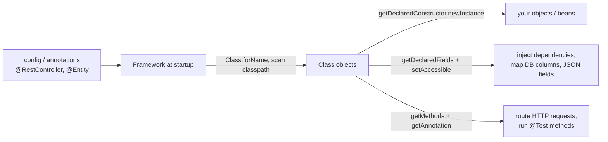
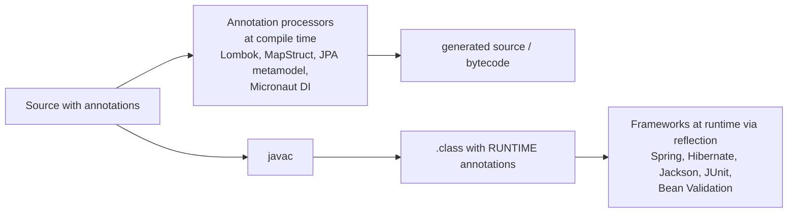
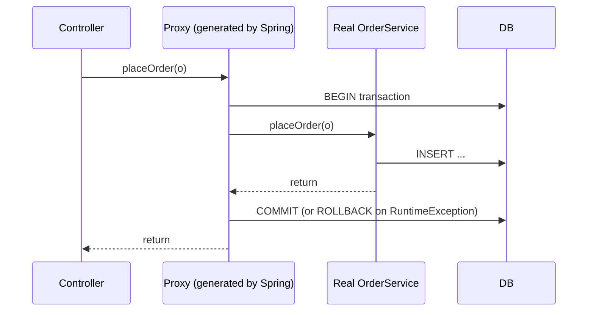
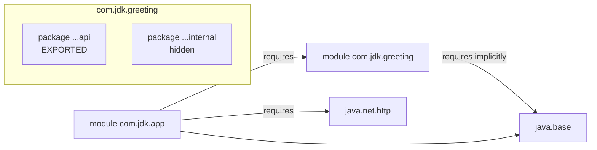

# 06.09 · Reflection, annotations, dynamic proxies and modules

> The "magic" behind Spring, Hibernate, Jackson and JUnit: inspecting and calling code at runtime
> (reflection, method handles), defining and processing annotations, generating proxies that wrap
> your objects (`@Transactional`, `@Cacheable`), and the Java Platform Module System (JPMS).
> After this topic, frameworks stop being magic.

---

## 1. Reflection

Reflection lets a program **inspect and use classes it didn't know at compile time**.

```java
Class<?> c1 = Employee.class;                       // from a type
Class<?> c2 = employee.getClass();                  // from an object
Class<?> c3 = Class.forName("com.shop.Employee");   // from a name (loads + initialises the class)
```

| You can... | API |
|------------|-----|
| list fields / methods / constructors | `getDeclaredFields()`, `getDeclaredMethods()`, `getDeclaredConstructors()` (all, incl. private) vs `getFields()`... (public, incl. inherited) |
| read modifiers | `Modifier.isPrivate(field.getModifiers())` |
| create objects | `c.getDeclaredConstructor(String.class).newInstance("Ali")` |
| call methods | `method.invoke(target, args...)` |
| read/write fields, even private | `field.setAccessible(true); field.get(obj); field.set(obj, v)` |
| read annotations | `method.getAnnotation(Route.class)` |
| read generic signatures | `field.getGenericType()` → `ParameterizedType` |
| inspect records | `c.getRecordComponents()` |
| inspect sealed types | `c.getPermittedSubclasses()` |



**Costs and limits**
* Slower than direct calls (checks, boxing, no inlining at first) — frameworks cache `Method` objects or use
  **`MethodHandle`s** (`java.lang.invoke`), which the JIT can optimise like normal calls.
* Breaks encapsulation and compile-time checking (typos become runtime errors).
* **Strong encapsulation** (Java 16/17): you can't `setAccessible` into JDK internals or into packages a module
  doesn't `open` → `InaccessibleObjectException`.
* GraalVM native images need reflection configuration (closed world).

---

## 2. Annotations

An annotation is **metadata** attached to code. It does nothing by itself — some tool must read it: the compiler,
an annotation processor at build time, or a framework at runtime via reflection.

### Built-in
| Annotation | Purpose |
|------------|---------|
| `@Override` | compiler checks you really override |
| `@Deprecated(since = "2", forRemoval = true)` | warns users |
| `@SuppressWarnings("unchecked")` | silence a specific warning |
| `@FunctionalInterface` | compiler checks a single abstract method |
| `@SafeVarargs` | promise a generic varargs method is safe |

### Meta-annotations (annotations on annotations)

| Meta-annotation | Values |
|-----------------|--------|
| `@Retention` | `SOURCE` (discarded by javac, e.g. Lombok), `CLASS` (in bytecode, not visible at runtime — default), **`RUNTIME`** (readable by reflection — what frameworks need) |
| `@Target` | `TYPE`, `METHOD`, `FIELD`, `PARAMETER`, `CONSTRUCTOR`, `RECORD_COMPONENT`, `TYPE_USE`... |
| `@Inherited` | subclasses inherit a class-level annotation |
| `@Documented` | shown in Javadoc |
| `@Repeatable` | can be applied multiple times |

### Custom annotation

```java
@Retention(RetentionPolicy.RUNTIME)
@Target(ElementType.FIELD)
public @interface Range {
    int min() default 0;            // elements look like methods; allowed types: primitives, String, Class, enums, annotations, arrays of those
    int max();
    String message() default "out of range";
}

public record Product(@Range(min = 1, max = 1000) int price) { }
```

### Where annotations are processed



Compile-time processing (Micronaut, Quarkus, Dagger) = faster startup, errors at build time. Runtime processing
(Spring classic) = more dynamic, slower startup.

---

## 3. Dynamic proxies — how `@Transactional` works

A **proxy** is an object that implements the same interface (or extends the same class) as the real object and
**intercepts** every call to add behaviour before/after: transactions, caching, security, logging, retries.



| Proxy technology | Works on | Used by |
|------------------|----------|---------|
| `java.lang.reflect.Proxy` (JDK) | **interfaces** only | Spring (when beans have interfaces), MyBatis mappers, Spring Data repositories, Feign |
| CGLIB / **ByteBuddy** (subclassing at runtime) | **classes** (not `final`, not `final`/`private` methods) | Spring (default for classes), Hibernate lazy-loading proxies, Mockito mocks |

### The famous corner cases (all caused by proxies)

* **Self-invocation**: calling `this.otherMethod()` inside the bean **bypasses the proxy** → `@Transactional`,
  `@Cacheable`, `@Async` on `otherMethod` are ignored.
* `@Transactional` on `private` or `final` methods does nothing (a subclass proxy can't override them).
* `final` classes can't be subclass-proxied (Kotlin classes are final by default → `kotlin-spring` plugin).
* Hibernate lazy proxies: `entity.getClass()` may be `Order$HibernateProxy$abc` → use `instanceof` in `equals`.
* Checked exceptions don't trigger a rollback by default (`rollbackFor = Exception.class`).

---

## 4. Java Platform Module System (JPMS, Java 9)

A **module** is a named group of packages with an explicit description of what it **needs** and what it
**exposes**: `module-info.java` at the root of the sources.

```java
module com.jdk.app {
    requires com.jdk.greeting;          // dependency
    requires java.net.http;             // JDK modules too (java.base is implicit)
}

module com.jdk.greeting {
    exports com.jdk.greeting.api;       // only this package is visible to other modules
    // com.jdk.greeting.internal stays hidden, even if its classes are public!
    opens com.jdk.greeting.model to com.fasterxml.jackson.databind;   // allow deep reflection
    provides com.jdk.greeting.api.Greeter with com.jdk.greeting.internal.ArabicGreeter;   // service
}
```



| Directive | Meaning |
|-----------|---------|
| `requires X` | this module depends on X |
| `requires transitive X` | my users automatically read X too |
| `requires static X` | needed at compile time only (optional at runtime) |
| `exports p` | public types of package `p` are accessible |
| `exports p to M` | qualified export, only to module M |
| `opens p` | allow **deep reflection** (private members) at runtime — frameworks need this |
| `uses S` / `provides S with Impl` | service loader (plugin) mechanism |

Benefits: **reliable configuration** (missing modules fail at startup, not at runtime), **strong encapsulation**,
smaller runtimes with **`jlink`**. Reality check: the JDK itself is fully modular, but most Spring Boot applications
still run on the **classpath** (the "unnamed module"); libraries publish `Automatic-Module-Name` for compatibility.

### `ServiceLoader` (SPI)
`ServiceLoader.load(Greeter.class)` finds implementations declared with `provides` (modules) or in
`META-INF/services/<interface name>` (classpath). It's how JDBC drivers, logging back-ends and many plugins are found.

---

## 5. Packages / libraries and why

| Package / library | Why |
|-------------------|-----|
| `java.lang.reflect` | `Class`, `Field`, `Method`, `Constructor`, `Proxy`, `Modifier`, `ParameterizedType` |
| `java.lang.annotation` | `@Retention`, `@Target`, `Annotation` |
| `java.lang.invoke` | `MethodHandles`, `VarHandle` — fast, JIT-friendly reflection |
| `java.util.ServiceLoader` | plugin/SPI discovery |
| `javax.annotation.processing` | write compile-time annotation processors |
| **ByteBuddy**, CGLIB | generate classes/proxies at runtime (Mockito, Hibernate, Spring) |
| **ClassGraph** / Reflections | scan the classpath for annotated classes |
| **Lombok**, **MapStruct** | annotation processors that generate code |
| Jakarta Bean Validation (Hibernate Validator) | real-world runtime annotation processing (`@NotBlank`, `@Email`) |

---

## 6. Practical

```bash
java topics/06-advanced-java/09-reflection-annotations-modules/practical/ReflectionDemo.java
java topics/06-advanced-java/09-reflection-annotations-modules/practical/AnnotationsDemo.java
java topics/06-advanced-java/09-reflection-annotations-modules/practical/ProxyDemo.java
```

Modules (run from `practical/modules-demo`):

```bash
javac -d out --module-source-path src $(find src -name "*.java")          # bash
java --module-path out --module com.jdk.app/com.jdk.app.Main
jlink --module-path out --add-modules com.jdk.app --output tiny-runtime   # custom runtime with only 3 modules
tiny-runtime/bin/java --list-modules
```
PowerShell: `javac -d out --module-source-path src (Get-ChildItem -Recurse src -Filter *.java).FullName`

## 7. Interview questions

1. What is reflection? Give three framework features that rely on it.
2. What does `@Retention(RUNTIME)` mean? Why do Spring annotations need it?
3. How does Spring implement `@Transactional`? Why doesn't it work for self-invocation or private methods?
4. JDK dynamic proxy vs CGLIB proxy?
5. `exports` vs `opens` in `module-info.java`?
6. How are JDBC drivers discovered automatically?
7. Why is `MethodHandle` faster than `Method.invoke`?

## Exercises

- [ ] Write a mini "JSON serializer" that turns any record into JSON using `getRecordComponents()`.
- [ ] Write `@Command("name")` and a tiny CLI dispatcher that calls the annotated method matching `args[0]`.
- [ ] Write a `@Retry(times = 3)` annotation and a dynamic proxy that retries methods that throw.
- [ ] Add a third module to `modules-demo` that `provides` another `Greeter` and make `Main` pick it up via `ServiceLoader`.
