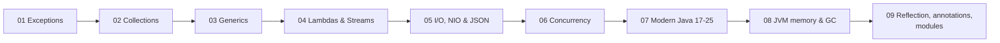

# 06 · Advanced Java

> After syntax and OOP, these are the concepts that separate a beginner from a professional Java
> backend developer. Each sub-topic is its own folder with theory, diagrams, packages/libraries and
> why, corner cases, and runnable practicals.

| # | Folder | What you learn | Used later in |
|---|--------|----------------|---------------|
| 01 | [01-exceptions](01-exceptions/README.md) | hierarchy, checked vs unchecked, try-with-resources, custom exceptions, best practices | REST error handling, transactions |
| 02 | [02-collections](02-collections/README.md) | `List/Set/Map/Queue/Deque`, internals of `ArrayList`, `HashMap`, `TreeMap`, Big-O, `Comparable/Comparator` | everywhere |
| 03 | [03-generics](03-generics/README.md) | type parameters, bounds, wildcards & PECS, erasure, bridge methods | repositories, Spring `ResponseEntity<T>` |
| 04 | [04-functional-streams](04-functional-streams/README.md) | lambdas, functional interfaces, method references, Streams, Collectors, `Optional`, gatherers | business logic, LINQ comparison (topic 09) |
| 05 | [05-io-nio-json](05-io-nio-json/README.md) | streams vs readers, `java.nio.file`, serialization, **Jackson** JSON | REST APIs, config files |
| 06 | [06-concurrency](06-concurrency/README.md) | threads, JMM, `synchronized`, locks, atomics, executors, `CompletableFuture`, virtual threads | web servers, async jobs |
| 07 | [07-modern-java](07-modern-java/README.md) | records, sealed, pattern matching, text blocks, `var`, sequenced collections... | idiomatic modern code |
| 08 | [08-jvm-memory-gc](08-jvm-memory-gc/README.md) | heap/stack/metaspace, GC algorithms, tuning, leaks, profiling | production troubleshooting |
| 09 | [09-reflection-annotations-modules](09-reflection-annotations-modules/README.md) | reflection, custom annotations, dynamic proxies, JPMS | how Spring/Hibernate work inside |

Practicals that need third-party libraries are Maven modules of [`topics/pom.xml`](../pom.xml); all other
practicals run with `java File.java`.
