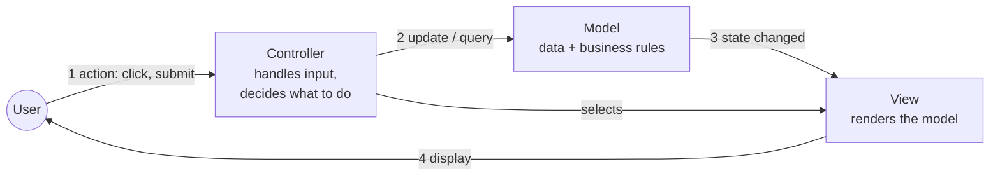
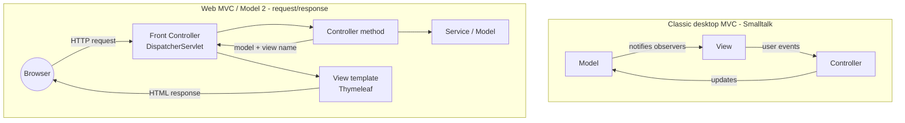
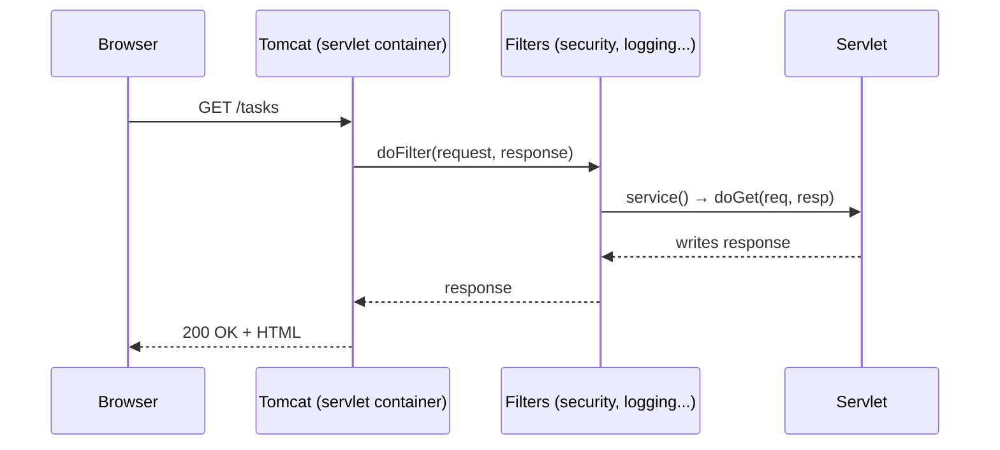
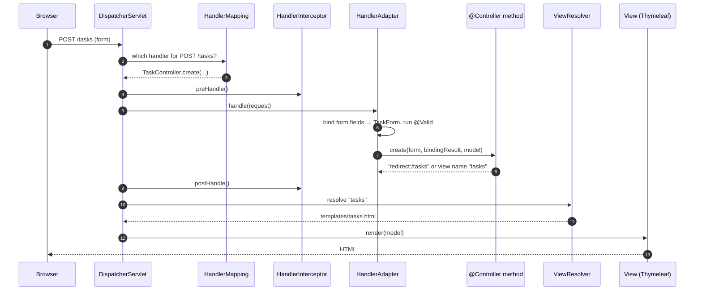
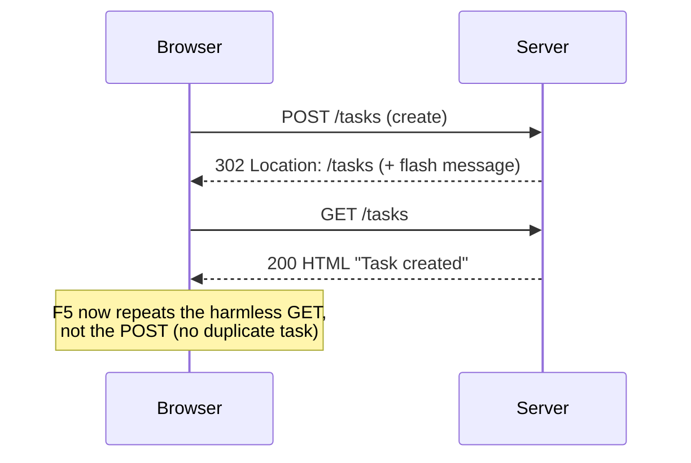
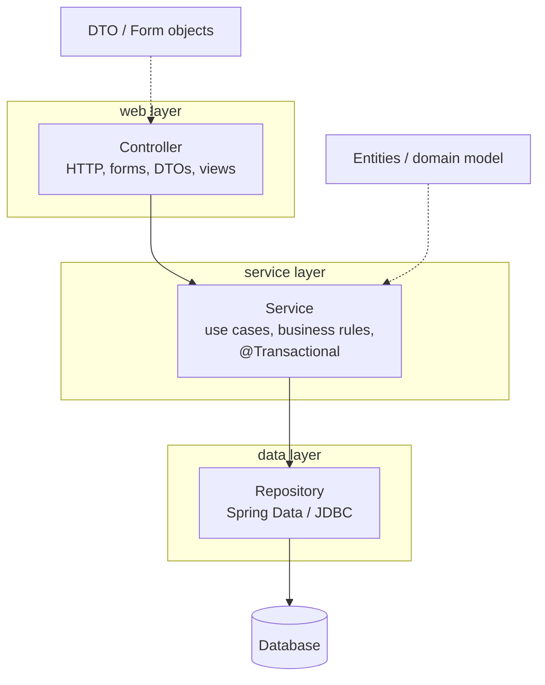

# 07 · MVC — Model, View, Controller

> The most influential UI/web architecture pattern: what each part is responsible for, how it evolved
> (Smalltalk → Servlets/JSP → Spring MVC), its variants (MVP, MVVM, Front Controller), exactly how a
> request travels through **Spring MVC's `DispatcherServlet`**, the layered Controller → Service →
> Repository architecture, server-side templates with Thymeleaf, validation and the
> Post/Redirect/Get pattern. Practicals: a plain-Java MVC and a tested Spring Boot 4 MVC web app.

---

## 1. The idea: separation of concerns



| Part | Responsibility | Must NOT |
|------|----------------|----------|
| **Model** | domain data, business rules, validation of invariants, persistence (through repositories) | know about HTTP, HTML or the UI |
| **View** | present the model (HTML, JSON, console, mobile screen) | contain business logic or talk to the database |
| **Controller** | receive input, call the model/services, choose the view, translate between UI and model | contain business rules (keep it thin) |

**Why?** Each part changes for different reasons (UI redesign vs business rule vs new input channel). Separation lets
teams work in parallel, makes the model testable without a UI, and allows several views on the same model
(web page + REST API + mobile app).

---

## 2. History

| Year | Step |
|------|------|
| 1978–79 | **Trygve Reenskaug** describes MVC at Xerox PARC for Smalltalk-76/80 desktop GUIs. The view **observes** the model (Observer pattern). |
| 1997–99 | **Java Servlets** + **JSP**. "Model 1": JSP pages contain logic and render HTML (messy). |
| 1999–2000 | **Model 2 / MVC2**: a Servlet acts as controller, JavaBeans as model, JSP as view. **Apache Struts** (2000) popularises it. |
| 2003–2004 | **Spring MVC** (with Spring Framework 1.0) and **JSF** (component-based). |
| 2004–2005 | Ruby on Rails, Django, ASP.NET MVC (2009) bring MVC to every web stack. |
| 2010s | SPAs (Angular, React): MVC moves to the **browser** (MVVM/components); the server becomes a REST API (topic 08). |
| 2020s | Server-side rendering is back for simplicity: **Thymeleaf + HTMX**, Hotwire, Next.js SSR. |

---

## 3. Classic MVC vs Web MVC (Model 2)



On the web the view can't be "notified" — HTTP is request/response — so the controller pulls data from the model and
passes it to the view **on every request**.

### Variants

| Pattern | Who updates the view? | Typical platform |
|---------|----------------------|------------------|
| **MVC** | view reads the model (observer) / controller picks a view | Spring MVC, Rails, ASP.NET MVC |
| **Front Controller** | one central handler dispatches all requests | `DispatcherServlet` |
| **MVP** (Model-View-Presenter) | presenter updates a passive view via an interface | WinForms, older Android |
| **MVVM** (Model-View-ViewModel) | data binding between view and view-model | WPF, Angular, Vue, Android Jetpack |
| **HMVC / component-based** | each component is its own little MVC | JSF, React components |

---

## 4. Servlets — the foundation under Spring MVC

A **Servlet** is a Java class that handles HTTP requests inside a **servlet container** (Tomcat, Jetty, Undertow).
Spring Boot starts an **embedded Tomcat** for you.



Lifecycle: `init()` once → `service()` per request (in a **thread from the pool**, or a virtual thread) →
`destroy()` at shutdown. One servlet instance serves all requests → **controllers must be stateless** (no per-user
fields!).

---

## 5. Spring MVC request flow (memorise this)



For a **`@RestController`** steps 9–11 are replaced by an `HttpMessageConverter` (Jackson) that writes the return
value as JSON — that's topic 08.

### Key annotations

| Annotation | Purpose |
|------------|---------|
| `@Controller` | class returns **view names** (HTML) |
| `@RestController` | `@Controller` + `@ResponseBody`: returns data (JSON) |
| `@RequestMapping("/tasks")` | base path on the class |
| `@GetMapping`, `@PostMapping`, `@PutMapping`, `@DeleteMapping` | method + path |
| `@PathVariable` | `/tasks/{id}` → `Long id` |
| `@RequestParam` | `?page=2` → `int page` |
| `@ModelAttribute` | bind form fields into an object / add common model data |
| `@Valid` + `BindingResult` | run Bean Validation; errors go to `BindingResult` (must follow the object) |
| `Model` / `ModelAndView` | data for the view |
| `RedirectAttributes.addFlashAttribute` | data that survives one redirect |
| `@ControllerAdvice` + `@ExceptionHandler` | global error handling |
| `@InitBinder` | customise data binding (trim strings, date formats) |

### Post / Redirect / Get (PRG)



---

## 6. Layered architecture in a Spring app



Rules: dependencies point **downwards only**; controllers never touch repositories directly; **don't expose entities to
views/JSON** — map them to DTOs (avoids leaking fields, lazy-loading surprises and mass-assignment attacks).
Package by **feature** (`task/`, `user/`) rather than by layer once the app grows.

---

## 7. Views: template engines

| Engine | Notes |
|--------|-------|
| **Thymeleaf** | Spring Boot default; *natural templates* (valid HTML opened directly in a browser); `th:text`, `th:each`, `th:if`, `th:field`, `th:object` |
| JSP / JSTL | legacy; doesn't work well with executable Boot jars |
| FreeMarker, Mustache, Groovy templates | alternatives |
| **JTE**, JStachio | type-safe, compiled templates (fast) |
| HTMX (with any engine) | partial page updates without writing JavaScript |

Thymeleaf essentials:
```html
<p th:text="${message}">placeholder</p>
<tr th:each="task : ${tasks}">
  <td th:text="${task.title}">Title</td>
</tr>
<form th:action="@{/tasks}" th:object="${taskForm}" method="post">
  <input th:field="*{title}">
  <span th:if="${#fields.hasErrors('title')}" th:errors="*{title}">error</span>
</form>
```

Thymeleaf escapes output by default (`th:text`) → protection against **XSS**. `th:utext` doesn't escape — avoid it
for user data. Spring Security adds **CSRF** tokens to Thymeleaf forms automatically.

---

## 8. Packages / libraries and why

| Dependency | Why |
|------------|-----|
| `spring-boot-starter-webmvc` (Boot 4; `spring-boot-starter-web` in Boot 3) | Spring MVC + embedded Tomcat + Jackson |
| `spring-boot-starter-thymeleaf` | server-side HTML templates |
| `spring-boot-starter-validation` | Jakarta Bean Validation (Hibernate Validator): `@NotBlank`, `@Size`, `@Email` |
| `spring-boot-starter-webmvc-test` (+ `spring-boot-starter-test`) | `@WebMvcTest`, `MockMvc`, JUnit, AssertJ, Mockito |
| `spring-boot-devtools` | automatic restart and live reload during development |
| `jakarta.servlet` API | the Servlet specification under Spring MVC |
| Alternatives | Jakarta MVC (Eclipse Krazo), JSF (PrimeFaces), Vaadin (Java-only UI), Quarkus Qute |

---

## 9. Practical

### 9.1 Plain Java MVC (no framework)
```bash
java topics/07-mvc/practical/ConsoleMvc.java
```
Model with observers, a console view and a controller that parses commands — the original Smalltalk idea in 150 lines.

### 9.2 Spring Boot 4 MVC web app — task manager
`practical/spring-mvc-tasks`: Thymeleaf views, form validation, PRG with flash messages, layered
controller/service/repository, global exception handling, `@WebMvcTest` tests.

```bash
./mvnw -f topics/pom.xml -pl 07-mvc/practical/spring-mvc-tasks test               # run the tests
./mvnw -f topics/pom.xml -pl 07-mvc/practical/spring-mvc-tasks spring-boot:run    # then open http://localhost:8080
```

## 10. Interview questions

1. Explain MVC. What belongs in the controller and what doesn't?
2. Describe the Spring MVC request lifecycle from `DispatcherServlet` to the view.
3. `@Controller` vs `@RestController`?
4. What is the Post/Redirect/Get pattern and why use it?
5. Why should controllers be stateless?
6. Why use DTOs instead of exposing JPA entities?
7. MVC vs MVP vs MVVM?
8. How does Spring know which method handles `GET /tasks/5`?

## Exercises

- [ ] Add an "edit task" page (`GET /tasks/{id}/edit`, `POST /tasks/{id}`) with validation.
- [ ] Add filtering `?status=done|open` with `@RequestParam(defaultValue = "all")`.
- [ ] Add a `HandlerInterceptor` that logs the time of each request.
- [ ] Add a `@RestController` at `/api/tasks` that reuses the same `TaskService` — two views, one model.
- [ ] Replace the in-memory repository with Spring Data JPA after topic 10.
