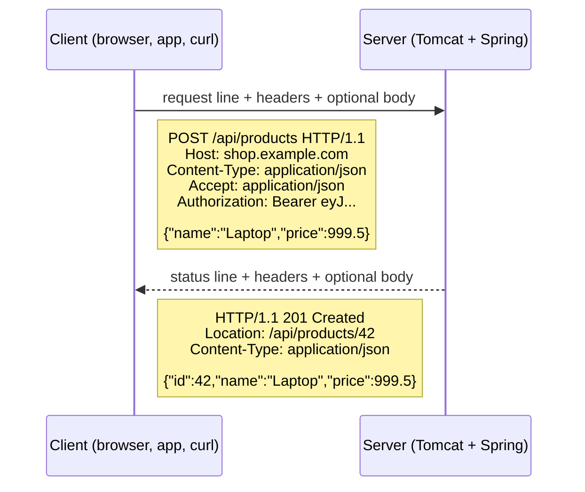
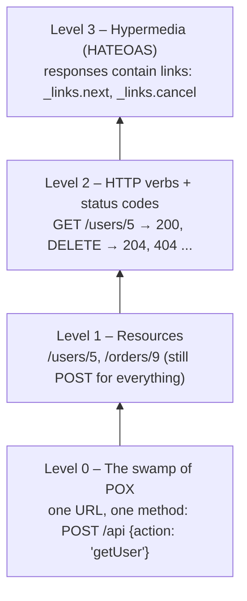
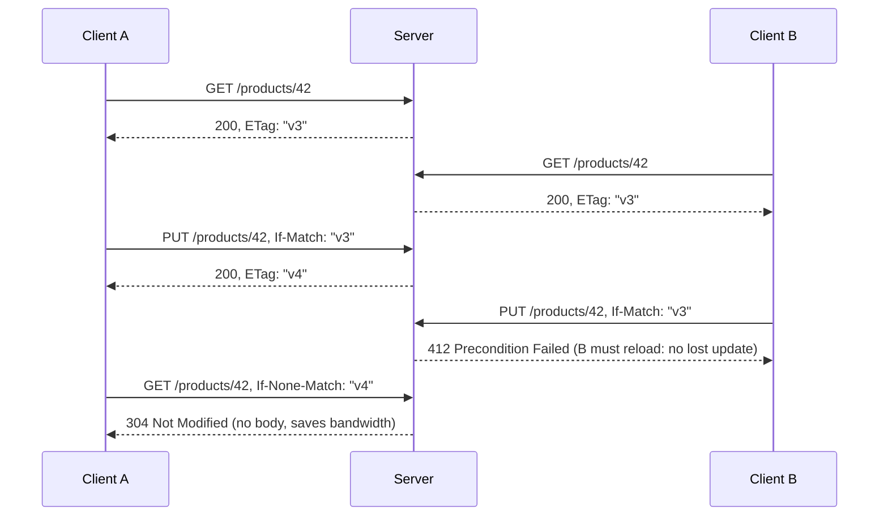

# 08 · HTTP and REST APIs

> Everything a backend developer needs to design, build, secure and test REST APIs: HTTP anatomy,
> methods (safe/idempotent), status codes, headers, Fielding's REST constraints, the Richardson
> maturity model, resource and URL design, pagination/filtering/versioning, error responses with
> **Problem Details (RFC 9457)**, caching and optimistic concurrency with ETags, security basics,
> REST vs GraphQL vs gRPC, and the Java stacks (Spring, JAX-RS, JDK `HttpServer`/`HttpClient`).
> Practicals: a zero-dependency REST server + client and a tested Spring Boot 4 product API.

---

## 1. HTTP in one page



```
 https://shop.example.com:443/api/products/42/reviews?sort=rating,desc&page=2#top
 \___/   \______________/\__/\_____________________/ \______________________/ \_/
 scheme        host      port        path                     query            fragment (browser only)
```

* **Stateless**: each request carries everything needed (auth token, ids). The server keeps no conversation memory
  → easy to scale horizontally behind a load balancer.
* **Text-based headers** (HTTP/1.1), **binary multiplexed streams** (HTTP/2), **over QUIC/UDP** (HTTP/3 — supported by
  Java's `HttpClient` since JDK 26).
* **HTTPS** = HTTP over TLS: encryption + server identity. Always use it outside localhost.

### Methods

| Method | Purpose | Body | **Safe** (no change) | **Idempotent** (repeat = same result) | Cacheable |
|--------|---------|------|:---:|:---:|:---:|
| `GET` | read a resource / collection | no | ✅ | ✅ | ✅ |
| `HEAD` | like GET, headers only | no | ✅ | ✅ | ✅ |
| `OPTIONS` | allowed methods, CORS pre-flight | no | ✅ | ✅ | ❌ |
| `POST` | create / trigger an action | yes | ❌ | ❌ | rarely |
| `PUT` | **replace** a resource entirely (create if the client picks the id) | yes | ❌ | ✅ | ❌ |
| `PATCH` | **partial** update | yes | ❌ | ❌ (can be made idempotent) | ❌ |
| `DELETE` | remove | usually no | ❌ | ✅ | ❌ |

Idempotency matters for **retries**: a client may safely retry `PUT`/`DELETE` after a timeout; retrying `POST` might
create duplicates → use an **`Idempotency-Key`** header for payments/orders.

### Status codes

| Code | Meaning | Use when |
|------|---------|----------|
| **200 OK** | success with body | GET, PUT/PATCH returning the resource |
| **201 Created** | resource created | POST; include **`Location`** header |
| **202 Accepted** | accepted, processed later | long-running jobs; return a status URL |
| **204 No Content** | success, no body | DELETE, PUT without body |
| 301 / 308 | moved permanently | renamed endpoints |
| **304 Not Modified** | cached copy still valid | conditional GET with `If-None-Match` |
| **400 Bad Request** | malformed/invalid input | validation errors |
| **401 Unauthorized** | not authenticated (no/invalid credentials) | missing/expired token |
| **403 Forbidden** | authenticated but not allowed | wrong role |
| **404 Not Found** | resource doesn't exist | unknown id |
| 405 Method Not Allowed | method not supported on this URL | `DELETE /api/health` |
| 406 / 415 | can't produce `Accept` / can't read `Content-Type` | XML requested from a JSON-only API |
| **409 Conflict** | state conflict | duplicate unique value, invalid state transition |
| **412 Precondition Failed** | `If-Match` ETag no longer matches | lost-update protection |
| **422 Unprocessable Content** | syntactically fine, semantically invalid | some APIs prefer it over 400 for validation |
| **429 Too Many Requests** | rate limit hit | include `Retry-After` |
| **500 Internal Server Error** | bug / unexpected failure | never leak stack traces |
| 502 / 503 / 504 | bad gateway / unavailable / gateway timeout | dependency down, maintenance, timeouts |

### Headers you'll use

| Header | Direction | Purpose |
|--------|-----------|---------|
| `Content-Type` | both | format of the body (`application/json`) |
| `Accept` | request | formats the client wants (content negotiation) |
| `Authorization` | request | `Bearer <token>`, `Basic <base64>` |
| `Location` | response | URL of a created resource |
| `ETag` / `If-None-Match` / `If-Match` | both | caching and optimistic concurrency |
| `Cache-Control` | response | `no-store`, `max-age=60`, `private` |
| `Retry-After` | response | when to retry after 429/503 |
| `X-Request-Id` / `traceparent` | both | correlate logs across services (topic 27) |
| `Access-Control-Allow-Origin` | response | CORS: which browser origins may call the API |

---

## 2. What makes an API "RESTful"?

**REST** (*Representational State Transfer*) was defined by **Roy Fielding** in his 2000 PhD dissertation as the
architectural style of the Web. Six constraints:

| Constraint | Meaning |
|------------|---------|
| Client–server | UI and data storage evolve independently |
| **Stateless** | no client session on the server; every request is self-contained |
| Cacheable | responses say whether they can be cached |
| **Uniform interface** | resources identified by URIs; manipulated through representations (JSON); self-descriptive messages (methods, media types); **HATEOAS** (links drive the client) |
| Layered system | proxies, gateways, load balancers can sit in between transparently |
| Code on demand (optional) | server may send executable code (JavaScript) |

### Richardson Maturity Model



Most real-world "REST" APIs are **Level 2** — which is what this topic (and the industry) targets. Spring HATEOAS
exists for Level 3.

---

## 3. Designing resources and URLs

| Rule | ✅ Good | ❌ Bad |
|------|--------|-------|
| Nouns, not verbs | `POST /orders` | `POST /createOrder` |
| Plural collections | `/products`, `/products/42` | `/product/getAll` |
| Hierarchy for ownership | `/customers/7/orders` | `/getOrdersOfCustomer?id=7` |
| Lowercase, kebab-case | `/order-items` | `/OrderItems`, `/order_items` |
| Filtering/sorting/paging in the query | `/products?category=books&sort=price,desc&page=0&size=20` | `/products/books/sortedByPrice` |
| Actions that aren't CRUD → sub-resource | `POST /orders/9/cancellation` or `POST /orders/9:cancel` | `GET /cancelOrder?id=9` |
| Don't expose implementation | `/products/42` | `/api/ProductServlet?table=PRODUCT` |
| JSON field names consistent | `camelCase` (most Java APIs) or `snake_case` — pick one | mixing both |

### Versioning

| Strategy | Example | Notes |
|----------|---------|-------|
| URI path | `/api/v1/products` | most common, explicit, easy to route |
| Header | `X-API-Version: 2` / `API-Version: 2` | clean URLs |
| Media type | `Accept: application/vnd.shop.v2+json` | most "RESTful", harder to test |
| Query | `?version=2` | simple, less common |

Spring Framework 7 / Boot 4 add **built-in API versioning** (`@GetMapping(path = "/products", version = "2")` with a
configured version resolver). Only bump the version for **breaking** changes; adding fields is not breaking.

### Pagination

```json
{
  "content": [ { "id": 1, "name": "Laptop" }, { "id": 2, "name": "Mouse" } ],
  "page": 0, "size": 2, "totalElements": 57, "totalPages": 29
}
```
* **Offset** (`page`/`size` or `offset`/`limit`): simple, supports "jump to page 5"; slow on huge tables, unstable when
  rows are inserted.
* **Cursor / keyset** (`?after=eyJpZCI6NDJ9&limit=20`): stable and fast at any depth; no random access. Used by
  Twitter/Stripe/GitHub-style APIs.

---

## 4. Errors: Problem Details (RFC 9457)

A standard JSON error format (`Content-Type: application/problem+json`), supported natively by Spring
(`ProblemDetail`):

```json
{
  "type": "https://api.shop.example/problems/validation",
  "title": "Validation failed",
  "status": 400,
  "detail": "2 fields are invalid",
  "instance": "/api/products",
  "errors": { "name": "must not be blank", "price": "must be greater than 0" }
}
```

Rules: consistent shape for every error, machine-readable `type`/codes, human-readable `detail`, **no stack traces or
SQL** in responses (log them instead with a request id).

---

## 5. Caching and concurrency with ETags



The ETag is often the entity's `@Version` column (topic 10 — optimistic locking).

---

## 6. Security essentials (details in topic 21)

* HTTPS everywhere; HSTS.
* Authentication: **JWT bearer tokens** / OAuth2 for APIs; sessions + cookies for browser apps; API keys for
  server-to-server (with care).
* Authorization on **every** endpoint and **object** (check that order 9 belongs to the caller → OWASP API #1
  *Broken Object Level Authorization*).
* Validate all input (Bean Validation), limit payload sizes, never trust client-sent ids/prices/roles.
* **CORS** only for the browser origins you trust; **rate limiting** (429).
* Don't expose entities directly (mass assignment); return DTOs.
* See the **OWASP API Security Top 10**.

---

## 7. REST vs the alternatives

| | REST | GraphQL | gRPC | SOAP | WebSocket / SSE |
|---|---|---|---|---|---|
| Transport | HTTP | HTTP (POST) | HTTP/2 | HTTP + XML envelope | persistent connection |
| Format | JSON (any) | JSON | Protobuf (binary) | XML | any |
| Contract | OpenAPI (optional) | schema (required) | `.proto` (required) | WSDL | – |
| Strength | simple, cacheable, universal | client chooses fields, one round trip | fast, typed, streaming, service-to-service | enterprise standards (WS-Security) | real-time push |
| Weakness | over/under-fetching | caching, complexity, N+1 resolvers | not browser-native, binary | verbose, heavy | stateful connections |
| Java | Spring MVC, JAX-RS | Spring for GraphQL | grpc-java, Spring gRPC | Jakarta XML WS (JAX-WS) | Spring WebSocket, SSE |

---

## 8. Building REST APIs in Java

```mermaid
flowchart LR
    REQ[HTTP request] --> F[Filters<br/>security, CORS, logging]
    F --> DS[DispatcherServlet]
    DS --> HM[HandlerMapping → @RestController method]
    HM --> AR[Argument resolvers<br/>@PathVariable, @RequestParam,<br/>@RequestBody via Jackson, @Valid]
    AR --> C[Controller → Service → Repository]
    C --> RV[Return value: DTO / ResponseEntity]
    RV --> MC[HttpMessageConverter<br/>Jackson writes JSON]
    MC --> RES[HTTP response]
    C -. exception .-> EH[@RestControllerAdvice<br/>→ ProblemDetail]
    EH --> RES
```

### Server frameworks

| Framework | Style | Notes |
|-----------|-------|-------|
| **Spring Web MVC** (`@RestController`) | blocking, servlet | the industry default; with virtual threads it scales very well |
| Spring WebFlux | reactive, Netty | streaming, very high concurrency with non-blocking drivers |
| **Jakarta REST (JAX-RS)** — Jersey, RESTEasy | annotations `@Path`, `@GET` | Jakarta EE servers, Quarkus |
| Quarkus / Micronaut / Helidon | cloud-native, build-time DI | fast startup, native images |
| Javalin, Spark, Vert.x | lightweight | small services |
| JDK `com.sun.net.httpserver.HttpServer` | built in | demos, tests, tiny tools (no framework) |

### Spring building blocks

| Annotation / class | Purpose |
|--------------------|---------|
| `@RestController` | controller whose return values are written as JSON |
| `@RequestMapping("/api/products")`, `@GetMapping("/{id}")`... | routing |
| `@PathVariable`, `@RequestParam`, `@RequestHeader` | read URL / query / headers |
| `@RequestBody` + `@Valid` | JSON body → DTO, then Bean Validation |
| `ResponseEntity<T>` | full control: status, headers (`Location`, `ETag`), body |
| `@ResponseStatus(HttpStatus.CREATED)` | fixed status for a method or exception |
| `@RestControllerAdvice` + `@ExceptionHandler` | global error → `ProblemDetail` |
| `ProblemDetail`, `ErrorResponseException` | RFC 9457 responses |
| `Pageable` / `Page<T>` (Spring Data) | pagination |
| `@CrossOrigin` / `CorsConfigurationSource` | CORS |

### Corner cases met while building the practical

* **Two error advices compete**: `spring.mvc.problemdetails.enabled=true` registers Boot's own
  `ResponseEntityExceptionHandler`. If you also write `@ExceptionHandler(MethodArgumentNotValidException.class)` in your
  advice, which one runs is not guaranteed. Fix: make **your** advice `extends ResponseEntityExceptionHandler` and
  override `handleMethodArgumentNotValid(...)` — Boot's handler then backs off.
* **Primitive fields in request DTOs**: with Jackson 3 (Boot 4) a missing JSON field for an `int` fails the whole
  request with *400 Failed to read request* (`FAIL_ON_NULL_FOR_PRIMITIVES` is on by default). Use `Integer` for
  optional numbers.
* `GET` with `If-None-Match` equal to the `ETag` you return in `ResponseEntity` → Spring answers **304** automatically.
* Shared singleton beans make tests leak state: reset repositories (and their id sequences) in `@BeforeEach`.

### HTTP clients (calling other APIs)

| Client | Notes |
|--------|-------|
| JDK `java.net.http.HttpClient` (Java 11) | built in, sync/async, HTTP/2 and HTTP/3 (26) |
| **Spring `RestClient`** (Boot 3.2+) | fluent, synchronous — recommended in Spring MVC apps |
| Spring **HTTP interface clients** (`@HttpExchange`) | declarative interfaces, like Feign |
| Spring `WebClient` | reactive / non-blocking |
| OpenFeign, Retrofit, OkHttp | popular alternatives |

---

## 9. Packages / libraries and why

| Dependency | Why |
|------------|-----|
| `spring-boot-starter-webmvc` | Spring MVC, Tomcat, Jackson JSON |
| `spring-boot-starter-validation` | validate request bodies/params |
| `spring-boot-starter-webmvc-test` | `@WebMvcTest`, `MockMvc`/`MockMvcTester` |
| `spring-boot-starter-restclient` | `RestClient` / HTTP interface clients |
| `springdoc-openapi-starter-webmvc-ui` | OpenAPI + Swagger UI (topic 22) |
| `spring-boot-starter-security` + `oauth2-resource-server` | JWT/OAuth2 security (topic 21) |
| `spring-hateoas` | Level-3 hypermedia links |
| Tools | **curl**, HTTPie, Postman/Bruno/Insomnia, IntelliJ/VS Code `.http` files |

---

## 10. Practical

### 10.1 REST with zero dependencies
```bash
java topics/08-rest-api/practical/JdkRestServerAndClient.java
```
Starts a CRUD API on the JDK's built-in `HttpServer`, then calls it with `HttpClient` and prints every request and
response (methods, status codes, `Location`, 404/405/400) — HTTP with nothing hidden.

### 10.2 Spring Boot 4 product API
`practical/spring-rest-products`: DTO records with validation, 201 + `Location`, 204, PUT and PATCH, filtering +
sorting + pagination, ETag / `If-Match` → 412, Problem Details for 400/404/409/412, and MockMvc tests.

```bash
./mvnw -f topics/pom.xml -pl 08-rest-api/practical/spring-rest-products test
./mvnw -f topics/pom.xml -pl 08-rest-api/practical/spring-rest-products spring-boot:run
# then use practical/spring-rest-products/requests.http, or:
curl -i localhost:8080/api/products
curl -i -X POST localhost:8080/api/products -H "Content-Type: application/json" -d '{"name":"Mouse","category":"tech","price":25}'
```

## 11. Interview questions

1. What are the REST constraints? Is your API really RESTful (which Richardson level)?
2. Safe vs idempotent methods? Is `PATCH` idempotent? Is `POST`?
3. `PUT` vs `PATCH` vs `POST`?
4. 401 vs 403? 400 vs 422? 404 vs 410? When do you return 409?
5. How do you design pagination? Offset vs cursor?
6. How do you version an API? What counts as a breaking change?
7. How do you prevent lost updates when two clients edit the same resource?
8. How should errors be returned? What is RFC 9457?
9. REST vs GraphQL vs gRPC — when would you choose each?
10. Explain what happens in Spring from the HTTP request to the JSON response.

## Exercises

- [ ] Add `GET /api/products/{id}/reviews` and `POST` a review (nested resource) to the Spring practical.
- [ ] Implement cursor pagination (`?after=<id>&limit=10`) next to page/size.
- [ ] Add an `Idempotency-Key` header to `POST /api/products` so retries don't create duplicates.
- [ ] Return `304 Not Modified` for `GET /api/products/{id}` when `If-None-Match` matches the ETag.
- [ ] Call a public API (e.g. `https://api.github.com/repos/spring-projects/spring-boot`) with `RestClient` and map the JSON to a record.
