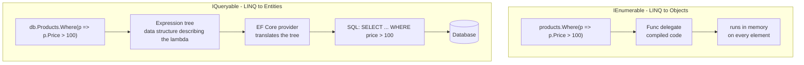
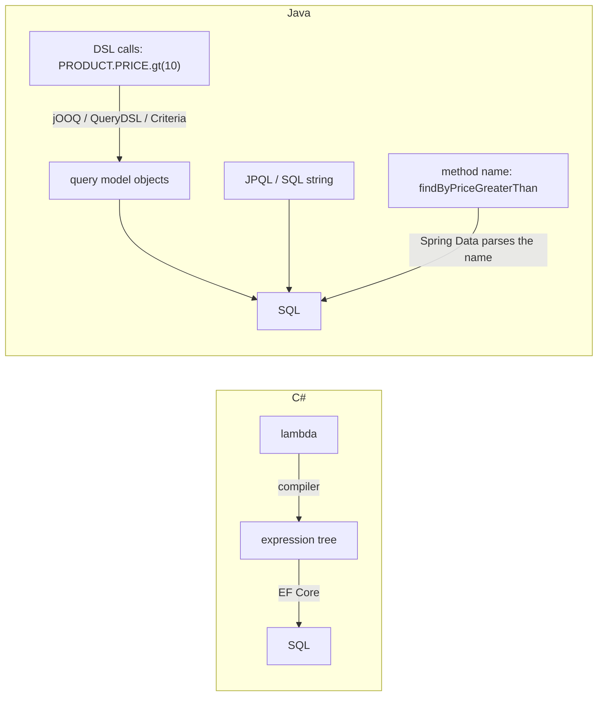

# 09 · LINQ and its Java equivalents

> **LINQ** (Language-Integrated Query) is C#'s way of querying any data source — collections, databases,
> XML — with one syntax. Java has no LINQ, but it has the pieces: **Streams** for in-memory data,
> and **JPQL / Criteria API / Spring Data / QueryDSL / jOOQ** for databases. This topic explains LINQ
> properly (query vs method syntax, deferred execution, `IEnumerable` vs `IQueryable`, expression
> trees, providers), then maps **every LINQ operator to Java**, explains why Java needs DSLs for SQL,
> and runs the same queries in C#, Java Streams and jOOQ.

---

## 1. What LINQ is

* Introduced in **C# 3.0 / .NET 3.5 (2007)** by Anders Hejlsberg's team (Erik Meijer's ideas from functional programming).
* Built from smaller language features: **lambda expressions**, **extension methods**, **anonymous types**,
  **type inference (`var`)**, **query expressions** and **expression trees**.

Two syntaxes, same meaning:

```csharp
// query syntax (SQL-like, compiled into method calls)
var expensive = from p in products
                where p.Price > 100
                orderby p.Price descending
                select new { p.Name, p.Price };

// method syntax (fluent, what most code uses)
var expensive = products.Where(p => p.Price > 100)
                        .OrderByDescending(p => p.Price)
                        .Select(p => new { p.Name, p.Price });
```

### LINQ providers

| Provider | Source | Execution |
|----------|--------|-----------|
| **LINQ to Objects** | `IEnumerable<T>`: lists, arrays | C# delegates run in memory |
| **LINQ to Entities** (Entity Framework Core) | `IQueryable<T>` over a `DbContext` | translated to **SQL**, run in the database |
| LINQ to XML | `XDocument`, `XElement` | in memory over XML trees |
| LINQ to SQL | legacy SQL Server ORM | SQL |
| **PLINQ** | `.AsParallel()` | in memory, parallel |

### `IEnumerable<T>` vs `IQueryable<T>` — the key idea



With `IQueryable`, the C# compiler turns the lambda into an **expression tree** (an object graph like
`GreaterThan(Property(p, Price), Constant(100))`) instead of executable code, so the provider can **read** it and
generate SQL. This is what makes LINQ special — and what Java lambdas cannot do (they compile to opaque bytecode).

### Deferred execution

```csharp
var query = products.Where(p => p.Price > 100);   // nothing executed yet
products.Add(new Product("Monitor", 300));
foreach (var p in query) { ... }                   // executes NOW, sees the Monitor
var list = query.ToList();                         // executes AGAIN (re-enumeration)
```

Immediate operators: `ToList`, `ToArray`, `ToDictionary`, `Count`, `First`, `Sum`, `Any`... Same idea as Java streams'
terminal operations — but a LINQ query **can be enumerated many times**, a Java `Stream` only **once**.

---

## 2. Concept mapping: C# → Java

| C# / .NET | Java |
|-----------|------|
| LINQ to Objects (`IEnumerable<T>`) | **`java.util.stream.Stream<T>`** |
| PLINQ (`AsParallel()`) | `parallelStream()` |
| LINQ to Entities / EF Core (`IQueryable<T>`) | **JPA**: JPQL strings, **Criteria API**, **Spring Data** derived queries / `@Query`, **QueryDSL**, **jOOQ**, JPAstreamer |
| Expression trees | none in the language → libraries use DSLs, metamodels (`Product_.price`), code generation, or bytecode analysis |
| Query syntax `from ... where ... select` | no equivalent; jOOQ's fluent DSL reads like SQL; text blocks for JPQL |
| Anonymous types `new { p.Name, p.Price }` | **records** (`record NamePrice(String name, BigDecimal price)`), or `Map.entry` |
| Extension methods (add your own operators) | not available; Java 24 **`Stream.gather(...)`** adds custom intermediate operations |
| `IGrouping<TKey, T>` | `Map<K, List<T>>` from `Collectors.groupingBy` |
| `Lookup<TKey, T>` | `Map<K, List<T>>` |
| `Dictionary<K,V>` from `ToDictionary` | `Map<K,V>` from `Collectors.toMap` |
| Nullable / `FirstOrDefault` → `null` | `Optional<T>` from `findFirst()` |
| `Func<T, TResult>`, `Predicate<T>`, `Action<T>` | `Function<T,R>`, `Predicate<T>`, `Consumer<T>` |

---

## 3. Operator-by-operator table

| LINQ (C#) | Java Streams | Notes |
|-----------|--------------|-------|
| `Where(p => ...)` | `filter(p -> ...)` | |
| `Select(p => ...)` | `map(p -> ...)` | |
| `Select((p, i) => ...)` (with index) | `IntStream.range(0, list.size()).mapToObj(i -> ...)` | no indexed overload |
| `SelectMany(c => c.Orders)` | `flatMap(c -> c.orders().stream())` | |
| `OrderBy(p => p.Price)` | `sorted(Comparator.comparing(Product::price))` | |
| `OrderByDescending` | `sorted(Comparator.comparing(...).reversed())` | |
| `ThenBy` / `ThenByDescending` | `.thenComparing(...)` / `.thenComparing(..., reverseOrder())` | |
| `GroupBy(p => p.Category)` | `collect(groupingBy(Product::category))` | terminal in Java |
| `GroupBy(k, (k, g) => new {k, Count = g.Count()})` | `collect(groupingBy(Product::category, counting()))` | downstream collectors |
| `Join(inner, o => o.Key, i => i.Key, (o, i) => ...)` | build a `Map` of the inner side, then `map`/`flatMap` | no built-in join |
| `GroupJoin` (left outer join) | `groupingBy` on inner + `getOrDefault(key, List.of())` | |
| `Distinct()` | `distinct()` | uses `equals/hashCode` |
| `DistinctBy(p => p.Category)` (.NET 6) | `collect(toMap(key, p -> p, (a, b) -> a, LinkedHashMap::new)).values()` | or a `seen` set in `filter` |
| `Take(n)` / `Skip(n)` | `limit(n)` / `skip(n)` | |
| `TakeWhile` / `SkipWhile` | `takeWhile` / `dropWhile` (Java 9) | |
| `First()` | `findFirst().orElseThrow()` | |
| `FirstOrDefault()` | `findFirst().orElse(null)` | prefer returning the `Optional` |
| `Single()` | `reduce((a, b) -> { throw ... })` or check `count() == 1` | no built-in |
| `Last()` | `list.getLast()` (Java 21) / `reduce((a, b) -> b)` | |
| `ElementAt(i)` | `skip(i).findFirst()` / `list.get(i)` | |
| `Any()` / `Any(pred)` | `findAny().isPresent()` / `anyMatch(pred)` | |
| `All(pred)` | `allMatch(pred)` | |
| `Contains(x)` | `anyMatch(x::equals)` / `collection.contains(x)` | |
| `Count()` / `LongCount()` | `count()` | |
| `Sum(p => p.Price)` | `map(Product::price).reduce(BigDecimal.ZERO, BigDecimal::add)` / `mapToInt(...).sum()` | |
| `Average`, `Min`, `Max` | `mapToDouble(...).average()`, `min(cmp)`, `max(cmp)` | return `Optional*` |
| `MinBy` / `MaxBy` (.NET 6) | `min(comparing(...))` / `max(comparing(...))` | |
| `Aggregate(seed, func)` | `reduce(identity, accumulator)` | |
| `ToList()` / `ToArray()` | `toList()` / `toArray(T[]::new)` | |
| `ToDictionary(k, v)` | `collect(toMap(k, v))` | both throw on duplicate keys |
| `ToHashSet()` | `collect(toSet())` | |
| `ToLookup(k)` | `collect(groupingBy(k))` | |
| `Zip(a, b, f)` | `IntStream.range(0, min).mapToObj(i -> f(a.get(i), b.get(i)))` | no built-in |
| `Concat` / `Append` / `Prepend` | `Stream.concat(a, b)` | |
| `Union` / `Intersect` / `Except` | `concat(...).distinct()` / `filter(set::contains)` / `filter(not(set::contains))` | |
| `Chunk(3)` (.NET 6) | `gather(Gatherers.windowFixed(3))` (Java 24) | |
| `OfType<Car>()` | `filter(Car.class::isInstance).map(Car.class::cast)` or `mapMulti` | |
| `Cast<T>()` | `map(T.class::cast)` | |
| `Reverse()` | `list.reversed()` (Java 21) | streams can't reverse lazily |
| `DefaultIfEmpty(x)` | `Optional.orElse(x)` / check emptiness | |
| `SequenceEqual` | `list1.equals(list2)` | |
| `Enumerable.Range(1, 10)` | `IntStream.rangeClosed(1, 10)` | |
| `Enumerable.Repeat(x, n)` | `Stream.generate(() -> x).limit(n)` / `Collections.nCopies(n, x)` | |
| `AsParallel()` | `parallel()` | |

---

## 4. The same query everywhere

> "Top 3 categories by total revenue of products costing more than 10, with their total."

```csharp
// C# LINQ to Objects - method syntax
var top = products.Where(p => p.Price > 10)
                  .GroupBy(p => p.Category)
                  .Select(g => new { Category = g.Key, Revenue = g.Sum(p => p.Price * p.Sold) })
                  .OrderByDescending(x => x.Revenue)
                  .Take(3)
                  .ToList();

// C# LINQ to Entities - same code on db.Products becomes ONE SQL query (via IQueryable + expression trees)
```

```java
// Java Streams (in memory)
record CategoryRevenue(String category, BigDecimal revenue) { }
List<CategoryRevenue> top = products.stream()
        .filter(p -> p.price().compareTo(TEN) > 0)
        .collect(groupingBy(Product::category,
                reducing(ZERO, p -> p.price().multiply(BigDecimal.valueOf(p.sold())), BigDecimal::add)))
        .entrySet().stream()
        .map(e -> new CategoryRevenue(e.getKey(), e.getValue()))
        .sorted(comparing(CategoryRevenue::revenue).reversed())
        .limit(3)
        .toList();
```

```java
// JPQL (string, checked at startup by Hibernate) - runs in the database
List<CategoryRevenue> top = em.createQuery("""
        select new com.shop.CategoryRevenue(p.category, sum(p.price * p.sold))
        from Product p
        where p.price > 10
        group by p.category
        order by sum(p.price * p.sold) desc
        """, CategoryRevenue.class).setMaxResults(3).getResultList();

// Spring Data JPA - same JPQL in an annotation on a repository interface
@Query("select new ...CategoryRevenue(p.category, sum(p.price * p.sold)) from Product p where p.price > :min group by p.category order by 2 desc")
List<CategoryRevenue> revenueByCategory(BigDecimal min, Pageable top3);

// jOOQ - type-safe SQL DSL (closest to LINQ to Entities in spirit)
ctx.select(PRODUCT.CATEGORY, sum(PRODUCT.PRICE.mul(PRODUCT.SOLD)).as("revenue"))
   .from(PRODUCT)
   .where(PRODUCT.PRICE.gt(TEN))
   .groupBy(PRODUCT.CATEGORY)
   .orderBy(field("revenue").desc())
   .limit(3)
   .fetchInto(CategoryRevenue.class);

// QueryDSL - generated Q-classes from JPA entities
query.select(product.category, product.price.multiply(product.sold).sum())
     .from(product).where(product.price.gt(10)).groupBy(product.category)
     .orderBy(product.price.multiply(product.sold).sum().desc()).limit(3).fetch();
```

### Why Java needs DSLs for databases

A Java lambda `p -> p.price() > 10` is compiled to bytecode; a library **cannot inspect it** to produce
`WHERE price > 10`. So Java libraries make you build the query with **objects that describe it**:



Options, from most SQL-like to most object-like:

| Tool | Style | Type-safe? | Good for |
|------|-------|-----------|----------|
| **jOOQ** | SQL as a Java DSL, code-generated from the DB schema | ✅ fully | complex SQL, reporting, database-first teams |
| **QueryDSL** | fluent queries over JPA entities (Q-classes) | ✅ | dynamic filters on JPA entities |
| **JPA Criteria API** + metamodel (`Product_`) | verbose builder, standard | ✅ | dynamic queries without extra libraries |
| **JPQL / HQL** | string queries over entities | checked at startup (named queries) | most static queries |
| **Spring Data derived queries** | method names → queries (`findByCategoryAndPriceGreaterThan`) | ✅ (validated at startup) | simple CRUD lookups |
| Spring Data **Specifications** | composable `Predicate`s (Criteria) | ✅ | search screens with optional filters |
| **JPAstreamer** | write Java Streams over entities, translated to JPQL | ✅ | the closest thing to "LINQ to Entities" feel |
| Jinq | bytecode analysis of lambdas | ✅ | historical (inactive) — proof that it's hard |

---

## 5. Differences that bite

| Topic | LINQ | Java Streams |
|-------|------|--------------|
| Re-use | query object can be enumerated many times (re-executes) | a stream is **single-use** |
| Laziness | deferred until enumeration | lazy until a terminal op |
| Grouping | `GroupBy` is lazy, yields `IGrouping` | `groupingBy` is a **terminal** collector returning a `Map` |
| Joins | `Join`, `GroupJoin` built in | build a lookup `Map` yourself |
| Extensibility | extension methods | fixed API; gatherers (Java 24) |
| Anonymous projections | `new { a, b }` | records |
| Null semantics | `FirstOrDefault` returns `null`/default | `Optional` |
| Database queries | same syntax via `IQueryable` | separate tools (JPA/jOOQ) |
| N+1 risk | lazy navigation in EF | lazy associations in JPA (topic 10) — same problem |

---

## 6. Packages / libraries and why

| Package / library | Why |
|-------------------|-----|
| `java.util.stream` (`Stream`, `Collectors`, `Gatherers`) | LINQ to Objects equivalent |
| `jakarta.persistence` (JPQL, Criteria API) | standard database queries over entities |
| `spring-boot-starter-data-jpa` | repositories, derived queries, `@Query`, Specifications, paging |
| **jOOQ** (`org.jooq:jooq`) | type-safe SQL DSL; renders SQL you can inspect (like EF's `ToQueryString`) |
| **QueryDSL** (`io.github.openfeign.querydsl` fork / `com.querydsl`) | type-safe queries on JPA entities |
| **JPAstreamer** | Stream API translated to JPQL |
| **StreamEx**, Vavr | extra operators: `zip`, `join`, `distinctBy`, `chunk`... |

---

## 7. Practical

```bash
# C# LINQ (requires the .NET SDK)
cd topics/09-linq/practical/csharp && dotnet run

# The same queries with Java Streams
java topics/09-linq/practical/StreamsAsLinq.java

# "LINQ to SQL" in Java: jOOQ builds composable, deferred queries and runs them on an in-memory H2 database
./mvnw -q -f topics/pom.xml -pl 09-linq/practical/jooq-queries compile exec:java
./mvnw -f topics/pom.xml -pl 09-linq/practical/jooq-queries test
```

## 8. Interview questions

1. What is LINQ? Query syntax vs method syntax?
2. `IEnumerable` vs `IQueryable`? What are expression trees?
3. What is deferred execution? How does it compare with Java stream laziness?
4. What is the Java equivalent of `GroupBy`, `SelectMany`, `ToDictionary`, `FirstOrDefault`?
5. Why can't Java translate stream lambdas into SQL? Which libraries fill the gap?
6. When would you choose jOOQ over JPA/Hibernate?

## Exercises

- [ ] Implement `Zip` and `DistinctBy` as reusable static helper methods for streams.
- [ ] Write the "customers with their order count, including customers without orders" query (LINQ `GroupJoin`) with Java streams.
- [ ] Translate five queries from `LinqDemo` into Spring Data derived query method names.
- [ ] Use jOOQ's dynamic `Condition` building to add optional filters (category, min price, max price) like an EF `IQueryable` being extended step by step.
