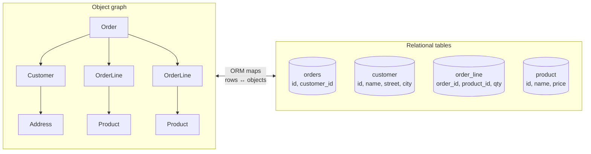
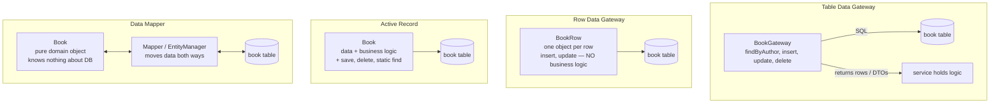
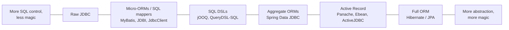
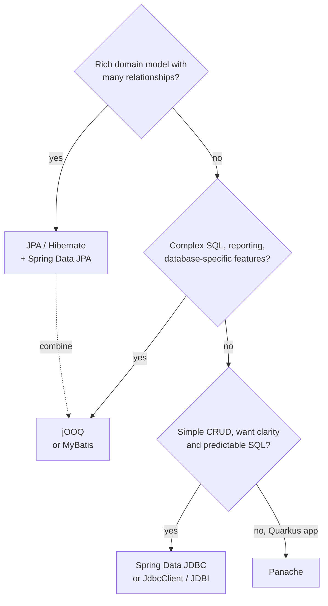
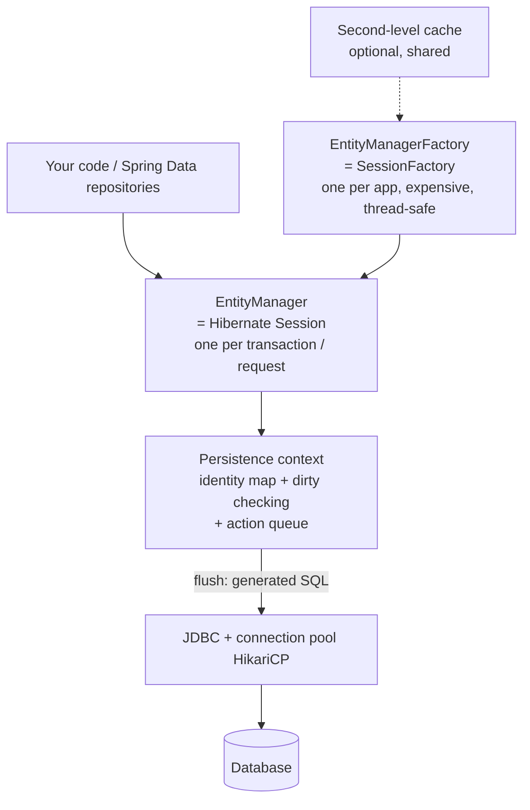
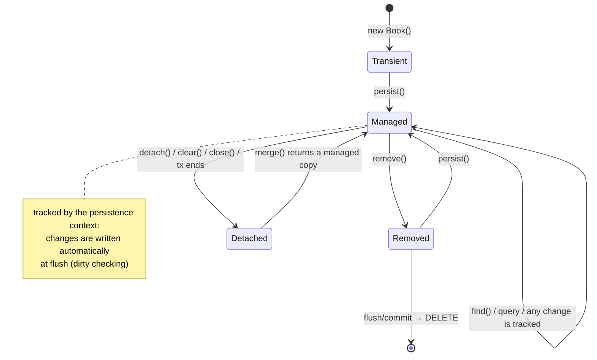
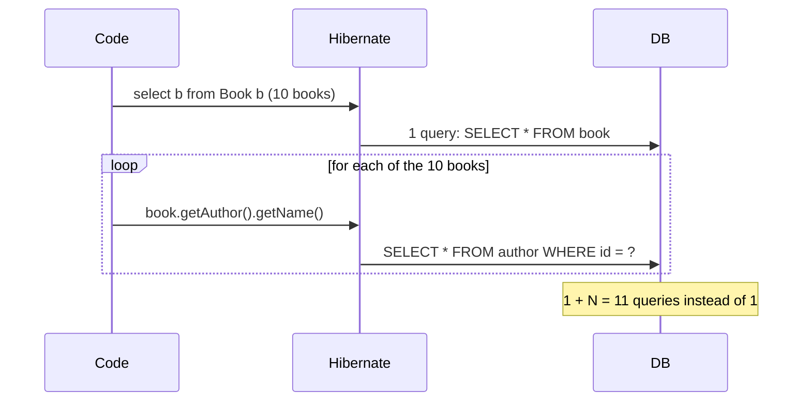
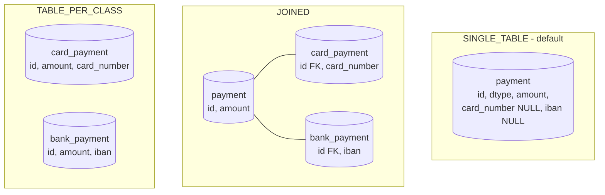

# 10 · ORM — every type, and JPA/Hibernate in depth

> How object-oriented code talks to relational databases. The **object-relational impedance mismatch**,
> the **data-access patterns** every ORM is built from (Table Data Gateway, Row Data Gateway, Active
> Record, Data Mapper, Unit of Work, Identity Map, Lazy Load, Repository...), the **categories of ORM
> tools** (full ORM, Active Record, micro-ORM/SQL mappers, SQL DSLs, aggregate-oriented, reactive,
> ODMs) with Java and non-Java examples, and a deep dive into **JPA/Hibernate**: mapping, entity
> lifecycle, persistence context, relationships, fetching and the **N+1 problem**, inheritance
> strategies, transactions, locking and caching. The practical implements the same use case with
> **JDBC, Active Record, JPA/Hibernate, MyBatis and JDBI** and measures what each one does.

---

## 1. Why ORM? The impedance mismatch

Objects and tables model data differently:

| Problem | Objects | Tables |
|---------|---------|--------|
| **Granularity** | `Customer` has an `Address` object | one row with `street`, `city` columns |
| **Inheritance** | `CardPayment extends Payment` | no inheritance |
| **Identity** | `a == b` (same object) and `a.equals(b)` | primary key |
| **Associations** | references, can be bidirectional, collections | foreign keys, one direction, join tables |
| **Navigation** | `order.getCustomer().getAddress()` (walk the graph) | JOINs (fetch what you need in one query) |
| **Types** | `LocalDate`, enums, `BigDecimal`, value objects | `DATE`, `VARCHAR`, `NUMERIC` |



Writing that mapping by hand with JDBC is repetitive and error-prone (`ResultSet` → objects, objects →
`INSERT/UPDATE`, transactions, caching). ORMs automate it — at the cost of abstraction and new pitfalls.

---

## 2. The building-block patterns (Martin Fowler, *Patterns of Enterprise Application Architecture*)

### 2.1 The four main data-source patterns — the "types" of ORM



| Pattern | Idea | Domain knows the DB? | Good for | Java examples |
|---------|------|----------------------|----------|---------------|
| **Table Data Gateway** | one object handles **all rows** of a table (SQL inside) | no | simple apps, reporting | JDBC DAO classes, Spring `JdbcClient`, MyBatis mappers, JDBI DAOs |
| **Row Data Gateway** | one object **per row**, with `insert()/update()`, no logic | partly | simple scripts | rarely used alone |
| **Active Record** | domain object **is** the row: data + logic + `save()/delete()/find()` | **yes** | CRUD-heavy apps with simple domain | ActiveJDBC, Ebean (`Model`), Quarkus **Panache** (`PanacheEntity`); Rails ActiveRecord, Laravel Eloquent, Django models |
| **Data Mapper** | domain objects are **persistence-ignorant**; a separate mapper moves data | **no** | rich domain models, complex mappings | **JPA/Hibernate**, EclipseLink, MyBatis (partly); EF Core, SQLAlchemy, Doctrine |

### 2.2 Supporting patterns (inside every full ORM)

| Pattern | What it does | In JPA/Hibernate |
|---------|--------------|------------------|
| **Unit of Work** | tracks new/changed/deleted objects during a business transaction and writes them all at commit | the **persistence context**: dirty checking + flush at commit |
| **Identity Map** | each row is loaded **once** per unit of work; same id → same object | first-level cache: `em.find(Book.class, 1) == em.find(Book.class, 1)` |
| **Lazy Load** | load associated data only when accessed (lazy init, virtual proxy, value holder, ghost) | `FetchType.LAZY`, Hibernate proxies |
| **Identity Field** | store the primary key in the object | `@Id` |
| **Foreign Key Mapping** | object reference ↔ FK column | `@ManyToOne @JoinColumn` |
| **Association Table Mapping** | many-to-many via a link table | `@ManyToMany @JoinTable` |
| **Embedded Value** | small value object stored in the owner's columns | `@Embeddable` / `@Embedded` |
| **Single / Class / Concrete Table Inheritance** | map class hierarchies to tables | `InheritanceType.SINGLE_TABLE / JOINED / TABLE_PER_CLASS` |
| **Metadata Mapping** | mapping described by metadata | annotations / `orm.xml` |
| **Query Object** | queries built as objects | Criteria API, QueryDSL, jOOQ |
| **Repository** | collection-like interface for aggregates | Spring Data `JpaRepository` |
| **Optimistic Offline Lock** | detect concurrent edits with a version column | `@Version` |

---

## 3. Categories of ORM / data-access tools



| Category | How it works | Java tools | Other ecosystems | Pros | Cons |
|----------|--------------|------------|------------------|------|------|
| **Raw JDBC** | you write SQL and map `ResultSet`s | `java.sql` | ADO.NET, PDO | full control, no magic | boilerplate, error-prone |
| **Micro-ORM / SQL mapper** | you write SQL; tool maps parameters and rows to objects | **MyBatis**, **JDBI**, Spring **`JdbcClient`/`JdbcTemplate`**, Sql2o | **Dapper** (.NET), sqlx (Go/Rust) | SQL is explicit, fast, easy to tune | no dirty checking, no lazy loading, you write all SQL |
| **Type-safe SQL DSL** | SQL built with a Java API, often generated from the schema | **jOOQ**, QueryDSL-SQL | Exposed (Kotlin), Kysely (TS) | compile-time checked SQL, any SQL feature | database-first, SQL-minded design |
| **Full ORM (Data Mapper + Unit of Work)** | maps object graphs; tracks changes; generates SQL | **Hibernate**, EclipseLink, OpenJPA (all **JPA** implementations), DataNucleus | **EF Core**, SQLAlchemy ORM, Doctrine, NHibernate | rich domain models, little SQL to write, caching, portability | complexity, N+1, hidden SQL, learning curve |
| **Active Record ORM** | entity has `persist()`/`find()` | **Panache** (Quarkus), **Ebean**, ActiveJDBC | Rails ActiveRecord, Django ORM, Eloquent | very productive for CRUD | couples domain to DB, harder to test pure logic |
| **Aggregate-oriented ORM** | maps DDD aggregates; no lazy loading, no dirty checking, saves the whole aggregate | **Spring Data JDBC** | – | simple mental model, predictable SQL | fewer features, aggregates must be designed well |
| **Reactive ORM / clients** | non-blocking drivers | Hibernate Reactive, Spring Data **R2DBC** | – | high concurrency with reactive stacks | reactive complexity (virtual threads reduce the need) |
| **ODM (NoSQL)** | maps objects to documents/graphs | Spring Data **MongoDB**, Morphia, Spring Data Neo4j/Cassandra | Mongoose (JS) | natural fit for documents | not relational |

### Approaches to the schema

| Approach | Meaning | Tools |
|----------|---------|-------|
| **Code-first** | entities drive the schema | Hibernate `hbm2ddl` (only for prototypes/tests!), EF Core migrations |
| **Database-first** | schema drives the code | jOOQ code generation, Hibernate reverse engineering |
| **Migrations** (always in production) | versioned SQL scripts applied in order | **Flyway**, **Liquibase** (topic 18) |

### Which one should I use?



Many real projects **combine** them: JPA for writes/aggregates, jOOQ/native SQL for complex reads (CQRS-style).

---

## 4. JPA and Hibernate in depth

**JPA** (Jakarta Persistence, `jakarta.persistence.*`) is the **specification**; **Hibernate** is the most used
**implementation** (others: EclipseLink, OpenJPA). Spring Boot 4 ships **Hibernate 7** (JPA 3.2).
**Spring Data JPA** adds repositories on top.



### 4.1 Mapping an entity

```java
@Entity
@Table(name = "book", uniqueConstraints = @UniqueConstraint(columnNames = "isbn"))
public class Book {

    @Id
    @GeneratedValue(strategy = GenerationType.SEQUENCE)       // or IDENTITY / UUID
    private Long id;

    @Column(nullable = false, length = 200)
    private String title;

    @Column(precision = 10, scale = 2)
    private BigDecimal price;

    @Enumerated(EnumType.STRING)                              // NEVER ORDINAL: reordering the enum corrupts data
    private Format format;

    @Embedded                                                 // value object in the same table
    private Dimensions dimensions;

    @ManyToOne(fetch = FetchType.LAZY, optional = false)      // FK book.author_id
    @JoinColumn(name = "author_id")
    private Author author;

    @Version                                                  // optimistic locking
    private int version;

    protected Book() { }                                      // JPA needs a no-arg constructor (can be protected)
}
```

| ID strategy | How | Notes |
|-------------|-----|-------|
| `IDENTITY` | DB auto-increment column | simple; **disables JDBC batch inserts** (id known only after each insert) |
| `SEQUENCE` | DB sequence, Hibernate pre-allocates ids (pooled optimizer) | best performance on PostgreSQL/Oracle/H2 |
| `UUID` | generated in Java | no DB round trip, globally unique; bigger indexes (use UUIDv7 for ordering) |
| `TABLE` | emulated with a table | slow, avoid |

Entity rules: `@Entity` class with `@Id`, a no-arg constructor, **not `final`** (proxies subclass it), fields not
`final`. **Records can't be entities** (immutable, final) — but they're perfect for **DTO projections** and
`@Embeddable`s.

### 4.2 Entity lifecycle



| Method | Effect |
|--------|--------|
| `persist(e)` | transient → managed; INSERT at flush (sequence ids may be fetched earlier) |
| `find(Book.class, id)` | returns managed entity (from 1st-level cache if already loaded) |
| `getReference(Book.class, id)` | returns a lazy proxy without querying |
| `merge(detached)` | copies state onto a managed instance and **returns it** (the argument stays detached!) |
| `remove(e)` | managed → removed; DELETE at flush |
| `flush()` | send pending SQL now (still inside the transaction) |
| `detach(e)` / `clear()` | stop tracking one / all entities |
| `refresh(e)` | reload state from the DB |

**Dirty checking**: you **don't call `update()`**. Change a managed entity's field; at flush Hibernate compares it with
the snapshot taken when loaded and issues an `UPDATE`.

**Flush** happens: before commit, before a query that might see pending changes (`FlushModeType.AUTO`), or when you
call `flush()`.

> Corner case (found while writing the tests): `persist()` with a `SEQUENCE` id assigns the id **immediately** but the
> `INSERT` waits for flush. If you `detach()` the entity before flushing, the pending insert is discarded; a later
> `merge()` finds no row and **Hibernate 6.6+/7 throws `OptimisticLockException`** ("Row was already updated or deleted")
> instead of inserting it as older versions did.

### 4.3 Relationships

| Annotation | Default fetch | Owning side (has the FK) | Tips |
|------------|---------------|--------------------------|------|
| `@ManyToOne` | **EAGER** ⚠ | this side (`@JoinColumn`) | always set `fetch = LAZY` |
| `@OneToMany(mappedBy = "author")` | LAZY | the `@ManyToOne` side | `mappedBy` = inverse side; add helper methods to keep both sides in sync |
| `@OneToOne` | **EAGER** ⚠ | the side with `@JoinColumn` | prefer `@MapsId` (shared PK) |
| `@ManyToMany` | LAZY | side without `mappedBy` | use `Set`; for extra columns map the join table as an entity |

```java
@Entity
public class Author {
    @OneToMany(mappedBy = "author", cascade = CascadeType.ALL, orphanRemoval = true)
    private List<Book> books = new ArrayList<>();

    public void addBook(Book b) { books.add(b); b.setAuthor(this); }      // keep both sides consistent
    public void removeBook(Book b) { books.remove(b); b.setAuthor(null); }
}
```

* **Cascade** (`PERSIST`, `MERGE`, `REMOVE`, `ALL`...) propagates operations from parent to children. Use it from the
  aggregate root to its parts, never from child to parent.
* **`orphanRemoval = true`**: removing a child from the collection deletes its row.
* Only the **owning side** is written to the database; changing only `author.getBooks()` without setting
  `book.author` saves nothing.

### 4.4 Fetching and the N+1 problem



Fixes:

| Fix | Code |
|-----|------|
| **JOIN FETCH** in JPQL | `select b from Book b join fetch b.author` |
| **Entity graph** | `@EntityGraph(attributePaths = "author")` on a Spring Data method |
| **Batch fetching** | `spring.jpa.properties.hibernate.default_batch_fetch_size=50` → `WHERE id IN (?, ?, ...)` |
| **DTO projection** (best for reads) | `select new com.shop.BookView(b.title, a.name) from Book b join b.author a` |

Related traps:
* **`LazyInitializationException`**: accessing a lazy association after the persistence context closed. Fix by
  fetching what you need in the query (not by switching to EAGER). Disable **Open Session in View**:
  `spring.jpa.open-in-view=false`.
* `join fetch` on a **collection** + pagination → Hibernate paginates **in memory** (warning HHH90003004). Page the
  ids first, then fetch.
* Fetching two collections with `join fetch` → `MultipleBagFetchException` / cartesian product.
* `EAGER` everywhere → huge queries for every load. Make everything `LAZY` and fetch per use case.

### 4.5 Inheritance strategies



| Strategy | Pros | Cons |
|----------|------|------|
| `SINGLE_TABLE` | fastest, polymorphic queries without joins | nullable subclass columns, one wide table |
| `JOINED` | normalised, NOT NULL constraints possible | joins for every polymorphic query |
| `TABLE_PER_CLASS` | each class standalone | polymorphic queries need `UNION` |
| `@MappedSuperclass` | share fields (`id`, `createdAt`) — **not** an entity, no polymorphic queries | – |

### 4.6 Querying

| Way | Example |
|-----|---------|
| JPQL | `em.createQuery("select b from Book b where b.price > :min", Book.class)` |
| Named query | `@NamedQuery(name = "Book.cheap", query = "...")` — validated at startup |
| Native SQL | `em.createNativeQuery("select ... /* any SQL */", Book.class)` |
| Criteria API | `cb.greaterThan(root.get(Book_.price), min)` — type-safe with the metamodel |
| Spring Data derived | `List<Book> findByAuthorNameAndPriceLessThan(String name, BigDecimal max);` |
| Spring Data `@Query` | `@Query("select b from Book b join fetch b.author where b.id = :id")` |
| Projections | interface / record DTOs: `List<BookView> findByPriceGreaterThan(BigDecimal p)` |
| Specifications / QueryDSL | dynamic filters |

### 4.7 Transactions

`@Transactional` (Spring) starts a transaction + persistence context around a method via a **proxy**
(see [06.09](../06-advanced-java/09-reflection-annotations-modules/README.md#3-dynamic-proxies--how-transactional-works)).

| Attribute | Common values |
|-----------|---------------|
| `propagation` | `REQUIRED` (default: join or create), `REQUIRES_NEW` (suspend outer, new tx — e.g. audit log), `MANDATORY`, `SUPPORTS`, `NOT_SUPPORTED`, `NESTED` |
| `isolation` | `READ_COMMITTED` (typical default), `REPEATABLE_READ`, `SERIALIZABLE` — see topic 16 |
| `readOnly = true` | skips dirty checking snapshots; hint to the driver/DB |
| `rollbackFor` | by default only **unchecked** exceptions roll back |
| `timeout` | seconds |

Put `@Transactional` on **service** methods (use cases), not on repositories or controllers.

### 4.8 Concurrency: locking

| Lock | How | When |
|------|-----|------|
| **Optimistic** | `@Version` column; `UPDATE ... WHERE id = ? AND version = ?`; 0 rows → `OptimisticLockException` | default choice; conflicts are rare (maps to HTTP 409/412) |
| **Pessimistic** | `em.find(Book.class, id, LockModeType.PESSIMISTIC_WRITE)` → `SELECT ... FOR UPDATE` | hot rows (stock counters, seat booking) |

### 4.9 Caching

| Level | Scope | Notes |
|-------|-------|-------|
| **First-level** (persistence context) | one `EntityManager` / transaction | always on; the identity map |
| **Second-level** | whole application (`EntityManagerFactory`) | opt-in per entity (`@Cache`), providers: Ehcache/Caffeine via JCache, Infinispan; great for read-mostly reference data |
| Query cache | results of queries | rarely worth it; invalidated on any table change |

### 4.10 Entity `equals`/`hashCode`

Don't use Lombok `@Data`/all-fields equality on entities (lazy collections, changing ids). Use a natural business key
(ISBN) or the id with a **constant** `hashCode`:
```java
@Override public boolean equals(Object o) {
    return this == o || (o instanceof Book b && id != null && id.equals(b.getId()));
}
@Override public int hashCode() { return getClass().hashCode(); }
```

### 4.11 Performance checklist

* Log SQL in development: `spring.jpa.show-sql=true`, `logging.level.org.hibernate.SQL=DEBUG`,
  bind values `logging.level.org.hibernate.orm.jdbc.bind=TRACE`.
* Count statements in tests (Hibernate `Statistics`, datasource-proxy) to catch N+1 early.
* All associations `LAZY`; fetch per use case (join fetch / entity graph / DTO projections).
* `SEQUENCE` ids + `hibernate.jdbc.batch_size=50` + `order_inserts=true` for bulk writes.
* `readOnly = true` transactions for queries; DTO projections for read screens.
* Bulk updates with JPQL `update ... where ...` (`@Modifying`) instead of loading thousands of entities.
* Proper DB indexes (topic 16) — no ORM can fix a missing index.
* `spring.jpa.open-in-view=false`.

---

## 5. Spring Data JPA in 30 seconds

```java
public interface BookRepository extends JpaRepository<Book, Long>, JpaSpecificationExecutor<Book> {
    List<Book> findByAuthorNameIgnoreCaseOrderByPriceDesc(String authorName);        // derived query
    Page<Book> findByPriceLessThan(BigDecimal max, Pageable pageable);              // pagination
    @EntityGraph(attributePaths = "author") List<Book> findByTitleContaining(String s);   // no N+1
    @Query("select new com.shop.BookView(b.title, a.name) from Book b join b.author a")   // projection
    List<BookView> findViews();
    @Modifying @Query("update Book b set b.price = b.price * :f") int reprice(BigDecimal f);
}
```

Hierarchy: `Repository` → `CrudRepository` → `ListCrudRepository` → `PagingAndSortingRepository` → `JpaRepository`.
Spring generates the implementation at startup (a proxy). Full example in
[20-spring-boot](../20-spring-boot/README.md).

---

## 6. Packages / libraries and why

| Dependency | Why |
|------------|-----|
| `jakarta.persistence-api` | the JPA annotations/interfaces (`@Entity`, `EntityManager`) |
| `org.hibernate.orm:hibernate-core` | the JPA implementation |
| `spring-boot-starter-data-jpa` | Hibernate + Spring Data JPA + HikariCP + transactions, auto-configured |
| `spring-boot-starter-data-jdbc` | Spring Data JDBC (aggregate-oriented, no lazy loading) |
| `spring-boot-starter-jdbc` | `JdbcClient` / `JdbcTemplate` + HikariCP |
| `org.mybatis:mybatis` (+ `mybatis-spring-boot-starter`) | SQL mapper with XML/annotation SQL |
| `org.jdbi:jdbi3-core` | fluent micro-ORM |
| `org.jooq:jooq` (+ `spring-boot-starter-jooq`) | type-safe SQL DSL |
| `org.hibernate.orm:hibernate-jpamodelgen` | generates the `Book_` metamodel for type-safe Criteria queries |
| HikariCP | the fastest JDBC connection pool (Spring Boot default) |
| Flyway / Liquibase | schema migrations (topic 18) |
| H2 / Testcontainers | in-memory DB for demos / real DB in tests (topic 23) |
| Hypersistence Utils / Optimizer | extra Hibernate types and performance checks |

---

## 7. Practical: one use case, five data-access styles

`practical/orm-comparison` (Maven module, in-memory H2): *"list books costing more than X with their author,
most expensive first"* and *"add a book"* implemented with:

| Package | Style | Pattern |
|---------|-------|---------|
| `jdbc` | raw JDBC `PreparedStatement` | Table Data Gateway |
| `activerecord` | hand-written `BookRecord.save()/find()` | Active Record |
| `jpa` | JPA/Hibernate entities + `EntityManager` | Data Mapper + Unit of Work + Identity Map + Lazy Load |
| `mybatis` | MyBatis annotated mapper | SQL mapper |
| `jdbi` | JDBI fluent API | micro-ORM |

Plus Hibernate behaviour tests: lifecycle states, **dirty checking without `update()`**, **identity map** (one SELECT
for two `find`s), **N+1 vs JOIN FETCH** (counted with Hibernate statistics), **optimistic locking**, `merge` of
detached entities, `LazyInitializationException`, and `SINGLE_TABLE` inheritance.

```bash
./mvnw -f topics/pom.xml -pl 10-orm/practical/orm-comparison test
./mvnw -q -f topics/pom.xml -pl 10-orm/practical/orm-comparison compile exec:java    # prints the SQL each style runs
```

## 8. Interview questions

1. What is the object-relational impedance mismatch?
2. Active Record vs Data Mapper? Which one is JPA? Which one is Rails/Panache?
3. JPA vs Hibernate vs Spring Data JPA?
4. Explain the entity lifecycle states. What does `merge` return?
5. What is dirty checking? When does Hibernate flush?
6. What is the N+1 problem and how do you fix it (4 ways)?
7. LAZY vs EAGER? What are the defaults for each relationship type? What is `LazyInitializationException`?
8. What does `mappedBy` mean? Which side is the owning side?
9. Compare the three inheritance strategies.
10. Optimistic vs pessimistic locking? How does `@Version` work?
11. First-level vs second-level cache?
12. When would you choose MyBatis/jOOQ/JDBC over Hibernate?
13. Why is `GenerationType.IDENTITY` bad for batch inserts?

## Exercises

- [ ] Add a `Publisher` with `@OneToMany` books and write a JPQL query with two `join fetch`es; observe the result size.
- [ ] Reproduce `MultipleBagFetchException` by fetching two `List` collections, then fix it with `Set` or two queries.
- [ ] Add `hibernate.default_batch_fetch_size=10` and show the N+1 test drops to 2 queries.
- [ ] Implement the same use case with Spring Data JDBC and compare the generated SQL.
- [ ] Write a pessimistic-lock "reserve the last copy" method and test it with two threads.
