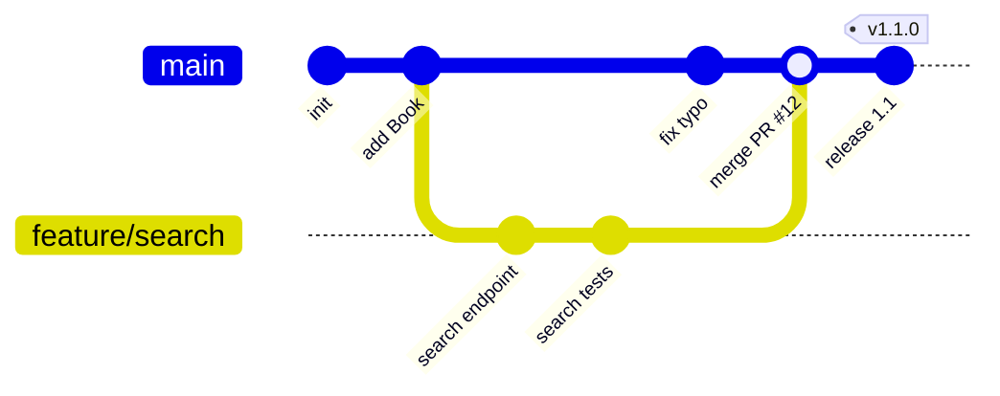
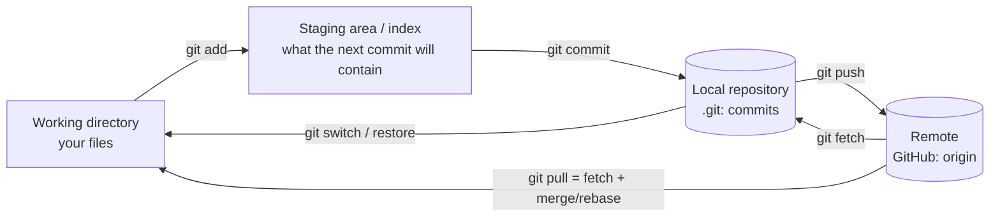
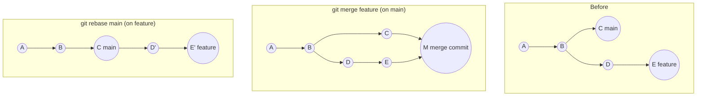
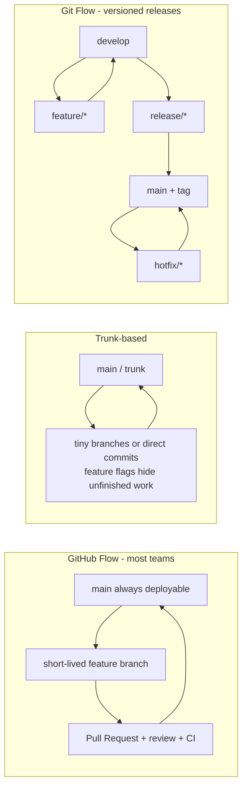
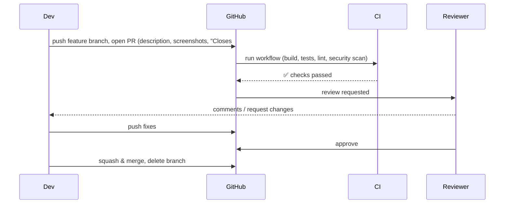

# 11 · Git and GitHub workflow

> Version control the way teams use it: how Git stores history (snapshots, commits, the DAG), the
> three areas, branching, merge vs rebase, resolving conflicts, undoing anything, writing good
> commits, pull requests and code review, branching strategies, tags and releases, and GitHub
> features. The practical is a script that builds a throw-away repository and walks through every
> scenario, including a conflict and a recovery with `reflog`.

---

## 1. How Git thinks

Git stores **snapshots**, not diffs. Every commit points to a full tree of the project (unchanged files are
shared), its **parent(s)**, the author and a message. A commit's id is the **SHA hash** of all that → history is
tamper-evident.



* A **branch** is just a movable pointer (a 41-byte file) to a commit. Creating branches is instant and free.
* **`HEAD`** points to the branch (or commit) you're on.
* History is a **DAG** (directed acyclic graph): merge commits have two parents.

### The three areas



---

## 2. Everyday commands

| Task | Command |
|------|---------|
| Configure once | `git config --global user.name "..."`, `user.email`, `init.defaultBranch main`, `pull.rebase true` |
| Start | `git init` / `git clone <url>` |
| See state | `git status`, `git diff` (unstaged), `git diff --staged` |
| Stage / commit | `git add <file>` / `git add -p` (pick hunks) → `git commit -m "..."` |
| History | `git log --oneline --graph --all`, `git show <sha>`, `git blame <file>` |
| Branches | `git switch -c feature/x`, `git switch main`, `git branch -d feature/x` |
| Sync | `git fetch`, `git pull`, `git push -u origin feature/x` |
| Merge / rebase | `git merge feature/x`, `git rebase main` |
| Stash work in progress | `git stash push -m "wip"`, `git stash pop` |
| Pick one commit | `git cherry-pick <sha>` |
| Find the commit that broke something | `git bisect start; git bisect bad; git bisect good v1.0` |
| Tags | `git tag -a v1.2.0 -m "Release 1.2.0"`, `git push --tags` |

---

## 3. Merge vs rebase



| | Merge | Rebase |
|---|---|---|
| History | true history, merge commits | linear, rewritten commits (new SHAs) |
| Safe on shared branches | ✅ | ❌ **never rebase commits others already pulled** |
| Typical use | integrating a PR into `main` | updating your **own** feature branch with the latest `main`, cleaning up commits before review |
| Variants | `--no-ff` (always a merge commit), **squash merge** (one commit per PR) | `rebase -i` to squash/reword/reorder |

Golden rule: **rebase private branches, merge public ones.** If you must update a pushed branch after a rebase use
`git push --force-with-lease` (refuses if someone else pushed meanwhile), never plain `--force`.

---

## 4. Conflicts

A conflict happens when both sides changed the **same lines** (or one deleted a file the other changed).

```
<<<<<<< HEAD
    return price.multiply(TAX_RATE);
=======
    return price.multiply(VAT).setScale(2, RoundingMode.HALF_UP);
>>>>>>> feature/vat
```

1. Open the file, decide the correct result (often a combination), delete the markers.
2. Build and **run the tests**.
3. `git add <file>` then `git commit` (merge) or `git rebase --continue` (rebase).
4. Changed your mind? `git merge --abort` / `git rebase --abort`.

Avoid big conflicts: small PRs, pull `main` often, don't reformat whole files in feature PRs.

---

## 5. Undoing things

| Situation | Command | Rewrites history? |
|-----------|---------|-------------------|
| Discard unstaged changes in a file | `git restore <file>` | no |
| Unstage a file | `git restore --staged <file>` | no |
| Fix the last commit (message/forgotten file) — not pushed yet | `git commit --amend` | yes |
| Undo a **pushed** commit safely | `git revert <sha>` (new commit that inverts it) | **no** |
| Move branch back, keep changes staged | `git reset --soft HEAD~1` | yes |
| Move branch back, keep changes unstaged | `git reset --mixed HEAD~1` (default) | yes |
| Move branch back, **throw changes away** | `git reset --hard HEAD~1` ⚠ | yes |
| "I lost a commit!" | `git reflog` → `git switch -c rescue <sha>` | – |
| Committed a secret | rotate the secret **first**, then purge with `git filter-repo`; assume it is leaked | yes |

`git reflog` records where `HEAD` has been for ~90 days: almost nothing committed is ever truly lost.

---

## 6. Good commits

* **Small and focused**: one logical change per commit; the build passes at every commit.
* Message: imperative summary ≤ 72 chars, blank line, body explaining **why**.
* **Conventional Commits** (enables automatic changelogs and semantic versioning):

```
feat(orders): add cancellation endpoint

Customers can cancel unpaid orders within 30 minutes.
Returns 409 when the order is already shipped.

Closes #42
```

Types: `feat`, `fix`, `docs`, `refactor`, `test`, `perf`, `build`, `ci`, `chore`; `feat!` or `BREAKING CHANGE:`
for breaking changes.

**`.gitignore`** what is generated or secret: `target/`, `build/`, `.idea/`, `*.class`, `.env`, logs. Never commit
passwords, API keys or `application-prod.properties` with secrets.

---

## 7. Branching strategies



| Strategy | Best for |
|----------|----------|
| **GitHub Flow** | web services with continuous deployment |
| **Trunk-based development** | high-performing teams, many deploys per day, strong CI |
| **Git Flow** | software shipped in versions (libraries, mobile apps, on-prem products) |

Branch names: `feature/order-cancel`, `fix/login-npe`, `chore/upgrade-boot-4`.

---

## 8. Pull requests and code review



As an author: small PRs (< 400 lines), describe *what and why*, self-review the diff first, add tests.
As a reviewer: correctness, tests, readability, security, naming — be kind and specific; ask questions.

Protect `main` on GitHub: **required reviews**, **required status checks**, no force pushes.

---

## 9. Tags, releases and versioning

**Semantic Versioning** `MAJOR.MINOR.PATCH`: MAJOR = breaking change, MINOR = new backwards-compatible feature,
PATCH = bug fix. Pre-releases: `2.0.0-rc.1`. Tag releases (`git tag -a v1.4.0`) and publish GitHub Releases with notes.

---

## 10. GitHub features worth knowing

Issues & labels, Projects (kanban), Pull requests & reviews, **Actions** (CI/CD — topic 28), Dependabot (dependency
updates), CodeQL/secret scanning, Releases & Packages (GHCR), Pages, Codespaces, branch protection & rulesets,
`CODEOWNERS`, PR/issue templates.

---

## 11. Tools and why

| Tool | Why |
|------|-----|
| Git CLI | the real thing; every GUI is built on it |
| IntelliJ / VS Code Git integration | visual diff, conflict resolution, partial staging |
| GitHub CLI `gh` | PRs, issues, Actions runs from the terminal |
| `git-filter-repo` | rewrite history (remove secrets/large files) |
| pre-commit hooks (`.git/hooks`, Husky, pre-commit) | run formatters/tests before committing |
| Git LFS | large binary files |

---

## 12. Practical

```bash
bash topics/11-git/practical/git-playground.sh        # builds a temp repo and runs every scenario, printing the graph
```

Also in `practical/`: a Conventional Commits `commit-msg` hook, a commit message template and a pull request
template you can copy into your own repositories.

```bash
cp topics/11-git/practical/commit-msg .git/hooks/commit-msg && chmod +x .git/hooks/commit-msg   # enable the hook
git config commit.template topics/11-git/practical/gitmessage.txt
```

## 13. Interview questions

1. What is the difference between `git fetch` and `git pull`?
2. Merge vs rebase? When is rebasing dangerous?
3. `reset --soft` vs `--mixed` vs `--hard`? `reset` vs `revert`?
4. How do you resolve a merge conflict?
5. How would you recover a commit you deleted with `reset --hard`?
6. What branching strategy does your team use and why?
7. What makes a good pull request?

## Exercises

- [ ] Run the playground and explain every graph it prints.
- [ ] Create a conflict yourself between two branches and resolve it in IntelliJ's merge tool.
- [ ] Use `git rebase -i HEAD~3` to squash three commits into one.
- [ ] Use `git bisect` to find which of 10 commits broke a test (script it with `git bisect run`).
- [ ] Protect `main` in your GitHub repository: require a PR, one review and passing checks.
