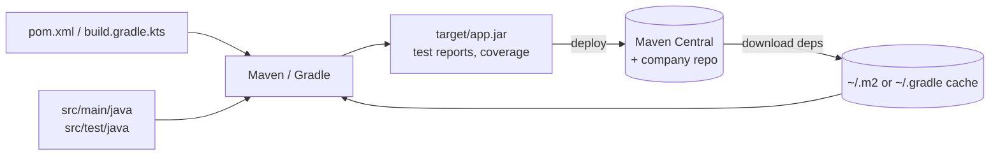
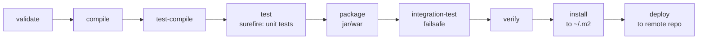
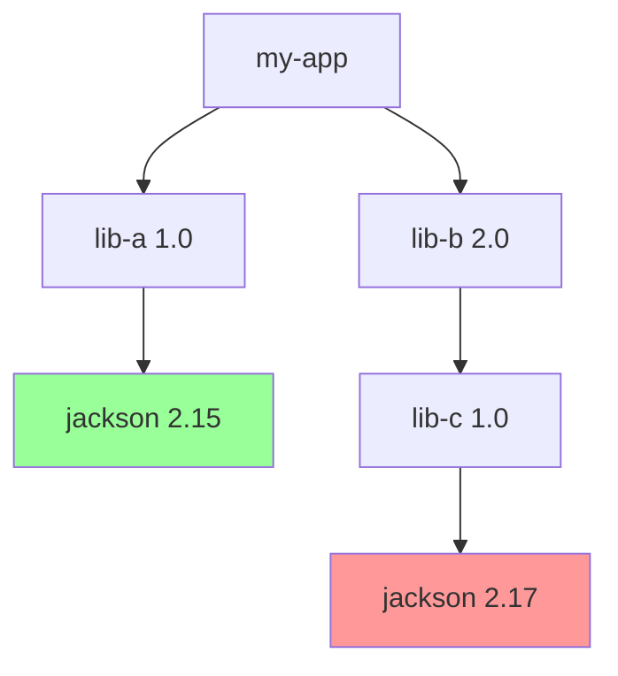
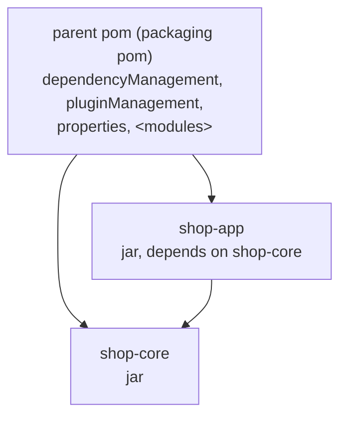

# 12 · Build tools: Maven and Gradle

> What a build tool does, Maven in depth (POM, coordinates, lifecycle, plugins, dependency scopes,
> transitive dependencies and conflict resolution, BOMs, multi-module builds, profiles, repositories,
> the wrapper) and Gradle (tasks, configurations, Kotlin DSL, version catalogs, build cache) — with a
> comparison and the commands you'll use daily. Practical: a multi-module Maven build with a BOM,
> profiles and the enforcer plugin, plus the same build written for Gradle.

---

## 1. Why a build tool?

Without one you'd run `javac` with a giant classpath, download jars by hand, run tests manually and zip the result.
A build tool gives you:

* **Dependency management**: declare `spring-boot-starter-webmvc`, get it and its ~40 transitive jars from a repository.
* **A standard project layout** (`src/main/java`, `src/test/java`, `src/main/resources`).
* **A repeatable build**: compile → test → package → publish, identical on every machine and in CI.
* **Plugins** for everything else: code coverage, formatting, Docker images, code generation, releases.



---

## 2. Maven

### 2.1 The POM and coordinates

```xml
<project>
    <modelVersion>4.0.0</modelVersion>
    <groupId>com.shop</groupId>            <!-- organisation / reversed domain -->
    <artifactId>order-service</artifactId> <!-- project name -->
    <version>1.4.0-SNAPSHOT</version>      <!-- SNAPSHOT = work in progress, can change -->
    <packaging>jar</packaging>             <!-- jar (default), war, pom (parent/aggregator) -->

    <properties>
        <maven.compiler.release>21</maven.compiler.release>
    </properties>

    <dependencies>
        <dependency>
            <groupId>org.springframework.boot</groupId>
            <artifactId>spring-boot-starter-webmvc</artifactId>
            <version>4.1.2</version>       <!-- omitted when a parent/BOM manages it -->
        </dependency>
    </dependencies>
</project>
```

**GAV** = `groupId:artifactId:version` identifies every artifact in the world, e.g.
`com.fasterxml.jackson.core:jackson-databind:2.18.2` → stored at
`com/fasterxml/jackson/core/jackson-databind/2.18.2/jackson-databind-2.18.2.jar`.

### 2.2 Build lifecycle



* Running a phase runs **all previous phases**: `mvn package` = validate + compile + test + package.
* Separate lifecycles: **`clean`** (delete `target/`) and `site` (reports).
* **Plugins** do the work; each **goal** (`compiler:compile`, `surefire:test`, `jar:jar`) is bound to a phase.
  You can also call goals directly: `mvn dependency:tree`, `mvn spring-boot:run`.

### 2.3 Dependency scopes

| Scope | Compile classpath | Test classpath | Runtime / packaged | Example |
|-------|:---:|:---:|:---:|---------|
| `compile` (default) | ✅ | ✅ | ✅ | Spring, Jackson |
| `provided` | ✅ | ✅ | ❌ (container provides it) | Servlet API in a WAR, Lombok |
| `runtime` | ❌ | ✅ | ✅ | JDBC drivers (`postgresql`), Logback |
| `test` | ❌ | ✅ | ❌ | JUnit, Mockito, AssertJ, Testcontainers |
| `import` (only in `dependencyManagement`, type `pom`) | – | – | – | BOMs like `spring-boot-dependencies` |
| `system` | deprecated | | | – |

`<optional>true</optional>`: don't pass this dependency on to my users.

### 2.4 Transitive dependencies and conflicts



Maven picks **one version per artifact** using **"nearest wins"** (shortest path from your project; on a tie, the first
declared). Above, `jackson 2.15` wins (depth 2 vs 3) even though `lib-c` needs 2.17 → possible `NoSuchMethodError` at
runtime. Tools:

* `mvn dependency:tree -Dverbose` — see what was chosen and what was omitted.
* `<dependencyManagement>` — force one version for the whole build.
* `<exclusions>` — drop an unwanted transitive dependency.
* **BOM** (Bill of Materials) — a POM that only contains `dependencyManagement` with versions that work together
  (`spring-boot-dependencies`, `jackson-bom`, `junit-bom`, `testcontainers-bom`). Import it once, then omit versions.
* `maven-enforcer-plugin` with `dependencyConvergence` — fail the build on conflicting versions.

### 2.5 Parent POMs, multi-module builds, profiles



* **Inheritance** (`<parent>`): children inherit properties, managed versions, plugin configuration.
* **Aggregation** (`<modules>`): one command builds all modules in dependency order (the *reactor*).
* Build part of it: `mvn -pl shop-app -am verify` (`-am` = also make the modules it depends on).
* **Profiles** change the build for an environment or a need: `mvn verify -Pstrict`; activated by flag, property,
  JDK version, OS or file presence.

### 2.6 Repositories and the wrapper

* **Local repository** `~/.m2/repository` caches everything. **Maven Central** is the default remote. Companies use
  a proxy (Nexus, Artifactory) configured in `~/.m2/settings.xml` (mirrors, credentials).
* `SNAPSHOT` versions are re-checked for updates; releases never change.
* **Maven Wrapper** (`mvnw`, `mvnw.cmd`, `.mvn/wrapper/`) pins the Maven version per project: anyone can build without
  installing Maven. Always commit it.

### 2.7 Commands you'll use daily

| Command | Purpose |
|---------|---------|
| `./mvnw clean verify` | full build with all tests (what CI runs) |
| `./mvnw test -Dtest=OrderServiceTest#cancel*` | run specific tests |
| `./mvnw package -DskipTests` | build quickly (`-Dmaven.test.skip=true` also skips compiling tests) |
| `./mvnw dependency:tree` | dependency graph |
| `./mvnw versions:display-dependency-updates` | outdated dependencies |
| `./mvnw help:effective-pom` | the final POM after inheritance |
| `./mvnw -pl module -am install` | build one module of a multi-module project |
| `./mvnw -o` / `-U` | offline / force update of snapshots |
| `./mvnw spring-boot:run` | run a Spring Boot app |

### 2.8 Plugins worth knowing

| Plugin | Purpose |
|--------|---------|
| `maven-compiler-plugin` | compile (`release`, `-parameters`, annotation processors) |
| `maven-surefire-plugin` / `maven-failsafe-plugin` | unit tests (`*Test`) / integration tests (`*IT`) |
| `maven-jar-plugin`, `maven-shade-plugin` | jars; shaded "fat" jars |
| `spring-boot-maven-plugin` | executable Boot jar, `spring-boot:run`, `build-image` |
| `jacoco-maven-plugin` | code coverage (topic 13) |
| `maven-enforcer-plugin` | rules: Java version, dependency convergence, banned dependencies |
| `versions-maven-plugin` | find/update versions |
| `spotless-maven-plugin`, `maven-checkstyle-plugin` | formatting / style checks |
| `exec-maven-plugin` | run a main class |
| `flyway-maven-plugin`, `jooq-codegen-maven`, `openapi-generator-maven-plugin` | DB migrations, code generation |

---

## 3. Gradle

Gradle builds are **code** (Kotlin or Groovy DSL) organised as a graph of **tasks**. It's faster on large builds thanks
to **incremental builds**, the **build cache** and a background **daemon**.

```kotlin
// build.gradle.kts
plugins {
    java
    application
    id("org.springframework.boot") version "4.1.2"
}

java { toolchain { languageVersion = JavaLanguageVersion.of(21) } }

dependencies {
    implementation(platform(libs.spring.boot.bom))        // BOM
    implementation("org.springframework.boot:spring-boot-starter-webmvc")
    runtimeOnly("org.postgresql:postgresql")
    testImplementation("org.springframework.boot:spring-boot-starter-test")
}

tasks.test { useJUnitPlatform() }
```

| Gradle configuration | ≈ Maven scope |
|----------------------|---------------|
| `implementation` | compile (not leaked to consumers' compile classpath) |
| `api` (`java-library` plugin) | compile, exposed to consumers |
| `compileOnly` | provided |
| `runtimeOnly` | runtime |
| `testImplementation` / `testRuntimeOnly` | test |
| `annotationProcessor` | annotation processors (Lombok, MapStruct) |
| `platform(...)` | import a BOM |

**Version catalogs** (`gradle/libs.versions.toml`) centralise versions for all modules. Commands:
`./gradlew build`, `./gradlew test --tests "*OrderService*"`, `./gradlew dependencies`, `./gradlew bootRun`,
`./gradlew tasks`.

---

## 4. Maven vs Gradle

| | Maven | Gradle |
|---|---|---|
| Build file | XML, declarative, convention-based | Kotlin/Groovy code, very flexible |
| Learning curve | easy to read, verbose | concise, more concepts |
| Performance | good; reactor, `-T 4` parallel builds | faster for big/multi-module builds (incremental, cache, daemon) |
| Customisation | via plugins | any logic in the build script |
| Ecosystem | the most common in enterprise Java backends | standard for Android, Kotlin, large monorepos |
| Spring Initializr | ✅ | ✅ |

**Advice**: learn Maven first (most job postings, most tutorials), be able to read Gradle.

---

## 5. Packages / tools and why

| Tool | Why |
|------|-----|
| Maven + Maven Wrapper | standard, reproducible builds |
| Gradle + Gradle Wrapper | faster, flexible builds |
| Maven Central / Nexus / Artifactory | public / private artifact repositories |
| BOMs (`spring-boot-dependencies`, `junit-bom`...) | compatible versions without listing each one |
| Dependabot / Renovate | automatic dependency update PRs |
| OWASP Dependency-Check, `mvn org.cyclonedx:cyclonedx-maven-plugin` (SBOM) | vulnerable dependencies, software bill of materials |

---

## 6. Practical

`practical/maven-multimodule` — a reactor with a parent, `shop-core` (library) and `shop-app` (depends on core),
a BOM import, `dependencyManagement`, the enforcer plugin (Java ≥ 21, dependency convergence) in a `strict`
profile, and a `exec:java` run configuration:

```bash
./mvnw -f topics/12-build-tools/practical/maven-multimodule/pom.xml verify                 # build both modules
./mvnw -f topics/12-build-tools/practical/maven-multimodule/pom.xml verify -Pstrict        # + enforcer rules
./mvnw -f topics/12-build-tools/practical/maven-multimodule/pom.xml -pl shop-app -am dependency:tree
# run the app: install the modules into ~/.m2 first, then run shop-app on its own
./mvnw -q -f topics/12-build-tools/practical/maven-multimodule/pom.xml install -DskipTests
./mvnw -q -f topics/12-build-tools/practical/maven-multimodule/shop-app/pom.xml exec:java
```

> Why not `-pl shop-app -am exec:java`? With `-am` the goal runs in **every** selected module, and the parent and
> `shop-core` have no main class, so `exec:java` fails there. Installing the library and running only the app module is
> exactly the workflow `install` exists for.

`practical/gradle-multimodule` — the same project for Gradle (Kotlin DSL + version catalog). Gradle is not installed
in this repository's environment, so it is a reference: install Gradle 9 and run `gradle build` (or generate the
wrapper with `gradle wrapper`).

## 7. Interview questions

1. Explain the Maven lifecycle. What does `mvn install` do that `mvn package` doesn't?
2. Compile vs provided vs runtime vs test scope?
3. How does Maven resolve version conflicts between transitive dependencies? How do you fix a conflict?
4. What is a BOM? What is `dependencyManagement` vs `dependencies`?
5. Inheritance vs aggregation in multi-module projects?
6. Why commit the Maven/Gradle wrapper?
7. `implementation` vs `api` in Gradle?

## Exercises

- [ ] Run `dependency:tree -Dverbose` on the Spring REST practical (topic 08) and find two omitted conflicting versions.
- [ ] Add a third module `shop-cli` that depends on `shop-core`, and build only it with `-pl shop-cli -am`.
- [ ] Add JaCoCo to the multi-module build and fail the build under 80% line coverage.
- [ ] Create a profile `dev` that sets a property used by a resource file (resource filtering).
