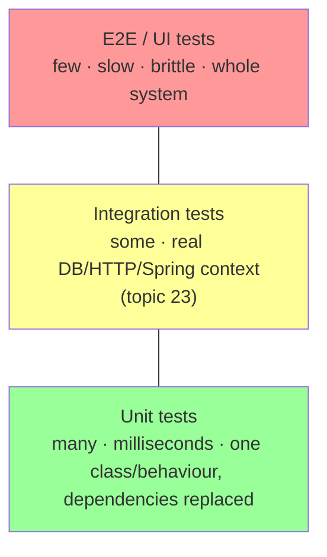
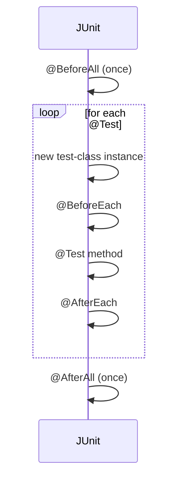
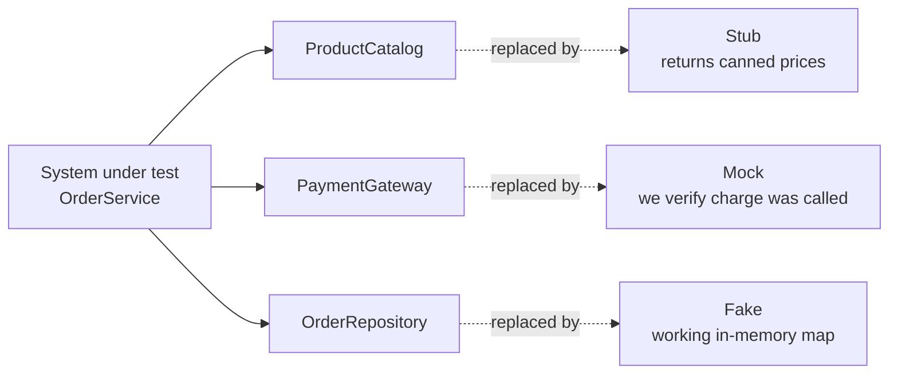
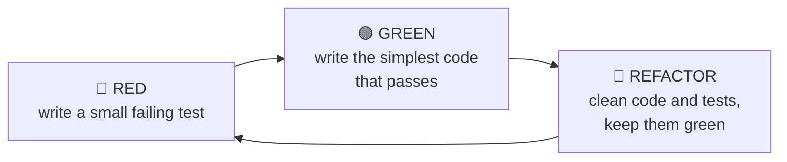

# 13 · Testing: JUnit, AssertJ, Mockito and TDD

> Why and what to test, the test pyramid, test doubles (dummy, stub, spy, mock, fake), **JUnit**
> (lifecycle, assertions, parameterized/nested/dynamic tests, extensions), **AssertJ** fluent
> assertions, **Mockito** (stubbing, verification, captors, BDD style, when *not* to mock),
> **test-driven development** step by step, coverage with **JaCoCo** and mutation testing with PIT,
> naming, structure and test smells. The practical module has ~40 tests showing every feature.

---

## 1. Why test?

* **Confidence to change code** (refactor, upgrade Spring, fix bugs) without breaking existing behaviour.
* **Fast feedback**: a unit test fails in milliseconds; a bug found in production costs hours.
* **Executable documentation**: tests show how the code is meant to be used.
* **Better design**: code that is easy to test is loosely coupled (dependency injection, small units).

## 2. The test pyramid



| Level | Scope | Tools | Speed |
|-------|-------|-------|-------|
| Unit | a class or small group of classes | JUnit + AssertJ + Mockito | ms |
| Slice / component | one Spring layer (`@WebMvcTest`, `@DataJpaTest`) | Spring Boot test | 100s of ms |
| Integration | app + real database/broker | `@SpringBootTest` + Testcontainers | seconds |
| Contract | API agreement between services | Spring Cloud Contract, Pact | seconds |
| End-to-end | deployed system through UI/API | Playwright, Selenium, REST Assured | minutes |

---

## 3. Anatomy of a good unit test

```java
@Test
void appliesTenPercentDiscountAboveThreshold() {          // name says the behaviour
    // Arrange (Given)
    var cart = new Cart().add("laptop", "1200.00", 1);
    // Act (When)
    BigDecimal total = pricing.totalWithDiscount(cart);
    // Assert (Then)
    assertThat(total).isEqualByComparingTo("1080.00");
}
```

**F.I.R.S.T.**: **F**ast, **I**ndependent (no order dependencies, no shared state), **R**epeatable (no real clock,
random, network), **S**elf-validating (assertions, no reading logs), **T**imely (written with the code).

Naming styles: `methodName_condition_expectedResult`, or a sentence `rejectsOrdersWithoutItems()`, or
`@DisplayName("rejects orders without items")`. Test **behaviour**, not implementation details.

---

## 4. JUnit (Jupiter, JUnit 5/6)

Spring Boot 4 ships **JUnit 6** (same Jupiter API as JUnit 5, Java 17 baseline).

| Annotation | Purpose |
|------------|---------|
| `@Test` | a test method |
| `@BeforeEach` / `@AfterEach` | run around **each** test (fresh fixtures) |
| `@BeforeAll` / `@AfterAll` | once per class (static by default) |
| `@DisplayName` | readable name in reports |
| `@Nested` | group related tests in inner classes (shared setup per group) |
| `@ParameterizedTest` + `@ValueSource`, `@CsvSource`, `@MethodSource`, `@EnumSource`, `@NullAndEmptySource` | run one test with many inputs |
| `@RepeatedTest(5)` | repeat |
| `@TestFactory` | dynamic tests generated at runtime |
| `@Tag("slow")` | filter tests (`-Dgroups=slow`) |
| `@Disabled("reason")` | skip (always give a reason) |
| `@Timeout(1)` | fail if too slow |
| `@TempDir` | temporary directory injected and deleted |
| `@ExtendWith(...)` | plug in extensions: `MockitoExtension`, `SpringExtension` |



JUnit creates a **new instance of the test class for every test method** — fields are never shared between tests
(unless `@TestInstance(PER_CLASS)`).

Assertions: `assertEquals`, `assertTrue`, `assertThrows`, `assertAll` (report every failure), `assertTimeout`;
assumptions: `assumeTrue(...)` skips a test when a precondition isn't met (e.g. no Docker).

---

## 5. AssertJ — readable assertions

```java
assertThat(order.total()).isEqualByComparingTo("99.90");
assertThat(names).hasSize(3).contains("Ali").doesNotContain("Bob").isSorted();
assertThat(users).extracting(User::email).containsExactly("a@x.com", "b@x.com");
assertThat(map).containsEntry("IT", 3L).doesNotContainKey("HR");
assertThatThrownBy(() -> service.place(emptyOrder))
        .isInstanceOf(EmptyOrderException.class)
        .hasMessageContaining("at least one item");
assertThat(actualDto).usingRecursiveComparison().ignoringFields("id").isEqualTo(expectedDto);
SoftAssertions.assertSoftly(s -> { s.assertThat(a).isEqualTo(1); s.assertThat(b).isTrue(); });   // report all
```

Why AssertJ over plain JUnit assertions: fluent, type-specific methods, excellent failure messages, no confusion about
`expected`/`actual` order.

---

## 6. Test doubles



| Double | What it is | Example |
|--------|-----------|---------|
| **Dummy** | passed but never used | `null` / any object to fill a parameter |
| **Stub** | returns predefined answers | catalog returns price 10 for "pen" |
| **Spy** | real object that also records calls | `spy(new ArrayList<>())` |
| **Mock** | pre-programmed with expectations; you **verify** interactions | `verify(gateway).charge(...)` |
| **Fake** | simplified working implementation | in-memory repository, H2 instead of PostgreSQL |

---

## 7. Mockito

```java
@ExtendWith(MockitoExtension.class)
class OrderServiceTest {
    @Mock ProductCatalog catalog;                  // mock created for each test
    @Mock PaymentGateway payments;
    @InjectMocks OrderService service;             // constructor injection of the mocks

    @Test
    void chargesTheCustomer() {
        when(catalog.priceOf("pen")).thenReturn(new BigDecimal("2.50"));            // stub
        when(payments.charge(any(), any())).thenReturn(PaymentResult.approved("tx-1"));

        service.place("cust-1", Map.of("pen", 4));

        verify(payments).charge(eq("cust-1"), argThat(a -> a.compareTo(new BigDecimal("10.00")) == 0));   // verify
        verifyNoMoreInteractions(payments);
    }
}
```

| Feature | API |
|---------|-----|
| Stub return / throw | `when(m.call()).thenReturn(x)` / `.thenThrow(new X())` / `doThrow(...).when(m).voidCall()` |
| Argument matchers | `any()`, `eq(x)`, `anyString()`, `argThat(predicate)` — all args must be matchers if one is |
| Verify | `verify(m).call(args)`, `verify(m, times(2))`, `never()`, `verifyNoInteractions(m)` |
| Capture arguments | `ArgumentCaptor<Order> c = ArgumentCaptor.forClass(Order.class); verify(repo).save(c.capture());` |
| Answers | `thenAnswer(inv -> inv.getArgument(0))` |
| Spies | `spy(realObject)` — careful: `doReturn(x).when(spy).method()` |
| BDD style | `given(...).willReturn(...)`, `then(m).should().call(...)` |
| Static/final mocking | supported by the inline mock maker (default since Mockito 5) — usually a design smell |
| In Spring tests | `@MockitoBean` replaces a bean in the context |

**When not to mock**: value objects and simple data (just create them), the class under test, types you don't own
when a fake/real implementation is easy (use Testcontainers for the DB), and don't verify every call (tests become
coupled to implementation). Mockito's **strict stubs** fail tests with unnecessary stubbings — keep them.

---

## 8. Test-Driven Development (TDD)



The `PasswordPolicy` in the practical was written this way. Its history:

| Step | Test added (RED) | Code change (GREEN) |
|------|------------------|---------------------|
| 1 | rejects `null`/empty | `if (p == null || p.isEmpty()) return invalid` |
| 2 | at least 8 characters | length check |
| 3 | needs a digit | `chars().anyMatch(Character::isDigit)` |
| 4 | needs upper and lower case | two more checks |
| 5 | reports **all** violations, not the first | refactor: collect a list of violations (tests stayed green) |
| 6 | rejects passwords containing the username | new rule |

Benefits: only necessary code, design driven by usage, a full regression suite for free. Use it especially for business
rules and bug fixes (first write a test that reproduces the bug).

---

## 9. Coverage and mutation testing

* **JaCoCo** measures which lines/branches the tests executed. The practical fails the build below **80% line coverage**
  (`./mvnw verify`, report in `target/site/jacoco/index.html`).
* Coverage shows what is **not** tested; high coverage doesn't prove good tests (a test without assertions covers lines).
* **Mutation testing (PIT)** changes your code (e.g. `>` → `>=`) and checks a test fails — measures test *quality*:
  `./mvnw org.pitest:pitest-maven:mutationCoverage`.

---

## 10. Test smells

| Smell | Fix |
|-------|-----|
| Tests depend on order / shared static state | fresh fixtures in `@BeforeEach` |
| `Thread.sleep` to wait for async work | Awaitility `await().until(...)` |
| Real time / randomness | inject `Clock`, seeded `Random` |
| Huge setup, many mocks | the class does too much → split it |
| Asserting on log output or private fields | assert on behaviour/outputs |
| One test checks 10 things | one behaviour per test (`assertAll`/soft assertions for one behaviour's facets) |
| Ignored/disabled tests forever | fix or delete |
| Flaky tests | find the non-determinism (time, order, concurrency, network) |

---

## 11. Packages / libraries and why

| Dependency | Why |
|------------|-----|
| `org.junit.jupiter:junit-jupiter` | the test framework |
| `org.assertj:assertj-core` | fluent assertions |
| `org.mockito:mockito-core` + `mockito-junit-jupiter` | mocks, stubs, spies; `MockitoExtension` |
| `spring-boot-starter-test` | bundles JUnit, AssertJ, Mockito, Hamcrest, JSONassert, JsonPath, Awaitility |
| `org.awaitility:awaitility` | test asynchronous code without sleeps |
| `org.testcontainers` | real databases/brokers in Docker for integration tests (topic 23) |
| `org.jacoco:jacoco-maven-plugin` | coverage reports and gates |
| `org.pitest:pitest-maven` | mutation testing |
| ArchUnit | test architecture rules ("controllers must not use repositories") |

---

## 12. Practical

`practical/testing-demo` (Maven module):

| Test class | Shows |
|------------|-------|
| `PasswordPolicyTest` | TDD result, `@Nested`, `@ParameterizedTest` (`@CsvSource`, `@NullAndEmptySource`, `@ValueSource`), `@DisplayName` |
| `OrderServiceTest` | Mockito: `@Mock`, `@InjectMocks`, stubbing, matchers, `verify`, `never`, `ArgumentCaptor`, `thenThrow`, BDDMockito, fake repository |
| `JUnitFeaturesTest` | lifecycle, `assertAll`, `assertThrows`, assumptions, `@Timeout`, `@RepeatedTest`, `@TempDir`, `@TestFactory`, `@Tag`, `@Disabled` |
| `AssertJShowcaseTest` | collections, maps, exceptions, soft assertions, recursive comparison, `extracting`, `satisfies` |

```bash
./mvnw -f topics/pom.xml -pl 13-testing/practical/testing-demo verify      # tests + JaCoCo 80% gate
./mvnw -f topics/pom.xml -pl 13-testing/practical/testing-demo test -Dgroups=fast
```

## 13. Interview questions

1. Unit vs integration vs end-to-end tests? What is the test pyramid?
2. Mock vs stub vs spy vs fake?
3. `@Mock` vs `@MockitoBean`? `@InjectMocks`?
4. How do you test a method that returns `void`? That uses the current time?
5. What is TDD? Walk through red-green-refactor.
6. Is 100% coverage a good goal? What does mutation testing add?
7. How do you test code that throws exceptions? Asynchronous code?
8. What makes a test flaky?

## Exercises

- [ ] Add a rule "no more than 2 repeated characters in a row" to `PasswordPolicy` test-first.
- [ ] Add "orders over 5 000 require manual approval" to `OrderService` using TDD and Mockito.
- [ ] Run PIT on the module and kill at least one surviving mutant with a new test.
- [ ] Replace the fake repository with a Mockito mock in one test and discuss which test is better.
