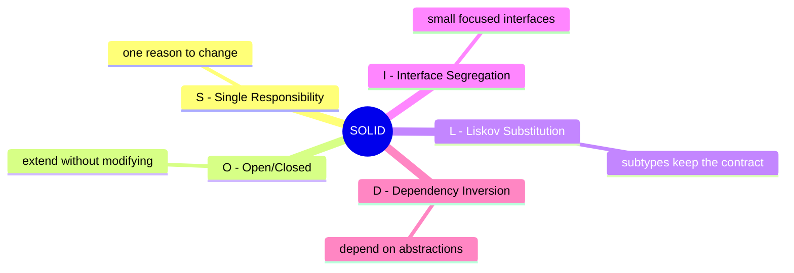
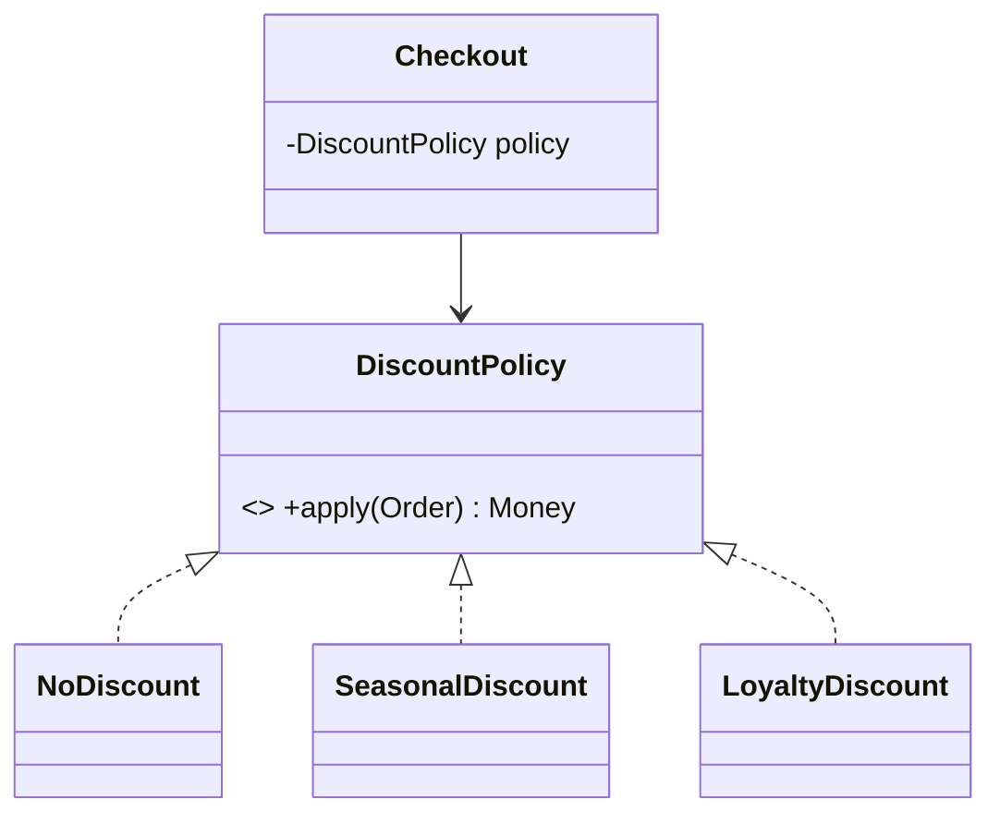
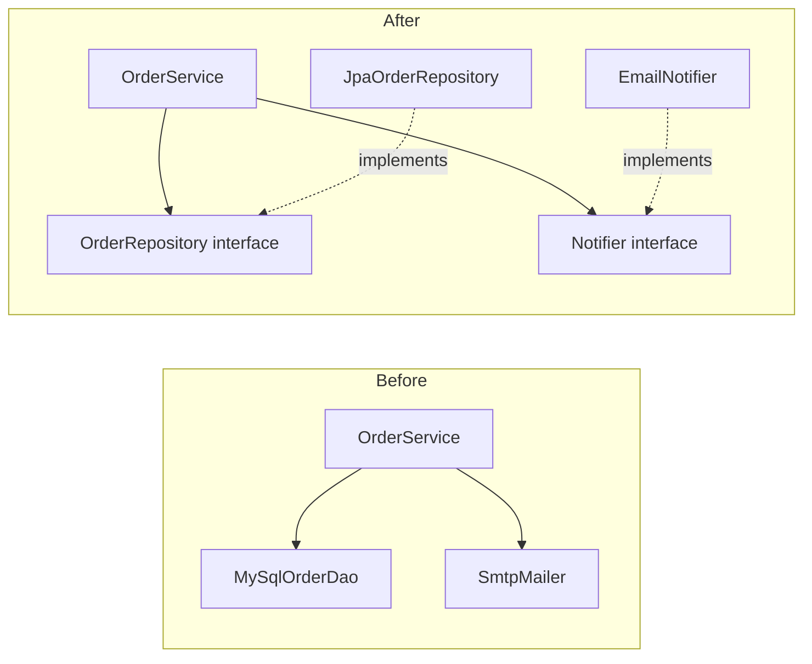
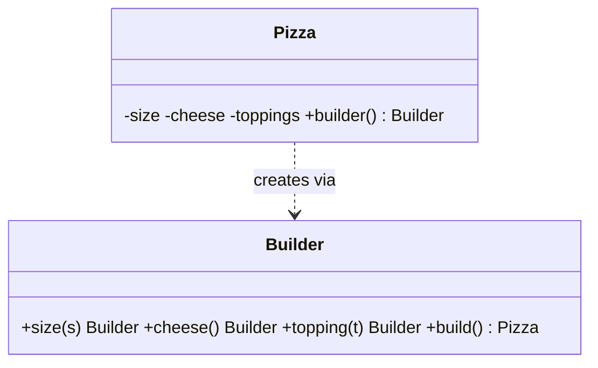
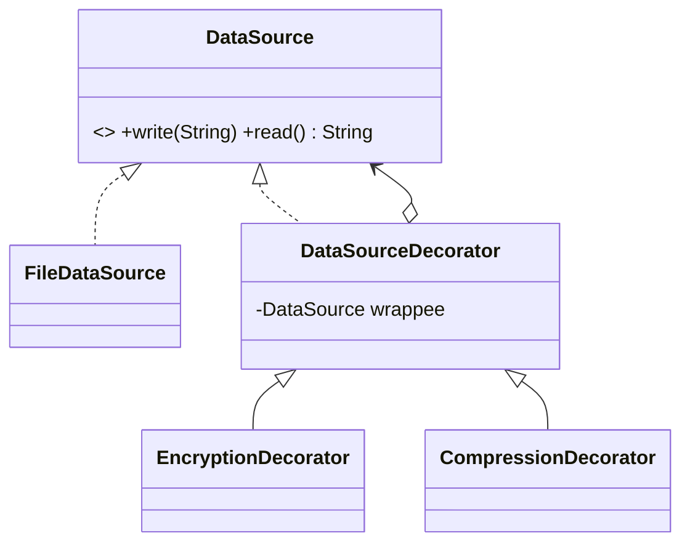
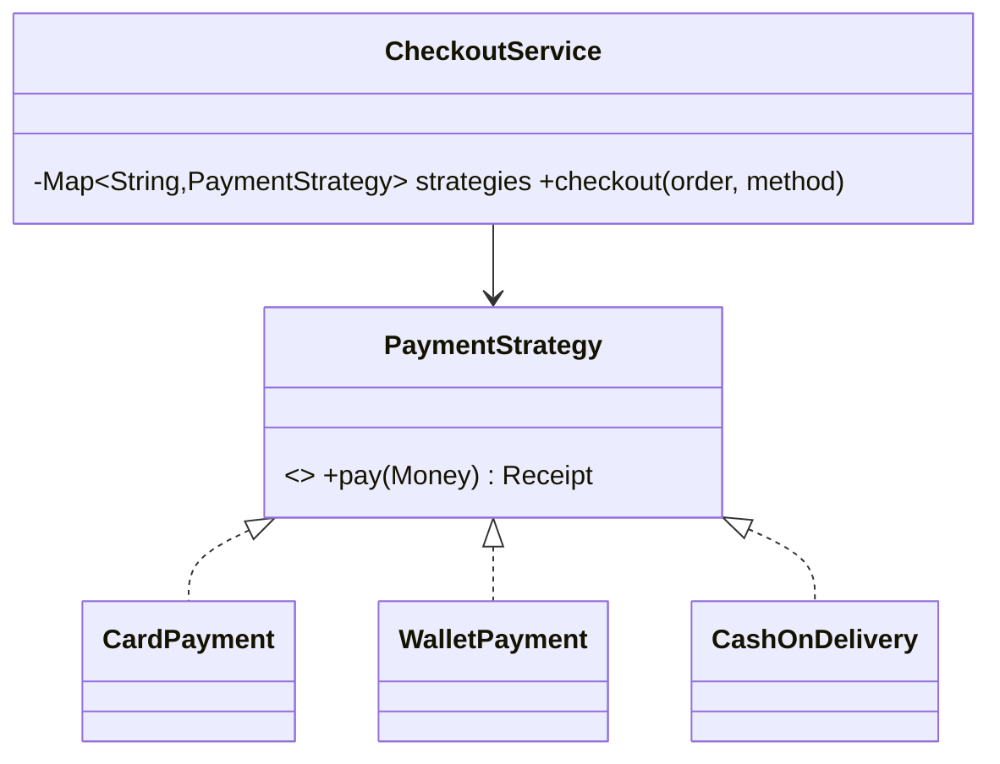
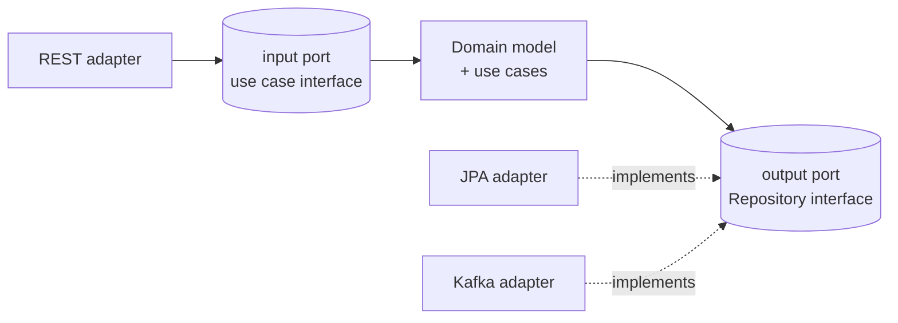

# 14 · Clean code, SOLID and design patterns

> Writing code that other people (and future you) can read and change safely: naming, functions,
> comments, code smells and refactorings, the **SOLID** principles with before/after code, DRY/KISS/
> YAGNI, and the **Gang of Four design patterns** most used in Java backends — each with a UML
> diagram, when to use it, and where Spring/the JDK already use it. Practicals: runnable SOLID and
> pattern examples.

---

## 1. Clean code essentials

> "Any fool can write code that a computer can understand. Good programmers write code that humans can
> understand." — Martin Fowler

| Area | Do | Don't |
|------|----|-------|
| **Names** | intention-revealing: `elapsedDays`, `activeCustomers`, `calculateShippingCost()` | `d`, `list2`, `data`, `doStuff()`, `mgr` |
| Classes / methods | nouns for classes (`Invoice`), verbs for methods (`send()`) | `InvoiceManagerHelperUtil` |
| **Functions** | small, do **one thing**, one level of abstraction, ≤ 3 parameters | 200-line methods, boolean flag parameters (`render(true)`) |
| Side effects | name them (`saveAndNotify`) or avoid them | `checkPassword()` that also logs the user in |
| **Comments** | explain **why** (business reason, trade-off), public API docs | explain *what* the code does — rename/extract instead; commented-out code |
| Errors | exceptions with context, fail fast | returning `null`, error codes, swallowing exceptions |
| **Formatting** | consistent, automated (Spotless, IDE formatter), small files | mixing styles, 300-character lines |
| Magic values | named constants/enums: `MAX_LOGIN_ATTEMPTS` | `if (attempts > 3)` |
| Structure | high cohesion (things that change together live together), low coupling | god classes, utility dumping grounds |

**Boy Scout Rule**: leave the code a little cleaner than you found it.

### Code smells → refactorings

| Smell | Refactoring |
|-------|-------------|
| Long method | **Extract Method** |
| Large class / god object | **Extract Class**, split responsibilities |
| Long parameter list | **Introduce Parameter Object** (a record) |
| Duplicated code | Extract Method / Pull Up Method / template method |
| Switch on type everywhere | **Replace Conditional with Polymorphism** (or sealed types + pattern matching) |
| Primitive obsession (`String email`, `BigDecimal amount` + `String currency`) | **Value objects** (`Email`, `Money` records) |
| Feature envy (method uses another class's data more than its own) | **Move Method** |
| Shotgun surgery (one change touches 10 classes) | Move related code together |
| Comments explaining confusing code | Rename, extract, simplify |
| Dead code, speculative generality | Delete it (YAGNI) |

Refactor in **small steps with tests green** after each step (IntelliJ: Ctrl+Alt+M extract method, Shift+F6 rename).

### DRY, KISS, YAGNI and friends

* **DRY** — Don't Repeat Yourself: every piece of *knowledge* has one representation (not "never two similar lines").
* **KISS** — Keep It Simple: the simplest solution that works.
* **YAGNI** — You Aren't Gonna Need It: don't build for imagined future requirements.
* **Law of Demeter** — talk to friends, not strangers: avoid `order.getCustomer().getAddress().getCity()` chains.
* **Composition over inheritance** (topic 05), **Tell, don't ask**, **Fail fast**, **Principle of least astonishment**.

---

## 2. SOLID



### S — Single Responsibility Principle
*A class should have one reason to change.*

```java
// ❌ one class: business rules + SQL + email + PDF → 4 reasons to change
class InvoiceService { calculate(); saveToDatabase(); sendEmail(); renderPdf(); }

// ✅ split by responsibility, orchestrated by a use-case service
class InvoiceCalculator { Money total(Invoice i); }
class InvoiceRepository { void save(Invoice i); }
class InvoiceMailer { void send(Invoice i); }
class InvoicePdfRenderer { byte[] render(Invoice i); }
```

### O — Open/Closed Principle
*Open for extension, closed for modification.*



Adding a new discount = **a new class**, no edits to `Checkout` (instead of growing an `if/else` chain).

### L — Liskov Substitution Principle
*Subtypes must be usable anywhere their base type is, without surprises.*

Classic violation: `Square extends Rectangle` — `setWidth` on a square also changes its height, breaking code that
expects `area == width * height`. Other smells: overriding a method to throw `UnsupportedOperationException`,
strengthening preconditions or weakening postconditions. Fix: different abstractions (`Shape` with `area()`), or
composition.

### I — Interface Segregation Principle
*Clients shouldn't depend on methods they don't use.*

```java
// ❌ fat interface: a basic printer must "implement" fax and scan
interface Machine { void print(Doc d); void scan(Doc d); void fax(Doc d); }

// ✅ role interfaces
interface Printer { void print(Doc d); }
interface Scanner { void scan(Doc d); }
class MultiFunctionPrinter implements Printer, Scanner { ... }
```

Spring Data does this: `CrudRepository`, `PagingAndSortingRepository`, `JpaSpecificationExecutor` are separate.

### D — Dependency Inversion Principle
*High-level policy shouldn't depend on low-level details; both depend on abstractions.*



**Dependency injection** (constructor injection, Spring's IoC container — topic 19) is how DIP is applied in practice.
It's also what makes code testable with mocks (topic 13).

---

## 3. Design patterns (Gang of Four, 1994)

A design pattern is a **named, reusable solution to a recurring design problem**. Three families:

| Creational (how objects are created) | Structural (how objects are composed) | Behavioral (how objects interact) |
|---|---|---|
| **Singleton**, **Factory Method**, Abstract Factory, **Builder**, Prototype | **Adapter**, **Decorator**, **Facade**, **Proxy**, Composite, Bridge, Flyweight | **Strategy**, **Observer**, **Template Method**, Command, Chain of Responsibility, State, Iterator, Visitor, Mediator, Memento |

### 3.1 Creational

| Pattern | Problem → solution | In Java / Spring |
|---------|-------------------|------------------|
| **Singleton** | exactly one instance → private constructor + static instance (best: `enum`) | Spring beans are singletons **per container** (no static state needed) |
| **Factory Method** | decide which subclass to create in one place | `List.of`, `Path.of`, `LocalDate.of`, `NumberFormat.getInstance()` |
| **Abstract Factory** | families of related objects | `DocumentBuilderFactory`, JDBC `Connection` creating `Statement`s |
| **Builder** | many optional parameters, immutable result | `StringBuilder`, `HttpRequest.newBuilder()`, `ResponseEntity.ok().header(...)`, Lombok `@Builder` |
| **Prototype** | create by copying | `clone()`, copy constructors, Spring `prototype` scope |



### 3.2 Structural

| Pattern | Problem → solution | In Java / Spring |
|---------|-------------------|------------------|
| **Adapter** | make an incompatible interface fit → wrapper translating calls | `Arrays.asList`, `InputStreamReader` (bytes → chars), Spring `HandlerAdapter` |
| **Decorator** | add behaviour without subclassing → wrap an object with the same interface | `BufferedInputStream(new FileInputStream())`, `Collections.unmodifiableList` |
| **Facade** | simple API over a complex subsystem | `JdbcTemplate` over JDBC, `RestClient`, a service orchestrating many repositories |
| **Proxy** | control access to an object (lazy, remote, security, transactions) | Spring AOP `@Transactional`, Hibernate lazy proxies (topic 06.09) |
| **Composite** | treat tree parts and wholes uniformly | Swing components, file/directory trees |



### 3.3 Behavioral

| Pattern | Problem → solution | In Java / Spring |
|---------|-------------------|------------------|
| **Strategy** | interchangeable algorithms → interface + implementations chosen at runtime | `Comparator`, Spring injecting `Map<String, PaymentStrategy>` |
| **Observer** | notify many listeners of events | Spring `ApplicationEventPublisher` + `@EventListener`, `PropertyChangeListener`, reactive streams |
| **Template Method** | fixed algorithm with overridable steps | `AbstractList`, `HttpServlet.service → doGet`, `JdbcTemplate` (callbacks) |
| **Command** | encapsulate a request as an object (queue, undo, log) | `Runnable`/`Callable` submitted to executors |
| **Chain of Responsibility** | pass a request along handlers until handled | Servlet **filter chain**, Spring Security filters, interceptors |
| **State** | behaviour changes with internal state | order lifecycle (`New → Paid → Shipped`), sealed types / enums |
| **Iterator** | traverse without exposing internals | `Iterator`, `Iterable`, for-each |
| **Visitor** | add operations to a stable type hierarchy | `FileVisitor`, compiler ASTs; often replaced by sealed types + pattern matching |



### Anti-patterns to recognise

God object, spaghetti code, golden hammer ("everything is a microservice"), premature optimisation, copy-paste
programming, anemic domain model (entities with only getters/setters and all logic in services — sometimes fine for
simple CRUD), singletons as global mutable state, pattern overuse (a factory for a class that has one implementation).

---

## 4. Architecture-level principles (preview)

* **Layered architecture** (controller → service → repository, topic 07).
* **Hexagonal / Ports & Adapters / Clean Architecture**: the domain in the centre, depending on nothing; adapters
  (web, DB, messaging) depend on it through ports (interfaces) — DIP applied to the whole application.
* **Domain-Driven Design**: ubiquitous language, entities, value objects, aggregates, bounded contexts (topic 26).



---

## 5. Tools and why

| Tool | Why |
|------|-----|
| IntelliJ refactorings & inspections | safe automated rename/extract/move |
| **SonarQube / SonarCloud**, SonarLint | code smells, duplication, complexity, bugs, security hotspots |
| Checkstyle, PMD, SpotBugs, Error Prone | static analysis rules |
| **Spotless** + google-java-format / Palantir | automatic consistent formatting |
| **ArchUnit** | test architecture rules (layers, cycles, naming) |
| OpenRewrite | automated large-scale refactorings and migrations |

Books: *Clean Code* (Robert C. Martin), *Refactoring* (Martin Fowler), *Effective Java* (Joshua Bloch),
*Head First Design Patterns*, *Design Patterns* (GoF).

---

## 6. Practical

```bash
java topics/14-clean-code-solid-design-patterns/practical/SolidPrinciples.java
java topics/14-clean-code-solid-design-patterns/practical/CreationalPatterns.java
java topics/14-clean-code-solid-design-patterns/practical/StructuralPatterns.java
java topics/14-clean-code-solid-design-patterns/practical/BehavioralPatterns.java
java topics/14-clean-code-solid-design-patterns/practical/RefactoringKata.java
```

## 7. Interview questions

1. Explain each SOLID principle with an example. Which one does dependency injection implement?
2. Give an example of a Liskov violation.
3. Strategy vs State? Decorator vs Proxy? Adapter vs Facade?
4. How is Spring's singleton different from the GoF Singleton?
5. Which design patterns does Spring use internally? (Proxy, Template Method, Factory, Singleton, Observer, Chain of Responsibility, Front Controller...)
6. What is a code smell? Name five and their refactorings.
7. When is applying a design pattern a bad idea?

## Exercises

- [ ] Refactor `RefactoringKata.java`'s "before" method yourself before reading the "after" version.
- [ ] Implement a `Notification` system with the Strategy pattern (email/SMS/push) and add a new channel without changing existing classes.
- [ ] Write a logging + timing + caching **decorator** chain around a `PriceService` interface.
- [ ] Model an order lifecycle with the State pattern, then rewrite it with a sealed interface and pattern matching; compare.
- [ ] Add an ArchUnit test to the Spring MVC practical (topic 07) that forbids controllers from using repositories.
