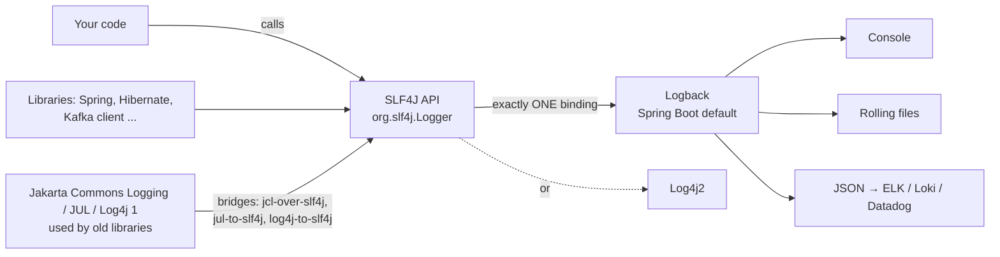
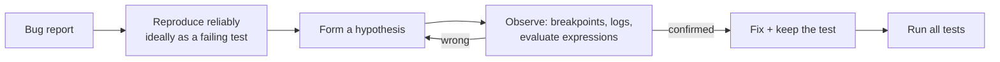

# 15 · Logging and debugging

> Why `System.out.println` isn't logging; the **SLF4J** facade and its back-ends (**Logback**, Log4j2),
> levels, parameterized messages, exceptions, **MDC** for request correlation, structured (JSON)
> logs, configuration and rotation, what never to log; then **debugging**: breakpoints of every kind,
> stepping, evaluating expressions, remote debugging, and diagnosing running JVMs with thread dumps,
> heap dumps and Flight Recorder. Practical: a tested Logback module and a debugging exercise.

---

## 1. Why a logging framework?

| `System.out.println` | Logging framework |
|----------------------|-------------------|
| always prints, can't be turned off | **levels** per package/class, changeable without code changes |
| no timestamp, thread, class | pattern with time, level, thread, logger, request id |
| only to the console | console, files with **rotation**, JSON to Elasticsearch/Loki, syslog |
| string concatenation always runs | `log.debug("x={}", x)` formats only when enabled |
| synchronised, slow | async appenders, buffered output |

---

## 2. The architecture: facade + back-end



* **SLF4J** (Simple Logging Facade for Java) is the API you code against. You can switch the back-end without touching
  code.
* **Logback** is the default implementation in Spring Boot (by the author of SLF4J and Log4j 1). **Log4j2** is the main
  alternative (async loggers, garbage-free). `java.util.logging` (JUL) and `System.Logger` exist in the JDK but are
  rarely used directly in applications.
* Never have **two bindings** on the classpath (SLF4J warns and picks one).
* Log4Shell (CVE-2021-44228, Dec 2021) hit **Log4j 2** message lookups — keep logging libraries updated.

---

## 3. Using SLF4J

```java
private static final Logger log = LoggerFactory.getLogger(OrderService.class);   // one per class

log.info("Order {} placed by {} for {}", order.id(), customerId, total);         // {} placeholders, no concatenation
log.debug("Cart contents: {}", cart);                                             // cart.toString() only if DEBUG on
log.warn("Payment retry {} of {} for order {}", attempt, max, orderId);
log.error("Payment failed for order {}", orderId, exception);                     // exception LAST → full stack trace

// SLF4J 2 fluent API: lazy arguments and key-value pairs (great with JSON logs)
log.atDebug().setMessage("Expensive state: {}").addArgument(() -> computeState()).log();
log.atInfo().addKeyValue("orderId", id).addKeyValue("amount", total).log("order placed");
```

### Levels

| Level | Use for | Typical production setting |
|-------|---------|----------------------------|
| `ERROR` | a failure needing attention (request failed, job aborted) | on |
| `WARN` | something unexpected but handled (retry, fallback, deprecated usage) | on |
| `INFO` | important business/lifecycle events (app started, order placed) | on (root level) |
| `DEBUG` | detailed flow for developers | off, enable per package when investigating |
| `TRACE` | very fine-grained (SQL bind values, every loop) | off |

Setting a level enables it **and everything above** it (`INFO` → INFO, WARN, ERROR).

### MDC — correlate all log lines of one request

```java
MDC.put("requestId", requestId);           // thread-local context
try {
    service.handle(request);               // every log line inside includes requestId
} finally {
    MDC.clear();                           // ALWAYS clear: threads are reused by pools
}
```

```
2026-11-15 10:00:01.120 INFO  [req=7f3a] c.j.o.OrderService - Order 42 placed by cust-1 for 99.90
2026-11-15 10:00:01.125 WARN  [req=7f3a] c.j.o.PaymentClient - Payment retry 1 of 3 for order 42
```

In Spring Boot with Micrometer Tracing (topic 27), `traceId`/`spanId` are put in the MDC automatically.

---

## 4. Configuration

Spring Boot: simple settings in `application.properties`, full control in `logback-spring.xml`:

```properties
logging.level.root=INFO
logging.level.com.shop=DEBUG
logging.level.org.hibernate.SQL=DEBUG                     # see SQL statements
logging.file.name=logs/app.log                            # rolling file
logging.structured.format.console=ecs                     # JSON logs (Boot 3.4+): ecs, logstash, gelf
```

Plain Logback (`src/main/resources/logback.xml`):

```xml
<configuration>
  <appender name="CONSOLE" class="ch.qos.logback.core.ConsoleAppender">
    <encoder><pattern>%d{HH:mm:ss.SSS} %-5level [req=%X{requestId:-none}] %logger{20} - %msg%n</pattern></encoder>
  </appender>
  <appender name="FILE" class="ch.qos.logback.core.rolling.RollingFileAppender">
    <file>logs/app.log</file>
    <rollingPolicy class="ch.qos.logback.core.rolling.SizeAndTimeBasedRollingPolicy">
      <fileNamePattern>logs/app-%d{yyyy-MM-dd}.%i.log.gz</fileNamePattern>
      <maxFileSize>50MB</maxFileSize><maxHistory>14</maxHistory><totalSizeCap>2GB</totalSizeCap>
    </rollingPolicy>
    <encoder class="ch.qos.logback.classic.encoder.JsonEncoder"/>   <!-- structured JSON -->
  </appender>
  <logger name="com.shop" level="DEBUG"/>
  <root level="INFO"><appender-ref ref="CONSOLE"/><appender-ref ref="FILE"/></root>
</configuration>
```

Spring Boot Actuator lets you change levels at runtime: `POST /actuator/loggers/com.shop {"configuredLevel":"DEBUG"}`.

---

## 5. Logging best practices

* **Never log secrets or personal data**: passwords, tokens, card numbers, full national IDs, health data. Mask them
  (`****1234`). Logs are copied to many systems and kept for months.
* Log **events with context** (ids, amounts, states), not "here 1", "here 2".
* Log an exception **once**, at the place that handles it — with the exception as the last argument.
* Don't log **and** rethrow at every layer (duplicate stack traces).
* Use structured JSON logs in production so they can be searched/filtered (`orderId:42 AND level:ERROR`).
* Keep INFO volume reasonable: one line per request/business event, not per loop iteration.
* Make logs correlatable: request id / trace id in every line (MDC).
* Logs are not metrics: count things with Micrometer (topic 27), not by grepping logs.

---

## 6. Debugging

### 6.1 IDE debugger (IntelliJ / VS Code)

| Feature | Use |
|---------|-----|
| **Line breakpoint** | pause at a line |
| **Conditional breakpoint** | pause only when `orderId == 42` (right-click the breakpoint) |
| **Exception breakpoint** | pause where an exception is thrown (e.g. any `NullPointerException`), even if it is caught later |
| **Method breakpoint** | pause on entry/exit of a method (slow — use sparingly) |
| **Field watchpoint** | pause when a field is read/written |
| **Logpoint** (non-suspending) | print an expression without stopping or editing code |
| Step **Over** (F8) / **Into** (F7) / **Out** (Shift+F8) | move through code |
| **Run to cursor** (Alt+F9), **Drop frame** | jump ahead / re-run a method |
| **Evaluate expression** (Alt+F8) | run any Java expression in the paused context |
| **Watches**, **Variables**, **Frames**, **Threads** views | inspect state, call stack, other threads |
| Hot swap | reload changed method bodies without restarting |



### 6.2 Remote debugging

Start the JVM with the JDWP agent, then attach the IDE ("Remote JVM Debug" configuration):

```bash
java -agentlib:jdwp=transport=dt_socket,server=y,suspend=n,address=*:5005 -jar app.jar
# Docker: expose 5005; Maven: ./mvnw spring-boot:run -Dspring-boot.run.jvmArguments="-agentlib:jdwp=..."
```

Never leave a debug port open in production (anyone who can reach it can run code in your JVM).

### 6.3 Diagnosing a running JVM

| Problem | Tool |
|---------|------|
| App hangs / slow / deadlock | **thread dump**: `jcmd <pid> Thread.print` or `jstack <pid>` (look for BLOCKED threads and "Found one Java-level deadlock") |
| Memory keeps growing / OOM | **heap dump**: `jcmd <pid> GC.heap_dump heap.hprof` → Eclipse MAT (topic 06.08) |
| High CPU, which method? | **JDK Flight Recorder**: `jcmd <pid> JFR.start duration=60s filename=rec.jfr` → JDK Mission Control; async-profiler flame graphs |
| What flags/version is it running? | `jcmd <pid> VM.flags`, `VM.system_properties`, `jinfo` |
| Find Java processes | `jps -l` or `jcmd` |

---

## 7. Packages / libraries and why

| Dependency | Why |
|------------|-----|
| `org.slf4j:slf4j-api` | the logging API you code against |
| `ch.qos.logback:logback-classic` | default back-end (comes with `spring-boot-starter-logging`) |
| `org.apache.logging.log4j:log4j-core` / `spring-boot-starter-log4j2` | alternative back-end |
| `jul-to-slf4j`, `jcl-over-slf4j`, `log4j-to-slf4j` | route legacy logging APIs into SLF4J |
| `net.logstash.logback:logstash-logback-encoder` | rich JSON logs (Boot also has built-in structured logging) |
| Lombok `@Slf4j` | generates the `log` field |
| ELK (Elasticsearch, Logstash, Kibana), Grafana Loki, Datadog, Splunk | central log storage and search |

---

## 8. Practical

```bash
./mvnw -f topics/pom.xml -pl 15-logging-debugging/practical/logging-demo test            # asserts on captured logs
./mvnw -q -f topics/pom.xml -pl 15-logging-debugging/practical/logging-demo compile exec:java   # see console + JSON output
java topics/15-logging-debugging/practical/DebuggingExercise.java                         # find the bug with the debugger
```

## 9. Interview questions

1. Why use SLF4J instead of Logback/Log4j directly?
2. Why `log.debug("x={}", x)` instead of `log.debug("x=" + x)`?
3. What is MDC and why must it be cleared?
4. How do you log an exception correctly?
5. What must never appear in logs?
6. How would you investigate an application that hangs in production? One that runs out of memory?
7. What is a conditional breakpoint? An exception breakpoint?

## Exercises

- [ ] Add a servlet filter to the Spring MVC practical (topic 07) that puts a request id in the MDC and returns it in an `X-Request-Id` header.
- [ ] Switch the Spring REST practical (topic 08) to JSON console logs with `logging.structured.format.console=ecs`.
- [ ] Use an exception breakpoint to find where `DebuggingExercise` should fail fast.
- [ ] Take a thread dump of `RaceConditionsAndLocks.java` (topic 06.06) while the deadlock section runs.
