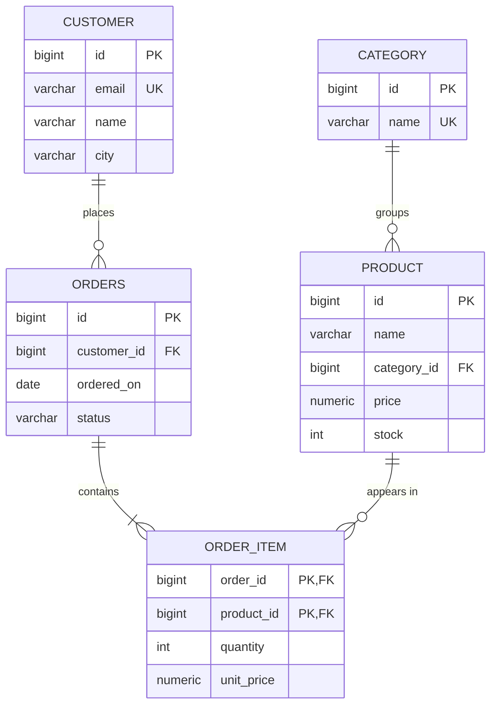
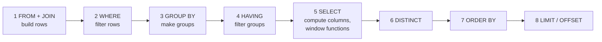
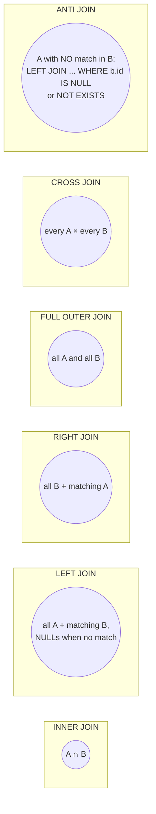
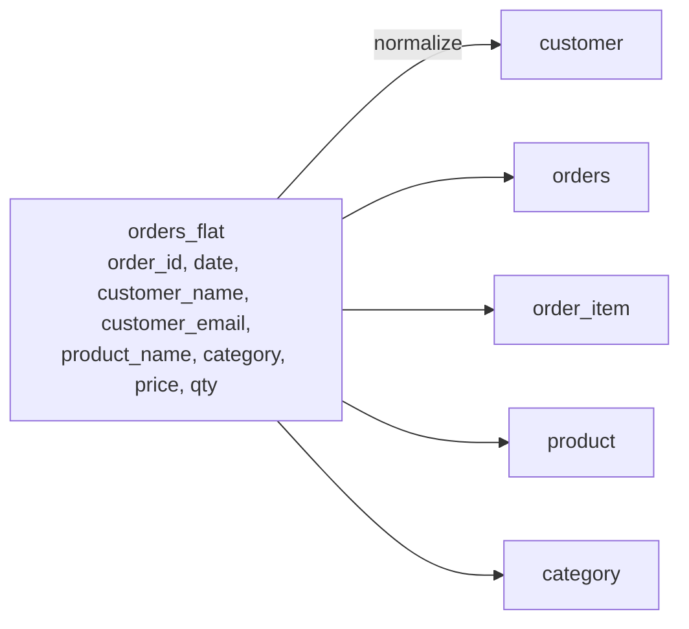
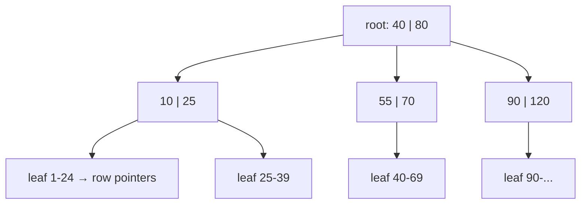

# 16 · SQL and relational databases

> The database skills every backend developer is interviewed on: the relational model and keys,
> DDL/DML, how a `SELECT` is evaluated, joins, aggregation, subqueries, CTEs, **window functions**,
> `NULL` logic, constraints, **normalization**, **indexes** and `EXPLAIN`, **transactions, ACID,
> isolation levels and their anomalies**, locking, MVCC, deadlocks, SQL injection, and how
> PostgreSQL/MySQL/others differ. The practical runs ~25 verified queries on a shop schema.

---

## 1. The relational model

Data lives in **tables** (relations) of **rows** (tuples) and **columns** (attributes) with types. Relationships are
expressed with **keys**, not pointers.

| Key | Meaning | Example |
|-----|---------|---------|
| **Primary key (PK)** | uniquely identifies a row; not null | `customer.id` |
| **Foreign key (FK)** | references a PK in another table; enforces referential integrity | `orders.customer_id → customer.id` |
| Natural key | a real-world unique value | email, ISBN, national id |
| Surrogate key | generated meaningless id | `bigint` identity/sequence, UUID |
| Composite key | PK of several columns | `order_item(order_id, product_id)` |
| Candidate / unique key | could be a PK; enforced with `UNIQUE` | `customer.email` |



This is the schema used in the practical (`practical/sql-playground/src/main/resources/sql/schema.sql`).

---

## 2. SQL sub-languages

| Group | Statements |
|-------|------------|
| **DDL** (definition) | `CREATE`, `ALTER`, `DROP`, `TRUNCATE` tables, indexes, views, sequences |
| **DML** (manipulation) | `INSERT`, `UPDATE`, `DELETE`, `MERGE` (upsert) |
| **DQL** (query) | `SELECT` |
| **DCL** (control) | `GRANT`, `REVOKE` |
| **TCL** (transactions) | `BEGIN`, `COMMIT`, `ROLLBACK`, `SAVEPOINT` |

Common types: `integer`/`bigint`, `numeric(10,2)` (money — never `float`), `varchar(n)`/`text`, `boolean`,
`date`/`timestamp`/`timestamptz`, `uuid`, `jsonb` (PostgreSQL).

---

## 3. How a SELECT is evaluated

You **write** clauses in one order, the database **evaluates** them in another:



Consequences: you can't use a `SELECT` alias in `WHERE` (it doesn't exist yet), but you can in `ORDER BY`;
aggregates (`SUM`) are not allowed in `WHERE` — use `HAVING`.

```sql
SELECT c.city, COUNT(*) AS orders, SUM(oi.quantity * oi.unit_price) AS revenue
FROM orders o
JOIN customer c    ON c.id = o.customer_id
JOIN order_item oi ON oi.order_id = o.id
WHERE o.status <> 'CANCELLED'
GROUP BY c.city
HAVING SUM(oi.quantity * oi.unit_price) > 100
ORDER BY revenue DESC
LIMIT 5;
```

---

## 4. Joins



| Join | Returns | Typical question |
|------|---------|------------------|
| `INNER JOIN` | only matching pairs | orders with their customer |
| `LEFT JOIN` | all left rows, NULLs for missing right | customers **and** their order count, including 0 |
| `RIGHT JOIN` | mirror of LEFT (rarely used) | – |
| `FULL OUTER JOIN` | everything from both | reconciliation between two sources |
| `CROSS JOIN` | Cartesian product | all size × colour combinations |
| Self join | a table with itself | employee → manager |
| Anti join | left rows **without** a match | customers who never ordered |
| Semi join (`EXISTS`) | left rows **with** at least one match, no duplicates | customers who bought a book |

Trap: a condition on the right table in `WHERE` turns a `LEFT JOIN` into an `INNER JOIN`; put it in the `ON` clause.

---

## 5. Aggregation, subqueries, CTEs

* Aggregates: `COUNT(*)` (rows) vs `COUNT(col)` (non-null values) vs `COUNT(DISTINCT col)`, `SUM`, `AVG`, `MIN`,
  `MAX`, `FILTER (WHERE ...)` (PostgreSQL/H2), `STRING_AGG`.
* Every non-aggregated column in `SELECT` must be in `GROUP BY`.
* **Subqueries**: scalar (`WHERE price > (SELECT AVG(price) FROM product)`), `IN`, `EXISTS`, correlated (references the
  outer row — runs per row conceptually).
* **CTE** (`WITH name AS (...)`) — named subqueries that make complex queries readable; `WITH RECURSIVE` walks trees
  (category hierarchies, org charts).

---

## 6. Window functions

Calculations across a set of rows **related to the current row**, without collapsing rows like `GROUP BY` does.

```sql
SELECT name, category_id, price,
       RANK()       OVER (PARTITION BY category_id ORDER BY price DESC) AS rank_in_category,
       AVG(price)   OVER (PARTITION BY category_id)                      AS category_avg,
       SUM(price)   OVER (ORDER BY id)                                    AS running_total,
       LAG(price)   OVER (ORDER BY id)                                    AS previous_price
FROM product;
```

| Function | Purpose |
|----------|---------|
| `ROW_NUMBER()` | 1, 2, 3... (top-N per group, deduplication) |
| `RANK()` / `DENSE_RANK()` | ranking with gaps / without gaps on ties |
| `SUM/AVG/COUNT ... OVER` | running totals, moving averages, share of total |
| `LAG` / `LEAD` | previous / next row's value (month-over-month change) |
| `FIRST_VALUE` / `NTILE(4)` | first value in the window / quartiles |

"Top 2 products per category" is the classic interview question: `ROW_NUMBER() OVER (PARTITION BY ... ORDER BY ...)`
in a CTE, then `WHERE rn <= 2`.

---

## 7. NULL — three-valued logic

`NULL` means *unknown*. Comparisons with `NULL` are **UNKNOWN**, not true or false:

| Expression | Result |
|------------|--------|
| `NULL = NULL` | UNKNOWN (use `IS NULL`) |
| `NULL <> 5` | UNKNOWN |
| `TRUE AND UNKNOWN` | UNKNOWN |
| `TRUE OR UNKNOWN` | TRUE |
| `WHERE col <> 'X'` | **drops rows where col is NULL** |
| `NOT IN (subquery with a NULL)` | returns **no rows** at all — use `NOT EXISTS` |
| `COUNT(col)`, `AVG(col)` | ignore NULLs |
| `COALESCE(a, b, 'default')` | first non-null |

---

## 8. Constraints and integrity

`PRIMARY KEY`, `FOREIGN KEY ... ON DELETE CASCADE/RESTRICT/SET NULL`, `UNIQUE`, `NOT NULL`, `CHECK (price >= 0)`,
`DEFAULT`. Put rules in the database **as well as** in the application: the DB is the last line of defence when
several apps, scripts or concurrent requests write data.

---

## 9. Normalization

Goal: each fact stored **once** → no update/insert/delete anomalies.

| Form | Rule | Violation example | Fix |
|------|------|-------------------|-----|
| **1NF** | atomic values, no repeating groups | `phones = "0100..., 0111..."` | separate `customer_phone` table |
| **2NF** | 1NF + every non-key column depends on the **whole** composite key | `order_item(order_id, product_id, product_name)` — name depends on product only | move `product_name` to `product` |
| **3NF** | 2NF + no column depends on another **non-key** column (no transitive dependency) | `customer(id, city, country)` where city → country | `city` table with its country |
| **BCNF** | every determinant is a candidate key | rare edge cases of 3NF | split the table |



**Denormalization** (duplicating data on purpose) is a valid *performance* decision for read-heavy reports — do it
consciously (materialized views, read models), not by accident.

---

## 10. Indexes

Without an index the database scans **every row**. A **B-tree index** keeps keys sorted in a balanced tree →
lookups in O(log n).



| Topic | Rule |
|-------|------|
| What to index | PKs (automatic), **foreign keys** (joins, cascades), columns in frequent `WHERE`/`JOIN`/`ORDER BY` |
| **Composite index** `(customer_id, ordered_on)` | usable for `customer_id = ?` and `customer_id = ? AND ordered_on > ?` — **not** for `ordered_on` alone (leftmost-prefix rule) |
| **Covering index** | contains all columns a query needs → no table access |
| Selectivity | indexes on low-cardinality columns (`status` with 3 values) rarely help |
| Index killers | functions on the column (`WHERE LOWER(email) = ?` — use a function index), leading wildcard `LIKE '%son'`, implicit type casts, `OR` across columns |
| Costs | every index slows down `INSERT/UPDATE/DELETE` and uses disk/memory |
| Other types | hash, GIN (full-text, `jsonb`), GiST (geo), BRIN (huge append-only tables), partial indexes |

Always check with **`EXPLAIN` / `EXPLAIN ANALYZE`**: look for *Seq Scan* on big tables, row estimates far from actual,
nested loops over many rows, sorts spilling to disk.

---

## 11. Transactions, ACID and isolation

| ACID | Meaning |
|------|---------|
| **Atomicity** | all statements of a transaction happen, or none (rollback) |
| **Consistency** | constraints hold before and after |
| **Isolation** | concurrent transactions don't see each other's half-done work (to a configurable degree) |
| **Durability** | once committed, it survives a crash (write-ahead log) |

```sql
BEGIN;
UPDATE account SET balance = balance - 100 WHERE id = 1;
UPDATE account SET balance = balance + 100 WHERE id = 2;
COMMIT;      -- or ROLLBACK if anything failed
```

### Isolation levels and anomalies

| Anomaly | Description |
|---------|-------------|
| **Dirty read** | reading another transaction's **uncommitted** change |
| **Non-repeatable read** | reading the same row twice gives different values (someone committed an update) |
| **Phantom read** | re-running a query returns new/missing rows (someone inserted/deleted) |
| **Lost update** | two transactions read-modify-write the same row; one write is lost |
| Write skew | two transactions each check a condition and write different rows, together breaking a rule |

| Level | Dirty read | Non-repeatable | Phantom | Default in |
|-------|:---:|:---:|:---:|-----------|
| READ UNCOMMITTED | possible | possible | possible | – |
| **READ COMMITTED** | ✅ prevented | possible | possible | PostgreSQL, Oracle, SQL Server, H2 |
| **REPEATABLE READ** | ✅ | ✅ | possible (prevented in PostgreSQL/MySQL InnoDB in practice) | MySQL InnoDB |
| SERIALIZABLE | ✅ | ✅ | ✅ | – |

Higher isolation = fewer anomalies, more blocking or serialization failures (which the app must retry). Prevent lost
updates with **optimistic locking** (`version` column, topic 10) or `SELECT ... FOR UPDATE`.

### MVCC, locks, deadlocks

* **MVCC** (PostgreSQL, Oracle, MySQL InnoDB): writers create new row *versions*; readers see a consistent snapshot →
  **readers don't block writers** and vice versa.
* Writers still lock the rows they change; two transactions locking rows in opposite order → **deadlock**; the database
  kills one ("deadlock detected"). Fix: consistent order, short transactions, retries.

---

## 12. SQL injection

```java
// ❌ attacker sends name = "x' OR '1'='1" → returns every row (or worse: '; DROP TABLE customer; --)
stmt.executeQuery("SELECT * FROM customer WHERE name = '" + name + "'");
// ✅ parameters are sent separately from the SQL text, never interpreted as SQL
PreparedStatement ps = con.prepareStatement("SELECT * FROM customer WHERE name = ?");
ps.setString(1, name);
```

ORMs (JPQL parameters), jOOQ, Spring `JdbcClient` all use bind parameters. Never build SQL with string concatenation
of user input (also not in `ORDER BY` — whitelist sortable columns, as topic 08's practical does).

---

## 13. Which database?

| Database | Notes |
|----------|-------|
| **PostgreSQL** | most popular open-source choice for new backends; rich SQL, `jsonb`, extensions (PostGIS), strict and standards-compliant |
| **MySQL / MariaDB** | very common (web, PHP history), simple to operate, InnoDB engine |
| Oracle | enterprise, banking; powerful, expensive |
| SQL Server | Microsoft stack |
| SQLite | embedded file database (mobile, desktop, tests) |
| **H2** | in-memory Java database for demos/tests (used here, in PostgreSQL mode) — prefer Testcontainers with the real DB for integration tests (topic 23) |

NoSQL in one line each: **MongoDB** (documents), **Redis** (key-value in memory, topic 25), **Cassandra** (wide-column,
huge write volumes), **Elasticsearch** (search), **Neo4j** (graphs). Choose relational by default for business data.

---

## 14. Tools and why

| Tool | Why |
|------|-----|
| `psql`, `mysql` CLI | scripts, quick checks |
| **DBeaver**, DataGrip, pgAdmin | GUI: browse, query, ER diagrams, explain plans |
| H2 console | inspect the in-memory DB of a Spring app (`spring.h2.console.enabled=true`) |
| `EXPLAIN (ANALYZE, BUFFERS)` | query performance |
| Flyway / Liquibase | versioned schema changes (topic 18) |
| pg_stat_statements | find the slowest queries in production |

---

## 15. Practical

`practical/sql-playground` creates the shop schema in H2 (PostgreSQL mode), loads sample data and runs every concept
above as a JUnit test with the expected result: filtering, all join types, anti/semi joins, grouping, `HAVING`,
subqueries, CTE + recursive CTE, window functions (top-N per group, running totals, `LAG`), `NULL` traps,
`MERGE` upsert, constraint violations, transactions with rollback, isolation (no dirty reads) and an index visible in
`EXPLAIN`.

```bash
./mvnw -f topics/pom.xml -pl 16-sql/practical/sql-playground test
```

The SQL files are in `src/main/resources/sql/`, and [exercises.md](exercises.md) has 15 questions to solve against the
same schema (answers in the tests).

> Found while building it: with **H2 2.4.240**, CHECK constraints fail with *"Check constraint invalid ... database has
> been closed"* in new sessions once the session that created them is closed. `Database` keeps that first connection
> open. It's one more reason to run integration tests against the **real** database with Testcontainers (topic 23).

## 16. Interview questions

1. INNER vs LEFT JOIN? How do you find customers who never ordered?
2. `WHERE` vs `HAVING`? Why can't you use a `SELECT` alias in `WHERE`?
3. Write "the 2 most expensive products per category".
4. `COUNT(*)` vs `COUNT(col)`? What does `NOT IN` with a `NULL` return?
5. What is normalization? Explain 1NF, 2NF, 3NF with an example. When would you denormalize?
6. How does a B-tree index work? Why might a query not use an index?
7. What does ACID mean? Explain the isolation levels and anomalies.
8. Optimistic vs pessimistic locking?
9. How do you prevent SQL injection?
10. `DELETE` vs `TRUNCATE` vs `DROP`?
