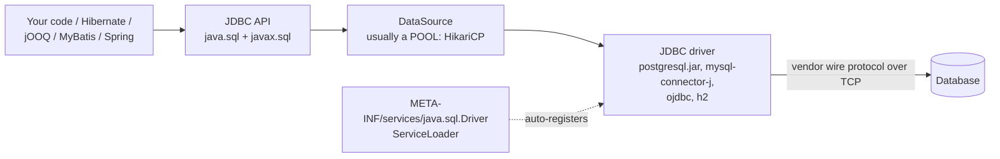
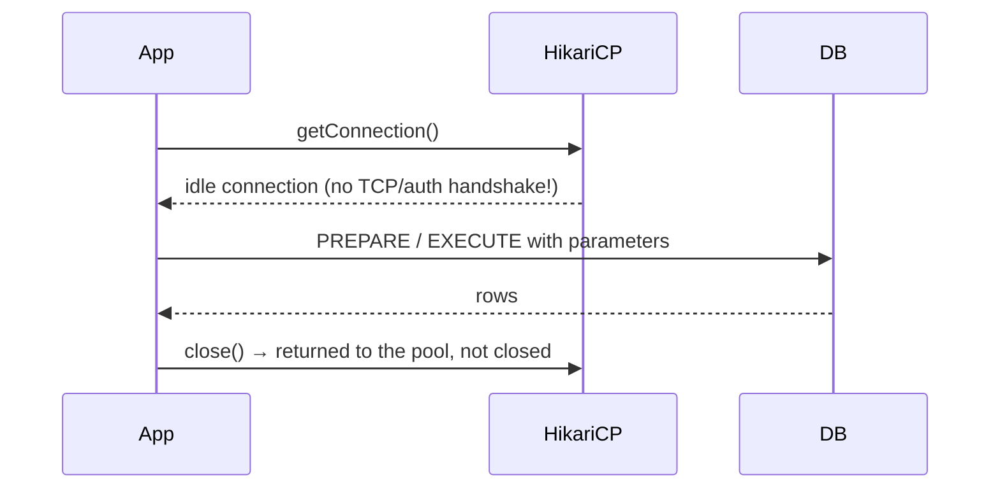
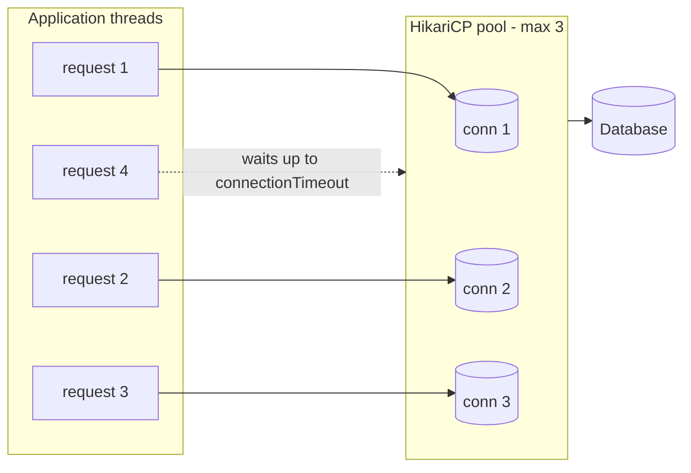

# 17 · JDBC and connection pools

> The layer every Java database library is built on: drivers and URLs, `Connection`,
> `PreparedStatement`, `ResultSet`, type mapping, transactions and savepoints, batching, generated
> keys, metadata, error codes — then **connection pooling with HikariCP** (why, how to size it, leak
> detection) and Spring's **`JdbcClient`/`JdbcTemplate`**. Practical: a tested module with a DAO,
> transactions, batch vs single inserts, a real pool (exhaustion, reuse) and `JdbcClient`.

---

## 1. Architecture



* JDBC is an **API specification**; each database vendor ships a **driver** implementing it.
* Drivers are discovered automatically via `ServiceLoader` (topic 06.09) — `Class.forName("org.postgresql.Driver")` is
  no longer needed.
* Applications should use a **`DataSource`** (configured once, pooled) instead of `DriverManager.getConnection` per call.

| Database | JDBC URL | Driver (Maven) |
|----------|----------|----------------|
| PostgreSQL | `jdbc:postgresql://localhost:5432/shop` | `org.postgresql:postgresql` |
| MySQL | `jdbc:mysql://localhost:3306/shop` | `com.mysql:mysql-connector-j` |
| SQL Server | `jdbc:sqlserver://localhost:1433;databaseName=shop` | `com.microsoft.sqlserver:mssql-jdbc` |
| Oracle | `jdbc:oracle:thin:@//localhost:1521/XEPDB1` | `com.oracle.database.jdbc:ojdbc11` |
| H2 in memory | `jdbc:h2:mem:shop;DB_CLOSE_DELAY=-1` | `com.h2database:h2` |

---

## 2. Core interfaces

| Interface | Role |
|-----------|------|
| `DataSource` | factory of connections (pooled) |
| `Connection` | a session with the DB: transactions, statements, metadata. **Expensive** to create |
| `Statement` | executes static SQL — avoid with user input |
| **`PreparedStatement`** | precompiled SQL with `?` parameters → **safe from SQL injection**, faster when reused |
| `CallableStatement` | calls stored procedures `{call proc(?, ?)}` |
| `ResultSet` | cursor over query results (`next()`, `getString(...)`) |
| `ResultSetMetaData`, `DatabaseMetaData` | column info, database/driver info |
| `SQLException` | errors, with `getSQLState()` and vendor `getErrorCode()` |

```java
String sql = "SELECT id, name, price FROM product WHERE price < ? ORDER BY price";
try (Connection con = dataSource.getConnection();                     // borrow from the pool
     PreparedStatement ps = con.prepareStatement(sql)) {
    ps.setBigDecimal(1, maxPrice);
    try (ResultSet rs = ps.executeQuery()) {
        while (rs.next()) {
            products.add(new Product(rs.getLong("id"), rs.getString("name"), rs.getBigDecimal("price")));
        }
    }
}                                                                       // closed in reverse order: rs, ps, con (returned to pool)
```



| Method | Use |
|--------|-----|
| `executeQuery()` | `SELECT` → `ResultSet` |
| `executeUpdate()` | `INSERT/UPDATE/DELETE` → affected row count |
| `execute()` | anything (DDL, unknown) → boolean |
| `addBatch()` + `executeBatch()` | many parameter sets in one round trip |
| `prepareStatement(sql, RETURN_GENERATED_KEYS)` + `getGeneratedKeys()` | ids generated by the DB |
| `setFetchSize(n)` | rows fetched per round trip for big result sets |

---

## 3. Type mapping

| SQL | Java |
|-----|------|
| `INTEGER`, `BIGINT` | `int`/`Integer`, `long`/`Long` |
| `NUMERIC(10,2)`, `DECIMAL` | **`BigDecimal`** (never `double` for money) |
| `VARCHAR`, `TEXT` | `String` |
| `BOOLEAN` | `boolean` |
| `DATE` | `LocalDate` → `rs.getObject(col, LocalDate.class)` / `ps.setObject(i, localDate)` |
| `TIMESTAMP` | `LocalDateTime` |
| `TIMESTAMP WITH TIME ZONE` | `OffsetDateTime` / `Instant` |
| `UUID` | `UUID` (`getObject`) |
| `BLOB` / `BYTEA` | `byte[]`, `InputStream` |

**NULLs**: `rs.getInt("stock")` returns **0** for SQL `NULL`; check `rs.wasNull()` or use `rs.getObject("stock", Integer.class)`.
Setting a null parameter: `ps.setNull(i, Types.INTEGER)` or `ps.setObject(i, null)`.

---

## 4. Transactions

By default a connection is in **auto-commit** mode: every statement is its own transaction.

```java
try (Connection con = dataSource.getConnection()) {
    con.setAutoCommit(false);                              // BEGIN
    try {
        debit(con, from, amount);
        Savepoint afterDebit = con.setSavepoint();         // partial rollback point
        credit(con, to, amount);
        con.commit();                                      // COMMIT
    } catch (SQLException | RuntimeException e) {
        con.rollback();                                    // ROLLBACK everything
        throw e;
    }
}
```

* All statements of a transaction must use the **same `Connection`** — that's why Spring binds the connection to the
  thread inside `@Transactional`.
* `con.setTransactionIsolation(Connection.TRANSACTION_REPEATABLE_READ)` — levels from topic 16.
* `con.setReadOnly(true)` — hint for read-only work (can route to replicas).
* Always restore auto-commit/isolation before returning a connection to a pool (pools do reset it).

---

## 5. Errors

`SQLException.getSQLState()` is standardised (5 chars, the first 2 = class):

| Class | Meaning | Typical handling |
|-------|---------|------------------|
| `08` | connection problems | retry / fail over |
| `23` | integrity constraint violation (`23505` unique, `23503` FK in PostgreSQL) | 409 Conflict / validation message |
| `40` | transaction rollback (`40001` serialization failure, deadlock) | **retry the transaction** |
| `42` | syntax error / unknown table | a bug |

Subclasses: `SQLIntegrityConstraintViolationException`, `SQLTransientConnectionException`, `SQLTimeoutException`...
Spring translates all of them into its unchecked `DataAccessException` hierarchy
(`DuplicateKeyException`, `DataIntegrityViolationException`, `CannotAcquireLockException`...).

---

## 6. Connection pooling

Opening a physical connection = TCP handshake + TLS + authentication + session setup → **milliseconds to tens of
milliseconds**. A pool keeps connections open and lends them out.



**HikariCP** is the fastest, most widely used pool and the Spring Boot default.

| Setting (`spring.datasource.hikari.*`) | Default | Meaning |
|----------------------------------------|---------|---------|
| `maximum-pool-size` | 10 | max connections (in use + idle) |
| `minimum-idle` | = max | idle connections kept ready |
| `connection-timeout` | 30 s | how long a thread waits for a free connection → `SQLTransientConnectionException` |
| `idle-timeout` | 10 min | idle connections above `minimum-idle` are closed |
| `max-lifetime` | 30 min | recycle connections (set below DB/firewall timeouts) |
| `leak-detection-threshold` | 0 (off) | log a stack trace when a connection is held longer than this |

**Sizing**: bigger is **not** better — the database has limited CPU cores and disks. A common starting point is
`connections ≈ (DB cores × 2) + effective spindles`, i.e. often **10–20**, shared by all app instances
(`instances × pool size` must stay below the database's `max_connections`). Measure with pool metrics
(active, idle, pending threads — exported by Micrometer, topic 27). With **virtual threads**, thousands of requests can
wait for a small pool: the pool becomes the natural throttle.

---

## 7. Spring's JDBC support

```java
JdbcClient jdbc = JdbcClient.create(dataSource);                          // Spring Framework 6.1+

List<Product> cheap = jdbc.sql("SELECT id, name, price FROM product WHERE price < :max ORDER BY price")
        .param("max", new BigDecimal("50"))
        .query(Product.class)                                             // maps columns to record components
        .list();

int updated = jdbc.sql("UPDATE product SET price = :p WHERE id = :id")
        .param("p", newPrice).param("id", 3L)
        .update();
```

* `JdbcClient` (fluent, recommended) / `JdbcTemplate` / `NamedParameterJdbcTemplate`: no boilerplate, resources
  always closed, exceptions translated, takes part in `@Transactional`.
* `spring-boot-starter-jdbc` auto-configures HikariCP + `JdbcClient` + transaction manager from
  `spring.datasource.url/username/password`.
* **Spring Data JDBC** builds repositories on top of it (topic 10).

---

## 8. JDBC vs ORM — when to use plain JDBC

Use JDBC/`JdbcClient` (or jOOQ) for: reporting queries, bulk operations, database-specific SQL, performance-critical
paths, simple services with few tables. Use JPA/Hibernate (topic 10) for rich domain models with many relationships.
Every ORM still uses JDBC underneath — knowing JDBC explains pools, transactions and errors at every level.

---

## 9. Packages / libraries and why

| Dependency | Why |
|------------|-----|
| `java.sql`, `javax.sql` (JDK) | the JDBC API |
| JDBC driver of your database | talks the DB's protocol (`runtime` scope) |
| **`com.zaxxer:HikariCP`** | connection pool |
| `org.springframework:spring-jdbc` / `spring-boot-starter-jdbc` | `JdbcClient`, `JdbcTemplate`, exception translation, transactions |
| `net.ttddyy:datasource-proxy`, p6spy | log/count SQL statements in tests and dev |
| Testcontainers (topic 23) | real database in tests |

---

## 10. Practical

`practical/jdbc-demo` (H2 in memory, HikariCP, Spring `JdbcClient`):

| Test | Shows |
|------|-------|
| `ProductDaoTest` | CRUD DAO with `PreparedStatement`, generated keys, `Optional` mapping, NULL handling, `LocalDate` mapping |
| `TransferServiceTest` | manual transactions: commit, rollback on failure, savepoint |
| `BatchInsertTest` | 2 000 single inserts vs one batch — same rows, far fewer round trips |
| `ConnectionPoolTest` | pool reuses physical connections, exhausted pool → timeout exception, metrics |
| `JdbcClientTest` | the same queries with Spring's `JdbcClient` and translated exceptions |

```bash
./mvnw -f topics/pom.xml -pl 17-jdbc/practical/jdbc-demo test
```

## 11. Interview questions

1. `Statement` vs `PreparedStatement`? Why is `PreparedStatement` safer and often faster?
2. How do you run several statements in one transaction with JDBC?
3. Why use a connection pool? How would you size it?
4. What happens when the pool is exhausted?
5. How do you read a nullable integer column correctly?
6. How do you get the id generated by an `INSERT`?
7. Why is batching faster?
8. What does Spring's `JdbcTemplate`/`JdbcClient` add over raw JDBC?
