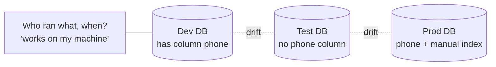
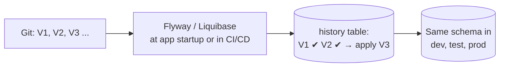
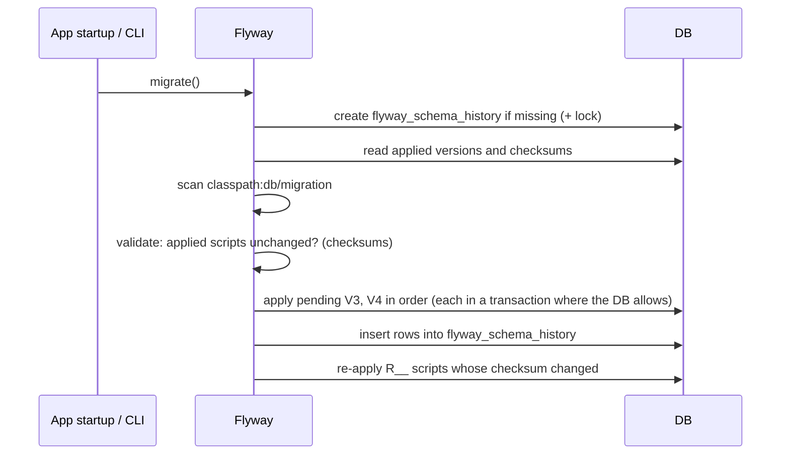
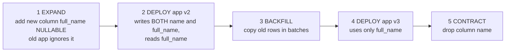

# 18 · Database migrations: Flyway and Liquibase

> How to evolve a database schema safely across developer machines, test and production: versioned
> migrations, the schema history table, checksums, baselining, repeatable migrations, Java
> migrations, rollbacks, **zero-downtime expand/contract changes**, and the Spring Boot integration —
> with **Flyway** and **Liquibase** side by side. Practical: a tested module that migrates H2 with both
> tools, detects a tampered migration, baselines an existing database and rolls back a changeset.

---

## 1. The problem



Hand-run SQL scripts and `hibernate.hbm2ddl.auto=update` lead to **drift**: every environment ends up with a slightly
different schema, nobody knows which changes were applied, and production changes are risky.

**Migrations** = schema changes as **versioned, immutable scripts in Git**, applied **automatically and in order** by a
tool that records what it applied in a history table. The schema becomes reproducible from zero on any machine.



---

## 2. Flyway

### Naming conventions

```
src/main/resources/db/migration/
  V1__create_customer.sql            versioned: applied once, in version order
  V2__create_orders.sql
  V3__add_customer_phone.sql
  V3_1__index_orders_status.sql      versions can be 3.1, 2026.11.15.1 ...
  R__customer_summary_view.sql       repeatable: re-applied whenever its checksum changes (views, functions)
  U3__drop_customer_phone.sql        undo (paid editions only)
```

`V<version>__<description>.sql` — capital V, **two** underscores. Java-based migrations: classes named
`V5__Seed_countries extends BaseJavaMigration` in the `db.migration` package.

### How it works



`flyway_schema_history` columns: `installed_rank`, `version`, `description`, `type`, `script`, `checksum`,
`installed_by`, `installed_on`, `execution_time`, `success`.

| Command / setting | Purpose |
|-------------------|---------|
| `migrate` | apply pending migrations |
| `info` | list applied / pending migrations |
| `validate` | fail if an applied migration was changed (**checksum mismatch**), is missing, or failed |
| `baseline` / `baselineOnMigrate` | adopt an **existing** database: mark it as version N, apply only later migrations |
| `repair` | fix the history table after a failed migration / accepted checksum change |
| `clean` | **drops everything** — disabled by default since Flyway 10 (`cleanDisabled=true`); never in production |
| `outOfOrder` | allow applying a lower version that arrived late (feature branches) |
| placeholders `${schema}` | environment-specific values |
| callbacks `beforeMigrate.sql`, `afterMigrate.sql` | hooks |

---

## 3. Liquibase

Changes are **changesets** inside a **changelog** (YAML, XML, JSON or SQL), identified by `id` + `author` + file:

```yaml
databaseChangeLog:
  - changeSet:
      id: 1
      author: ali
      changes:
        - createTable:
            tableName: product
            columns:
              - column: { name: id, type: bigint, autoIncrement: true, constraints: { primaryKey: true } }
              - column: { name: name, type: varchar(100), constraints: { nullable: false, unique: true } }
      rollback:
        - dropTable: { tableName: product }
```

* History in `DATABASECHANGELOG` (+ `DATABASECHANGELOGLOCK` to stop two instances migrating at once).
* Database-independent change types (`createTable`, `addColumn`, `createIndex`...) generate SQL for each vendor.
* **Rollback**: automatic for many change types, or explicit `rollback` blocks; `rollbackCount`, `rollbackToDate`, tags.
* **Preconditions** (`tableExists`, `sqlCheck`), **contexts/labels** (run only in `test`), `diff` and
  `generateChangelog` (reverse-engineer an existing DB).

---

## 4. Flyway vs Liquibase

| | Flyway | Liquibase |
|---|---|---|
| Migration format | **plain SQL** (and Java) | YAML / XML / JSON / SQL changesets |
| Learning curve | very low: it's just SQL | higher, more concepts |
| Database independence | you write vendor SQL | abstract change types → SQL per DB |
| Rollback | undo scripts in paid editions; usually forward-fix | built-in rollback (community) |
| Conditional logic | callbacks, placeholders | preconditions, contexts, labels |
| Diff / generate from DB | limited (paid) | `diff`, `generateChangelog` |
| Spring Boot | `spring-boot-starter-flyway` | `spring-boot-starter-liquibase` |
| Popular with | teams comfortable with SQL (most Spring projects) | multi-database products, enterprises needing rollback |

Both are good — pick one per project and never mix them on the same schema.

---

## 5. Spring Boot integration

```properties
# just add the starter: migrations run at startup, BEFORE JPA initialises
spring.flyway.locations=classpath:db/migration
spring.flyway.baseline-on-migrate=false
# let Hibernate VERIFY the schema matches the entities instead of changing it
spring.jpa.hibernate.ddl-auto=validate
```

| `ddl-auto` | Use |
|------------|-----|
| `create-drop` / `create` | throw-away demos and some tests |
| `update` | never in production (no history, can't drop/rename, surprises) |
| **`validate`** | production with Flyway/Liquibase |
| `none` | disabled |

In production many teams run migrations as a separate CI/CD step (Flyway CLI / Maven plugin / init container) instead of
at app startup, so several app instances don't race and the migration has its own approval and logs.

---

## 6. Zero-downtime changes: expand → migrate → contract

During a rolling deployment, **old and new versions of the app run at the same time** against the same database. Every
migration must work with both.



| Risky change | Safe approach |
|--------------|---------------|
| Rename column | add new column, dual-write, backfill, switch reads, drop old (5 steps above) |
| Add NOT NULL column | add nullable or with default → backfill → add constraint |
| Drop column | stop using it in code first, drop in a later release |
| Big index on a large table | `CREATE INDEX CONCURRENTLY` (PostgreSQL) in its own non-transactional migration |
| Change column type | new column + backfill + switch |
| Long data migrations | batch them; don't lock the table for minutes |

---

## 7. Best practices

1. **Never edit or delete a migration that has been applied** anywhere shared — write a new one. (Checksums will catch it.)
2. One logical change per migration; descriptive names.
3. Migrations are **code**: reviewed in PRs, tested in CI against the **real** database engine (Testcontainers, topic 23).
4. Prefer **forward fixes** over rollbacks; backups before risky releases.
5. Keep migrations backwards compatible with the currently running app version (expand/contract).
6. Seed only **reference data** (countries, roles) in migrations; test data belongs to tests.
7. Use `ddl-auto=validate` so the app refuses to start if entities and schema disagree.

---

## 8. Packages / tools and why

| Dependency / tool | Why |
|-------------------|-----|
| `org.flywaydb:flyway-core` (+ `flyway-database-postgresql`, `flyway-mysql`...) | Flyway engine (+ database modules since Flyway 10) |
| `spring-boot-starter-flyway` | auto-run Flyway at startup |
| `flyway-maven-plugin`, Flyway CLI, Docker image `flyway/flyway` | run migrations from CI/CD |
| `org.liquibase:liquibase-core` / `spring-boot-starter-liquibase` | Liquibase engine / Boot integration |
| Testcontainers | test migrations on the real engine |

---

## 9. Practical

`practical/migrations-demo`:

| Test | Shows |
|------|-------|
| `FlywayMigrationTest` | fresh migrate (4 SQL + 1 Java + 1 repeatable), history table, idempotent re-run, expand step (new nullable columns + backfill), **checksum mismatch detection**, baselining an existing DB, `clean` disabled by default |
| `LiquibaseMigrationTest` | YAML changelog update, `DATABASECHANGELOG` rows, `rollbackCount` undoing the last changeset |

```bash
./mvnw -f topics/pom.xml -pl 18-database-migrations/practical/migrations-demo test
```

## 10. Interview questions

1. Why use a migration tool instead of `ddl-auto=update`?
2. How does Flyway know which migrations to apply? What is stored in `flyway_schema_history`?
3. What happens if someone edits an already-applied migration?
4. Versioned vs repeatable migrations?
5. How do you introduce Flyway into a project whose production database already exists?
6. How do you rename a column without downtime?
7. Flyway vs Liquibase?
