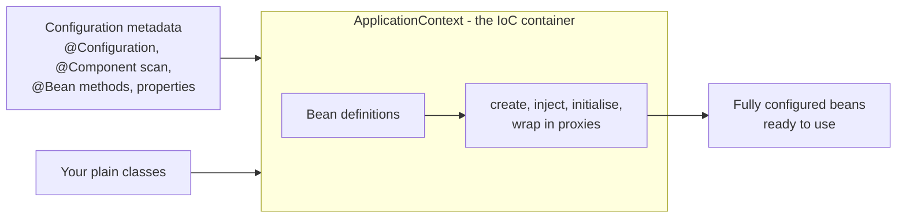
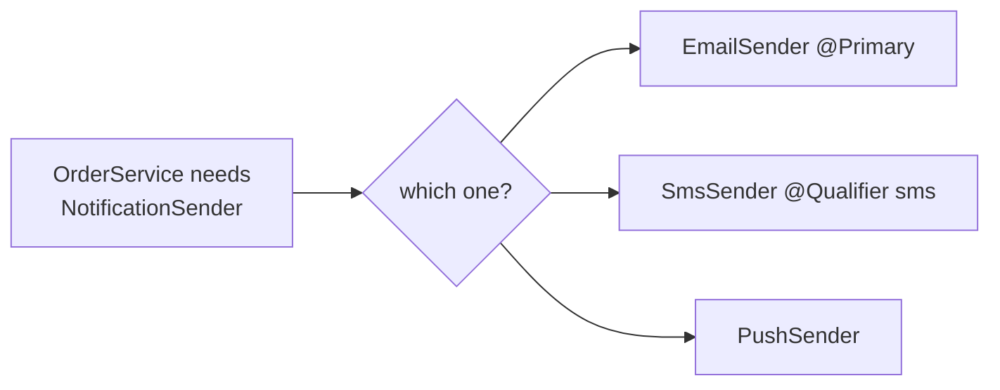
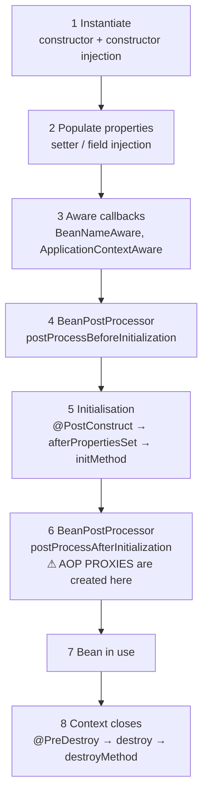
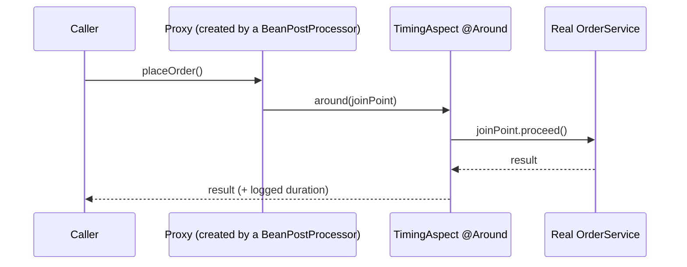
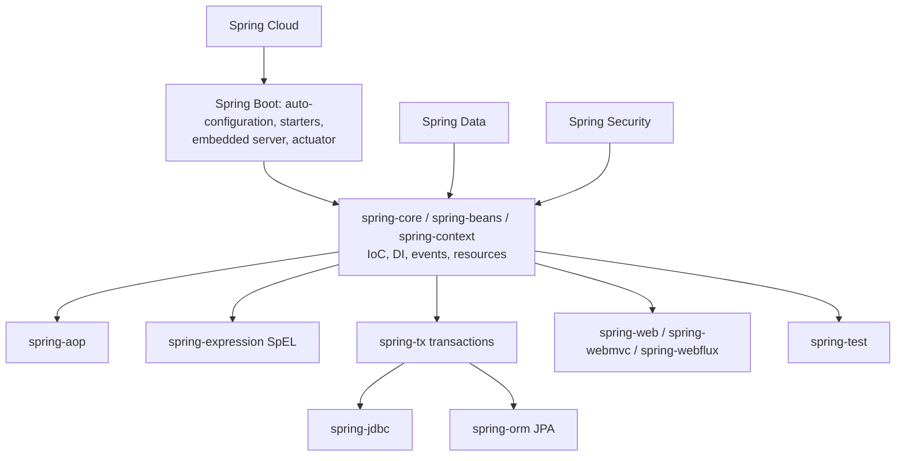

# 19 · Spring Core: IoC container and dependency injection

> The foundation under Spring Boot, Spring Data, Spring Security — everything. Inversion of Control,
> dependency injection styles, the `ApplicationContext`, bean definitions (`@Component` vs `@Bean`),
> resolving ambiguity, **bean scopes**, the **bean lifecycle**, `BeanPostProcessor`s, profiles,
> the `Environment` and `@Value`, events, **AOP** with proxies, `@Conditional` (the root of Boot's
> auto-configuration) and circular dependencies. The practical uses **plain Spring without Boot**, so
> nothing is hidden.

---

## 1. Inversion of Control and Dependency Injection

```java
// without IoC: the class creates (and is welded to) its dependencies
class OrderService {
    private final PaymentGateway payments = new StripeGateway("sk_live_...");   // hard-coded, untestable
}

// with DI: dependencies come from outside; the class only declares what it needs
class OrderService {
    private final PaymentGateway payments;
    OrderService(PaymentGateway payments) { this.payments = payments; }          // any implementation, a mock in tests
}
```

* **Inversion of Control**: the framework, not your code, creates objects and wires them together.
* **Dependency Injection**: the way IoC provides dependencies — through constructors, setters or fields.
* Benefits: loose coupling (Dependency Inversion Principle, topic 14), easy testing with mocks, one place for
  configuration, the container can add behaviour around your objects (transactions, security, caching — via proxies).



---

## 2. The container

| Type | What it adds |
|------|--------------|
| `BeanFactory` | the basic container: create beans, inject dependencies, lazy by default |
| **`ApplicationContext`** | everything in `BeanFactory` + eager singleton creation, events, `Environment`/profiles, i18n messages, resource loading, `BeanPostProcessor` auto-registration. **Always use this.** |
| `AnnotationConfigApplicationContext` | standalone context from `@Configuration` classes (used in the practical) |
| Spring Boot | creates the right context for you (`SpringApplication.run`) |

A **bean** is simply an object created and managed by the container.

---

## 3. Defining beans

| Way | When |
|-----|------|
| `@Component` (+ `@Service`, `@Repository`, `@Controller`) on your classes, found by **`@ComponentScan`** | your own classes |
| `@Bean` methods in a `@Configuration` class | third-party classes you can't annotate (`ObjectMapper`, `DataSource`), or when creation needs logic |
| XML `<bean>` | legacy |
| Functional registration (`registerBean`) | programmatic, GraalVM-friendly |

| Stereotype | Meaning / extra behaviour |
|------------|---------------------------|
| `@Component` | generic bean |
| `@Service` | business logic (documentation only) |
| `@Repository` | data access; **translates persistence exceptions** into `DataAccessException` |
| `@Controller` / `@RestController` | web layer (topic 07/08) |
| `@Configuration` | holds `@Bean` methods; proxied so calling one `@Bean` method from another returns the **same** singleton |

```java
@Configuration
@ComponentScan("com.shop")
class AppConfig {
    @Bean
    Clock clock() { return Clock.systemUTC(); }       // bean name = method name: "clock"
}
```

---

## 4. Injection styles

| Style | Example | Verdict |
|-------|---------|---------|
| **Constructor** | `OrderService(PaymentGateway p)` | ✅ recommended: dependencies `final`, required, visible, easy to test without Spring. With one constructor `@Autowired` is optional |
| Setter | `@Autowired void setMailer(Mailer m)` | optional dependencies only |
| Field | `@Autowired private Mailer mailer;` | ❌ hides dependencies, can't be `final`, needs reflection/Spring in tests |

### Several candidates for one dependency



| Tool | Effect |
|------|--------|
| `@Primary` | default winner when several beans match |
| `@Qualifier("sms")` on the injection point | pick a specific bean |
| parameter name matching the bean name | fallback |
| `List<NotificationSender>` / `Map<String, NotificationSender>` | inject **all** of them (strategy pattern, topic 14) |
| `Optional<X>` / `ObjectProvider<X>` | optional or lazy dependency |

No match → `NoSuchBeanDefinitionException`; several matches without a rule → `NoUniqueBeanDefinitionException`.
Both fail at **startup**, which is a feature: wiring errors never reach production traffic.

---

## 5. Bean scopes

| Scope | Instances | Typical use |
|-------|-----------|-------------|
| **`singleton`** (default) | one per container | services, repositories, controllers — must be **stateless/thread-safe** |
| `prototype` | a new one every time it is requested | stateful helpers, builders |
| `request` | one per HTTP request | request-scoped data (web apps) |
| `session` | one per HTTP session | user's shopping cart in server-rendered apps |
| `application` | one per `ServletContext` | rare |

> Spring singleton ≠ GoF Singleton: one instance **per container per bean definition**, no static field, and you can
> still create other instances with `new`.

**Prototype inside a singleton trap**: a prototype injected into a singleton is created **once** (at injection time),
so the singleton always sees the same "prototype". Fix: inject `ObjectProvider<Cart>` and call `getObject()` each time
(or use a scoped proxy / `@Lookup` method).

---

## 6. Bean lifecycle



* `@PostConstruct`: validate configuration, warm caches, open resources — **after** injection is complete.
* `@PreDestroy`: release resources (singletons only; Spring does **not** destroy prototypes).
* **`BeanPostProcessor`** is how Spring itself works: `@Autowired` processing, `@Transactional`/`@Async`/`@Cacheable`
  proxies, `@Scheduled`... all are post-processors. The bean you get injected may be a **proxy** around your object.
* `BeanFactoryPostProcessor`: changes bean **definitions** before any bean exists (e.g. resolving `${...}` placeholders).

---

## 7. Configuration: Environment, properties, profiles

```java
@Configuration
@PropertySource("classpath:app.properties")
class AppConfig { }

@Component
class PricingService {
    PricingService(@Value("${shop.tax-rate:0.14}") BigDecimal taxRate,      // property with default
                   @Value("#{T(java.time.Year).now().value}") int year) {   // SpEL expression
    }
}
```

* The **`Environment`** merges property sources (system properties, env variables, files...) and knows the
  **active profiles**.
* **Profiles** register beans only in some environments:

```java
@Component @Profile("dev")  class FakePaymentGateway implements PaymentGateway { }
@Component @Profile("prod") class StripePaymentGateway implements PaymentGateway { }
// activate: -Dspring.profiles.active=prod  or  context.getEnvironment().setActiveProfiles("prod")
```

* Spring Boot adds `application.properties/yml`, profile-specific files and type-safe `@ConfigurationProperties`
  (topic 20).

---

## 8. Events

```java
publisher.publishEvent(new OrderPlaced(orderId, total));      // ApplicationEventPublisher (injected)

@EventListener
void sendReceipt(OrderPlaced event) { ... }                   // any bean method
```

Observer pattern built into the container: decouple "order placed" from "send email", "add loyalty points".
Listeners run **synchronously in the same thread** by default (add `@Async` for background), and
`@TransactionalEventListener(phase = AFTER_COMMIT)` runs only if the transaction commits.

---

## 9. Aspect-Oriented Programming (AOP)

Cross-cutting concerns (logging, timing, security, transactions, retries) applied **around** methods without touching
their code.

| Term | Meaning |
|------|---------|
| **Aspect** | a class with cross-cutting logic (`@Aspect`) |
| **Join point** | a point in execution — in Spring AOP always a **method call** on a bean |
| **Pointcut** | expression selecting join points: `@annotation(com.shop.Timed)`, `execution(* com.shop..*Service.*(..))` |
| **Advice** | what to run: `@Before`, `@AfterReturning`, `@AfterThrowing`, `@After`, `@Around` |
| **Weaving** | how advice is applied — Spring uses **runtime proxies** (JDK or CGLIB) |



Proxy-based AOP limits (same as topic 06.09): only **public calls coming from outside** the bean are intercepted —
self-invocation, `private` and `final` methods are not.

---

## 10. `@Conditional` — how Spring Boot auto-configuration works

```java
@Bean
@Conditional(LoyaltyFeatureEnabled.class)       // register only if the condition matches
LoyaltyService loyaltyService() { ... }
```

Spring Boot builds on this with `@ConditionalOnClass`, `@ConditionalOnMissingBean`, `@ConditionalOnProperty`:
"if Jackson is on the classpath **and** you didn't define an `ObjectMapper`, create one". That's all auto-configuration
is (topic 20).

---

## 11. Circular dependencies

`A` needs `B` and `B` needs `A` through constructors → Spring can't create either:
`BeanCurrentlyInCreationException`. Spring Boot refuses cycles by default (since 2.6). A cycle is a **design smell** —
extract the shared logic into a third bean, or publish an event instead of calling back.

---

## 12. Spring modules (map)



---

## 13. Packages / libraries and why

| Dependency | Why |
|------------|-----|
| `org.springframework:spring-context` | the `ApplicationContext`, annotations, events |
| `org.springframework:spring-aop` + `org.aspectj:aspectjweaver` | `@Aspect` support (pointcut language) |
| `jakarta.annotation:jakarta.annotation-api` | `@PostConstruct`, `@PreDestroy` |
| `org.springframework:spring-test` | `@SpringJUnitConfig`, `@ActiveProfiles`, context caching in tests |
| `spring-boot-starter` | all of the above, auto-configured (topic 20) |

---

## 14. Practical

`practical/spring-core-demo` — plain Spring Framework 7, no Boot:

| Test | Shows |
|------|-------|
| `DependencyInjectionTest` | component scan + `@Bean`, constructor injection, `@Primary`/`@Qualifier`, injecting `List`/`Map` of all implementations, `@Value` with defaults and SpEL |
| `ScopesAndLifecycleTest` | singleton vs prototype, the prototype-in-singleton trap and the `ObjectProvider` fix, `@PostConstruct`/`@PreDestroy` order, a custom `BeanPostProcessor` |
| `ProfilesAndConditionsTest` | `dev` vs `prod` beans, a custom `@Conditional` feature flag |
| `EventsAndAopTest` | events and listeners, an `@Around` timing aspect, the proxy class, self-invocation not intercepted |
| `CircularDependencyTest` | a constructor cycle failing at startup |

```bash
./mvnw -f topics/pom.xml -pl 19-spring-core/practical/spring-core-demo test
./mvnw -q -f topics/pom.xml -pl 19-spring-core/practical/spring-core-demo compile exec:java
```

## 15. Interview questions

1. What are IoC and DI? Why does DI make code testable?
2. `BeanFactory` vs `ApplicationContext`?
3. `@Component` vs `@Bean`? `@Service` vs `@Repository`?
4. Constructor vs field injection — which and why?
5. How does Spring choose between two beans of the same type?
6. Explain bean scopes. What happens when a prototype is injected into a singleton?
7. Describe the bean lifecycle. Where are AOP proxies created?
8. What is a `BeanPostProcessor`? Give examples from Spring itself.
9. Explain AOP terms. Why is self-invocation not intercepted?
10. How does `@Conditional` relate to Spring Boot auto-configuration?
