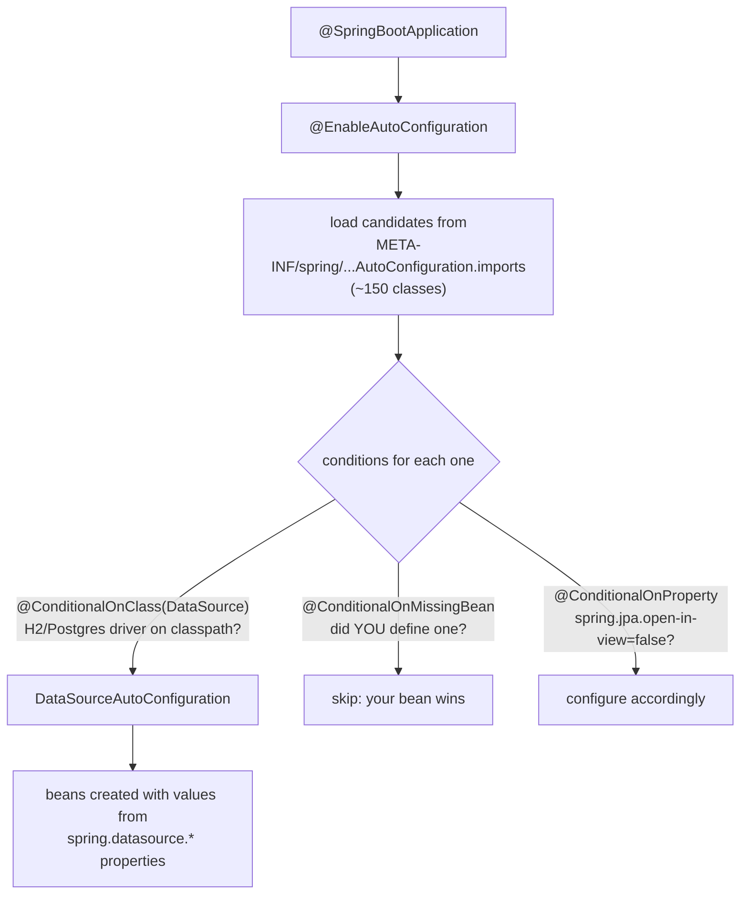
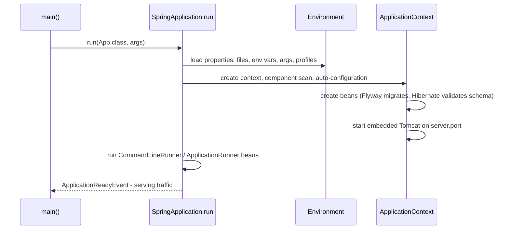
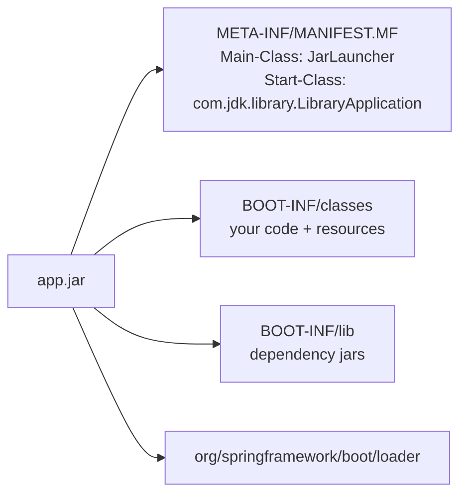

# 20 · Spring Boot

> What Spring Boot adds on top of Spring (topic 19): starters, **auto-configuration**, the embedded
> server, externalized configuration and profiles, `@ConfigurationProperties`, Spring Data JPA in
> practice, validation and global error handling, **Actuator**, DevTools, packaging and running,
> the **test slices**, and what changed in Boot 4. Practical: a complete, tested library API with
> Flyway, JPA, paging, projections, Problem Details, type-safe configuration and Actuator.

---

## 1. What Spring Boot adds

| Plain Spring (topic 19) | Spring Boot |
|-------------------------|-------------|
| choose and align versions of 50 libraries | **BOM** + **starters**: one dependency per feature, compatible versions |
| configure `DataSource`, `EntityManagerFactory`, `ObjectMapper`, `DispatcherServlet`... by hand | **auto-configuration** creates them, you override only what you need |
| deploy a WAR into an installed Tomcat | **embedded server**: `java -jar app.jar` |
| your own config loading | **externalized configuration**: properties/YAML, env vars, profiles, validation |
| build your own health checks/metrics | **Actuator** |
| – | DevTools, Initializr, Docker image build, Testcontainers support, GraalVM native images |

> "Opinionated defaults, easy to override." Boot never stops you from writing the plain Spring configuration.

---

## 2. Starters

| Starter (Boot 4 names) | Brings |
|------------------------|--------|
| `spring-boot-starter-webmvc` (Boot 3: `-web`) | Spring MVC, embedded Tomcat, Jackson 3 |
| `spring-boot-starter-webflux` | reactive web on Netty |
| `spring-boot-starter-data-jpa` | Hibernate 7, Spring Data JPA, HikariCP, transactions |
| `spring-boot-starter-jdbc` / `-data-jdbc` | `JdbcClient` / Spring Data JDBC |
| `spring-boot-starter-flyway` / `-liquibase` | migrations at startup |
| `spring-boot-starter-validation` | Hibernate Validator |
| `spring-boot-starter-security`, `-oauth2-resource-server` | security (topic 21) |
| `spring-boot-starter-actuator` | health, metrics, info, loggers... |
| `spring-boot-starter-cache`, `-data-redis`, `-amqp`, `-kafka` | topic 25 |
| `spring-boot-starter-test` (+ `-webmvc-test`, `-data-jpa-test`...) | JUnit 6, AssertJ, Mockito, slices |

Start a project at **<https://start.spring.io>** (or File → New → Spring Boot in IntelliJ).

---

## 3. Auto-configuration



* It is just `@Configuration` classes guarded by `@Conditional` (topic 19 §10).
* **Your beans always win** (`@ConditionalOnMissingBean`).
* See what happened and why: run with `--debug` → *Conditions Evaluation Report*, or `GET /actuator/conditions`.
* Exclude one: `@SpringBootApplication(exclude = DataSourceAutoConfiguration.class)`.

### Startup sequence



---

## 4. Project structure

```
src/main/java/com/jdk/library/
  LibraryApplication.java        @SpringBootApplication in the ROOT package (component scan starts here)
  config/LibraryProperties.java  @ConfigurationProperties
  book/                          package by FEATURE: entity, repository, service, controller, DTOs
  web/ApiExceptionHandler.java   cross-cutting web concerns
src/main/resources/
  application.properties         configuration (or application.yml)
  application-postgres.properties profile-specific overrides
  db/migration/V1__*.sql         Flyway
  static/, templates/            web assets / Thymeleaf views
```

Classes **outside** the main class's package are not scanned — a classic "my bean isn't found" bug.

---

## 5. Externalized configuration

Property sources, **highest priority first** (simplified):

1. Command-line arguments `--server.port=9090`
2. `SPRING_APPLICATION_JSON`
3. OS **environment variables** `SERVER_PORT=9090` (relaxed binding: `SPRING_DATASOURCE_URL` → `spring.datasource.url`)
4. Java system properties `-Dserver.port=9090`
5. Profile-specific files `application-{profile}.properties` (outside the jar, then inside)
6. `application.properties` / `application.yml` (outside the jar, then inside)
7. `@PropertySource`, defaults

Profiles: `spring.profiles.active=prod` (property, env var `SPRING_PROFILES_ACTIVE`, or `--spring.profiles.active`).

### `@ConfigurationProperties` vs `@Value`

```java
@Validated
@ConfigurationProperties(prefix = "library")
public record LibraryProperties(@NotBlank String name, @Min(1) @Max(200) int maxPageSize) { }
```

| | `@ConfigurationProperties` | `@Value("${...}")` |
|---|---|---|
| Type-safe groups of settings | ✅ (records, nested objects, lists, maps, `Duration`, `DataSize`) | one value at a time |
| Validation at startup | ✅ `@Validated` | ❌ |
| IDE auto-completion | ✅ with `spring-boot-configuration-processor` | ❌ |
| SpEL | ❌ | ✅ |

**Secrets** (passwords, keys) never in `application.properties` committed to Git: use environment variables,
`${DB_PASSWORD}` placeholders, Kubernetes secrets, Vault or a cloud secret manager.

---

## 6. Data access with Spring Data JPA (in practice)

Building on topic 10:

```java
public interface BookRepository extends JpaRepository<Book, Long> {
    @EntityGraph(attributePaths = "author")                              // no N+1
    Page<Book> findByTitleContainingIgnoreCase(String title, Pageable pageable);   // derived query + paging
    boolean existsByIsbn(String isbn);
}
```

* Configure with `spring.datasource.*`, `spring.jpa.*`. **`spring.jpa.hibernate.ddl-auto=validate`** + Flyway, and
  **`spring.jpa.open-in-view=false`**.
* `@Transactional(readOnly = true)` at class level of services, `@Transactional` on writing methods.
* Return **DTOs** from services; keep entities inside the transaction.
* Projections: interface-based, record/DTO constructor expressions, `@Query` with native SQL when needed.
* Auditing: `@EnableJpaAuditing` + `@CreatedDate`, `@LastModifiedBy`.

---

## 7. Web: validation and errors

* `@Valid @RequestBody` with Jakarta Validation annotations on DTO records (topic 08).
* One `@RestControllerAdvice` extending `ResponseEntityExceptionHandler` → consistent **Problem Details**.
* Map domain exceptions: not found → 404, conflict → 409, bad sort property → 400 (never let them become 500).

---

## 8. Actuator

| Endpoint | Shows |
|----------|-------|
| `/actuator/health` | UP/DOWN + components (db, diskSpace, redis...); `/health/liveness`, `/health/readiness` for Kubernetes |
| `/actuator/info` | app/build/git info |
| `/actuator/metrics` | JVM, HTTP, datasource pool, cache... (Micrometer, topic 27) |
| `/actuator/prometheus` | metrics in Prometheus format (with `micrometer-registry-prometheus`) |
| `/actuator/loggers` | view and **change log levels at runtime** |
| `/actuator/env`, `/configprops`, `/beans`, `/conditions`, `/mappings` | debugging (never expose publicly!) |
| `/actuator/threaddump`, `/heapdump` | diagnostics |

Only `health` is exposed over HTTP by default; expose more with `management.endpoints.web.exposure.include` and secure
them (topic 21) or serve them on a separate `management.server.port`.

---

## 9. Developer experience, packaging, running

* **DevTools**: automatic restart on classpath changes, LiveReload; disabled automatically in packaged jars.
* **Executable fat jar**: `spring-boot-maven-plugin` repackages your classes + all dependency jars + a launcher.



| Run | Command |
|-----|---------|
| development | `./mvnw spring-boot:run` (or the IDE's run button) |
| packaged | `./mvnw package` → `java -jar target/app.jar --spring.profiles.active=prod` |
| container image (no Dockerfile) | `./mvnw spring-boot:build-image` (Cloud Native Buildpacks) — or a Dockerfile, topic 24 |
| native executable | GraalVM: `./mvnw -Pnative native:compile` |

Production settings worth knowing: `server.shutdown=graceful`, `spring.threads.virtual.enabled=true`,
`server.forward-headers-strategy=framework` behind proxies, `spring.lifecycle.timeout-per-shutdown-phase`.

---

## 10. Testing Spring Boot apps

| Annotation (Boot 4 package) | Starts | Use for |
|-----------------------------|--------|---------|
| none (plain JUnit + Mockito) | nothing | services and domain logic — most tests |
| `@WebMvcTest` (`o.s.boot.webmvc.test.autoconfigure`) | controllers, advice, JSON, validation, MockMvc | web layer; mock services with `@MockitoBean` |
| `@DataJpaTest` (`o.s.boot.data.jpa.test.autoconfigure`) | JPA, repositories, DataSource, Flyway; **rolls back** each test | queries and mappings |
| `@JsonTest`, `@RestClientTest` | Jackson / HTTP clients | serialization, outgoing calls |
| `@SpringBootTest` | the whole application (optionally a real server: `RANDOM_PORT`) | end-to-end paths, config, wiring |

* The Spring **test context is cached** between test classes with the same configuration — `@MockitoBean`,
  different properties or `@DirtiesContext` create new contexts (slower).
* Integration tests against real PostgreSQL/Kafka with **Testcontainers** + `@ServiceConnection`: topic 23.

---

## 11. Spring Boot 3 → 4 (November 2025)

* Spring Framework 7, Jakarta EE 11, **Jackson 3** (`tools.jackson` packages), **Hibernate 7**, JUnit 6, Java 17+
  baseline (Java 25 supported).
* Modularised auto-configuration: smaller, focused jars and **renamed starters** (`spring-boot-starter-webmvc`,
  `...-webmvc-test`, `...-data-jpa-test`); test annotations moved to per-technology packages.
* JSpecify null-safety annotations across the portfolio; built-in **API versioning** and HTTP service clients.
* Spring Data 4 moved some types (e.g. `PropertyReferenceException` → `org.springframework.data.core`).
* Upgrade path: first get to the latest Boot 3.5, fix deprecations, then use the Boot 4 migration guide / OpenRewrite.

---

## 12. Common pitfalls

| Pitfall | Fix |
|---------|-----|
| Bean not found | it's outside the `@SpringBootApplication` package, or missing a stereotype |
| `LazyInitializationException` in controllers | fetch in the query, return DTOs, keep `open-in-view=false` |
| `ddl-auto=update` in production | Flyway/Liquibase + `validate` |
| Field injection everywhere | constructor injection |
| Exposing all actuator endpoints publicly | expose `health` only, secure the rest |
| Long startup in tests | prefer slices, avoid needless `@MockitoBean`/`@DirtiesContext` variations |
| Secrets in properties files | environment variables / secret managers |

---

## 13. Practical

`practical/spring-boot-library` — a complete API:

* Flyway migrations (schema + seed), Hibernate in `validate` mode, entities with `@Version`.
* Spring Data JPA: derived queries, paging & sorting, `@EntityGraph`, JPQL record projection.
* Service layer with read-only/read-write transactions and dirty checking.
* REST controller with DTOs, validation, `201 + Location`, `204`, Problem Details for 400/404/409.
* `@ConfigurationProperties` record with validation (page size cap), profiles (`application-postgres.properties`).
* Actuator `health` (with db), `info`, `metrics`; virtual threads.

| Test | Slice |
|------|-------|
| `BookRepositoryTest` | `@DataJpaTest`: seed data, derived queries, paging, projections, save |
| `BookControllerTest` | `@WebMvcTest` + `@MockitoBean`: JSON, validation, 404, 201 |
| `LibraryApplicationTests` | `@SpringBootTest(RANDOM_PORT)` + `RestClient`: real HTTP, config override, 409, 400, Actuator |

```bash
./mvnw -f topics/pom.xml -pl 20-spring-boot/practical/spring-boot-library verify
./mvnw -f topics/pom.xml -pl 20-spring-boot/practical/spring-boot-library spring-boot:run
curl -s "localhost:8080/api/books?title=clean&sort=price"
curl -s localhost:8080/api/authors/stats
curl -s localhost:8080/actuator/health
```

## 14. Interview questions

1. What does `@SpringBootApplication` do?
2. How does auto-configuration work? How do you override or debug it?
3. What is a starter?
4. In which order are configuration properties resolved? How do you set a property per environment?
5. `@ConfigurationProperties` vs `@Value`?
6. Which test annotations exist and what does each start?
7. What is Actuator? Which endpoints are safe to expose?
8. What's inside an executable Spring Boot jar?
9. Why `open-in-view=false` and `ddl-auto=validate`?
10. What changed in Spring Boot 4?

## Exercises

- [ ] Add a `Member` entity and a `Loan` (member borrows a book, max 3 open loans) with a Flyway migration, service rule and tests.
- [ ] Add `@EnableJpaAuditing` with `createdAt`/`updatedAt` on `Book`.
- [ ] Add a `/api/books/{id}` `PUT` with optimistic locking (`If-Match` → `@Version`), like topic 08.
- [ ] Run against PostgreSQL with the `postgres` profile and Docker (`docker run -e POSTGRES_PASSWORD=library -p 5432:5432 postgres:17`).
- [ ] Add a custom `HealthIndicator` that reports DOWN when no books exist.
