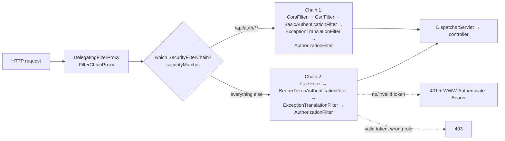
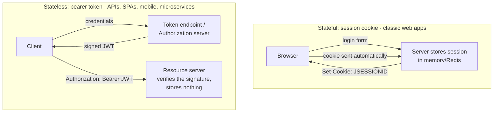
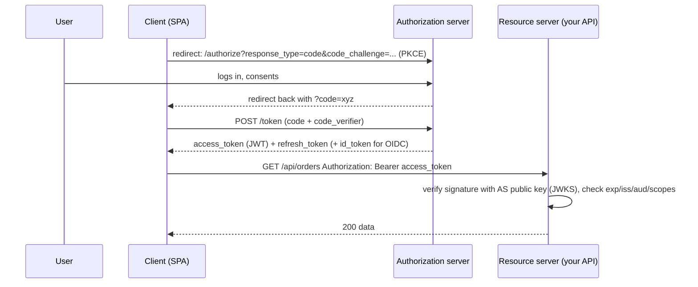

# 21 · Spring Security, JWT and OAuth2

> Authentication vs authorization, how Spring Security's **filter chain** works, users and
> **password hashing**, sessions vs **stateless JWT**, the structure and validation of a JWT,
> **OAuth2/OpenID Connect** roles and flows, the resource-server setup, URL and **method security**
> (including object-level checks), CSRF, CORS, security headers, the OWASP API Top 10, and how to
> test all of it. Practical: an API with a Basic-auth token endpoint, JWT-protected endpoints, roles,
> `@PreAuthorize`/`@PostAuthorize`, CORS — and 11 tests attacking it (tampered and expired tokens,
> other users' data).

---

## 1. Authentication vs authorization

| | Authentication (authN) | Authorization (authZ) |
|---|---|---|
| Question | **Who are you?** | **What may you do?** |
| Evidence | password, token, certificate, passkey | roles, permissions, ownership, scopes |
| Failure | **401 Unauthorized** (+ `WWW-Authenticate`) | **403 Forbidden** |
| Spring | `AuthenticationManager`, `UserDetailsService`, `JwtDecoder` | `authorizeHttpRequests`, `@PreAuthorize`, `@PostAuthorize` |

---

## 2. The filter chain

Spring Security is a chain of **servlet filters** that runs **before** your controllers (Chain of Responsibility,
topic 14).



* Authentication filters turn credentials into an **`Authentication`** object stored in the **`SecurityContext`**
  (thread-local for the request).
* `AuthorizationFilter` checks URL rules; method security (`@PreAuthorize`) checks again at service level via a proxy.
* `ExceptionTranslationFilter` turns security exceptions into 401/403 responses.
* Multiple `SecurityFilterChain` beans, each with a `securityMatcher` and an `@Order`, let different URL spaces use
  different mechanisms — exactly what the practical does.

```java
@Bean
SecurityFilterChain api(HttpSecurity http) throws Exception {
    return http
        .authorizeHttpRequests(auth -> auth
            .requestMatchers("/api/public/**").permitAll()
            .requestMatchers("/api/admin/**").hasRole("ADMIN")
            .anyRequest().authenticated())
        .oauth2ResourceServer(o -> o.jwt(Customizer.withDefaults()))
        .sessionManagement(s -> s.sessionCreationPolicy(SessionCreationPolicy.STATELESS))
        .build();
}
```

Rule order matters: the **first matching** rule wins — put specific rules before general ones.

---

## 3. Users and passwords

* `UserDetailsService` loads a user (username, **hashed** password, authorities) — from a DB in real apps.
* **Never store plain or reversibly encrypted passwords.** Use a slow, salted, adaptive hash: **bcrypt** (default),
  **Argon2**, scrypt, PBKDF2.
* `PasswordEncoderFactories.createDelegatingPasswordEncoder()` stores `{bcrypt}$2a$10$...` — the prefix allows
  upgrading the algorithm later.
* Roles vs authorities: `hasRole("ADMIN")` checks the authority `ROLE_ADMIN`; `hasAuthority("orders:delete")` checks a
  fine-grained permission.

---

## 4. Sessions vs tokens



| | Session cookie | JWT bearer token |
|---|---|---|
| Server state | session store (sticky sessions or Redis) | none — any instance can verify |
| Revocation | delete the session | hard: wait for expiry → keep tokens **short-lived** (5–15 min) + refresh tokens / deny-lists |
| CSRF risk | **yes** (browser sends cookies automatically) → CSRF protection required | no (header added by code) — but don't store tokens where XSS can read them |
| Best for | server-rendered apps (topic 07) | APIs consumed by SPAs, mobile apps, other services |

---

## 5. JWT (JSON Web Token)

```
eyJhbGciOiJIUzI1NiJ9 . eyJpc3MiOiJqZGstY291cnNlIiwic3ViIjoiYWxpIiwicm9sZXMiOlsiVVNFUiJdLCJleHAiOjE3...} . 8xK3...
       header                                   payload (claims)                                          signature
```

```json
{ "alg": "HS256" }
{ "iss": "jdk-course", "sub": "ali", "iat": 1795000000, "exp": 1795000900, "roles": ["USER"] }
```

* **Base64url-encoded, not encrypted** — anyone can read the payload. Never put secrets or personal data in it.
* The **signature** proves it was issued by someone with the key and not modified. Change one character of the payload →
  signature check fails (the practical's `tamperedTokenIsRejected`).
* Standard claims: `iss` issuer, `sub` subject, `aud` audience, `exp` expiry, `iat` issued at, `nbf` not before, `jti` id.
* Algorithms: **HS256** (shared secret — fine for one service that issues and verifies), **RS256/ES256** (private key
  signs, public key verifies — use when another server issues tokens; public keys published at a **JWKS** URL).
* Validate: signature, `exp`/`nbf`, `iss`, and `aud`. Reject `alg: none`.

---

## 6. OAuth 2.0 and OpenID Connect

**OAuth 2.0** is a framework for **delegated authorization**: an app gets a token to call an API on behalf of a user
without seeing the user's password. **OpenID Connect (OIDC)** adds **authentication** on top (an ID token saying who the
user is) — "Login with Google".

| Role | Example |
|------|---------|
| Resource owner | the user |
| Client | your SPA / mobile app / backend service |
| **Authorization server** | Keycloak, Auth0, Okta, Azure Entra ID, Google, Spring Authorization Server |
| **Resource server** | your API (this practical) — validates access tokens |



| Grant / flow | Use |
|--------------|-----|
| **Authorization Code + PKCE** | users logging into web/mobile/SPA apps (the standard) |
| **Client Credentials** | service-to-service calls (no user) |
| Refresh token | get a new access token without logging in again |
| ~~Implicit~~, ~~Password~~ | deprecated |

Resource server with an external authorization server = **two lines** of configuration:

```properties
spring.security.oauth2.resourceserver.jwt.issuer-uri=https://auth.example.com/realms/shop
# Spring fetches the JWKS public keys and validates iss/exp automatically
```

---

## 7. Method security and object-level authorization

```java
@EnableMethodSecurity
...
@PreAuthorize("hasRole('ADMIN')")
public void delete(long id) { ... }

@PreAuthorize("#owner == authentication.name or hasRole('ADMIN')")
public List<Order> ordersOf(String owner) { ... }

@PostAuthorize("returnObject.owner() == authentication.name or hasRole('ADMIN')")
public Order get(long id) { ... }          // checks the RESULT: you may only see YOUR order
```

URL rules alone can't express "user 7 may read order 42 only if it's theirs". Missing these checks is the **#1 API
vulnerability** (OWASP *Broken Object Level Authorization*, a.k.a. IDOR: change `/orders/2` to `/orders/3` and read
someone else's data). For lists, filter in the query (`where owner = :currentUser`).

Same proxy rules as topic 06.09: self-invocation and private methods are not secured.

---

## 8. CSRF, CORS and headers

| Mechanism | What it protects | Configure |
|-----------|------------------|-----------|
| **CSRF** token | malicious sites making the browser send **cookie-authenticated** requests | on by default; keep it for cookie/session apps (Thymeleaf adds the token), disable for stateless bearer-token APIs |
| **CORS** | which **browser origins** may call your API from JavaScript | `CorsConfigurationSource` with explicit origins; never `*` with credentials |
| Security headers | clickjacking, MIME sniffing, downgrade attacks | on by default: `X-Content-Type-Options`, `X-Frame-Options`, `Cache-Control`, HSTS (on HTTPS); add a CSP for web UIs |

CORS is enforced by **browsers** only — it is not authentication; curl and servers ignore it.

---

## 9. OWASP API Security Top 10 (2023) — what to do in Spring

| Risk | Defence |
|------|---------|
| 1 Broken object level authorization | ownership checks (`@PostAuthorize`, query filters) |
| 2 Broken authentication | standard mechanisms (OAuth2/OIDC, Spring Security), short-lived tokens, rate-limit login |
| 3 Broken object property level authorization | DTOs: never bind requests to entities, never return internal fields |
| 4 Unrestricted resource consumption | pagination limits (topic 20), timeouts, rate limiting, request size limits |
| 5 Broken function level authorization | URL + method rules for admin functions; deny by default (`anyRequest().authenticated()`) |
| 6 Unrestricted access to sensitive business flows | rate limits, captchas, anomaly detection |
| 7 Server-side request forgery | validate/allow-list outbound URLs |
| 8 Security misconfiguration | no default passwords, don't expose actuator, HTTPS, secure headers |
| 9 Improper inventory management | document APIs (OpenAPI, topic 22), retire old versions |
| 10 Unsafe consumption of APIs | validate data from third-party APIs too |

Also: keep dependencies patched (Dependabot), never log tokens/passwords (topic 15), store secrets outside the code.

---

## 10. Testing security

| Tool | Use |
|------|-----|
| `@SpringBootTest` + `@AutoConfigureMockMvc` | the **real** filter chains |
| `httpBasic("user", "pw")` post-processor | log in through Basic auth |
| `jwt().authorities(...)` post-processor | a test JWT without signing — test authorization rules quickly |
| `@WithMockUser(roles = "ADMIN")` | for session-based/method-security tests |
| negative tests | no token, wrong password, tampered/expired token, other user's resource, wrong origin |

---

## 11. Packages / libraries and why

| Dependency | Why |
|------------|-----|
| `spring-boot-starter-security` | filter chain, authentication, password encoders, method security |
| `spring-boot-starter-oauth2-resource-server` | validate JWT/opaque bearer tokens; includes Nimbus JOSE+JWT |
| `spring-boot-starter-oauth2-client` | log users in via an OIDC provider ("Login with Google/Keycloak") |
| `spring-boot-starter-oauth2-authorization-server` | build your own authorization server |
| `spring-boot-starter-security-test` (`spring-security-test`) | `jwt()`, `httpBasic()`, `@WithMockUser` |
| Keycloak / Auth0 / Okta / Entra ID | managed identity providers (don't build login + MFA + password reset yourself) |

---

## 12. Practical

`practical/spring-security-jwt`:

* Chain 1 (`/api/auth/**`): **HTTP Basic** → `POST /api/auth/token` returns an HS256 JWT (15 min) with `roles`.
* Chain 2: **stateless JWT resource server**, roles mapped from the `roles` claim, URL rules (`/api/admin/**`),
  method security (`@PreAuthorize`, `@PostAuthorize` ownership), CORS for `http://localhost:3000`.
* In-memory users with bcrypt-hashed passwords: `ali/ali-password`, `sara/sara-password`, `admin/admin-password`.

```bash
./mvnw -f topics/pom.xml -pl 21-spring-security/practical/spring-security-jwt test
./mvnw -f topics/pom.xml -pl 21-spring-security/practical/spring-security-jwt spring-boot:run
TOKEN=$(curl -s -u ali:ali-password -X POST localhost:8080/api/auth/token | jq -r .accessToken)
curl -H "Authorization: Bearer $TOKEN" localhost:8080/api/me
curl -i -H "Authorization: Bearer $TOKEN" localhost:8080/api/orders/2        # 403: Sara's order
```

Paste a token into <https://jwt.io> to see that the payload is readable — and that changing it breaks the signature.

## 13. Interview questions

1. Authentication vs authorization? 401 vs 403?
2. How does the Spring Security filter chain work?
3. How should passwords be stored? Why bcrypt/Argon2 and not SHA-256?
4. Session cookies vs JWT: pros, cons, revocation?
5. What is inside a JWT? Is it encrypted? How is it validated?
6. HS256 vs RS256?
7. Explain the OAuth2 Authorization Code flow with PKCE. Client credentials?
8. OAuth2 vs OpenID Connect?
9. What is CSRF and when can you disable protection? What is CORS?
10. How do you prevent users from reading other users' data?

## Exercises

- [ ] Load users from a database table (`UserDetailsService` + Spring Data JPA) with bcrypt hashes.
- [ ] Add a refresh-token endpoint and reduce access-token lifetime to 5 minutes.
- [ ] Switch to RS256: generate an RSA key pair, sign with the private key, publish the public key at `/.well-known/jwks.json`.
- [ ] Run Keycloak in Docker, create a realm and client, and point `issuer-uri` at it instead of issuing tokens yourself.
- [ ] Add rate limiting to the token endpoint (Bucket4j or Resilience4j `RateLimiter`).
