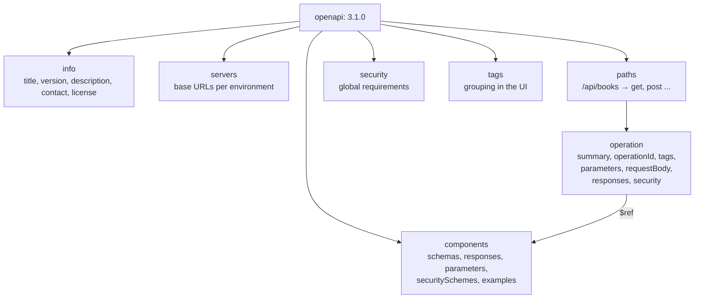

# 22 · API documentation with OpenAPI and Swagger

> How to describe a REST API in a machine-readable contract: the **OpenAPI 3.1** specification and its
> structure, **code-first vs design-first**, generating docs from Spring code with **springdoc-openapi**
> and annotating them well, **Swagger UI**, securing and versioning docs, generating clients and
> servers with **openapi-generator**, and contract testing. Practical: a documented Task API whose
> generated spec is verified by tests, plus a hand-written design-first spec.

---

## 1. Why document APIs with OpenAPI?

* **One contract** read by humans (Swagger UI, Redoc) and machines (client generators, test tools, gateways).
* Frontend/mobile teams can work in parallel, generating typed clients instead of guessing JSON.
* Reviews of API changes become reviews of a diff in the spec; breaking changes can be detected automatically.
* OWASP API #9 "improper inventory management": undocumented endpoints are forgotten endpoints.

**Names**: *Swagger* was the original spec (2011) and toolset by SmartBear; it was donated in 2016 and renamed the
**OpenAPI Specification** (Linux Foundation). "Swagger" now means the tools (Swagger UI, Swagger Editor, Swagger Codegen).
Current versions: **OpenAPI 3.0** (very widespread) and **3.1** (full JSON Schema compatibility).

---

## 2. Structure of a spec



```yaml
paths:
  /api/books/{id}:
    get:
      summary: Get a book
      operationId: getBook
      parameters:
        - { name: id, in: path, required: true, schema: { type: integer, format: int64 } }
      responses:
        "200": { description: The book, content: { application/json: { schema: { $ref: "#/components/schemas/Book" } } } }
        "404": { $ref: "#/components/responses/Problem" }
```

See the complete example in [`practical/api-first/library-api.yaml`](practical/api-first/library-api.yaml) — paste it
into <https://editor.swagger.io> to see it rendered.

---

## 3. Code-first vs design-first

| | Code-first | Design-first (API-first) |
|---|---|---|
| Source of truth | the Java code; spec generated at runtime/build | the YAML spec; code generated or checked against it |
| Tooling | **springdoc-openapi** annotations | Swagger Editor / Stoplight, **openapi-generator** |
| Pros | fast, docs never drift from the code | contract agreed **before** implementation; parallel work; better API design reviews |
| Cons | design decisions made in code; easy to leak internals | generated code style; discipline to keep in sync |
| Good for | internal APIs, small teams | public/partner APIs, many consumers, microservice contracts |

Many teams combine them: design-first for the contract, then **contract tests** to prove the implementation matches.

---

## 4. springdoc-openapi (code-first for Spring Boot)

Add one dependency (`springdoc-openapi-starter-webmvc-ui`, 3.x for Boot 4) and you get:

| URL | Content |
|-----|---------|
| `/v3/api-docs` | the spec as JSON (`/v3/api-docs.yaml` as YAML) |
| `/swagger-ui.html` | interactive UI ("Try it out") |

springdoc builds the spec by inspecting `@RestController`s, request mappings, parameter types, return types, **Jackson**
serialization and **Bean Validation** annotations — `@NotBlank` becomes `required`, `@Size(max = 80)` becomes
`maxLength: 80`, enums become `enum` lists.

### Annotations (`io.swagger.v3.oas.annotations`)

| Annotation | Where | Purpose |
|------------|-------|---------|
| `@OpenAPIDefinition(info = @Info(...), servers = ...)` | config class | title, version, description, contact, license |
| `@Tag(name, description)` | controller | grouping |
| `@Operation(summary, description)` | method | what the endpoint does |
| `@Parameter(description, example)` | parameter | query/path/header parameters |
| `@ApiResponse(responseCode, description, content)` | method | each possible response (document **errors** too: 400, 404, 409) |
| `@Schema(description, example, accessMode)` | DTO / field | model documentation and examples |
| `@SecurityScheme` + `@SecurityRequirement` | config / method | bearer JWT, OAuth2, API keys |
| `@Hidden` | anything | exclude from docs |

Configuration: `springdoc.paths-to-match=/api/**`, `springdoc.swagger-ui.path`, grouping several APIs with `GroupedOpenApi`
beans, `springdoc.api-docs.enabled=false` in production if the API must not be public.

**Good documentation** has: summaries on every operation, examples on DTO fields, all error responses with their
Problem Detail schema, security requirements, and consistent naming.

---

## 5. Generating code from a spec

```bash
# Java client from a spec (RestClient-based)
docker run --rm -v "$PWD:/work" openapitools/openapi-generator-cli generate \
  -i /work/library-api.yaml -g java --library restclient -o /work/generated-client

# Spring server interfaces (you implement them)
... -g spring --additional-properties=interfaceOnly=true,useSpringBoot3=true
```

Also as a Maven plugin (`openapi-generator-maven-plugin`) to regenerate on every build, and for TypeScript (`-g typescript-fetch`)
for frontend teams. Spring's own **HTTP interface clients** (`@HttpExchange`) are a hand-written alternative.

---

## 6. Contract testing and versioning

* **Spec tests** (the practical): assert the generated spec still contains the endpoints, schemas and constraints
  clients rely on.
* **Breaking-change detection**: `openapi-diff` / `oasdiff` in CI compares the spec of a PR with `main`
  (removed field, new required parameter, changed type → breaking).
* **Consumer-driven contracts**: Pact, Spring Cloud Contract — consumers publish expectations, the provider verifies them.
* Version the API (topic 08 §3) and publish one spec per version; mark deprecated operations with `deprecated: true`.

---

## 7. Packages / tools and why

| Dependency / tool | Why |
|-------------------|-----|
| `org.springdoc:springdoc-openapi-starter-webmvc-ui` | spec + Swagger UI for Spring MVC (`-webflux-ui` for WebFlux, `-webmvc-api` without UI) |
| `io.swagger.core.v3:swagger-annotations` (transitive) | the annotations |
| Swagger UI / **Redoc** / Scalar | render specs |
| Swagger Editor, Stoplight | write specs (design-first) |
| **openapi-generator** | clients and server stubs in 50+ languages |
| oasdiff / openapi-diff | breaking-change detection |
| Spectral | lint specs against style rules |
| Postman / Bruno / Insomnia | import a spec to get a ready request collection |

---

## 8. Practical

`practical/openapi-demo` — a Task API documented with springdoc 3: `@OpenAPIDefinition`, `@Tag`, `@Operation`,
`@Parameter`, `@ApiResponse` (incl. Problem Details errors), `@Schema` with examples, a bearer `@SecurityScheme`.
`OpenApiDocsTest` verifies the spec (paths, responses, security, validation → schema constraints, YAML endpoint,
Swagger UI) and exports it to `target/openapi.json`.

```bash
./mvnw -f topics/pom.xml -pl 22-openapi-swagger/practical/openapi-demo test
./mvnw -f topics/pom.xml -pl 22-openapi-swagger/practical/openapi-demo spring-boot:run
# open http://localhost:8080/swagger-ui.html
```

`practical/api-first/library-api.yaml` — a hand-written design-first contract for the topic 20 API.

## 9. Interview questions

1. What is OpenAPI? How is it related to Swagger?
2. Code-first vs design-first: pros and cons?
3. How does springdoc know a field is required or has a maximum length?
4. How do you document error responses and security in OpenAPI?
5. How can you detect breaking API changes automatically?
6. Should Swagger UI be enabled in production?

## Exercises

- [ ] Add springdoc to the topic 20 library app and compare its generated spec with `library-api.yaml`.
- [ ] Generate a Java client from `library-api.yaml` with openapi-generator (Docker) and call the running topic 20 app with it.
- [ ] Add `GroupedOpenApi` beans to split public and admin endpoints into two documents.
- [ ] Lint `library-api.yaml` with Spectral and fix the warnings.
