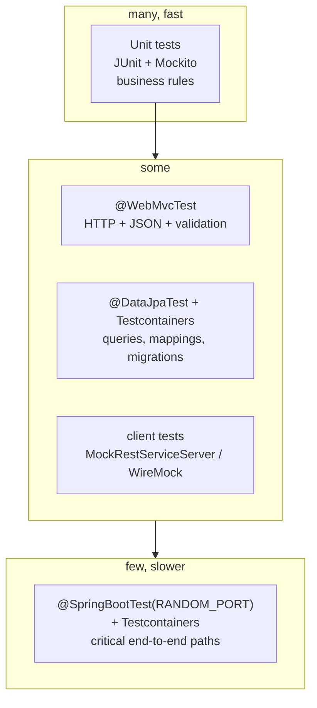
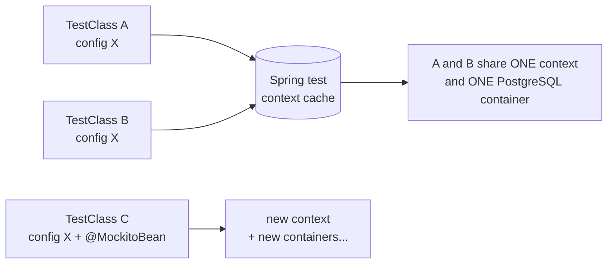
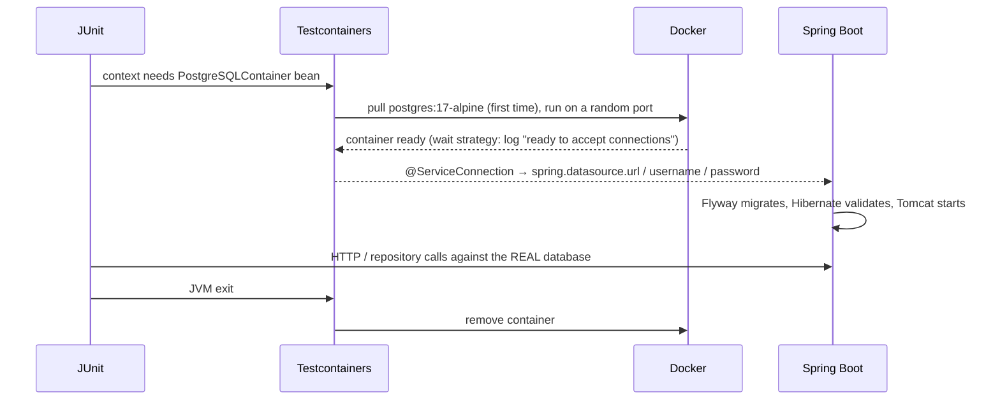

# 23 · Integration testing and Testcontainers

> Unit tests (topic 13) prove each class works; **integration tests** prove the pieces work
> **together** with real infrastructure: the Spring context, HTTP, JSON, transactions, the real
> database engine and its SQL dialect, locking, asynchronous behaviour and external APIs.
> This topic covers what to integration-test, Spring Boot's test support and context caching,
> **Testcontainers** with `@ServiceConnection`, testing HTTP clients without the real service,
> async code with Awaitility, test data, and running it all in CI. The practical runs against a real
> PostgreSQL 17 in Docker.

---

## 1. Why the real thing?

| Using H2 / mocks instead of PostgreSQL... | ...misses |
|-------------------------------------------|-----------|
| different SQL dialect | `jsonb`, `ON CONFLICT`, partial indexes, window-function differences, `FOR UPDATE SKIP LOCKED` |
| different locking / isolation | race conditions, deadlocks, lost updates |
| different migrations behaviour | a Flyway script that only fails on the real engine |
| mocked repositories | wrong JPQL, missing indexes, N+1, constraint violations |
| mocked HTTP | JSON mapping mistakes, wrong URLs, timeouts, error handling |

H2 bit us in topic 16 too (a CHECK-constraint quirk that real PostgreSQL doesn't have). Rule: **test against the same
engine and version you run in production.**

---

## 2. What to test at which level



Integration tests worth having: persistence (queries, migrations, constraints, locking), the full request path of
critical use cases, security rules (topic 21), messaging (topic 25), and outgoing HTTP calls.

---

## 3. Spring Boot test support recap

| Tool | Purpose |
|------|---------|
| `@SpringBootTest` | full application context; `webEnvironment = RANDOM_PORT` starts real Tomcat |
| `@WebMvcTest`, `@DataJpaTest`, `@JsonTest`, `@RestClientTest` | slices (topic 20) |
| `MockMvc` / `MockMvcTester` | HTTP through the DispatcherServlet without a network |
| `RestClient` / `RestTestClient` to `localhost:${local.server.port}` | real HTTP calls |
| `@MockitoBean`, `@MockitoSpyBean` | replace/spy beans in the context |
| `@Sql("/data.sql")` | run SQL before a test (`executionPhase` for after) |
| `@Transactional` on a test | roll back after each test — **only** for code running in the test thread (not with `RANDOM_PORT` HTTP calls or `@Async`) |
| `@DirtiesContext` | throw the context away (expensive) |
| `@DynamicPropertySource` | register properties computed at runtime |

### Context caching



Keep test configuration **uniform** (same imports, properties, mock beans) so the cache is reused; every variation
starts a new application (and maybe new containers). Data isolation then comes from unique test data, cleanup, or
transactions — not from new contexts.

---

## 4. Testcontainers

A Java library that starts **throw-away Docker containers** for your tests (databases, Kafka, Redis, RabbitMQ,
Keycloak, LocalStack, any image) and removes them afterwards (the *Ryuk* container cleans up even if the JVM crashes).



### The Spring Boot way (Boot 3.1+)

```java
@TestConfiguration(proxyBeanMethods = false)
public class TestcontainersConfiguration {
    @Bean
    @ServiceConnection                      // Boot configures the DataSource from the container - no properties needed
    PostgreSQLContainer postgres() {
        return new PostgreSQLContainer("postgres:17-alpine");    // pin the version you use in production
    }
}

@Testcontainers(disabledWithoutDocker = true)     // skip instead of fail on machines without Docker
@SpringBootTest(webEnvironment = RANDOM_PORT)
@Import(TestcontainersConfiguration.class)
class InventoryIntegrationTest { ... }
```

`@ServiceConnection` supports PostgreSQL, MySQL, MariaDB, Oracle, SQL Server, MongoDB, Redis, Kafka, RabbitMQ,
Elasticsearch, Cassandra, Neo4j, Zipkin, OpenTelemetry and more. The older style uses `@Container static` fields plus
`@DynamicPropertySource`.

**Local development with containers**: `TestInventoryApplication` starts the real app with the same container
configuration (`SpringApplication.from(App::main).with(TestcontainersConfiguration.class)`) — no database installation
needed. Spring Boot can also start `compose.yaml` services automatically with `spring-boot-docker-compose`.

Speed tips: one container per test run (context caching or a static singleton container), `*-alpine` images,
reuse (`testcontainers.reuse.enable=true`) for local runs, avoid `@DirtiesContext`.

---

## 5. External HTTP APIs

| Approach | When |
|----------|------|
| **`MockRestServiceServer`** (Spring) | `RestClient`/`RestTemplate` clients: expect requests, return canned responses — in-process, very fast |
| `@RestClientTest` | the same inside a Boot slice with auto-configured Jackson |
| **WireMock** (also as a Testcontainer) | a real HTTP server with stubs: timeouts, faults, any client technology |
| Contract tests (Pact, Spring Cloud Contract) | prove both sides agree on the API |

Always test the unhappy paths: 4xx/5xx, missing fields, timeouts (and your retry/circuit-breaker behaviour, topic 26).

---

## 6. Asynchronous code: Awaitility

```java
await().atMost(Duration.ofSeconds(5)).untilAsserted(() ->
        assertThat(auditRows("AUDIT-1")).containsExactly("6"));
```

Never `Thread.sleep(2000)`: too short → flaky, too long → slow. Awaitility polls until the condition holds or the timeout
expires. Needed for `@Async`, `@TransactionalEventListener` after-commit work, message consumers (topic 25), scheduled
jobs.

---

## 7. Test data strategies

| Strategy | Pros | Cons |
|----------|------|------|
| Unique data per test (random SKUs/emails) | works with shared DB and real HTTP | data accumulates (fine for throw-away containers) |
| `@Transactional` rollback | perfectly clean | doesn't cover commit behaviour, async, or other threads |
| Truncate tables in `@BeforeEach` / `@Sql(executionPhase = AFTER_TEST_METHOD)` | clean | slower, careful with order/FKs |
| `@Sql` fixtures | readable SQL | keep them small and close to the test |
| Builders / object mothers | expressive Java test data | some code to maintain |

---

## 8. Running in CI

* GitHub Actions `ubuntu-latest` runners have **Docker preinstalled** → Testcontainers just works (this repository's
  workflow runs these tests).
* Separate fast and slow suites if needed: Surefire for unit tests (`*Test`), **Failsafe** for integration tests
  (`*IT`, `mvn verify`), or JUnit `@Tag("integration")`.
* Cache Docker images / Maven repository; pin image versions for reproducibility.
* Testcontainers Cloud / remote Docker hosts when CI agents can't run Docker.

---

## 9. Packages / libraries and why

| Dependency | Why |
|------------|-----|
| `org.springframework.boot:spring-boot-testcontainers` | `@ServiceConnection`, dev-time container support |
| `org.testcontainers:testcontainers-postgresql` (TC 2.x module names; 1.x: `postgresql`) | PostgreSQL container |
| `org.testcontainers:testcontainers-junit-jupiter` | `@Testcontainers`, `@Container` |
| `org.awaitility:awaitility` | async assertions |
| `spring-test` `MockRestServiceServer` | mock outgoing HTTP |
| WireMock | stub HTTP servers |
| `spring-boot-docker-compose` | start `compose.yaml` services on app start |

---

## 10. Practical

`practical/integration-tests-demo` — an inventory service on **PostgreSQL** (Flyway SQL with `jsonb`, `timestamptz`,
a partial index), pessimistic locking (`SELECT ... FOR UPDATE`), an `@Async @TransactionalEventListener` audit writer,
and an exchange-rate HTTP client.

| Test | Shows |
|------|-------|
| `InventoryIntegrationTest` (needs Docker; skipped otherwise) | real PostgreSQL 17 via `@ServiceConnection`; HTTP create/reserve (201/409); **20 concurrent buyers, stock 5 → exactly 5 succeed**; async after-commit `jsonb` audit row verified with Awaitility; `@Sql` data |
| `ExchangeRateClientTest` | `MockRestServiceServer`: request URL/method, JSON mapping, missing data, 503 |
| `TestInventoryApplication` | run the real app locally with a container database |

```bash
./mvnw -f topics/pom.xml -pl 23-integration-testing/practical/integration-tests-demo verify      # Docker must be running
```

## 11. Interview questions

1. Unit vs integration vs end-to-end tests — what belongs where?
2. Why test against PostgreSQL in Docker instead of H2?
3. What does `@ServiceConnection` do?
4. How does Spring's test context caching work and how can you break it?
5. How do you test code that runs asynchronously?
6. How do you test a component that calls an external REST API?
7. Why doesn't `@Transactional` rollback help in a `RANDOM_PORT` test?

## Exercises

- [ ] Add a `@DataJpaTest` with `@AutoConfigureTestDatabase(replace = NONE)` + the container to test only the repository.
- [ ] Rewrite the topic 20 library tests to run on PostgreSQL with Testcontainers instead of H2.
- [ ] Add a WireMock container and test a 2-second timeout on `ExchangeRateClient`.
- [ ] Split tests into Surefire (`*Test`) and Failsafe (`*IT`) runs and add both to CI.
