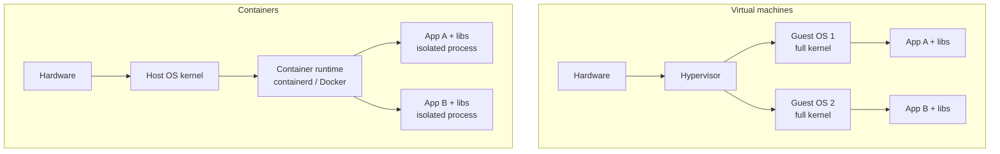
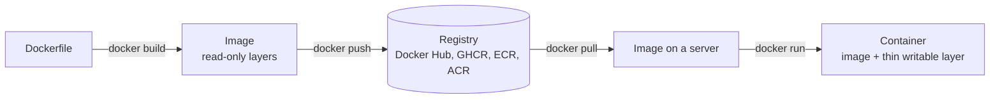
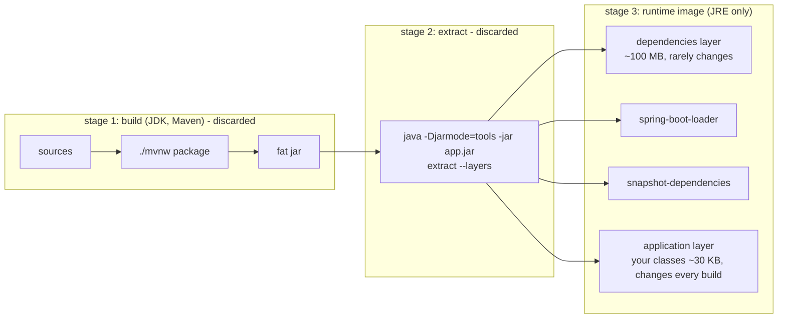
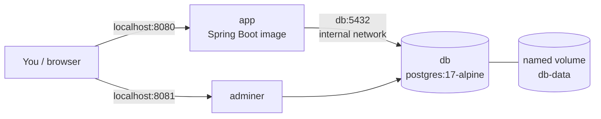

# 24 · Docker and Docker Compose

> Packaging a Java backend so it runs the same everywhere: containers vs virtual machines, images and
> layers, the Dockerfile instructions, **multi-stage builds** and **layered Spring Boot jars**, the
> JVM inside containers, security best practices, volumes and networks, **Docker Compose** for an
> app + database stack, and alternatives (Buildpacks, Jib). Practical: a production-style Dockerfile
> and a Compose stack (Spring Boot + PostgreSQL + Adminer) that was built and run end-to-end.

---

## 1. Containers vs virtual machines



| | VM | Container |
|---|---|---|
| Isolation | own kernel (strong) | shared kernel, isolated with namespaces + cgroups |
| Size | GBs | MBs |
| Start time | minutes | seconds / milliseconds |
| Density | few per host | dozens–hundreds per host |

A container is "just" a Linux process with its own filesystem view (namespaces) and resource limits (cgroups). On
Windows/macOS, Docker Desktop runs a small Linux VM to host them.

**Why containers for backends**: "works on my machine" disappears (the image *is* the environment), identical artifacts
from dev to prod, fast scaling, and the standard unit for Kubernetes and cloud platforms (topic 28).

---

## 2. Images, layers, registries



* An **image** is a stack of read-only **layers**, one per filesystem-changing instruction. Layers are cached and shared:
  if only the last layer changes, only it is rebuilt, pushed and pulled.
* A **container** is a running instance of an image with a thin writable layer (lost when the container is removed —
  persistent data belongs in **volumes**).
* Image names: `registry/namespace/name:tag` — e.g. `ghcr.io/ahmed/inventory:1.4.0`. Avoid relying on `latest`;
  pin versions (and ideally digests `@sha256:...`) for base images.

---

## 3. Dockerfile instructions

| Instruction | Purpose |
|-------------|---------|
| `FROM image AS name` | base image; several `FROM`s = **multi-stage** build |
| `WORKDIR /app` | working directory for following instructions |
| `COPY src dest` / `COPY --from=stage` | copy files from the build context / another stage |
| `RUN command` | execute at build time (creates a layer) |
| `ENV KEY=value` | environment variable (build + runtime) |
| `ARG NAME=default` | build-time variable (`--build-arg`) |
| `EXPOSE 8080` | documents the port (doesn't publish it) |
| `USER app` | run as a non-root user |
| `HEALTHCHECK CMD ...` | how Docker knows the app is healthy |
| `ENTRYPOINT [...]` / `CMD [...]` | what runs when the container starts (use the exec/JSON form) |

`.dockerignore` (at the build-context root) keeps `target/`, `.git`, secrets and IDE files out of the context — faster
builds and no leaked files. This repository has one.

---

## 4. Building Spring Boot images well

### Multi-stage + layered jar (the practical's Dockerfile)



* **Multi-stage**: compile with a JDK + Maven in a throw-away stage; ship only a **JRE** + the app → smaller image,
  no build tools or source code in production.
* **Layered jar**: Spring Boot splits the fat jar so dependencies (big, rarely changing) and your code (small, changing
  every commit) are separate layers. In the practical the application layer is **28.7 kB** — a code change pushes
  kilobytes, not 100 MB.
* **BuildKit cache mount** (`RUN --mount=type=cache,target=/root/.m2`) keeps Maven's repository between builds without
  putting it in the image.

### Alternatives without a Dockerfile

| Tool | How |
|------|-----|
| **Cloud Native Buildpacks** | `./mvnw spring-boot:build-image` — layered, secure, reproducible image from conventions |
| **Jib** (Google) | Maven/Gradle plugin builds and pushes images without a Docker daemon |
| GraalVM native image | tiny, fast-starting images (`-Pnative spring-boot:build-image`) |

---

## 5. The JVM in containers

* Modern JVMs are **container-aware**: they read the cgroup CPU and memory limits.
* Size the heap **relative to the container limit**: `-XX:MaxRAMPercentage=75` (leave room for metaspace, thread
  stacks, code cache, direct buffers — topic 06.08). Never set `-Xmx` larger than the limit.
* `-XX:+ExitOnOutOfMemoryError`: crash fast on OOM so the orchestrator restarts the container instead of leaving a
  zombie.
* Set JVM options via `JAVA_TOOL_OPTIONS` or `JAVA_OPTS` environment variables, not hard-coded.
* Startup: Class Data Sharing / AOT cache (JDK 24+ Leyden), CRaC, or native images for fast-starting services.

---

## 6. Security best practices

| Practice | Why |
|----------|-----|
| **Run as non-root** (`USER app`) | a container escape gives less power |
| Small base images (`*-jre-alpine`, `ubi-minimal`, distroless) | fewer packages → fewer vulnerabilities |
| Pin base image versions, rebuild regularly | get security patches deliberately |
| **Never put secrets in images** (`ENV DB_PASSWORD=...`, copied `.env`) | anyone who pulls the image can read them; inject at runtime |
| Scan images: Trivy, Docker Scout, Grype | find known CVEs in OS packages and jars |
| Read-only filesystem, drop capabilities (in Kubernetes) | defence in depth |
| One process per container | simpler health, logs, scaling |

---

## 7. Everyday Docker CLI

| Command | Purpose |
|---------|---------|
| `docker build -t name:tag -f Dockerfile .` | build an image |
| `docker run -d --name app -p 8080:8080 -e KEY=value name:tag` | run detached, publish a port, set env |
| `docker ps`, `docker ps -a` | running / all containers |
| `docker logs -f app` | follow logs (apps should log to stdout) |
| `docker exec -it app sh` | shell inside a running container |
| `docker stop app && docker rm app` | stop / remove |
| `docker images`, `docker history name:tag` | list images / see layers and sizes |
| `docker inspect app` | full JSON details (IP, health, mounts) |
| `docker system prune` | clean up unused images/containers/networks |
| `docker push ghcr.io/user/app:1.0` | publish to a registry (after `docker login`) |

### Volumes and networks

* **Named volume** (`db-data:/var/lib/postgresql/data`): managed by Docker, survives container re-creation — for
  databases.
* **Bind mount** (`./config:/app/config`): a host folder — for local development.
* Containers on the same user-defined **network** reach each other by **service/container name** (`db:5432`);
  `ports:` only publishes to the host.

---

## 8. Docker Compose

Describe a multi-container application in `compose.yaml` and manage it with one command.



| Command | Purpose |
|---------|---------|
| `docker compose up --build -d` | build images if needed and start everything in the background |
| `docker compose ps` / `logs -f app` | status / logs |
| `docker compose exec db psql -U inventory` | run a command in a service |
| `docker compose down` (`-v` removes volumes) | stop and remove |

Key features used in the practical: `depends_on` with `condition: service_healthy` (the app waits until PostgreSQL
accepts connections), healthchecks, environment variables with defaults (`${DB_PASSWORD:-inventory}`, overridable from
a `.env` file), memory limits, restart policies, named volumes.

Compose is for **local development, CI and simple single-host deployments**; production clusters use Kubernetes or a
managed container platform (topic 28). Spring Boot's `spring-boot-docker-compose` can even start `compose.yaml`
automatically when you run the app.

---

## 9. Packages / tools and why

| Tool | Why |
|------|-----|
| Docker Desktop / Docker Engine / Podman | build and run containers |
| Docker Compose | multi-container local environments |
| `eclipse-temurin` images | official OpenJDK builds (JDK for build, JRE for runtime) |
| Spring Boot `jarmode=tools` / Buildpacks / Jib | Java-optimised images |
| Trivy / Docker Scout | vulnerability scanning |
| Hadolint | lint Dockerfiles |
| GHCR / Docker Hub / ECR / ACR / GAR | registries |

---

## 10. Practical

`practical/Dockerfile` — 3-stage build (JDK build with BuildKit Maven cache → layer extraction → JRE runtime),
non-root user, container-aware heap, healthcheck. Works for any Spring Boot practical via `--build-arg MODULE=...`.

`practical/compose.yaml` — topic 23's inventory service + PostgreSQL 17 (healthcheck, named volume) + Adminer.

```bash
# from the repository root (Docker must be running)
docker compose -f topics/24-docker/practical/compose.yaml up --build -d
curl localhost:8080/actuator/health
curl -X POST localhost:8080/api/products -H "Content-Type: application/json" -d '{"sku":"MUG","name":"Mug","stock":3}'
curl -X POST localhost:8080/api/products/MUG/reservations -H "Content-Type: application/json" -d '{"quantity":2}'
# browse the database: http://localhost:8081  (system PostgreSQL, server db, user/password inventory)
docker history jdk/inventory:local          # see the layers: the application layer is tiny
docker compose -f topics/24-docker/practical/compose.yaml down -v
```

Verified while writing this topic: the stack built and started, the app became `healthy`, the reservation was stored,
the async audit row appeared in PostgreSQL, and the container runs as `uid=100(app)`.

## 11. Interview questions

1. Container vs VM?
2. What is an image layer and why does layer order in a Dockerfile matter?
3. Why use multi-stage builds? What is a layered Spring Boot jar?
4. How do you size the JVM heap in a container?
5. `CMD` vs `ENTRYPOINT`? `EXPOSE` vs `-p`?
6. Volume vs bind mount?
7. How do two containers in Compose talk to each other?
8. Name four Docker security best practices.

## Exercises

- [ ] Build the topic 20 library app image with `--build-arg MODULE=20-spring-boot/practical/spring-boot-library` and run it with `docker run -p 8080:8080`.
- [ ] Build the same app with `./mvnw spring-boot:build-image` and compare image size and layers.
- [ ] Scan the image with `docker scout cves jdk/inventory:local` or Trivy and fix what you can by changing the base image.
- [ ] Add Redis to the compose file and connect topic 25's caching practical to it.
