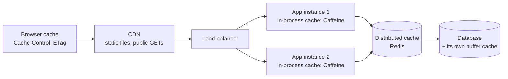
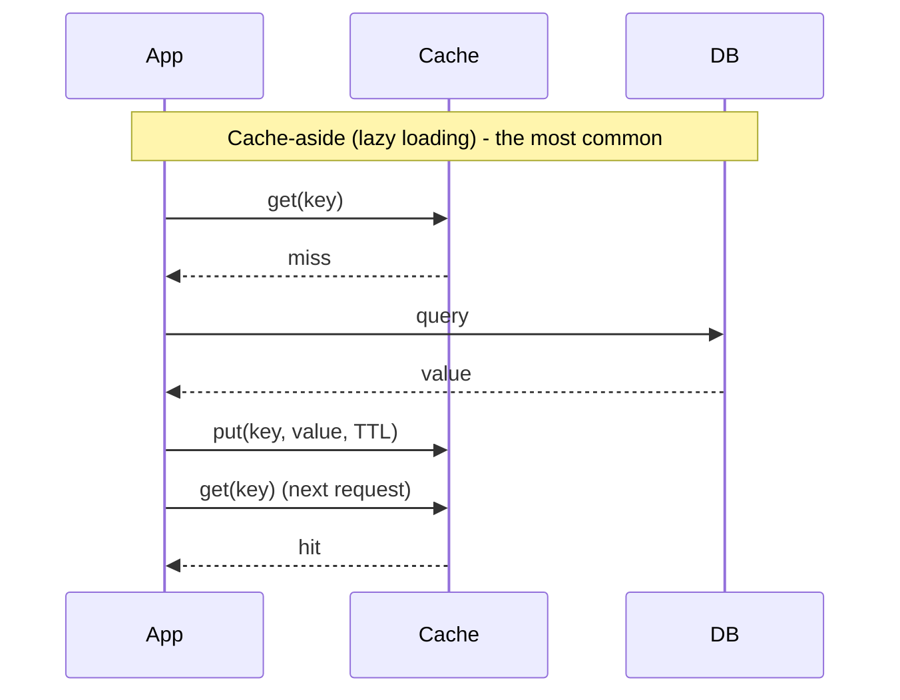
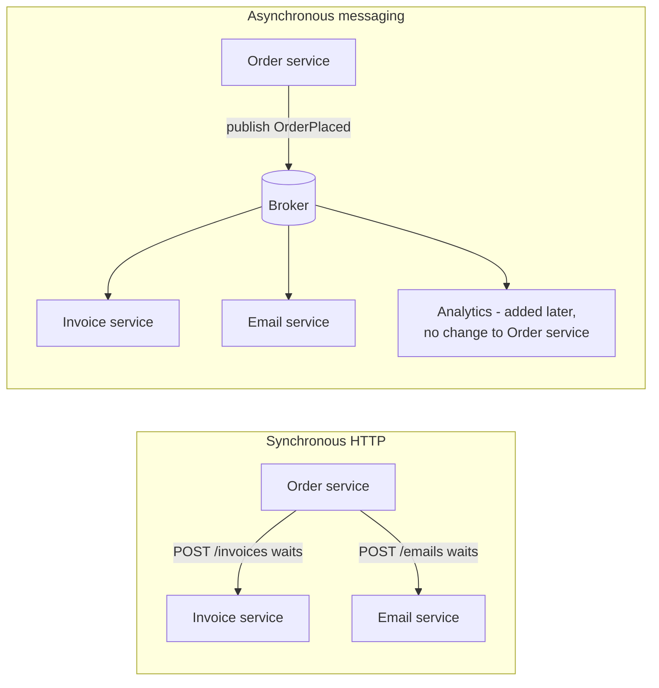
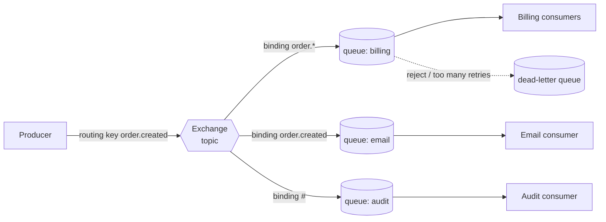
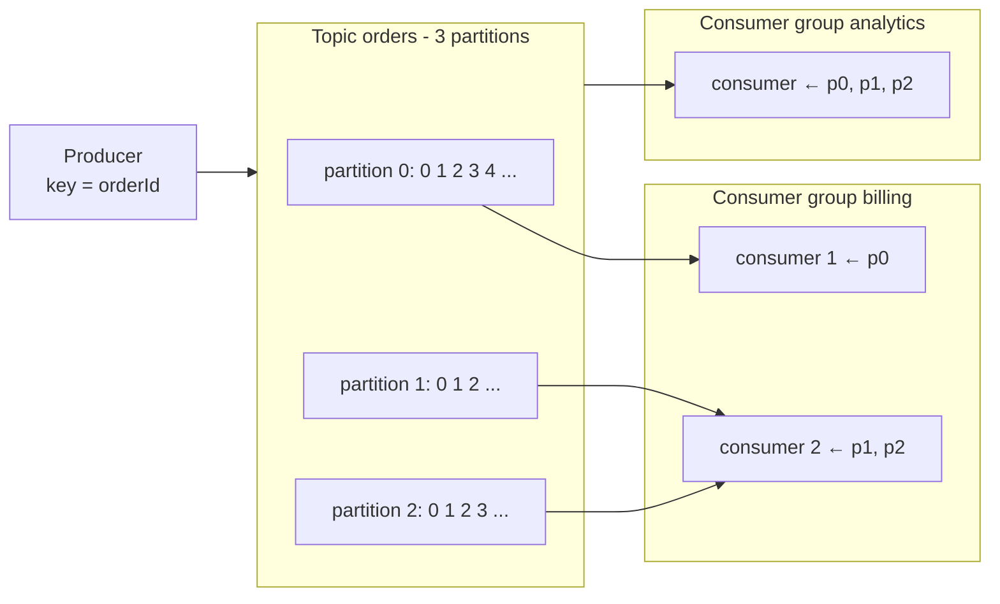

# 25 · Caching and messaging (Redis, RabbitMQ, Kafka)

> Two tools every scalable backend uses. **Caching**: where to cache, cache-aside/read-through/write-
> through/write-behind, eviction and TTL, invalidation, the Spring Cache abstraction, Caffeine vs
> Redis, and Redis beyond caching. **Messaging**: synchronous vs asynchronous communication, queues
> vs publish/subscribe, **RabbitMQ** (exchanges, routing, acks, dead letters) vs **Kafka** (topics,
> partitions, offsets, consumer groups), delivery guarantees, idempotent consumers and the
> **transactional outbox**. Practical: Caffeine caching tests plus real Redis and Kafka in containers.

---

# Part A — Caching

## 1. Why and where

A cache stores the result of expensive work (DB query, remote call, computation) so the next request is served from
fast memory. Benefits: lower latency, less load on databases and partners, higher throughput.



| Cache | Speed | Shared between instances | Survives restarts | Use for |
|-------|-------|--------------------------|-------------------|---------|
| In-process (Caffeine) | nanoseconds | ❌ each instance has its own copy | ❌ | reference data, hot lookups, per-instance memoisation |
| Distributed (Redis, Hazelcast, Memcached) | ~sub-millisecond network hop | ✅ | ✅ (Redis persistence) | sessions, shared caches, rate limits, data every instance must agree on |
| HTTP caching (topic 08) | no request at all | – | – | public, cacheable GETs |

> "There are only two hard things in Computer Science: cache invalidation and naming things." — Phil Karlton

## 2. Caching patterns



| Pattern | How | Notes |
|---------|-----|-------|
| **Cache-aside** | app reads cache, on miss loads DB and fills cache; on write updates DB then **evicts** the key | simple, cache only holds what's used; Spring's `@Cacheable` + `@CacheEvict` |
| Read-through | the cache itself loads missing values (loader function) | Caffeine `LoadingCache` |
| Write-through | write goes to cache **and** DB synchronously | cache always fresh; `@CachePut` |
| Write-behind | write to cache, DB updated asynchronously later | fast writes, risk of loss |
| Refresh-ahead | refresh popular keys before they expire | avoids latency spikes |

### Eviction, expiry and pitfalls

* **Size-based** eviction (LRU, LFU — Caffeine uses W-TinyLFU) and **time-based** expiry (TTL / `expireAfterWrite`,
  `expireAfterAccess`). **Always set both**: an unbounded cache is a memory leak (topic 06.08).
* **Stale data**: decide how stale is acceptable per use case; evict on writes; short TTLs as a safety net.
* **Cache stampede** (many requests miss at the same time and hammer the DB): request coalescing (Caffeine does it per
  key), `@Cacheable(sync = true)`, jittered TTLs, refresh-ahead.
* **Cache penetration** (repeated lookups of non-existent keys): cache "not found" for a short time.
* Don't cache: user-specific sensitive data in shared caches without care, things that are cheap to compute,
  rapidly-changing data.

## 3. Spring Cache abstraction

```java
@EnableCaching                                      // on a @Configuration / the application class
...
@Cacheable(cacheNames = "products", key = "#sku")   // read: return cached value or call the method and cache it
public Product find(String sku) { ... }

@CachePut(cacheNames = "products", key = "#product.sku()")   // write-through: always run, update the cache
public Product update(Product product) { ... }

@CacheEvict(cacheNames = "products", key = "#sku")           // invalidate
public void delete(String sku) { ... }
```

```properties
spring.cache.type=caffeine                         # or redis, simple, none
spring.cache.caffeine.spec=maximumSize=1000,expireAfterWrite=10m,recordStats
# spring.cache.type=redis + spring.cache.redis.time-to-live=10m for a shared cache
```

Proxy-based like `@Transactional`: self-invocation and private methods are not cached (topics 06.09/19). Exceptions are
not cached. Cache metrics (hit ratio) appear in Actuator/Micrometer with `recordStats`.

## 4. Redis

An in-memory data-structure server (single-threaded command execution → every command is **atomic**), with optional
persistence and replication.

| Data type | Commands | Backend use case |
|-----------|----------|------------------|
| String | `SET key value EX 60`, `GET`, `INCR` | cache entries, counters, **rate limiting**, one-time codes |
| Hash | `HSET`, `HGETALL` | objects, user sessions |
| List | `LPUSH`, `BRPOP` | simple queues |
| Set | `SADD`, `SISMEMBER` | unique visitors, tags, dedupe |
| Sorted set | `ZINCRBY`, `ZREVRANGE` | **leaderboards**, priority queues, time-ordered data |
| Stream / Pub-Sub | `XADD`, `PUBLISH` | lightweight messaging |
| TTL | `EXPIRE`, `TTL` | automatic deletion |

Spring: `spring-boot-starter-data-redis` → `StringRedisTemplate` / `RedisTemplate`, Redis repositories, Spring Session
Redis, `RedisCacheManager`. Distributed locks: Redisson (use carefully).

---

# Part B — Messaging

## 5. Synchronous vs asynchronous



| | Synchronous (REST/gRPC) | Asynchronous (messages/events) |
|---|---|---|
| Coupling | caller must know and wait for callee | producer doesn't know the consumers |
| Availability | callee down → caller fails | broker buffers; consumer catches up later |
| Load | spikes hit everyone | queues absorb spikes |
| Consistency | immediate | **eventual** |
| Complexity | simple to follow | harder to debug, needs idempotency, ordering, monitoring |

Use messaging for: notifications, integration between services, long-running work, event sourcing/streams, buffering
writes. Keep synchronous calls for queries that need an immediate answer.

## 6. Queues vs publish/subscribe

* **Point-to-point (work queue)**: each message is processed by **one** of the competing consumers (load balancing jobs).
* **Publish/subscribe**: each **subscriber group** gets every message (fan-out of events).

## 7. RabbitMQ

A traditional **message broker** implementing AMQP: producers send to **exchanges**, which route to **queues** via
**bindings**; consumers read queues and **acknowledge** messages, which are then deleted.



| Exchange type | Routing |
|---------------|---------|
| direct | exact routing key match |
| **topic** | patterns: `order.*`, `order.#` |
| fanout | every bound queue |
| headers | by header values |

Key features: acknowledgements (manual ack after processing), prefetch, **dead-letter exchanges** for failed messages,
TTL, priority queues, delayed retries, quorum queues for HA. Spring: `spring-boot-starter-amqp`, `RabbitTemplate`,
`@RabbitListener`.

```java
rabbit.convertAndSend("orders.exchange", "order.created", event);

@RabbitListener(queues = "billing")
void onOrder(OrderPlaced event) { ... }      // exception → message re-queued or dead-lettered
```

## 8. Apache Kafka

A distributed, append-only **commit log**. Messages are **not deleted when read**; they're retained for a configured
time/size, and each consumer group tracks its own **offset**.



| Concept | Meaning |
|---------|---------|
| Topic | named stream of records |
| **Partition** | ordered, append-only log; the unit of parallelism and ordering |
| Key | records with the same key go to the same partition → **ordered per key** (e.g. per order) |
| Offset | position of a record in a partition; consumers commit offsets |
| **Consumer group** | consumers sharing the work; each partition is read by **one** consumer of the group |
| Retention | records kept for days (or forever with compaction), so consumers can replay |
| Replication | partitions copied to several brokers (`replication.factor=3`, `acks=all`) |
| KRaft | Kafka's built-in consensus (ZooKeeper removed in Kafka 4) |

Spring: `spring-boot-starter-kafka` (Boot 4 name), `KafkaTemplate`, `@KafkaListener`, `NewTopic` beans, error handlers
with retries and dead-letter topics (`DefaultErrorHandler` + `DeadLetterPublishingRecoverer`), Kafka Streams.

## 9. RabbitMQ vs Kafka

| | RabbitMQ | Kafka |
|---|---|---|
| Model | smart broker, queues, messages deleted after ack | dumb broker, smart consumers, retained log |
| Routing | rich (exchanges, patterns) | by topic + key → partition |
| Replay | no (once consumed, gone) | ✅ re-read from any offset |
| Ordering | per queue (single consumer) | per partition / key |
| Throughput | high (tens of thousands msg/s) | very high (millions msg/s), big data |
| Typical use | task queues, RPC, complex routing, per-message retries | event streaming, event sourcing, analytics pipelines, CDC, log aggregation |

## 10. Delivery guarantees and idempotency

| Guarantee | Meaning | Cost |
|-----------|---------|------|
| At-most-once | may be lost, never duplicated | ack before processing |
| **At-least-once** | never lost, **may be duplicated** | the default for both brokers |
| Exactly-once | neither | Kafka transactions within Kafka; end-to-end only with idempotent consumers |

Therefore consumers must be **idempotent**: processing the same message twice has the same effect as once — keep
processed `eventId`s (unique constraint), use upserts, or make operations naturally idempotent. The practical's
`BillingConsumer` ignores a duplicated event.

## 11. The transactional outbox

Problem: "save the order **and** publish `OrderPlaced`" — two systems, no shared transaction. If the app crashes between
them you lose the event (or publish an event for an order that was rolled back).

```mermaid
sequenceDiagram
    participant S as Order service
    participant DB as Database
    participant R as Outbox relay (poller / Debezium CDC)
    participant K as Kafka
    S->>DB: BEGIN; INSERT order; INSERT outbox(event); COMMIT  (one local transaction)
    R->>DB: read unpublished outbox rows
    R->>K: publish event
    R->>DB: mark row as published
    Note over R,K: may publish twice after a crash → consumers are idempotent
```

The outbox (plus idempotent consumers) is the standard way to keep a database and a broker consistent; sagas build on it
(topic 26).

---

## 12. Packages / libraries and why

| Dependency | Why |
|------------|-----|
| `spring-boot-starter-cache` + `com.github.ben-manes.caffeine:caffeine` | annotation-driven caching, fastest in-process cache |
| `spring-boot-starter-data-redis` | Redis client (Lettuce), templates, Redis cache manager |
| `spring-boot-starter-amqp` | RabbitMQ (`RabbitTemplate`, `@RabbitListener`) |
| `spring-boot-starter-kafka` (`spring-kafka`) | Kafka (`KafkaTemplate`, `@KafkaListener`, error handling) |
| Spring Cloud Stream | broker-independent messaging abstraction |
| Debezium | change data capture: outbox relay from the DB log |
| Testcontainers `kafka`, Redis/RabbitMQ containers | real brokers in tests |

---

## 13. Practical

`practical/caching-messaging-demo`:

| Test | Shows |
|------|-------|
| `CachingTest` (no Docker) | `@Cacheable` hit after one slow DB read, `@CachePut` refresh, `@CacheEvict` invalidation, Caffeine with size + TTL |
| `RedisAndKafkaIntegrationTest` (Docker) | Redis TTL keys, **atomic rate limiter** under parallel requests (exactly 5 of 8 allowed), sorted-set leaderboard; Kafka producer (key = orderId), topic with 3 partitions, **idempotent consumer** ignoring a duplicate, same key → same partition |

```bash
./mvnw -f topics/pom.xml -pl 25-caching-messaging/practical/caching-messaging-demo verify
# run the app against local infrastructure:
docker compose -f topics/25-caching-messaging/practical/compose.yaml up -d      # Redis, Kafka, RabbitMQ (UI :15672)
```

## 14. Interview questions

1. Cache-aside vs write-through vs write-behind?
2. How do you keep a cache consistent with the database? What is a cache stampede?
3. Caffeine vs Redis — when each?
4. Queue vs publish/subscribe?
5. RabbitMQ vs Kafka — how do they store and deliver messages? When would you pick each?
6. What is a Kafka partition and a consumer group? How is ordering guaranteed?
7. At-least-once delivery means what for your consumer code?
8. What problem does the transactional outbox solve?

## Exercises

- [ ] Switch the cache to Redis (`spring.cache.type=redis`) and observe the keys with `redis-cli KEYS 'products*'`.
- [ ] Add a RabbitMQ listener with a dead-letter queue and test it with a RabbitMQ Testcontainer.
- [ ] Configure `DefaultErrorHandler` with 3 retries and a dead-letter topic for the Kafka consumer.
- [ ] Implement a transactional outbox table + scheduled relay in the topic 23 inventory service.
