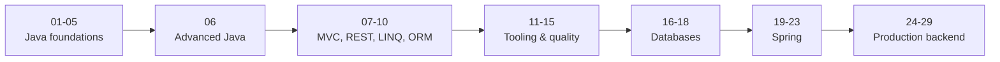

# Learning topics

Every topic is a folder with a `README.md` (theory, diagrams, the packages/libraries to use and why,
corner cases, interview questions, exercises) and a `practical/` folder with runnable code.

* Single-file practicals: `java topics/<topic>/practical/<File>.java`
* Maven practicals (Spring Boot, Hibernate, Jackson, jOOQ...): `./mvnw -f topics/pom.xml -pl <module path> verify`
* Everything at once: `./mvnw -f topics/pom.xml verify` and `bash scripts/run-practicals.sh`

## Part 1 — Core topics

| # | Topic | Highlights | Practical |
|---|-------|-----------|-----------|
| 01 | [History of Java](01-history/README.md) | Green Project → Java 27, LTS releases, OpenJDK/JCP/Jakarta, which JDK to install | `ModernJavaTour.java` |
| 02 | [Compilation & the JVM](02-compilation-and-jvm/README.md) | javac phases, `.class` format, bytecode, class loading, memory areas, interpreter + JIT, GC, AOT | `Hello`, `ClassLoadingDemo`, `JitWarmup`, `MemoryAreas` |
| 03 | [C vs C++ vs C# vs Java](03-language-comparison/README.md) | compilation, memory, type system, OOP, generics, errors, concurrency, ecosystems, jobs | same program in 4 languages |
| 04 | [Foundation syntax](04-foundation-syntax/README.md) | types, casting, operators, `BigDecimal`, strings, I/O, conditions, loops, arrays, methods, enums, `var`, `java.time` | 10 files + 30 exercises |
| 05 | [OOP](05-oop/README.md) | 4 pillars, constructors & init order, inheritance/hiding, overriding vs overload resolution, interfaces, `equals/hashCode`, nested classes, records, sealed, enums, UML relationships | 9 files + exercises |
| 06 | [Advanced Java](06-advanced-java/README.md) | 9 sub-topics below | |
| 06.01 | [Exceptions](06-advanced-java/01-exceptions/README.md) | hierarchy, checked/unchecked, try-with-resources, custom exceptions, best practices | 2 files |
| 06.02 | [Collections](06-advanced-java/02-collections/README.md) | internals of `ArrayList`/`HashMap`/`TreeMap`/`PriorityQueue`, Big-O, comparators | 3 files |
| 06.03 | [Generics](06-advanced-java/03-generics/README.md) | bounds, wildcards/PECS, erasure, bridge methods, type tokens | 2 files |
| 06.04 | [Lambdas & Streams](06-advanced-java/04-functional-streams/README.md) | functional interfaces, streams, collectors, parallel, `Optional`, gatherers | 3 files |
| 06.05 | [I/O, NIO & JSON](06-advanced-java/05-io-nio-json/README.md) | decorators, `java.nio.file`, encodings, serialization, Jackson 3 | 2 files + Jackson module |
| 06.06 | [Concurrency](06-advanced-java/06-concurrency/README.md) | JMM, locks, atomics, executors, `CompletableFuture`, virtual threads | 4 files |
| 06.07 | [Modern Java 9 → 27](06-advanced-java/07-modern-java/README.md) | every feature with JEP, before/after, migration checklist | 1 file |
| 06.08 | [JVM memory & GC](06-advanced-java/08-jvm-memory-gc/README.md) | object layout, GC algorithms, G1/ZGC, references, leaks, tuning, tools | 2 files |
| 06.09 | [Reflection, annotations, proxies, modules](06-advanced-java/09-reflection-annotations-modules/README.md) | how frameworks work, `@Transactional` pitfalls, JPMS | 3 files + modules demo |
| 07 | [MVC](07-mvc/README.md) | MVC/MVP/MVVM, servlets, `DispatcherServlet` flow, PRG, layering, Thymeleaf | console MVC + Spring MVC app |
| 08 | [HTTP & REST APIs](08-rest-api/README.md) | methods, status codes, REST constraints, design, Problem Details, ETags, REST vs GraphQL/gRPC | JDK-only server + Spring REST API |
| 09 | [LINQ & Java equivalents](09-linq/README.md) | `IEnumerable` vs `IQueryable`, every operator mapped to Streams, jOOQ/JPQL/QueryDSL | C# + Java + jOOQ |
| 10 | [ORM (all types) & JPA](10-orm/README.md) | Fowler patterns, ORM categories, Hibernate lifecycle, N+1, inheritance, locking, caching | JDBC/Active Record/JPA/MyBatis/JDBI |

## Part 2 — Roadmap topics

| # | Topic | Phase |
|---|-------|-------|
| 11 | [Git & GitHub workflow](11-git/README.md) | Tooling & quality |
| 12 | [Build tools: Maven & Gradle](12-build-tools/README.md) | Tooling & quality |
| 13 | [Testing: JUnit, AssertJ, Mockito, TDD](13-testing/README.md) | Tooling & quality |
| 14 | [Clean code, SOLID, design patterns](14-clean-code-solid-design-patterns/README.md) | Tooling & quality |
| 15 | [Logging & debugging](15-logging-debugging/README.md) | Tooling & quality |
| 16 | [SQL & relational databases](16-sql/README.md) | Databases |
| 17 | [JDBC & connection pools](17-jdbc/README.md) | Databases |
| 18 | [Database migrations: Flyway & Liquibase](18-database-migrations/README.md) | Databases |
| 19 | [Spring Core: IoC & DI](19-spring-core/README.md) | Web & Spring |
| 20 | [Spring Boot](20-spring-boot/README.md) | Web & Spring |
| 21 | [Spring Security, JWT, OAuth2](21-spring-security/README.md) | Web & Spring |
| 22 | [OpenAPI & Swagger](22-openapi-swagger/README.md) | Web & Spring |
| 23 | [Integration testing & Testcontainers](23-integration-testing/README.md) | Web & Spring |
| 24 | [Docker & Docker Compose](24-docker/README.md) | Production backend |
| 25 | [Caching & messaging (Redis, RabbitMQ, Kafka)](25-caching-messaging/README.md) | Production backend |
| 26 | [Microservices](26-microservices/README.md) | Production backend |
| 27 | [Observability](27-observability/README.md) | Production backend |
| 28 | [CI/CD & cloud deployment](28-cicd-cloud/README.md) | Production backend |
| 29 | [Capstone project](29-capstone/README.md) | Production backend |
